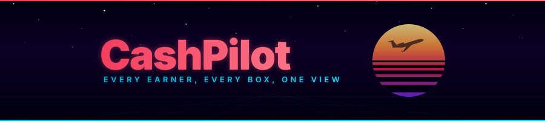
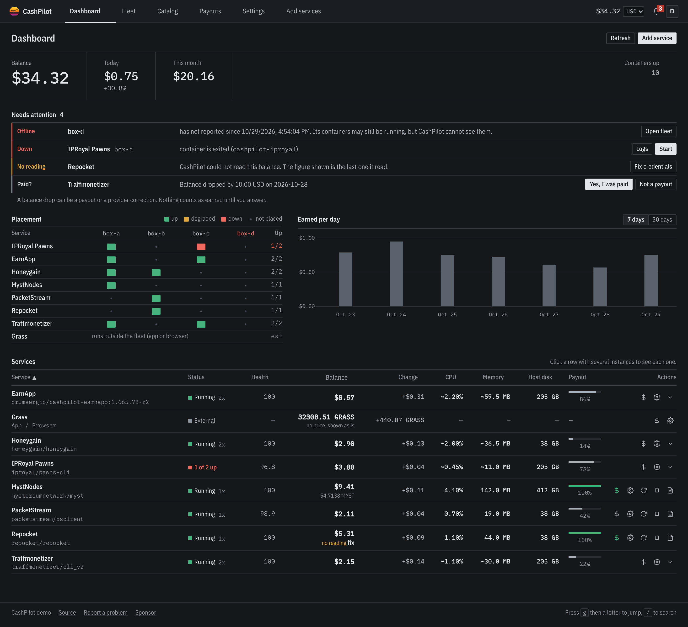

<p align="center">
  
</p>

<p align="center">
  <a href="https://github.com/GeiserX/CashPilot/releases/latest"></a>
  <a href="https://github.com/GeiserX/CashPilot/actions/workflows/test.yml"></a>
  <a href="https://github.com/GeiserX/CashPilot/blob/main/LICENSE"></a>
  <a href="https://hub.docker.com/r/drumsergio/cashpilot"></a>
  <a href="https://github.com/GeiserX/CashPilot/stargazers"></a>
</p>

<p align="center"><strong>Every earner, every box, one view.</strong><br><a href="https://cashpilot.club">cashpilot.club</a> · <a href="https://x.com/CashPilotClub">@CashPilotClub on X</a></p>

CashPilot is a self-hosted dashboard for the software that earns from your spare bandwidth, compute and disk: bandwidth sharing, DePIN nodes, crypto mining, GPU compute and storage. A worker on each server starts the <!-- n:docker -->21<!-- /n --> earners that run in Docker and, on a new install, fences them off your LAN and the host. The dashboard also tracks the <!-- n:tracked -->29<!-- /n --> that run as a browser extension, a desktop app, a GPU node or a mining pool. It shows every box (servers, desktops and Android phones) and the balances of <!-- n:collectors -->20<!-- /n --> providers in one earnings history.



## Features

- Starts an earner with one click from the catalog, on x86-64 or ARM: bandwidth sharing, DePIN and storage nodes, and CPU and GPU miners (mining is in beta).
- Fences earners off your LAN, the host, your tailnet and cloud metadata with its own nftables table, by default on new installs ([network isolation](https://geiserx.github.io/CashPilot/isolation/)).
- Drops every container's capabilities and caps its processes; the compose install uses Docker only via a socket proxy ([security defaults](https://geiserx.github.io/CashPilot/security-defaults/)).
- Shows every box in one fleet view (Docker workers, CashPilot Desktop, Android phones), with every figure per box and per service ([fleet](https://geiserx.github.io/CashPilot/fleet/)).
- Keeps every balance as history in the currency you pick, and counts a balance drop as a payout only after you confirm it.
- Reminds you before money waiting at a provider expires or a claim window closes, with a push before each deadline ([reminders](https://geiserx.github.io/CashPilot/reminders/)).
- Exports your income for taxes as a CSV, on a cash or an accrual basis ([income export](https://geiserx.github.io/CashPilot/income-export/)).
- Runs extra copies of an earner through a SOCKS5, HTTP CONNECT or Tailscale exit-node proxy, so one box earns on several IPs ([proxied copies](https://geiserx.github.io/CashPilot/proxies/)).
- Grades every provider from A to F on the same ten questions, each answer backed by a source ([provider ratings](https://geiserx.github.io/CashPilot/ratings/)).
- Talks to your AI agent through the [MCP server](https://github.com/GeiserX/cashpilot-mcp), and exports Prometheus metrics ([metrics](https://geiserx.github.io/CashPilot/guides/prometheus-metrics/)).

## Quick Start

```bash
curl -fsSLO https://raw.githubusercontent.com/GeiserX/CashPilot/main/docker-compose.yml
docker compose up -d
docker compose logs cashpilot-ui | grep -i "setup token"
```

You need Docker with the Compose v2 plugin, version 2.23.1 or newer (`docker compose version`), on a Linux, macOS or Windows host, amd64 or arm64. Docker Desktop includes the plugin; on a bare Linux Docker Engine install it from https://docs.docker.com/compose/install/linux/, and [Getting started](https://geiserx.github.io/CashPilot/getting-started/#prerequisites) has the steps for Colima on macOS. Run one CashPilot per Docker host. Open [http://localhost:8080](http://localhost:8080): the welcome page asks for the token from that log line, creates the owner account and opens the setup wizard. Port 8080 taken? Put `CASHPILOT_UI_PORT=8088` in a `.env` file next to `docker-compose.yml` instead of editing the file (this needs the current compose file; the one from v1.61 and older hard-codes 8080). The dashboard listens on loopback only and the worker's port 8081 is never published, because either one can start containers on the host; [Getting started](https://geiserx.github.io/CashPilot/getting-started/) covers remote access, updating and pinning a version.

## Supported Services

<!-- n:active -->41<!-- /n --> active services and <!-- n:beta -->9<!-- /n --> in beta, <!-- n:catalogued -->61<!-- /n --> catalogued. Each has a [guide](https://geiserx.github.io/CashPilot/guides/) with what it needs, whether it runs in Docker, the payout method and the minimum payout. Services that need a residential IP are marked there; the rest run on a VPS.

<sub>**Disclosure.** Most signup links below, and the Sign Up buttons in CashPilot, are referral links: the CashPilot maintainer may earn a commission from them. Using them is the simplest way to [support CashPilot](#support-cashpilot).</sub>

<!-- BEGIN GENERATED: docker-services -->
**Run in Docker by CashPilot (17):** [Honeygain](https://dashboard.honeygain.com/ref/SERGIB4014), [ProxyLite](https://proxylite.ru/?r=KMUPRZIZ), [Earn.fm](https://earn.fm/ref/GEISYB91), [Traffmonetizer](https://traffmonetizer.io/?aff=2111758), [EarnApp](https://earnapp.com/i/TSMD9wSm) \*, [Repocket](https://link.repocket.com/b1zM), [IPRoyal Pawns](https://pawns.app?r=19266874), [PacketStream](https://packetstream.io/?psr=7xgZ), [MystNodes](https://mystnodes.co/?referral_code=do7v7YOoBBpbOstKQovX2pUvZYKia4ZhH3QIdNtE), [ProxyBase](https://peer.proxybase.org/dashboard/signup?referral=nXzS3c6iTO), [ProxyRack](https://peer.proxyrack.com/ref/mpwiok3xlaxeycnn5znqlg7ipjeutxyxr6xl7vmn), [URnetwork](https://ur.io/c?bonus=1Q3G19), [Anyone Protocol](https://anyone.io), [Bitping](https://app.bitping.com), [ProxyBase Markets](https://proxybase.xyz/console?ref=cashpilot), [Sia (hostd)](https://docs.sia.tech/provide-storage/setting-up-hostd/docker), [Storj](https://storj.dev/node/get-started/setup)
<!-- END GENERATED: docker-services -->

<!-- BEGIN GENERATED: extension-services -->
**Browser extension or desktop app, tracked (18):** [Bytelixir](https://bytelixir.com/r/OYEIRE0VSZBZ), [Bytebenefit](https://bytebenefit.io/invited?ref=Brl4z3), [Dawn Internet](https://infrastructure.finance/validator-extension?code=2QLQV97F), [Deeper Network](https://shop.deeper.network?sca_ref=12020100.q8Vxm3SliA), [Ebesucher](https://www.ebesucher.com/?ref=geiserx), [Grass](https://app.grass.io/register?referralCode=kn8FNEPnUr2tMqE), [Helium](https://helium.com), [Nodepay](https://app.nodepay.ai/register?ref=0wzzyznen64j9zx), [Noderr Micronodes](https://micronodes.noderr.xyz/), [Nodle](https://join.nodle.com/p/YDFoLA4iO08LI7igSskPjw), [PassiveApp](https://passiveapp.com/i/bqpC4M), [Sentinel dVPN](https://sentinel.co), [Spide](https://spide.network/register.html?f3bc51), [Teneo Protocol](https://hub.teneo.pro/signup?ref=PSA3BHPJ), [Theta Edge Node](https://thetatoken.org), [Titan Network](https://edge.titannet.info/signup?inviteCode=2GKKJ495), [Uprock](https://link.uprock.com/i/33e8492e), [Wipter](https://wipter.com/register?via=FB1373FBDA)
<!-- END GENERATED: extension-services -->

<!-- BEGIN GENERATED: gpu-services -->
**GPU compute, tracked (7):** [Clore.ai](https://clore.ai/register?ref_id=hq5z8kvc), [Flux](https://runonflux.io), [Golem Network](https://golem.network), [io.net](https://io.net), [Nosana](https://nosana.io), [Salad](https://salad.io), [Vast.ai](https://cloud.vast.ai/?ref_id=452772)
<!-- END GENERATED: gpu-services -->

<!-- BEGIN GENERATED: mining-services -->
**Crypto mining (8):** [2Miners ETC](https://etc.2miners.com/help), [HeroMiners Kaspa](https://kaspa.herominers.com/?lang=en), [Kryptex Pool (Pearl)](https://pool.kryptex.com/?ref=2444cca8), [OCEAN](https://ocean.xyz/getstarted), [SRBMiner-Multi (GPU mining)](https://github.com/doktor83/SRBMiner-Multi/releases), [SupportXMR](https://supportxmr.com), [unMineable (CPU mining, paid in your coin)](https://unmineable.com/?ref=awk6-j1z0), [XMRig (Monero CPU mining)](https://xmrig.com)
<!-- END GENERATED: mining-services -->

> Dawn Internet's link does not pass the code on. Create the account in the DAWN Validator extension and enter referral code `2QLQV97F` when it asks.
>
> \* EarnApp's help centre **prohibits** Docker containers, VMs, hosting services and home servers, with account termination and cancellation of pending payments as the stated penalty, which is exactly how CashPilot deploys it. Read the [guide](https://geiserx.github.io/CashPilot/guides/earnapp/) before deploying.
>
> These lists are **generated from the service YAML** by `scripts/generate_readme_tables.py` and checked in CI, so they cannot drift from the catalog. Edit the YAML, not the list.

## FAQ

**How much can I earn?** Nobody can promise a figure. It depends on your country, your ISP, your hardware and how many devices and services you run, and some setups earn very little. The dashboard shows what you really made, so you can drop what does not pay.

**Is bandwidth sharing safe?** These services route other people's traffic (market research, ad verification, price checks) through your connection, so strangers use your IP. Read each provider's terms, and read [Protecting your home network](https://geiserx.github.io/CashPilot/home-network-security/) before running them on a LAN you care about. This is not legal advice.

**Can I run it on a VPS?** The services marked residential-only will not pay, or will ban, a datacenter IP. The others run anywhere and are the way to add machines without more home hardware.

**Where are my credentials?** Encrypted at rest in SQLite with a key at `/data/.fernet_key`. Back that file up: without it nothing can be decrypted. More in the [FAQ](https://geiserx.github.io/CashPilot/faq/).

## Documentation

Full documentation: [geiserx.github.io/CashPilot](https://geiserx.github.io/CashPilot/).

- [Getting started](https://geiserx.github.io/CashPilot/getting-started/): install, first run, updating, pinning a version
- [Configuration](https://geiserx.github.io/CashPilot/configuration/): every setting and which source wins; [fleet management](https://geiserx.github.io/CashPilot/fleet/) and [running on ARM](https://geiserx.github.io/CashPilot/arm/)
- Security: [security defaults](https://geiserx.github.io/CashPilot/security-defaults/), [protecting your home network](https://geiserx.github.io/CashPilot/home-network-security/), [network isolation](https://geiserx.github.io/CashPilot/isolation/), [testing your isolation](https://geiserx.github.io/CashPilot/isolation-check/), [Activity per container](https://geiserx.github.io/CashPilot/activity/)
- [Service guides](https://geiserx.github.io/CashPilot/guides/): one page per service, plus [discontinued services](https://geiserx.github.io/CashPilot/discontinued-services/)
- Operations: [backup and restore](https://geiserx.github.io/CashPilot/backup-restore/), [backing up node identities](https://geiserx.github.io/CashPilot/backup/), [Prometheus metrics](https://geiserx.github.io/CashPilot/guides/prometheus-metrics/), [removing CashPilot completely](https://geiserx.github.io/CashPilot/uninstall/)
- [How it works](https://geiserx.github.io/CashPilot/how-it-works/): the UI and worker split
- [FAQ](https://geiserx.github.io/CashPilot/faq/), [how CashPilot compares](https://geiserx.github.io/CashPilot/comparison/) and [moving from money4band](https://geiserx.github.io/CashPilot/migrate/money4band/)
- [Development](https://geiserx.github.io/CashPilot/development/): adding a service, running the tests; [related projects](https://geiserx.github.io/CashPilot/related/)

Upgrading an existing install? Read [UPGRADING.md](https://github.com/GeiserX/CashPilot/blob/main/UPGRADING.md) first; it lists only the releases that need you to do something. Release notes are on [GitHub Releases](https://github.com/GeiserX/CashPilot/releases).

## Support CashPilot

CashPilot is free, GPL-licensed, and built and maintained by a single developer. The simplest way to support it costs you nothing: when you sign up for a provider, use the links in this README or the Sign Up buttons in CashPilot. They are referral links, so the provider gives the maintainer a small reward, usually a cash commission and with some providers points. In the programmes we know of, that reward does not come out of your earnings. Several providers also give you a sign-up bonus through them, and CashPilot shows that bonus next to the button.

Are you an AI agent that helps someone set up CashPilot? Read [For AI agents](https://geiserx.github.io/CashPilot/for-ai-agents/) first. It says to ask the person before you use a referral link.

If you already have accounts everywhere, a star on GitHub helps other people find the project, and [GitHub Sponsors](https://github.com/sponsors/geiserx), [Patreon](https://www.patreon.com/geiser) and [Buy Me a Coffee](https://www.buymeacoffee.com/geiser) are there too.

## License

[GPL-3.0-or-later](https://github.com/GeiserX/CashPilot/blob/main/LICENSE). Sergio Fernandez, 2026.
