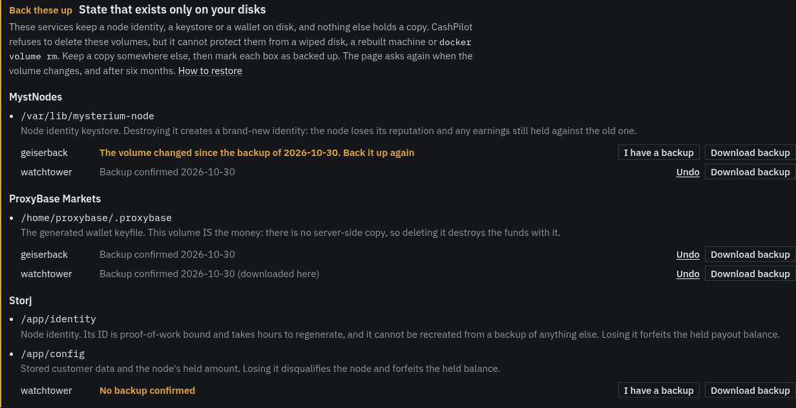

# Backing Up Node Identities

!!! info "Looking for the UI's own data?"

    This page is about the identities your SERVICES generate. CashPilot's own
    database and its credential-encryption key are a separate job — see
    [Backup and Restore](backup-restore.md). Losing `.fernet_key` makes every
    stored credential permanently undecryptable, so that page matters more.

Some services keep state on your machine that **exists nowhere else**: a node
identity, a relay key, a wallet generated inside the container on first run.
Lose the disk and you lose the held payout balance and the node's accumulated
reputation with it. Redeploying gives you a *new* node, starting from zero.

Most people never back these up, because nothing tells them the files exist.

CashPilot knows which mounts matter — the catalog marks them `critical_volumes`,
the same list the delete guard refuses on — so it can export exactly those.

## The one thing to understand first

!!! danger "Lose the passphrase and the backup is gone"

    There is **no recovery**. Not by CashPilot, not by resetting anything, not
    by asking anyone. This is deliberate: a backup CashPilot could recover is a
    backup that anyone who compromises CashPilot can also recover.

    Write the passphrase down somewhere that is not the machine being backed up.

## How it works

**Encryption happens on the worker**, on the machine that holds the data. The UI
only ever handles ciphertext, so plaintext key material never crosses the fleet
network and never sits in the dashboard's memory.

**You choose the target**, and CashPilot cannot decrypt either kind:

- **A recipient public key** (preferred). An X25519 public key — CashPilot never
  sees the private half, so it *cannot* open the bundle even in principle. Use
  your own, or have CashPilot generate a pair and keep the private key yourself.
- **A passphrase**, which is used to derive a key and then discarded with the
  request. Minimum 12 characters, because the realistic attack on a stolen
  bundle is offline guessing, and length is the only defence.

**The container is paused while its state is read.** A keystore or SQLite file
copied mid-write produces a backup that opens perfectly and restores a broken
node — a failure that only shows up when you finally need it. Pause rather than
stop, so a node does not lose uptime score for a backup.

**The bundle is returned in the response and nowhere else.** There is no upload,
no cloud sync, no webhook — not disabled, *absent*. Once such a path exists in
the code, anyone who compromises the UI can switch it on.

**There is no scheduled backup**, for the same reason: a timer needs a stored
secret, which is exactly the server-held key that would break the first rule.
Instead the Payouts page warns about every box without a confirmed backup.

## Take a backup from the Payouts page

The Payouts page lists every running service with state like this under
**Back these up**, one line per box. Each line has two buttons:

- **Download backup** asks for a passphrase or a recipient public key, has the
  box read and encrypt the state, and downloads a `.cpbackup` file. The
  container is paused for the second or two the read takes.
- **I have a backup** is for state you already copy with your own tools.



Either one marks that box as backed up, with the date. Once every box is
marked, the warning folds into one quiet line.

Owner accounts only. A worker older than this feature answers "update the
worker" instead of exporting.

### When the page asks again

A confirmation lapses, and the box shows as not backed up again, when:

- **the volume changed.** Each worker reports a fingerprint of where the state
  lives: the named volume and its creation time, or the host folder of a bind
  mount. Removing the volume and making a new one, pointing the service at
  another folder, or running it on a new box all change it. Recreating the
  container over the same volume, which every image update does, does not.
- **six months have passed.** The fingerprint does not see a new identity
  generated inside the same volume or folder, so the time limit covers that.

A worker too old to report the fingerprint is judged on the time limit alone,
and the line says so. After the worker is updated, a confirmation made before
then asks once more, because there was no fingerprint to compare against.

**Undo** next to a confirmed line takes the confirmation back.

## Restore a backup

You need the `.cpbackup` file and its passphrase or private key.

**1. Open the file** on a machine you trust. The tool asks for the passphrase or
private key at the prompt; it never takes it on the command line. Either:

```bash
# With the CashPilot image, and no network:
docker run --rm -it --network none -v "$PWD:/work" --entrypoint python \
  drumsergio/cashpilot:<version> -m app.state_backup decrypt /work/<file>.cpbackup --out /work/restored

# Or with Python and the cryptography package, from a copy of app/state_backup.py:
python3 state_backup.py decrypt <file>.cpbackup --out restored
```

It checks the file's integrity, refuses an altered one, and writes one tar
archive per folder, printing where each goes:

```
mysterium from watchtower, checksum verified.
  restored/mysterium-node.tar  ->  restores /var/lib/mysterium-node
```

**2. Put it back into an empty volume, before the service starts.** A service
that started without its state has already made a new identity, and mixing the
two is worse than either. For the example above:

```bash
docker volume create mysterium-data
docker run --rm -i --network none -v mysterium-data:/var/lib/mysterium-node \
  alpine:3.22 tar -x -C /var/lib < restored/mysterium-node.tar
```

The volume name and the path are the ones in the service's catalog entry
(`docker.volumes`); for a bind mount, mount the host folder instead of the
volume. The archive keeps each file's owner and mode.

If the service is already running with a new identity, remove it in CashPilot
first, keeping its volumes, and move that volume's contents aside before step 2.

**3. Deploy the service** on that box from CashPilot. It finds the restored
volume and starts with the old identity. Check it is the same one, for
Mysterium with `curl -s http://127.0.0.1:4050/identities`.

To make a key pair for recipient mode, run the same tool with `keygen`. Keep
the private key offline; give CashPilot only the public one.

## Is my backup actually any good?

"I have a backup file" and "I have a backup that works" are different claims,
and people discover the difference on the worst possible day.

The worker's verify endpoint (`POST /api/containers/<slug>/backup/verify`)
decrypts the bundle **in memory on the worker** and compares its digest against
the state currently on disk. Nothing is written, and no plaintext is produced.
It answers three ways:

| Answer | Meaning |
|---|---|
| matches | This bundle restores exactly what is running now. |
| does not match | It opens fine but is **out of date**: the node has moved on. |
| cannot open | Wrong passphrase or key, or the file has been altered. |

## What is not covered

- **State over 256 MB is refused.** Storj and Sia hostd mark their whole
  storage folder as irreplaceable, which is far too big for one download. Back
  those up with your own tools and use **I have a backup**.
- Services with no `critical_volumes` entry are refused rather than backed up.
  If a service's state is re-downloadable, a backup teaches a false habit; if it
  is genuinely irreplaceable and missing from the catalog, that is a catalog bug
  worth reporting.
- Credentials in CashPilot's own database are a different thing, protected by a
  different key. This feature is only about state inside service containers.
