# Brand colour: three proposals

The dashboard is calm and easy to read. It is also grey from edge to edge, and the orange sun in the logo appears nowhere else in the app. These three proposals bring some of the logo's colour back. They keep what already works: the layout, fonts, spacing and status colours (green for up, amber for a warning, red for down). Each one is a CSS override of 40 lines or fewer, with no template or JavaScript changes. All screenshots use the demo data (box-a to box-d, invented balances), in the dark theme.

The three:

1. [Sunrise edge](#1-sunrise-edge): the logo's gradient, only at the edges.
2. [Warm accent](#2-warm-accent): one orange for everything you click.
3. [Classic night](#3-classic-night-opt-in-theme): an opt-in theme with the old blue-black, rose and cyan look.

A recommendation is [at the end](#recommendation).

Contrast is the WCAG ratio. Text needs 4.5:1, and lines, rings and other UI parts need 3:1. Colour distance is ΔE (CIE76 or CIEDE2000, as noted). A higher ΔE means two colours are easier to tell apart.

## 1. Sunrise edge

Everything stays neutral, and the logo's sunrise gradient shows only at the edges: a 2 px line under the top bar, the active tab's underline, the "+ Add service" and full-size primary buttons, the focus ring, and the balance figure. Small buttons inside rows ("Start", "Yes, I was paid") stay neutral, so a warm button never sits next to a red "Down" row.

| Baseline | Sunrise edge |
|---|---|
| 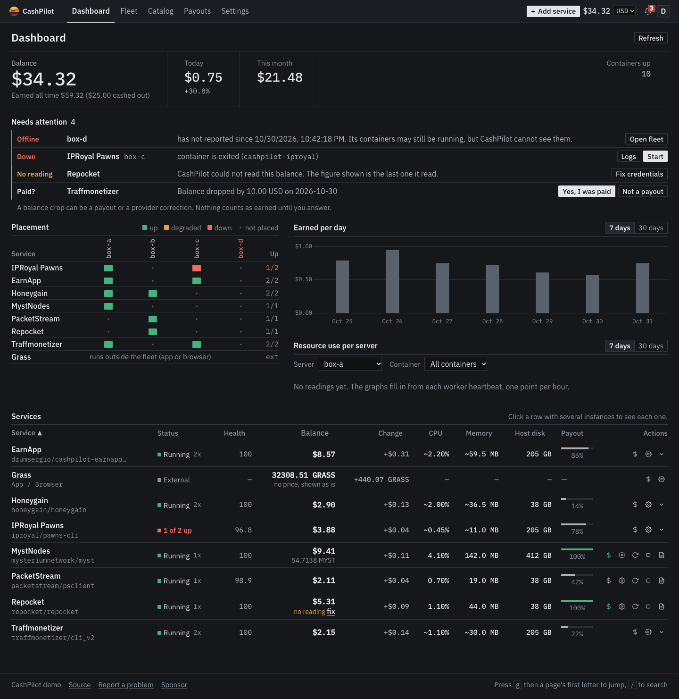 | 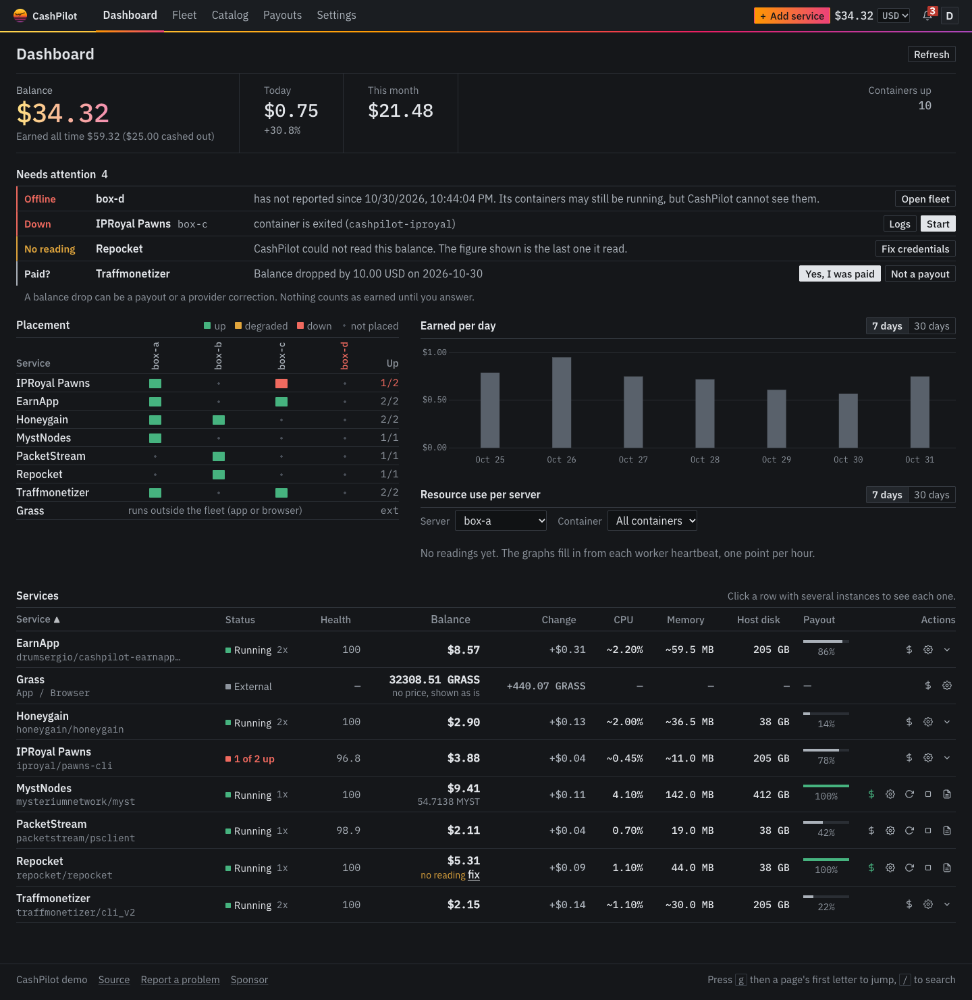 |

<details><summary>Other pages</summary>

Fleet:
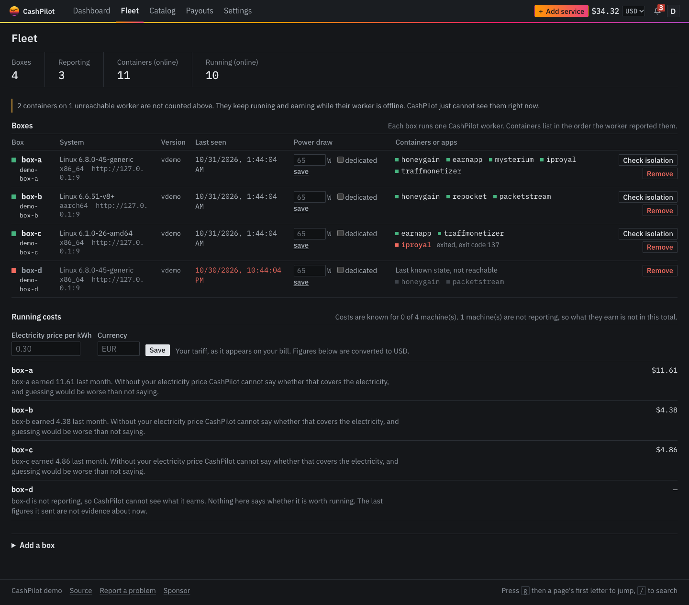

Payouts:
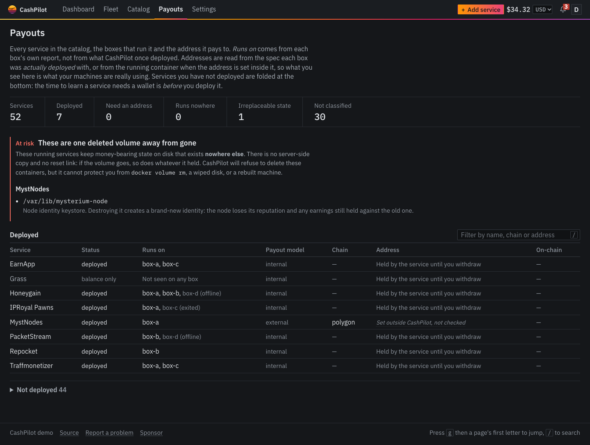

Catalog:
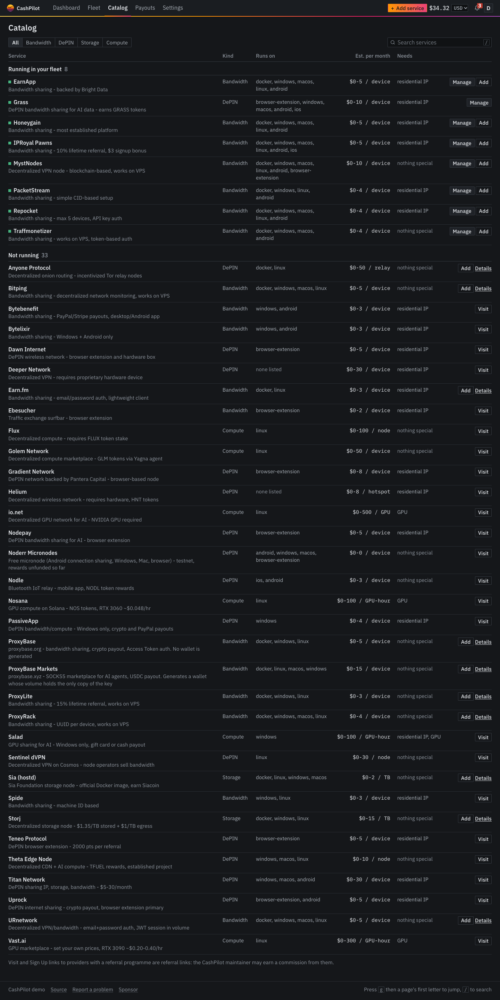

Add services (setup):
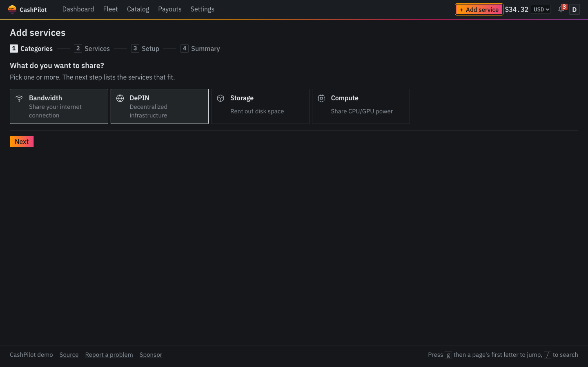

Focus ring on "+ Add service":
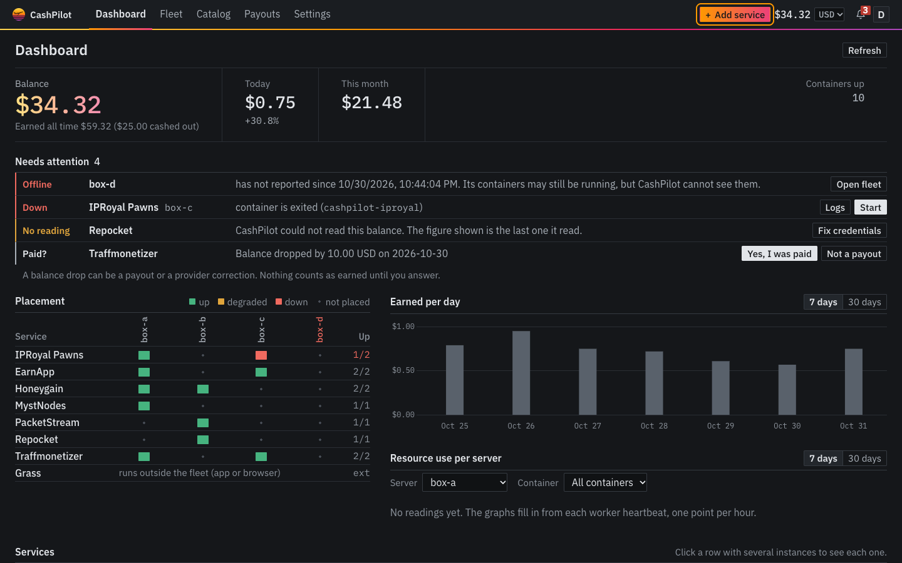

Disabled "Deploy" next to an enabled "Next":
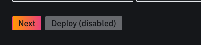

Phone, 375 px wide:
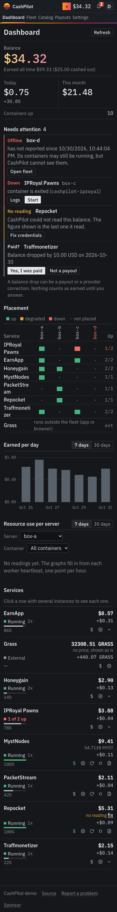

</details>

```css
/* ----- Sunrise edge -----
   The logo's sun, only at the edges: a line under the top bar, the active
   tab, the main buttons (small row buttons stay neutral), the focus ring and the balance. Text
   and status colours stay as they are. Dark theme only. */
:root:not([data-theme="light"]) {
  --sun: linear-gradient(90deg, #FFD54F, #FF9800 40%, #E91E63 72%, #AB47BC);
  --sun-warm: linear-gradient(90deg, #FF9800, #EC407A);       /* dark text >= 4.77:1 */
  --sun-warm-hover: linear-gradient(90deg, #FFA726, #F06292); /* dark text >= 5.87:1 */
  --sun-ring: #FF9800;
}
:root:not([data-theme="light"]) .topbar {
  border-bottom: 2px solid transparent;
  border-image: var(--sun) 1;
}
:root:not([data-theme="light"]) .topnav .sidebar-link.active {
  border-bottom-width: 3px; margin-bottom: -2px;
  border-image: var(--sun-warm) 1;
}
:root:not([data-theme="light"]) .topbar-add,
:root:not([data-theme="light"]) .btn-primary:not(.btn-sm) {
  background: var(--sun-warm); color: #15171a; border-color: transparent;
}
:root:not([data-theme="light"]) .topbar-add:hover,
:root:not([data-theme="light"]) .btn-primary:not(.btn-sm):hover:not(:disabled) {
  background: var(--sun-warm-hover); color: #15171a; border-color: transparent;
}
:root:not([data-theme="light"]) .btn-primary:not(.btn-sm):disabled { background: var(--text-primary); }
:root:not([data-theme="light"]) .topbar-add.active {
  box-shadow: 0 0 0 2px var(--bg-secondary), 0 0 0 3px var(--sun-ring);
}
:root:not([data-theme="light"]) :focus-visible,
:root:not([data-theme="light"]) .form-input:focus-visible { outline-color: var(--sun-ring); }
:root:not([data-theme="light"]) .money-strip .stat-card-balance .stat-value {
  background: linear-gradient(90deg, #FFE082, #F48FB1); /* no amber stop: #FFB74D read as warning */
  -webkit-background-clip: text; background-clip: text;
  color: transparent; width: fit-content;
}
```

| Pair | Ratio | Needs |
|---|---|---|
| Button text #15171a on #FF9800 (gradient start) | 8.33 | 4.5 |
| Button text #15171a on #EC407A (gradient minimum) | 4.77 | 4.5 |
| Hover text #15171a on #F06292 (hover minimum) | 5.87 | 4.5 |
| Focus ring #FF9800 on page #15171a | 8.33 | 3 |
| Focus ring #FF9800 on cards and top bar #1a1d21 | 7.85 | 3 |
| Focus ring #FF9800 on inputs #101214 | 8.71 | 3 |
| Active tab underline minimum #EC407A on top bar | 4.49 | 3 |
| Top bar line minimum #b83ea9 on top bar (decorative) | 3.46 | 3 |
| Balance #FFE082 on page | 13.89 | 3 |
| Balance #F48FB1 (gradient minimum) on page | 8.05 | 3 |
| Disabled primary button, neutral fill at opacity 0.4 (same as today) | 3.27 | exempt |

Risks:

- The orange #FF9800 is ΔE 25 (CIE76) from the warning amber #e0a53c. They are distinct but from the same family, so orange never appears as flat text, only as a gradient fill, a line or a focus ring. The pink end #EC407A is ΔE 31 from the error red.
- The balance gradient used to have an amber middle stop. It read like a warning next to the amber "No reading" label, so we dropped it. The gradient now runs pale gold to pink.
- A gradient button at opacity 0.4 drops its label to 1.70:1. Disabled full-size primary buttons fall back to the neutral fill, which matches today's disabled button.
- The focus ring is orange around an orange-to-pink button. It is offset by 4 px, so it still reads, but it is the same hue family.
- The balance uses `background-clip: text` with transparent text. A coloured child span inside the balance would lose its colour. Today it is plain text.
- The top bar border goes from 1 px to 2 px. Nothing else moves at 1440 px or 375 px.
- Dark theme only. Light mode is untouched. A light version would need darker stops (for example #E65100 to #C2185B with white text).

## 2. Warm accent

The neutral accent becomes one orange from the logo, #fb923c, used on everything you click: primary buttons, the active nav underline, active tabs and filters, selected cards, the wizard step, focus rings, checkboxes and the payout progress bars. The earnings bars and the two usage-chart lines take the logo colours, and the warning amber moves slightly toward yellow (#e0a53c to #e6bb45) so it is not confused with the accent.

| Baseline | Warm accent |
|---|---|
|  | 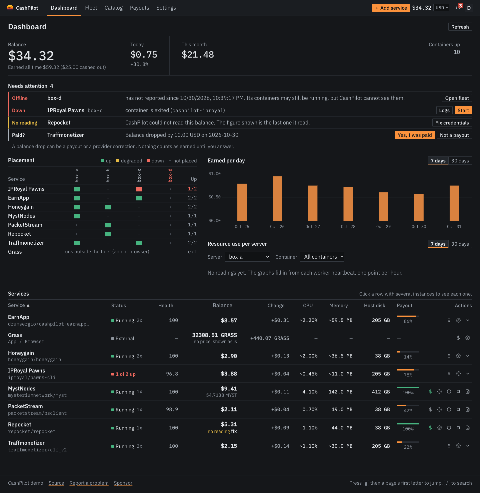 |

<details><summary>Other pages</summary>

Fleet:
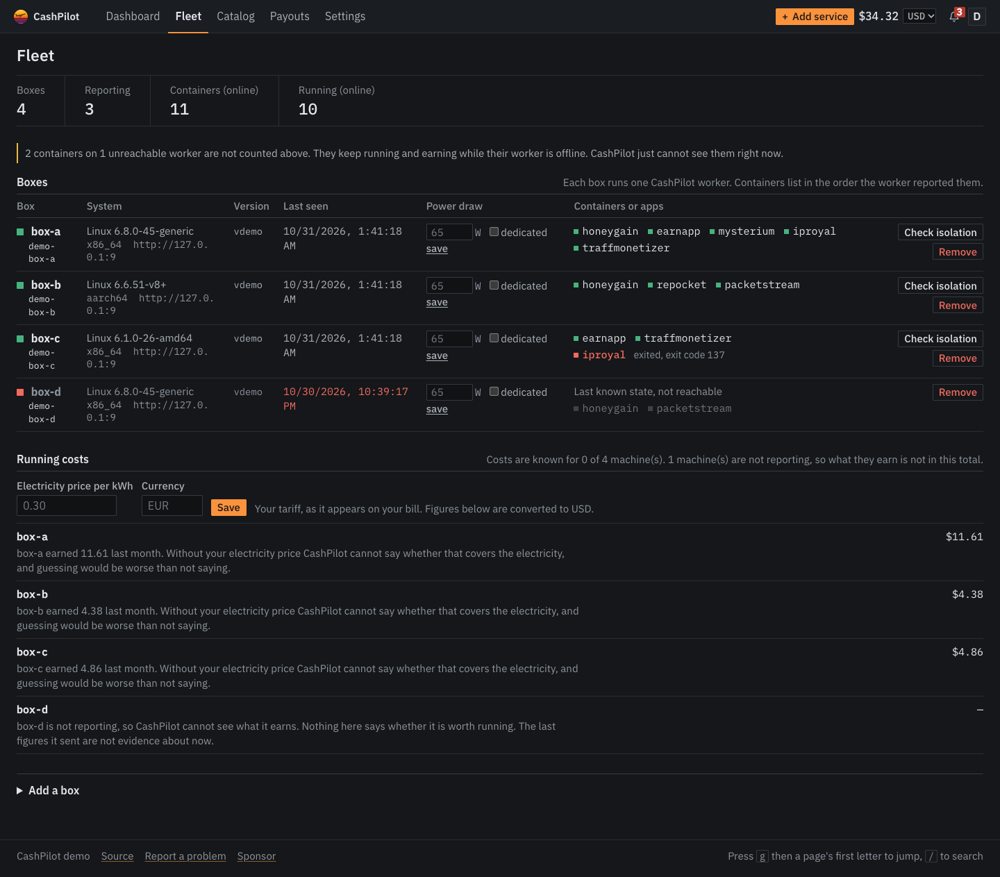

Payouts:
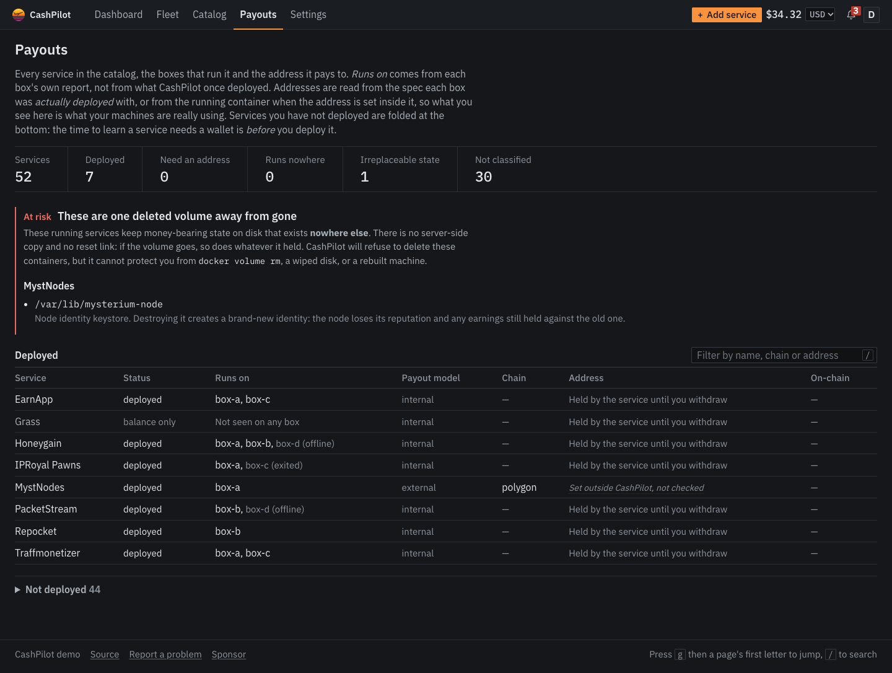

Catalog:
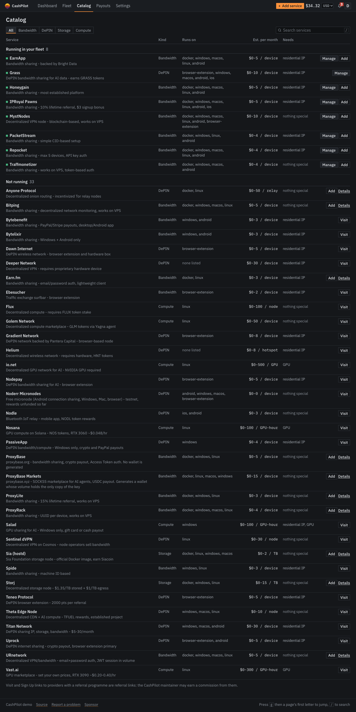

Add services (setup):
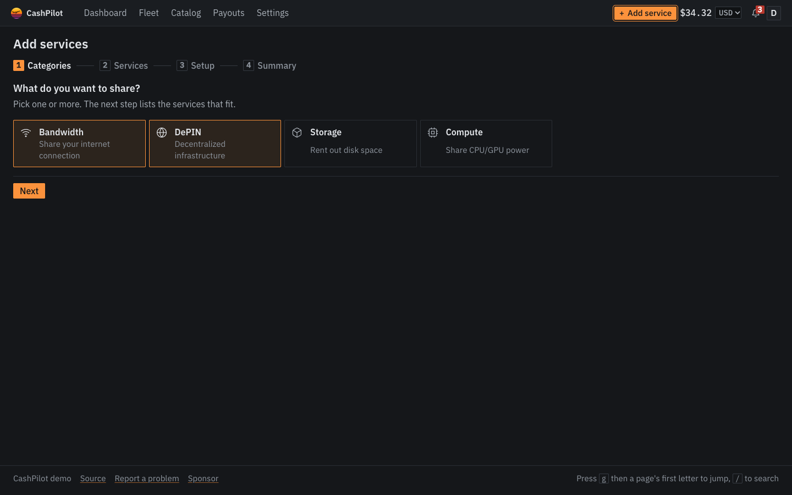

Phone, 375 px wide:
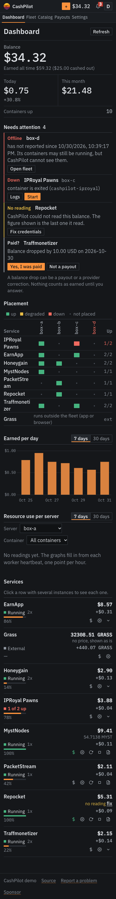

</details>

```css
/* ----- Brand: warm accent (logo sun orange). Surfaces stay graphite. ----- */
:root {
  --accent: #fb923c;            /* banner/logo orange: 7.9:1 on bg, 6.6:1 on hover */
  --accent-hover: #fdba74;
  --accent-bg: #fb923c;
  --accent-soft: rgba(251, 146, 60, 0.10);
  --warning: #e6bb45;           /* amber moved toward yellow, away from the accent */
  --warning-soft: rgba(230, 187, 69, 0.12);
  --chart-bar: #d9823f;         /* earnings bars: the accent, a step down */
  --series-1: #c27ad6;          /* logo violet, lifted for the dark ground */
  --series-2: #fb923c;          /* logo orange */
}
a { text-decoration-color: color-mix(in srgb, var(--accent) 55%, transparent); }
a:hover { color: var(--accent-hover); }
:focus-visible, .form-input:focus-visible { outline-color: var(--accent); }
.form-input:focus, .topbar-currency-select:focus { border-color: var(--accent); }
input[type="checkbox"], input[type="radio"] { accent-color: var(--accent); }
.btn-primary, .btn-success { background: var(--accent); border-color: var(--accent); color: var(--bg-primary); }
.topbar-add.active { box-shadow: 0 0 0 2px var(--bg-primary), 0 0 0 3px var(--accent); }
.topnav .sidebar-link.active { border-bottom-color: var(--accent); }
.tab-btn.active, .filter-tab.active { box-shadow: inset 0 -2px 0 var(--accent); }
.service-card.selected, .category-card.selected { border-color: var(--accent); }
:root:not([data-theme="light"]) .service-card.selected::after {
  background-color: var(--accent);
  background-image: url("data:image/svg+xml,%3Csvg xmlns='http://www.w3.org/2000/svg' width='14' height='14' viewBox='0 0 24 24' fill='none' stroke='%2315171a' stroke-width='3' stroke-linecap='round' stroke-linejoin='round'%3E%3Cpolyline points='20 6 9 17 4 12'/%3E%3C/svg%3E");
}
.wizard-step.active .wizard-step-number, .gate-step.active .wizard-step-number { background: var(--accent); border-color: var(--accent); }
.payout-progress-bar:not(.eligible), .payout-progress-fill { background: var(--accent); }
```

| Pair | Ratio | Needs |
|---|---|---|
| Button label #15171a on accent #fb923c | 7.93 | 4.5 |
| Button label #15171a on hover #fdba74 | 10.65 | 4.5 |
| Accent #fb923c on page #15171a | 7.93 | 3 |
| Accent #fb923c on cards #1a1d21 | 7.47 | 3 |
| Accent #fb923c on active tab #23272c | 6.64 | 3 |
| Accent #fb923c on inputs #101214 | 8.29 | 3 |
| Link hover #fdba74 on page | 10.65 | 4.5 |
| Warning #e6bb45 on page | 9.88 | 4.5 |
| Warning #e6bb45 on cards | 9.31 | 4.5 |
| Warning #e6bb45 on a warning row #323025 | 7.29 | 4.5 |
| Earnings bars #d9823f on cards | 5.81 | 3 |
| Chart line 1 #c27ad6 on cards | 5.68 | 3 |
| Chart line 2 #fb923c on cards | 7.47 | 3 |

Risks:

- This changes a status colour. Against today's amber the orange is only ΔE 12.8 (CIEDE2000) away, which looks alike. The new amber raises that to 19.5. The accent is 21.0 from the error red, so it sits about midway between the two status colours.
- With red-green colour blindness the accent and the warning still look nearly the same (simulated ΔE about 4 to 8). Status always comes with a word or sits in the status square, so it never relies on colour alone.
- "Start" in the red "Down" row and "Yes, I was paid" turn orange. They read as actions, but they are the loudest pixels on the dashboard.
- Payout bars under 100% turn orange, in the same column as the green 100% bars. They can read as a soft "not yet" status. Removing the `.payout-progress-*` line keeps them grey.
- The selected-card check mark is scoped to the dark theme. Unscoped, light mode would draw a near-black tick on a near-black square.
- The usage-chart lines are not in the screenshots, because the demo data has no readings.
- Light mode keeps its own accent. A light version would use #c2410c (5.2:1 on white).

## 3. Classic night (opt-in theme)

A third theme, `data-theme="classic"`, for people who miss the old look: the blue-black background, violet-tinted text and borders, a faint violet-to-cyan wash on cards and modals, and a rose-violet-cyan line under the top bar. Primary buttons, the active tab and selections turn rose with a soft glow, and focus rings turn cyan, while layout, fonts, spacing and status colours stay the same.

| Baseline | Classic night |
|---|---|
|  | 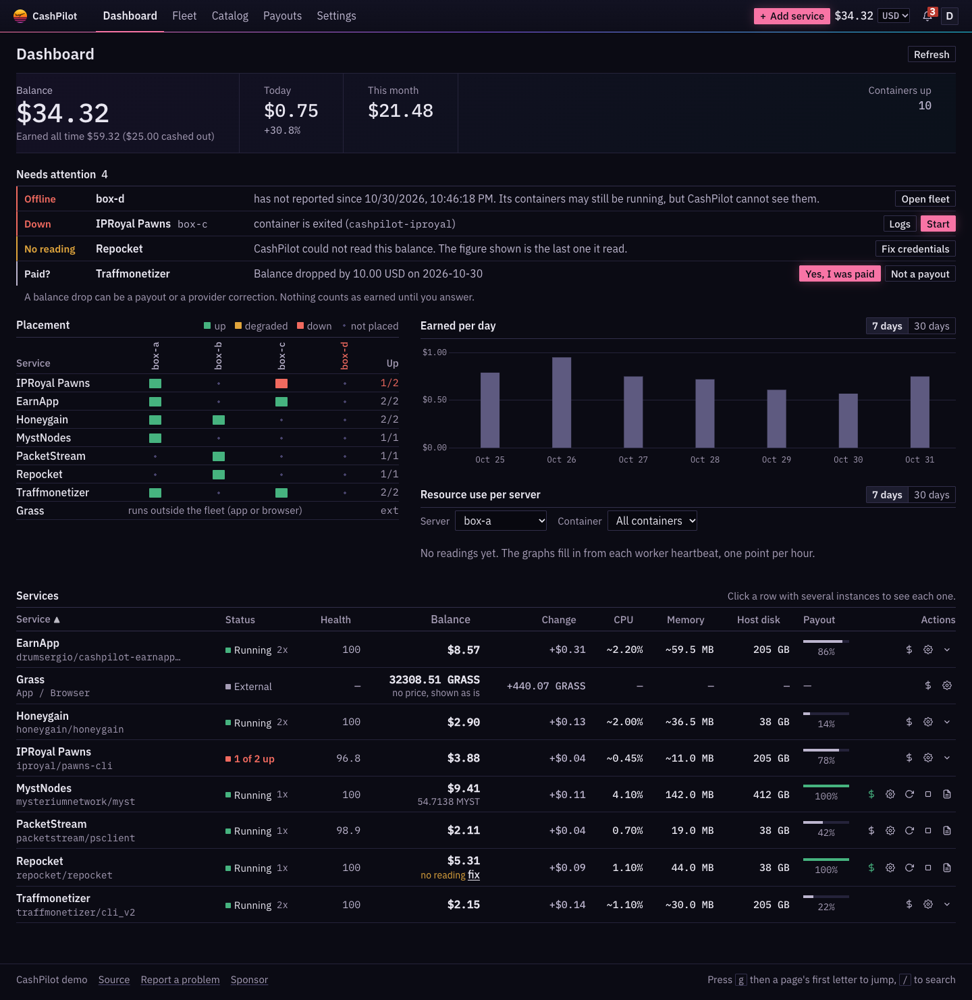 |

<details><summary>Other pages</summary>

Fleet:
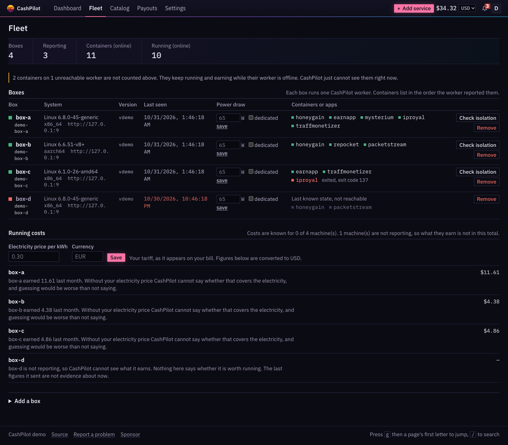

Payouts:
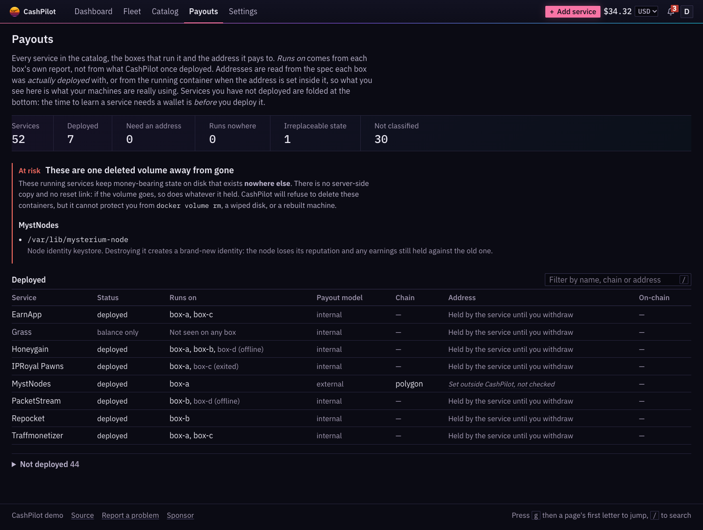

Catalog:
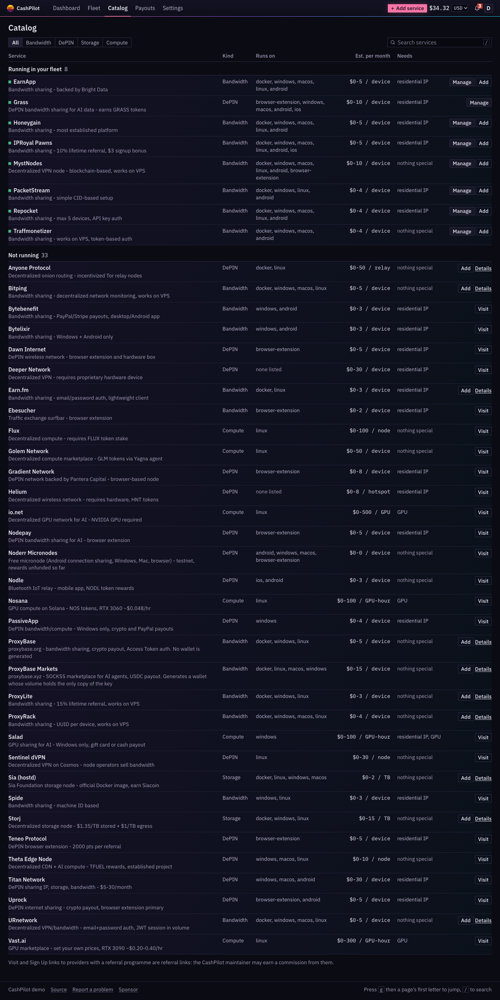

Add services (setup):
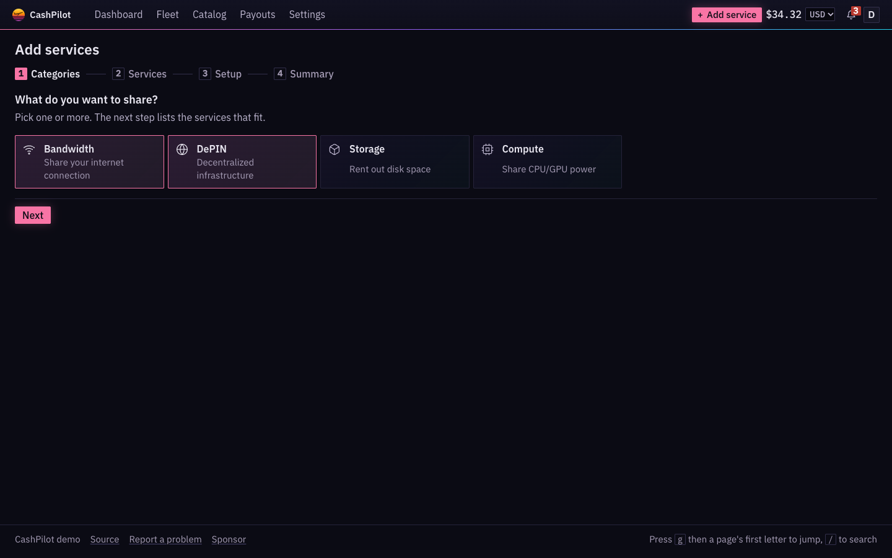

Phone, 375 px wide:
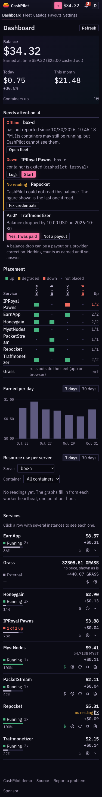

</details>

```css
/* ----- Classic night: opt-in, data-theme="classic". The old blue-black, rose and cyan. ----- */
:root[data-theme="classic"] {
  --bg-primary: #0b0b14; --bg-secondary: #11111d; --bg-card: #11111d; --bg-tertiary: #171726;
  --bg-hover: #1d1d2f; --bg-input: #08080f; --bg-log: #07070d;
  --border-color: #25233a; --border: #25233a; --border-light: #322f4b; --border-strong: #4b4670;
  --text-primary: #e8e6f0; --text-secondary: #bdb6cf; --text-muted: #a59cb5;
  /* Rose leans pink (#fb7185 -> #f874a5) so it never reads as the error coral. */
  --accent: #f874a5; --accent-hover: #fbadc8; --accent-bg: #f874a5;
  --accent-soft: rgba(248, 116, 165, 0.10);
  --accent-secondary: #22d3ee; --accent-secondary-soft: rgba(34, 211, 238, 0.10);
  --chart-bar: #5e5a80;
  --gradient-card: linear-gradient(135deg, rgba(139, 92, 246, 0.07), rgba(6, 182, 212, 0.035));
  --gradient-sidebar: linear-gradient(180deg, #121222, #0e0e1a);
  --shadow-glow-rose: 0 0 14px rgba(248, 116, 165, 0.28);
}
:root[data-theme="classic"] .topbar {
  background: var(--gradient-sidebar);
  border-image: linear-gradient(90deg, #f874a5, #8b5cf6 50%, #22d3ee) 1;
}
:root[data-theme="classic"] .topnav .sidebar-link.active { border-bottom-color: var(--accent); }
:root[data-theme="classic"] .btn-primary {
  background: var(--accent); border-color: var(--accent); color: var(--bg-primary);
  box-shadow: var(--shadow-glow-rose);
}
:root[data-theme="classic"] .btn-primary:hover:not(:disabled) { background: var(--accent-hover); border-color: var(--accent-hover); }
:root[data-theme="classic"] :is(.stats-grid, .modal, .category-card, .service-card) {
  background-image: var(--gradient-card);
}
:root[data-theme="classic"] :is(.category-card, .service-card).selected { border-color: var(--accent); }
:root[data-theme="classic"] .service-card.selected::after { background-color: var(--bg-primary); box-shadow: inset 0 0 0 1px var(--accent); }
:root[data-theme="classic"] .wizard-step.active .wizard-step-number {
  border-color: var(--accent); background: var(--accent);
}
:root[data-theme="classic"] :focus-visible,
:root[data-theme="classic"] .form-input:focus-visible { outline-color: var(--accent-secondary); }
```

| Pair | Ratio | Needs |
|---|---|---|
| Text #e8e6f0 on page #0b0b14 | 15.86 | 4.5 |
| Secondary text #bdb6cf on page | 10.03 | 4.5 |
| Muted text #a59cb5 on cards #11111d | 7.15 | 4.5 |
| Muted text on the rose glow peak #4d283d | 4.76 | 4.5 |
| Button label #0b0b14 on rose #f874a5 | 7.49 | 4.5 |
| Hover label #0b0b14 on #fbadc8 | 11.11 | 4.5 |
| Rose #f874a5 tab and selection on cards | 7.16 | 3 |
| Cyan focus ring #22d3ee on page | 10.84 | 3 |
| Selected-card check, white on dark box | 19 | 3 |
| Earnings bars #5e5a80 on page | 3.03 | 3 |
| Error #f06a5f on the violet card wash | 5.80 | 4.5 |
| Input border #322f4b on cards (same as today's theme) | 1.47 | 3 |

Risks:

- It needs a switch before it ships. Settings > Appearance would offer Dark, Light and Classic, saved per user and copied into the existing `cp-theme` key, which the page already writes into `data-theme` before paint. The sun/moon button in the top bar must skip Classic or treat it as dark, or one click sends a Classic user to light mode.
- The old rose #fb7185 is only ΔE 9.8 (CIEDE2000) from the error red. The accent moves pinker to #f874a5 (ΔE 18.0). A rose "Start" still sits in the red "Down" row. #f472b6 would give ΔE 22.2 if that is not enough.
- The earnings bars pass at 3.03:1, with almost no margin.
- Input borders are 1.47:1, short of 3:1. Today's theme has the same gap.
- Disabled primary buttons look dim and pink (label 2.08:1). WCAG exempts disabled controls.
- The green `$` claim buttons stay green, and the service-detail Deploy button stays neutral. The gate-page step number stays neutral while the wizard steps turn rose.

## Recommendation

We recommend **Sunrise edge**. It gives the app the logo's warmth where you look first (the top bar, the active tab, the main button, the balance) and leaves every working part alone. No status colour changes. Row buttons stay neutral, so nothing warm competes with a red or amber row. Warm accent works too, but it moves the warning colour and turns the attention list's buttons into the loudest thing on the page. Classic night is the strongest look of the three, but it needs a settings switch and a top-bar toggle fix before it can ship.

The designs can be combined. One option is Sunrise edge by default, plus Classic night later as an opt-in theme for people who want the old look. As written, the two would stack, because Sunrise edge applies to every theme that is not light, classic included. Changing its selector to `:root:not([data-theme="light"]):not([data-theme="classic"])` keeps each theme's accents separate.
