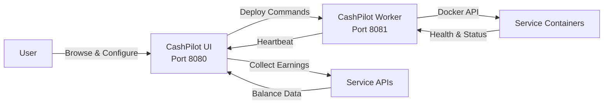

# Getting Started

## Prerequisites

- **Docker** and **Docker Compose** installed on your server
- A Linux, macOS, or Windows host (amd64 or arm64)
- At least 1 GB of RAM available for CashPilot + managed services

## Quick Start

### 1. Fetch the compose file and launch

```bash
curl -fsSLO https://raw.githubusercontent.com/GeiserX/CashPilot/main/docker-compose.yml
docker compose up -d
```

This starts three containers:

| Container | Port | Purpose |
|-----------|------|---------|
| **cashpilot-ui** | 8080 | Web dashboard, earnings collection, service catalog |
| **cashpilot-worker** | 8081 | Docker agent that deploys and monitors service containers |
| **cashpilot-socket-proxy** | none | Holds the Docker socket read-only and gives the worker a filtered copy ([Security defaults](security-defaults.md)) |

### 2. Open the dashboard

Navigate to [http://localhost:8080](http://localhost:8080) in your browser. Since no account exists yet, you land on the welcome page, which creates the owner account.

!!! tip "Port 8080 already in use?"
    Choose another host port in a `.env` file next to `docker-compose.yml`,
    instead of editing the compose file:

    ```bash
    printf '\nCASHPILOT_UI_PORT=8088\n' >> .env
    docker compose up -d
    ```

    Then open http://localhost:8088. Keep the value in `.env`, because the
    in-app update reads that file and not your shell. (`printf` starts with a
    newline so the line never joins the last one of an existing `.env`.)

    The variable needs a `docker-compose.yml` whose `ports:` line reads
    `${CASHPILOT_UI_PORT:-8080}:8080`. The file from v1.61 and older hard-codes
    `8080:8080` and ignores it. Download the current file, or
    keep your own edited port mapping: the in-app update accepts that too.

!!! warning "First-run setup token required"
    On first start, CashPilot generates a one-time setup token and prints it to the **cashpilot-ui** container logs:

    ```bash
    docker compose logs cashpilot-ui
    ```

    Look for a line like:

    ```
    FIRST-RUN SETUP: no account exists yet. Open /register and enter this
    one-time setup token to create the owner account: <token>
    ```

    Copy that token into the **Setup token** field on the **Owner account** step of the welcome page, together with a username and password, to create the first (owner) account. It is only ever shown in the logs, never in a URL, and is discarded permanently once the owner account exists.

### 3. Browse the service catalog

The **Catalog** page lists every service with its platforms, a monthly estimate and what it needs (residential IP, GPU). Filter by category (Bandwidth, DePIN, Storage, Compute) or search by name. **Add** opens the setup wizard on that service, **Details** shows its description, payouts and deploy risk, and services that do not run in Docker get a **Visit** link instead.

Two kinds of service need a closer look first: services that pay only after you lock up a token stake, such as Anyone Protocol, Sia and Flux, and relays that publish your IP, which may lower what residential bandwidth apps pay you. See [Check two things before you deploy](guides/index.md).

### 4. Add services with the wizard

Once the owner account exists, **Add services** opens the setup wizard; later, the **+ Add service** button in the top bar opens it again. Pick categories, then services. For each service the wizard shows a **Sign Up** link, asks only for the credentials that service needs (email and password, API token, and so on) and lets you choose the workers to run it on. Click **Deploy** and CashPilot pulls the image, creates the container and starts watching it.

### 5. Watch it on the dashboard

The dashboard shows each deployed service with its status and balance, and the **Fleet** page shows every worker.

## How It Works



1. **You configure** services through the web UI -- pick a service, enter credentials, click deploy.
2. **The UI sends** the container spec (image, env vars, volumes) to the worker via REST API.
3. **The worker creates** the Docker container and starts monitoring its health.
4. **The worker reports** container status back to the UI every 60 seconds via heartbeats.
5. **The UI collects** earnings from service APIs on a configurable schedule (default: every hour).
6. **The dashboard** shows aggregated earnings, per-service breakdowns, and container health.

## Configuration

### UI Environment Variables

| Variable | Default | Description |
|----------|---------|-------------|
| `TZ` | `UTC` | Timezone for scheduling and display |
| `CASHPILOT_SECRET_KEY` | *(auto-generated)* | Signing key for login sessions. Persisted at `/data/.secret_key`. **Does not encrypt credentials** |
| `CASHPILOT_ENCRYPTION_KEY` | *(auto-generated)* | Fernet key encrypting stored credentials at rest. Persisted at `/data/.fernet_key`. Adopted only when that file is absent, so set it only to restore a backup |
| `CASHPILOT_API_KEY` | *(from `/fleet`)* | Shared enrolment key for workers. Each worker gets its own key when it enrols; see [Fleet](fleet.md) |
| `CASHPILOT_COLLECT_INTERVAL` | `60` | Minutes between earnings collection cycles |
| `CASHPILOT_UI_PORT` | `8080` | Host port the UI is published on. Set it in `.env` when 8080 is taken |
| `CASHPILOT_BIND_ADDR` | `127.0.0.1` | Host interface the UI port is published on. **Loopback by default**: the dashboard can command the Docker-socket worker, so it is not exposed to your network out of the box. Set a specific IP (e.g. a Tailscale/VPN address) or `0.0.0.0` to expose it, or (preferred) run an authenticating reverse proxy in front |

The UI's web port inside the container is fixed at `8080` (set via the container's `CMD`). `CASHPILOT_UI_PORT` and `CASHPILOT_BIND_ADDR` choose only the host port and interface it is published on.

### Worker Environment Variables

| Variable | Default | Description |
|----------|---------|-------------|
| `TZ` | `UTC` | Timezone |
| `CASHPILOT_UI_URL` | -- | URL of the UI container, e.g. `http://cashpilot-ui:8080` |
| `CASHPILOT_API_KEY` | -- | Must match the UI's enrolment key. Needed only to enrol; the worker then uses its own key |
| `CASHPILOT_WORKER_NAME` | *(hostname)* | Display name for this worker in the fleet dashboard |
| `CASHPILOT_WORKER_URL` | *(auto-detected)* | URL the UI uses to reach this worker, e.g. `http://192.168.1.50:8081`. Set explicitly for cross-host fleets: auto-detection can report an unreachable container-internal IP |
| `CASHPILOT_WORKER_BIND_ADDR` | `127.0.0.1` | **Fleet and remote-worker compose only** (`docker-compose.fleet.yml`): host interface the worker's Docker-socket API port is published on, loopback by default. The default `docker-compose.yml` does not publish port 8081 at all. The worker API can deploy/stop any container (= root on the host), so for a remote worker bind a private/VPN interface (e.g. a Tailscale IP), **never** a public IP |
| `CASHPILOT_PORT` | `8081` | Port the worker **advertises** to the UI. It does *not* change the listen port, which is fixed by the image's `CMD`; see the [configuration reference](configuration.md) |

### Docker Compose Example

```yaml
--8<-- "docker-compose.yml"
```

!!! note "This is the real file"

    The block above is included verbatim from `docker-compose.yml` in the
    repository, so it cannot drift from what actually ships. Earlier, a
    hand-copied version of it published the worker's Docker-socket API on every
    interface and pinned `:latest`, both of which the
    [security defaults](security-defaults.md) page tells you not to do.

!!! warning "Docker Socket Access"
    The worker manages service containers through Docker, but it does not mount `/var/run/docker.sock`. The `cashpilot-socket-proxy` container holds the socket and passes the worker only the calls it makes, refusing privileged containers and binds of host folders you have not listed ([what it refuses](security-defaults.md#docker-socket-proxy)). Put `CASHPILOT_COMPOSE_DIR=<this folder>` in the `.env` next to the compose file so the in-app update can run. The worker still controls every container on the host, so run CashPilot on a dedicated machine or VLAN for best security.

!!! tip "Secret Key Persistence"
    Credentials are encrypted with `CASHPILOT_ENCRYPTION_KEY`, **not** `CASHPILOT_SECRET_KEY`, which only signs login sessions. The encryption key is auto-generated on first run and stored at `/data/.fernet_key`. **Back that file up.** If the volume is recreated without it, a fresh key is generated and every stored credential becomes permanently unreadable. Setting `CASHPILOT_ENCRYPTION_KEY` is for restoring that backup; the key file always wins, so setting it on a healthy instance changes nothing.

!!! tip "Passwords and secrets in the UI"
    Change your own password any time from the avatar menu -> **Change password** (available to all roles); this signs out your other sessions. In **Settings**, stored secrets are write-only: enter a value to change it, or leave the field blank to keep the existing one. Saved credentials are never sent back to the browser.

## Updating CashPilot

The compose file pins a major.minor series, such as `drumsergio/cashpilot:X.Y`, so `pull` fetches the newest patch of that series:

```bash
docker compose pull
docker compose up -d
```

`docker compose pull` fetches the newest published image and `up -d` recreates
only the containers whose image changed. The shipped compose files set
`pull_policy: always`, so even a bare `docker compose up -d` will pull the
latest image first.

**From the dashboard.** **Settings**, **About and updates** runs the same two
commands for you from a short-lived helper container. The helper reads your
compose files and the `.env` next to them (or the files you passed with
`--env-file`), never the shell you started CashPilot from. Say you started it with `CASHPILOT_UI_PORT=8088 docker compose up -d`.
The update would put the dashboard back on 8080, so it stops and tells you why
instead. Put that value in `.env` and the button works.

!!! note "You do **not** need to rebuild"
    CashPilot ships prebuilt multi-arch images on Docker Hub
    ([`drumsergio/cashpilot`](https://hub.docker.com/r/drumsergio/cashpilot),
    [`drumsergio/cashpilot-worker`](https://hub.docker.com/r/drumsergio/cashpilot-worker)).
    `docker compose build` / `--build` is only relevant if you deliberately
    build from source with `docker-compose.build.yml`. For normal installs,
    `pull` + `up -d` is the complete and correct update procedure.

### Pinning a specific version

To stay on one exact release, replace the `X.Y` series tag in
`docker-compose.yml` with a full release tag `X.Y.Z` on both
`drumsergio/cashpilot` and `drumsergio/cashpilot-worker` (always the same tag on
both), and remove `pull_policy: always`. To move to a newer
series, edit both tags. Browse tags on
[Docker Hub](https://hub.docker.com/r/drumsergio/cashpilot/tags).

### Automating updates (optional)

If you want hands-off updates, point a scheduler at the same two commands,
for example with a daily cron entry:

```cron
0 4 * * *  cd /path/to/cashpilot && docker compose pull && docker compose up -d
```

Or run an auto-updater such as [Watchtower](https://containrrr.dev/watchtower/)
or [Diun](https://crazymax.dev/diun/) against the CashPilot containers. These
are optional. CashPilot does not bundle an updater.

## Supported Services

CashPilot supports **<!-- n:live -->41<!-- /n --> services** that are active or in beta, across four categories:

- **Bandwidth Sharing** (<!-- n:bandwidth -->18<!-- /n -->): share your internet bandwidth for passive income
- **DePIN** (<!-- n:depin -->15<!-- /n -->): decentralized physical infrastructure networks
- **GPU Compute** (<!-- n:compute -->6<!-- /n -->): rent out your GPU for AI and compute workloads
- **Storage** (<!-- n:storage -->2<!-- /n -->): share disk space on decentralized storage networks

Of these, **<!-- n:docker -->17<!-- /n -->** can be deployed and managed automatically via Docker. The other <!-- n:tracked -->24<!-- /n --> (<!-- n:extension -->18<!-- /n --> browser or desktop apps, <!-- n:gpu -->6<!-- /n --> GPU nodes) are listed in the catalog with signup links, and their balances are read where a collector exists.

Browse the full catalog in the [Service Guides](guides/index.md) section.

## Next Steps

- [How it works](how-it-works.md) -- Understand the UI + Worker split design
- [Fleet Management](fleet.md) -- Deploy across multiple servers
- [Protecting your home network](home-network-security.md) -- Keep the containers off your LAN, and when gVisor helps
- [Service Guides](guides/index.md) -- Detailed setup instructions for each service
