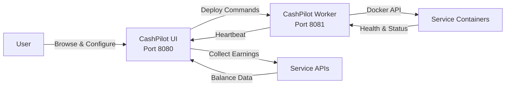

# البدء { #getting-started }

## المتطلبات المسبقة { #prerequisites }

- **Docker** مع **إضافة Compose v2، الإصدار 2.23.1 أو أحدث**. تحقّق من ذلك
  بالأمر `docker compose version`. لا تستطيع الإصدارات الأقدم قراءة الإعدادات
  المضمّنة في ملف compose. يتضمّن Docker Desktop هذه الإضافة. على Docker
  Engine مجرّد على Linux، ثبّتها من مستودع حزم Docker
  (https://docs.docker.com/compose/install/linux/). على macOS مع Colima،
  ثبّتها باستخدام Homebrew واربطها كإضافة لـ Docker:

    ```sh
    brew install docker-compose
    mkdir -p ~/.docker/cli-plugins
    ln -sfn "$(brew --prefix)/opt/docker-compose/bin/docker-compose" ~/.docker/cli-plugins/docker-compose
    ```

- مضيف Linux أو macOS أو Windows (amd64 أو arm64)
- ذاكرة RAM متاحة لا تقل عن 1 GB لـ CashPilot والخدمات التي يديرها
- **نسخة واحدة من CashPilot لكل مضيف Docker.** راجع التحذير أدناه.

!!! warning "نسخة واحدة من CashPilot لكل مضيف Docker"
    لا تشغّل تثبيتين من CashPilot على مضيف Docker واحد. تستخدم ملفات compose
    أسماء ثابتة للحاويات (`cashpilot-ui` و`cashpilot-worker`
    و`cashpilot-socket-proxy`)، لذلك تفشل نسخة ثانية من الملف بسبب تعارض في
    الأسماء. وإذا غيّرت الأسماء لتتجاوز ذلك، يظل التثبيتان يتشاركان المضيف.
    يدير كل عامل كل حاوية تحمل تسميات CashPilot، أيًّا كان التثبيت الذي أنشأها.
    لذلك تعرض كل لوحة تحكم تطبيقات الربح الخاصة بالتثبيت الآخر وتوقفها وتستبدلها.
    ويتشارك التثبيتان أيضًا الشبكة `cashpilot-isolated`، وأسماء تطبيقات الربح
    (`cashpilot-<service>`)، ومنافذ المضيف الخاصة بها، ووحدات التخزين مثل
    `mysterium-data`. لتثبيت ثانٍ، استخدم مضيفًا آخر أو آلة افتراضية أخرى.
    ولتشغيل تطبيقات الربح على خوادم أكثر، أضف عمّالًا إلى لوحة تحكم واحدة بدلًا من ذلك ([الأسطول](fleet.md)).

## البدء السريع { #quick-start }

### 1. اجلب ملف compose وشغّله { #1-fetch-the-compose-file-and-launch }

```bash
curl -fsSLO https://raw.githubusercontent.com/GeiserX/CashPilot/main/docker-compose.yml
docker compose up -d
```

يشغّل هذا ثلاث حاويات تعمل باستمرار. وقبلها تعمل الحاوية `cashpilot-migrate`
مرة واحدة وتخرج برمز 0 في كل `up`، لذلك يعرضها
`docker compose ps -a` بالحالة `Exited (0)`. هذا أمر طبيعي.

| الحاوية | المنفذ | الغرض |
|-----------|------|---------|
| **cashpilot-migrate** | لا يوجد | تعمل مرة واحدة ثم تخرج. تنقل البيانات التي أنشأها إصدار أقدم إلى وحدات تخزين يقبلها وكيل المقبس، ولا تجد شيئًا تفعله في التثبيت الجديد |
| **cashpilot-ui** | 8080 | لوحة التحكم على الويب، وجمع الأرباح، وكتالوج الخدمات |
| **cashpilot-worker** | 8081 | وكيل Docker الذي ينشر حاويات الخدمات ويراقبها |
| **cashpilot-socket-proxy** | لا يوجد | يحتفظ بمقبس Docker للقراءة فقط ويعطي العامل نسخة مفلترة منه ([الإعدادات الأمنية الافتراضية](security-defaults.md)) |

### 2. افتح لوحة التحكم { #2-open-the-dashboard }

انتقل إلى [http://localhost:8080](http://localhost:8080) في متصفحك. بما أنه لا يوجد حساب بعد، ستصل إلى صفحة الترحيب التي تُنشئ حساب المالك.

!!! tip "هل المنفذ 8080 مستخدم بالفعل؟"
    اختر منفذًا آخر على المضيف في ملف `.env` بجانب `docker-compose.yml`،
    بدلًا من تعديل ملف compose:

    ```bash
    printf '\nCASHPILOT_UI_PORT=8088\n' >> .env
    docker compose up -d
    ```

    ثم افتح http://localhost:8088. احتفظ بالقيمة في `.env`، لأن التحديث من
    داخل التطبيق يقرأ ذلك الملف وليس الصدفة (shell) الخاصة بك. (يبدأ `printf` بسطر
    جديد حتى لا يندمج السطر أبدًا مع آخر سطر في ملف `.env` موجود.)

    يحتاج المتغير إلى ملف `docker-compose.yml` يكون فيه سطر `ports:` بالشكل
    `${CASHPILOT_UI_PORT:-8080}:8080`. أما الملف من الإصدار v1.61 وما قبله فيثبّت
    `8080:8080` في الكود ويتجاهل المتغير. نزّل الملف الحالي، أو
    احتفظ بتعيين المنفذ الذي عدّلته بنفسك: فالتحديث من داخل التطبيق يقبله أيضًا.

!!! warning "رمز الإعداد للتشغيل الأول مطلوب"
    عند التشغيل الأول، يُنشئ CashPilot رمز إعداد يُستخدم مرة واحدة ويطبعه في سجلات الحاوية **cashpilot-ui**:

    ```bash
    docker compose logs cashpilot-ui
    ```

    ابحث عن سطر مثل:

    ```
    FIRST-RUN SETUP: no account exists yet. Open /register and enter this
    one-time setup token to create the owner account: <token>
    ```

    انسخ ذلك الرمز إلى حقل **Setup token** (رمز الإعداد) في خطوة **Owner account** (حساب المالك) من صفحة الترحيب، مع اسم مستخدم وكلمة مرور، لإنشاء الحساب الأول (حساب المالك). لا يظهر هذا الرمز إلا في السجلات، ولا يظهر أبدًا في عنوان URL، ويُحذف نهائيًا بمجرد وجود حساب المالك.

### 3. تصفّح كتالوج الخدمات { #3-browse-the-service-catalog }

تعرض صفحة **Catalog** (الكتالوج) كل خدمة مع منصاتها وتقدير شهري وما تحتاج إليه (عنوان IP منزلي، GPU). صفِّ النتائج حسب الفئة (عرض النطاق، DePIN، التخزين، الحوسبة، التعدين) أو ابحث بالاسم. يفتح **Add** (إضافة) معالج الإعداد على تلك الخدمة، ويعرض **Details** (التفاصيل) وصفها ودفعاتها ومخاطر نشرها، أما الخدمات التي لا تعمل في Docker فتحصل على رابط **Visit** (زيارة) بدلًا من ذلك.

هناك نوعان من الخدمات يحتاجان إلى نظرة أدق أولًا: خدمات لا تدفع إلا بعد أن تحجز حصة من رمز رقمي (token stake)، مثل Anyone Protocol وSia وFlux، والمرحّلات (relays) التي تنشر عنوان IP الخاص بك، مما قد يخفض ما تدفعه لك تطبيقات عرض النطاق المنزلي. راجع [تحقّق من أمرين قبل النشر](guides/index.md).

### 4. أضف الخدمات بالمعالج { #4-add-services-with-the-wizard }

بمجرد وجود حساب المالك، يفتح **Add services** (إضافة خدمات) معالج الإعداد؛ ولاحقًا يفتحه مجددًا الزر **+ Add service** (+ إضافة خدمة) في الشريط العلوي. اختر الفئات ثم الخدمات. لكل خدمة، يعرض المعالج رابط **Sign Up** (التسجيل)، ولا يطلب إلا بيانات الاعتماد التي تحتاج إليها تلك الخدمة (البريد الإلكتروني وكلمة المرور، أو رمز API، وما إلى ذلك)، ويتيح لك اختيار العمّال الذين ستعمل عليهم. انقر **Deploy** (نشر) فيسحب CashPilot صورة الحاوية، وينشئ الحاوية، ويبدأ مراقبتها.

### 5. راقبها على لوحة التحكم { #5-watch-it-on-the-dashboard }

تعرض لوحة التحكم كل خدمة منشورة مع حالتها ورصيدها، وتعرض صفحة **Fleet** (الأسطول) كل عامل.

## كيف يعمل { #how-it-works }



1. **أنت تضبط** الخدمات عبر واجهة الويب -- اختر خدمة، وأدخل بيانات الاعتماد، وانقر نشر.
2. **ترسل الواجهة** مواصفات الحاوية (صورة الحاوية، ومتغيرات البيئة، ووحدات التخزين) إلى العامل عبر REST API.
3. **ينشئ العامل** حاوية Docker ويبدأ مراقبة سلامتها.
4. **يبلّغ العامل** الواجهة بحالة الحاوية كل 60 ثانية عبر نبضات الاتصال.
5. **تجمع الواجهة** الأرباح من واجهات API الخاصة بالخدمات وفق جدول قابل للضبط (الافتراضي: كل ساعة).
6. **تعرض لوحة التحكم** الأرباح المجمّعة، وتفصيلها لكل خدمة، وسلامة الحاويات.

## الإعدادات { #configuration }

### متغيرات البيئة للواجهة { #ui-environment-variables }

| المتغير | الافتراضي | الوصف |
|----------|---------|-------------|
| `TZ` | `UTC` | المنطقة الزمنية للجدولة والعرض |
| `CASHPILOT_SECRET_KEY` | *(يُولَّد تلقائيًا)* | مفتاح توقيع جلسات تسجيل الدخول. يُحفظ في `/data/.secret_key`. **لا يشفّر بيانات الاعتماد** |
| `CASHPILOT_ENCRYPTION_KEY` | *(يُولَّد تلقائيًا)* | مفتاح Fernet يشفّر بيانات الاعتماد المخزّنة في حالة السكون. يُحفظ في `/data/.fernet_key`. لا يُعتمد إلا عندما يكون ذلك الملف غير موجود، لذلك لا تضبطه إلا لاستعادة نسخة احتياطية |
| `CASHPILOT_API_KEY` | *(من `/fleet`)* | مفتاح التسجيل المشترك للعمّال. يحصل كل عامل على مفتاحه الخاص عند تسجيله؛ راجع [الأسطول](fleet.md) |
| `CASHPILOT_COLLECT_INTERVAL` | `60` | الدقائق بين دورات جمع الأرباح |
| `CASHPILOT_UI_PORT` | `8080` | منفذ المضيف الذي تُنشر عليه الواجهة. اضبطه في `.env` عندما يكون 8080 مشغولًا |
| `CASHPILOT_BIND_ADDR` | `127.0.0.1` | واجهة الشبكة على المضيف التي يُنشر عليها منفذ الواجهة. **الاسترجاع المحلي (loopback) افتراضيًا**: تستطيع لوحة التحكم إصدار أوامر إلى العامل الذي يصل إلى مقبس Docker، لذلك لا تُكشف لشبكتك افتراضيًا. اضبط عنوان IP محددًا (مثل عنوان Tailscale أو VPN) أو `0.0.0.0` لكشفها، أو (وهو المفضّل) شغّل أمامها وكيلًا عكسيًا يتحقق من الهوية |

منفذ الويب الخاص بالواجهة داخل الحاوية ثابت على `8080` (يُضبط عبر `CMD` الخاص بالحاوية). لا يختار `CASHPILOT_UI_PORT` و`CASHPILOT_BIND_ADDR` إلا منفذ المضيف وواجهة الشبكة التي يُنشر عليها.

### متغيرات البيئة للعامل { #worker-environment-variables }

| المتغير | الافتراضي | الوصف |
|----------|---------|-------------|
| `TZ` | `UTC` | المنطقة الزمنية |
| `CASHPILOT_UI_URL` | -- | عنوان URL لحاوية الواجهة، مثل `http://cashpilot-ui:8080` |
| `CASHPILOT_API_KEY` | -- | يجب أن يطابق مفتاح التسجيل الخاص بالواجهة. لا يلزم إلا للتسجيل؛ بعد ذلك يستخدم العامل مفتاحه الخاص |
| `CASHPILOT_WORKER_NAME` | *(اسم المضيف)* | الاسم المعروض لهذا العامل في لوحة الأسطول |
| `CASHPILOT_WORKER_URL` | *(يُكتشف تلقائيًا)* | عنوان URL الذي تستخدمه الواجهة للوصول إلى هذا العامل، مثل `http://192.168.1.50:8081`. اضبطه صراحةً للأساطيل الموزّعة على عدة مضيفين: قد يبلّغ الاكتشاف التلقائي عن عنوان IP داخلي للحاوية لا يمكن الوصول إليه |
| `CASHPILOT_WORKER_BIND_ADDR` | `127.0.0.1` | **ملفات compose الخاصة بالأسطول والعامل البعيد فقط** (`docker-compose.fleet.yml`): واجهة الشبكة على المضيف التي يُنشر عليها منفذ API العامل الذي يصل إلى مقبس Docker، وهي الاسترجاع المحلي افتراضيًا. لا ينشر الملف الافتراضي `docker-compose.yml` المنفذ 8081 على الإطلاق. تستطيع API العامل نشر أي حاوية أو إيقافها (= صلاحيات root على المضيف)، لذلك اربط العامل البعيد بواجهة خاصة أو واجهة VPN (مثل عنوان IP من Tailscale)، و**أبدًا** لا تربطه بعنوان IP عام |
| `CASHPILOT_PORT` | `8081` | المنفذ الذي **يعلنه** العامل للواجهة. *لا* يغيّر منفذ الاستماع، الثابت بواسطة `CMD` الخاص بصورة الحاوية؛ راجع [مرجع الإعدادات](configuration.md) |

### مثال Docker Compose { #docker-compose-example }

```yaml
--8<-- "docker-compose.yml"
```

!!! note "هذا هو الملف الحقيقي"

    الكتلة أعلاه مُضمّنة حرفيًا من `docker-compose.yml` في
    المستودع، لذلك لا يمكن أن تنحرف عمّا يُشحن فعلًا. في السابق، كانت نسخة
    منسوخة يدويًا منه تنشر API العامل الذي يصل إلى مقبس Docker على كل
    واجهات الشبكة وتثبّت `:latest`، وكلا الأمرين تنصحك صفحة
    [الإعدادات الأمنية الافتراضية](security-defaults.md) بعدم فعلهما.

!!! warning "الوصول إلى مقبس Docker"
    يدير العامل حاويات الخدمات عبر Docker، لكنه لا يركّب `/var/run/docker.sock`. تحتفظ الحاوية `cashpilot-socket-proxy` بالمقبس ولا تمرّر إلى العامل إلا الاستدعاءات التي يجريها، وترفض الحاويات ذات الامتيازات وربط مجلدات المضيف التي لم تُدرجها ([ما الذي يرفضه](security-defaults.md#docker-socket-proxy)). التحديث من داخل التطبيق اختياري: لا يعمل إلا مع `CASHPILOT_COMPOSE_DIR=<this folder>` في ملف `.env` بجانب ملف compose، وهذا الإعداد يسمح للحاويات بربط المجلد، مما يُضعف الوكيل ([ما الذي يكلّفه ذلك](security-defaults.md#docker-socket-proxy)). اتركه غير مضبوط وحدّث بالأمر `docker compose pull && docker compose up -d`. ولا يزال العامل يتحكم في كل حاوية على المضيف، لذلك شغّل CashPilot على جهاز مخصّص أو VLAN للحصول على أفضل أمان.

!!! tip "استمرارية المفتاح السري"
    تُشفَّر بيانات الاعتماد باستخدام `CASHPILOT_ENCRYPTION_KEY`، **وليس** `CASHPILOT_SECRET_KEY` الذي لا يوقّع إلا جلسات تسجيل الدخول. يُولَّد مفتاح التشفير تلقائيًا عند التشغيل الأول ويُخزَّن في `/data/.fernet_key`. **احتفظ بنسخة احتياطية من ذلك الملف.** إذا أُعيد إنشاء وحدة التخزين بدونه، يُولَّد مفتاح جديد وتصبح كل بيانات الاعتماد المخزّنة غير قابلة للقراءة نهائيًا. ضبط `CASHPILOT_ENCRYPTION_KEY` مخصّص لاستعادة تلك النسخة الاحتياطية؛ فملف المفتاح هو الذي يُعتمد دائمًا، لذلك لا يغيّر ضبطه شيئًا على نسخة سليمة.

!!! tip "كلمات المرور والأسرار في الواجهة"
    غيّر كلمة مرورك في أي وقت من قائمة الصورة الرمزية -> **Change password** (تغيير كلمة المرور) (متاح لجميع الأدوار)؛ وهذا يُخرجك من جلساتك الأخرى. في **Settings** (الإعدادات)، تكون الأسرار المخزّنة للكتابة فقط: أدخل قيمة لتغييرها، أو اترك الحقل فارغًا للإبقاء على القيمة الحالية. لا تُرسل بيانات الاعتماد المحفوظة إلى المتصفح أبدًا.

## تحديث CashPilot { #updating-cashpilot }

يثبّت ملف compose سلسلة major.minor، مثل `drumsergio/cashpilot:X.Y`، لذلك يجلب `pull` أحدث إصدار تصحيحي من تلك السلسلة:

```bash
docker compose pull
docker compose up -d
```

يجلب `docker compose pull` أحدث صورة حاوية منشورة، ويعيد `up -d` إنشاء
الحاويات التي تغيّرت صورتها فقط. تضبط ملفات compose المرفقة
`pull_policy: always`، لذلك حتى الأمر `docker compose up -d` وحده سيسحب
أحدث صورة حاوية أولًا.

**من لوحة التحكم.** يشغّل **Settings** (الإعدادات)، **About and updates** (حول وتحديثات) الأمرين نفسيهما
نيابةً عنك من حاوية مساعدة قصيرة العمر. تقرأ الحاوية المساعدة ملفات compose الخاصة بك
وملف `.env` بجانبها (أو الملفات التي مرّرتها بالخيار
`--env-file`)، ولا تقرأ أبدًا الصدفة التي شغّلت منها CashPilot. لنفترض أنك شغّلته بالأمر `CASHPILOT_UI_PORT=8088 docker compose up -d`.
سيعيد التحديث لوحة التحكم إلى 8080، لذلك يتوقف ويخبرك بالسبب
بدلًا من ذلك. ضع تلك القيمة في `.env` وسيعمل الزر.

!!! note "**لا** تحتاج إلى إعادة البناء"
    يشحن CashPilot صور حاويات جاهزة متعددة المعماريات على Docker Hub
    ([`drumsergio/cashpilot`](https://hub.docker.com/r/drumsergio/cashpilot)،
    [`drumsergio/cashpilot-worker`](https://hub.docker.com/r/drumsergio/cashpilot-worker)).
    لا يكون `docker compose build` / `--build` مهمًا إلا إذا كنت تبني عمدًا
    من المصدر باستخدام `docker-compose.build.yml`. للتثبيتات العادية،
    `pull` + `up -d` هو إجراء التحديث الكامل والصحيح.

### تثبيت إصدار محدد { #pinning-a-specific-version }

للبقاء على إصدار محدد بعينه، استبدل وسم السلسلة `X.Y` في
`docker-compose.yml` بوسم إصدار كامل `X.Y.Z` على كل من
`drumsergio/cashpilot` و`drumsergio/cashpilot-worker` (الوسم نفسه دائمًا على
كليهما)، واحذف `pull_policy: always`. تصفّح الوسوم على
[Docker Hub](https://hub.docker.com/r/drumsergio/cashpilot/tags).

للانتقال إلى سلسلة أحدث، عدّل الوسمين كليهما: على مضيف الواجهة أولًا، ثم على
كل مضيف عامل. اقرأ
[UPGRADING.md](https://github.com/GeiserX/CashPilot/blob/main/UPGRADING.md)
أولًا، لأن الإصدار الرئيسي مثل 3.0 له خطواته الخاصة.

### أتمتة التحديثات (اختياري) { #automating-updates-optional }

إذا أردت تحديثات بلا تدخّل، فوجّه أداة جدولة إلى الأمرين نفسيهما،
مثلًا بإدخال cron يومي:

```cron
0 4 * * *  cd /path/to/cashpilot && docker compose pull && docker compose up -d
```

أو شغّل أداة تحديث تلقائي مثل [Watchtower](https://containrrr.dev/watchtower/)
أو [Diun](https://crazymax.dev/diun/) على حاويات CashPilot. هذه الأدوات
اختيارية. لا يتضمّن CashPilot أداة تحديث.

### تنظيف صور الحاويات القديمة { #cleaning-up-old-images }

يسحب CashPilot صور الحاويات لكنه لا يحذفها أبدًا. قد يترك كل تحديث وكل إعادة نشر
صورة الحاوية السابقة على القرص. في أسطول اختبار من ثلاثة خوادم، بلغ حجم صور
CashPilot وتطبيقات الربح القديمة نحو 3 GB إجمالًا. هذا قليل مقارنةً بما
تتركه عادةً البرامج الأخرى على المضيف نفسه، لذلك انظر إلى
المضيف كله:

```bash
docker system df
```

قيمة `RECLAIMABLE` في سطر `Images` هي ما يستطيع Docker تحريره.

**لماذا لا يفعل CashPilot هذا نيابةً عنك.** يصل العامل إلى Docker عبر
وكيل المقبس. بالنسبة إلى صور الحاويات، يسمح له الوكيل بسحب صورة وقراءة صورة بالاسم،
ولا شيء غير ذلك. لا يستطيع سرد صور الحاويات على المضيف ولا حذف أي منها. والعامل الذي
يستطيع ذلك سيرى أيضًا صور كل برنامج آخر على المضيف ويحذفها.
راجع [ما الذي يرفضه الوكيل](security-defaults.md#docker-socket-proxy).

**الخطوة 1: احذف الصور المتدلية (dangling).** الصورة المتدلية ليس لها وسم ولا
تستخدمها أي حاوية، سواء كانت تعمل أو متوقفة. التحديث عبر وسم متحرك مثل
`X.Y` (سلسلة مثل التي تثبّتها ملفات compose) أو `latest` أو بصمة (digest) يترك خلفه هذه الصور بالضبط:

```bash
docker image prune
```

يحذف هذا أيضًا صورة الحاوية التي كنت تشغّلها قبل التحديث عبر وسم متحرك: فبمجرد
وصول الصورة الجديدة لتلك السلسلة، تفقد القديمة وسمها. للإبقاء على طريق للعودة، دوّن
الإصدار الدقيق قبل التحديث (يعرضه أسفل الشريط الجانبي)، حتى
تستطيع سحب `drumsergio/cashpilot:<X.Y.Z>` مجددًا. أو ثبّت ملف compose على
وسم `X.Y.Z` دقيق؛ عندها تحتفظ الصورة القديمة بوسمها وتنطبق الخطوة 2.

يسأل Docker قبل أن يحذف. في إدخال cron، أضف `--force` لتخطي
السؤال. لا يغيّر ذلك شيئًا آخر:

```cron
30 4 * * 0  docker image prune --force
```

!!! warning "لا تضف `-a`"
    يحذف `docker image prune -a` كل صورة حاوية لا تستخدمها أي حاوية في هذه
    اللحظة، سواء كانت متدلية أو موسومة. ويشمل ذلك صور الحزم (stacks) التي أوقفتها
    عمدًا والصور التي بنيتها محليًا ولا تستطيع سحبها مجددًا.

**الخطوة 2: احذف الوسوم المثبّتة القديمة.** صورة الحاوية المثبّتة على إصدار تحتفظ بوسمها
بعد انتقالك إلى إصدار أحدث، لذلك يتخطاها `prune`. صور CashPilot هذه
مثبّتة:

| المستودع | ما الذي يثبّته |
|---|---|
| `drumsergio/cashpilot` | ملف compose (سلسلة قديمة، أو إصدار دقيق ثبّته أنت) |
| `drumsergio/cashpilot-worker` | ملف compose، كما في السطر السابق |
| `drumsergio/cashpilot-tunnel` | العامل، وسم واحد لكل إصدار من العامل |
| `drumsergio/cashpilot-earnapp` | إدخال EarnApp في الكتالوج |
| `drumsergio/cashpilot-anyone` | إدخال Anyone Protocol في الكتالوج |

وينطبق الأمر نفسه على صورة خدمة أزلتها: يبقى وسمها حتى
تحذفها. أما صورة الكتالوج المثبّتة ببصمة، مثل MystNodes أو ProxyBase،
فتفقد وسمها عندما تحل محلها صورة أحدث، لذلك تغطيها الخطوة 1 بالفعل.

اسرد أولًا الوسوم التي لا تستخدمها أي حاوية. هذا المثال لصورة العامل.
لمستودع آخر من الجدول، غيّر `repo`:

```bash
repo=drumsergio/cashpilot-worker
used=$(docker ps -a --format '{{.Image}}')
docker image ls "$repo" --format '{{.Repository}}:{{.Tag}}' | grep -vxF "$used"
```

ثم احذف كل وسم قديم باسمه، واحدًا تلو الآخر:

```bash
docker image rm drumsergio/cashpilot-worker:<old tag>
```

لا تضف `-f`. بدونه، يرفض Docker حذف صورة لا تزال
تستخدمها حاوية، سواء كانت تعمل أو متوقفة، ويطبع
`conflict: unable to delete`. عندما ترى ذلك، احتفظ بالصورة. احتفظ بالوسم
الذي تشغّله والوسم الذي شغّلته قبله، حتى تستطيع العودة إصدارًا واحدًا.
لا تحذف إلا الوسوم الأقدم من هذين.

يعرض العمود **Host disk** (قرص المضيف) في لوحة التحكم المساحة الحرة على نظام الملفات الذي
يحتوي على `/data` الخاص بالعامل. عادةً ما تقع صور الحاويات على نظام الملفات نفسه، تحت
جذر بيانات Docker، لكن ليس دائمًا. يعرض `docker info --format '{{.DockerRootDir}}'`
جذر بيانات Docker. مع مخزن صور containerd، وهو الافتراضي في
تثبيت جديد لـ Docker Engine 29، تقع صور الحاويات تحت جذر containerd بدلًا من ذلك،
وهو عادةً `/var/lib/containerd`. يطبع `docker info --format '{{.Driver}}'`
`overlayfs` لمخزن صور containerd و`overlay2` للمخزن التقليدي.
تحقّق من المساحة الحرة على نظام الملفات الذي يحتوي على المجلد المعني.

## الخدمات المدعومة { #supported-services }

يدعم CashPilot **<!-- n:live -->50<!-- /n --> خدمة** نشطة أو في المرحلة التجريبية، موزّعة على خمس فئات:

- **مشاركة عرض النطاق** (<!-- n:bandwidth -->18<!-- /n -->): شارك عرض نطاق الإنترنت لديك لتحصل على دخل سلبي
- **DePIN** (<!-- n:depin -->15<!-- /n -->): شبكات البنية التحتية المادية اللامركزية
- **حوسبة GPU** (<!-- n:compute -->7<!-- /n -->): أجّر وحدة GPU لديك لأحمال الذكاء الاصطناعي والحوسبة
- **التخزين** (<!-- n:storage -->2<!-- /n -->): شارك مساحة القرص على شبكات التخزين اللامركزية
- **التعدين** (<!-- n:mining -->8<!-- /n -->): انشر برنامج تعدين أو تتبّع مجمّع تعدين بعنوان الدفع ([التعدين](mining.md))

من بين هذه الخدمات، يمكن نشر **<!-- n:docker -->21<!-- /n -->** وإدارتها تلقائيًا عبر Docker. ويتتبّع الكتالوج الخدمات الـ <!-- n:tracked -->29<!-- /n --> الأخرى (<!-- n:extension -->18<!-- /n --> تطبيقًا للمتصفح أو سطح المكتب، و<!-- n:gpu -->7<!-- /n --> عقد GPU، و<!-- n:mining_pools -->4<!-- /n --> مجمّعات تعدين). يقرأ CashPilot أرصدتها حيثما يوجد مُجمِّع لها.

تصفّح الكتالوج الكامل في قسم [أدلة الخدمات](guides/index.md).

## الخطوات التالية { #next-steps }

- [كيف يعمل](how-it-works.md) -- افهم التصميم القائم على الفصل بين الواجهة والعامل
- [إدارة الأسطول](fleet.md) -- انشر عبر عدة خوادم
- [حماية شبكتك المنزلية](home-network-security.md) -- أبقِ الحاويات بعيدًا عن شبكتك المحلية (LAN)، واعرف متى يساعد gVisor
- [أدلة الخدمات](guides/index.md) -- تعليمات إعداد مفصّلة لكل خدمة
- [إزالة CashPilot بالكامل](uninstall.md) -- أزل كل ما أنشأه، لتبدأ من جديد أو لتغادره
