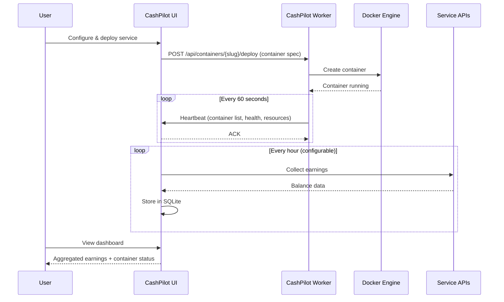

# كيف يعمل { #how-it-works }

يستخدم CashPilot بنية مقسّمة إلى **واجهة + عامل**. لا تتعامل الواجهة مع Docker أبدًا -- فكل عمليات الحاويات تمر عبر العمّال. هذا الفصل مبدأ أساسي في التصميم، وهو ما يتيح إدارة أسطول متعدد الخوادم.

## المكوّنات { #components }

| المكوّن | صورة الحاوية | المنفذ | الوصول إلى Docker | الغرض |
|-----------|-------|:----:|:-------------:|---------|
| **CashPilot UI** | `drumsergio/cashpilot` | 8080 | لا | لوحة التحكم على الويب، وجمع الأرباح، وكتالوج الخدمات، وتخزين بيانات الاعتماد، والجدولة |
| **CashPilot Worker** | `drumsergio/cashpilot-worker` | 8081 | عبر `cashpilot-socket-proxy` | دورة حياة حاويات Docker، والإبلاغ عن السلامة، ونبضات الاتصال إلى الواجهة |

لا يوجد **أي وضع مستقل**. كل خادم يشغّل حاويات Docker يحتاج إلى عامل. الواجهة مجرد لوحة تحكم وأداة جدولة -- يمكن أن تعمل على أي جهاز، بما في ذلك جهاز بلا Docker.

## مبادئ التصميم { #design-principles }

1. **فصل المسؤوليات.** تتولى الواجهة: لوحة التحكم، وجمع الأرباح، والجدولة، والتحقق من هوية المستخدمين. ويتولى العمّال: دورة حياة حاويات Docker، والإبلاغ عن السلامة. ولا تتداخل هذه المهام أبدًا.
2. **يحتاج العمّال إلى Docker، عبر وكيل المقبس.** العامل الذي لا يصل إلى Docker لا فائدة منه. ومع ملفات compose المرفقة لا يحصل أبدًا على المقبس الخام: بل يصل إلى Docker عبر `cashpilot-socket-proxy`. أما إدراجات Unraid وTrueNAS فلا تزال تركّب المقبس الخام ([متاجر التطبيقات](app-stores.md)). إذا لم تكن بحاجة إلى إدارة Docker، فشغّل الواجهة وحدها لتتبّع الأرباح.
3. **مصدر واحد للحقيقة.** نسخة الواجهة هي الوحيدة التي تجمع الأرباح، وتخزّن البيانات التاريخية، وتقدّم لوحة التحكم. لا يجمع العمّال الأرباح أبدًا.
4. **لا تتكرر الأرباح أبدًا.** بما أن الواجهة وحدها هي التي تجمع، فلا يوجد خطر احتساب الحساب نفسه مرتين.
5. **العمّال توابع عديمة الحالة.** يعرف العامل الحاويات التي عليه إبقاؤها قيد التشغيل وعنوان URL الخاص بالواجهة الذي يبلّغه. ولا يحفظ إلا معرّفه ومفتاح الأسطول الخاص به في ملفات محلية (`.worker_id`، `.worker_key`؛ بلا قاعدة بيانات وبلا بيانات أرباح).
6. **ملفات YAML هي الحقيقة.** تعيش كل خدمة في `services/{category}/{slug}.yml`. وتُشتق منها الواجهة والنشر والوثائق وتصدير compose.

## بنية المجلدات { #directory-structure }

```
cashpilot/
  app/                      # FastAPI application
    main.py                 # App entrypoint, lifespan, container/fleet/earnings routes
    deps.py                 # Shared auth guards + Jinja2 template environment
    routers/                # Route groups split out of main.py: auth, pages, users
    catalog.py              # Loads YAML service definitions, caches, SIGHUP reload
    orchestrator.py         # Docker SDK: deploy, stop, restart, remove, logs
    database.py             # Async SQLite: earnings, config, deployments, users, workers
    worker_api.py           # Worker REST API: heartbeat, container commands, mini-UI
    setup_token.py          # First-run setup-token gate (owner-account creation)
    metrics.py              # Optional Prometheus metrics (/metrics)
    exchange_rates.py       # Crypto/fiat conversion via CoinGecko + Frankfurter
    collectors/             # Earnings collectors (one module per service, UI only)
      base.py               # BaseCollector ABC + EarningsResult dataclass
      honeygain.py          # Example: JWT auth + balance endpoint
      __init__.py           # COLLECTOR_MAP registry + make_collectors() factory
    templates/              # Jinja2: dashboard, fleet, catalog, setup wizard, payouts, settings
    static/
      css/style.css         # Classic night by default, plus dark, light, sunrise and warm
      js/app.js             # Vanilla JS, CP namespace, Chart.js, wizard state machine
  services/                 # YAML service definitions (SINGLE SOURCE OF TRUTH)
    _schema.yml             # Schema documentation
    bandwidth/              # Bandwidth sharing services
    depin/                  # DePIN services
    storage/                # Storage sharing services
    compute/                # GPU compute services
    mining/                 # Mining services
  docs/                     # Documentation and guides
    guides/                 # Per-service setup guides
  Dockerfile                # UI image: multi-stage python:3.15-alpine, su-exec, non-root
  Dockerfile.worker         # Worker image: minimal deps, no collectors/templates
  docker-compose.yml        # Single-server deployment
  docker-compose.fleet.yml  # Multi-server fleet deployment
```

## تدفق البيانات { #data-flow }



### نبضة الاتصال (من العامل إلى الواجهة) { #heartbeat-worker-to-ui }

كل 60 ثانية، يرسل كل عامل:

- قائمة الحاويات مع حالتها (تعمل، متوقفة، خرجت)
- استهلاك الموارد لكل حاوية (نسبة CPU، والذاكرة بالـ MB)
- معلومات النظام (نظام التشغيل، والمعمارية، واسم المضيف، وتوفر Docker)
- عنوان URL الذي يبلّغ به عن نفسه (`CASHPILOT_WORKER_URL` صريح أو بديل يُكتشف تلقائيًا)

تخزّن الواجهة ذلك في قاعدة بيانات SQLite الخاصة بها وتعرضه في صفحة **Fleet** (الأسطول).

### الأوامر (من الواجهة إلى العامل) { #commands-ui-to-worker }

تستطيع الواجهة أن تطلب من أي عامل أن:

- **ينشر** حاوية خدمة (المواصفات الكاملة: صورة الحاوية، ومتغيرات البيئة، ووحدات التخزين، والمنافذ)
- **يوقف** حاوية، أو **يشغّلها**، أو **يعيد تشغيلها**، أو **يزيلها**
- **يجلب السجلات** من حاوية

تُرسل الأوامر عبر استدعاءات REST API من الواجهة إلى العامل.

### تدفق بيانات الاعتماد { #credential-flow }

العامل **لا يتعامل مع بيانات الاعتماد ولا يخزّنها أبدًا**:

1. يضبط المستخدم بيانات اعتماد الخدمة في الواجهة (تُخزَّن مشفّرة في SQLite).
2. عند النشر، ترسل الواجهة مواصفات الحاوية الكاملة (بما فيها متغيرات البيئة) إلى العامل.
3. يمرّر العامل المواصفات إلى Docker API. ويخزّن Docker متغيرات البيئة في إعدادات الحاوية.
4. لإعادة التشغيل: يحافظ `docker restart` على متغيرات البيئة تلقائيًا.
5. لإعادة النشر الكاملة (إزالة + إنشاء): تعيد الواجهة إرسال المواصفات الكاملة.

### جمع الأرباح { #earnings-collection }

تشغّل الواجهة مُجمِّعات مجدولة لكل خدمة مضبوطة:

- **المُجمِّعات المؤتمتة** تجلب الأرصدة عبر واجهات API الخاصة بالخدمات (تحقق JWT، أو تحقق بملفات تعريف الارتباط، أو مفاتيح API) للمزوّدين الذين لديهم واجهة كهذه
- تُخزَّن النتائج في SQLite بالعملة الأصلية (USD، MYST، GRASS، STORJ، إلخ)
- تُجلب أسعار الصرف من CoinGecko (للعملات المشفّرة) وFrankfurter (للعملات الورقية)، وتُخزَّن مؤقتًا 15 دقيقة
- تخزّن كل قراءة سعر USD في اليوم الذي أُخذت فيه. أما قراءة العملة المشفّرة المخزّنة بدونه (الأقدم من عمود السعر) فتحصل على سعر يومها من السجل اليومي لـ CoinGecko، عند بدء التشغيل ومرة يوميًا؛ ويبقى اليوم الذي لا سعر له بلا تسعير
- تحوّل لوحة التحكم المبالغ وتعرضها بالعملة المفضّلة لدى المستخدم

## التقنيات المستخدمة { #tech-stack }

| التقنية | الغرض |
|---|---|
| FastAPI | إطار العمل الخلفي (Python 3.15، غير متزامن) |
| Jinja2 | قوالب HTML تُعرض على الخادم |
| SQLite | قاعدة البيانات (aiosqlite، بلا إعداد، مخزّنة في `/data`) |
| Docker SDK for Python | إدارة دورة حياة الحاويات عبر المقبس |
| PyYAML | تحليل تعريفات الخدمات |
| APScheduler | الجمع الدوري للأرباح |
| httpx | عميل HTTP غير متزامن لمُجمِّعات الأرباح |
| cryptography (Fernet) | تشفير بيانات الاعتماد المخزّنة في حالة السكون |
| Chart.js | مخططات الأرباح في الواجهة الأمامية |
| su-exec | يتخلى عن صلاحيات root لصالح المستخدم `cashpilot` بعد إعداد نقطة الدخول (Dockerfile) |

## قاعدة البيانات { #database }

SQLite مع الاحتفاظ بالبيانات 400 يوم. الجداول الرئيسية:

- **earnings** -- الأرباح التاريخية لكل خدمة (الطابع الزمني، والمعرّف المختصر slug، والرصيد، والعملة)
- **deployments** -- عمليات نشر الحاويات النشطة (slug، ومعرّف الحاوية، ومتغيرات البيئة المشفّرة، والحالة)
- **config** -- إعدادات بصيغة مفتاح-قيمة وبيانات اعتماد مشفّرة
- **users** -- الحسابات (اسم المستخدم، وتجزئة كلمة المرور بـ bcrypt، والدور)
- **user_preferences** -- حالة الإعداد الأولي لكل مستخدم (وضع الإعداد، والفئات المختارة، والمنطقة الزمنية)
- **health_events** -- سجل سلامة الحاويات (start، stop، crash، check_ok، check_down)
- **workers** -- سجل عمّال الأسطول (معرّف العميل، والاسم، وعنوان URL، والحالة، وآخر نبضة اتصال، ومفتاح الأسطول المشفّر لكل عامل)

## نموذج الأمان { #security-model }

- كل بيانات الاعتماد مشفّرة في حالة السكون باستخدام تشفير Fernet المتماثل
- التحقق من هوية العامل لدى الواجهة عبر مفاتيح أسطول لكل عامل (`CASHPILOT_API_KEY` ليس إلا بيانات اعتماد التسجيل الأولي)
- تعمل الحاويات المُدارة مع `--security-opt no-new-privileges`
- اصطلاح تسمية الحاويات: `cashpilot-{slug}` مع التسميات `cashpilot.managed=true`
- حاوية الواجهة **لا** تصل إلى مقبس Docker
- تحقق من الهوية قائم على الجلسات مع نظام أدوار (المالك/المحرر/المشاهد)
