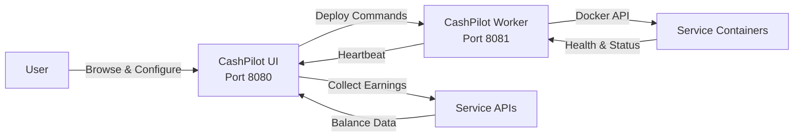

# Erste Schritte { #getting-started }

## Voraussetzungen { #prerequisites }

- **Docker** mit dem **Compose-v2-Plugin, Version 2.23.1 oder neuer**. Prüfe das
  mit `docker compose version`. Ältere Versionen können die Inline-Konfiguration
  in der Compose-Datei nicht lesen. Docker Desktop enthält das Plugin. Bei einer reinen
  Docker Engine unter Linux installierst du es aus dem Paket-Repository von Docker
  (<https://docs.docker.com/compose/install/linux/>). Unter macOS mit Colima
  installierst du es mit Homebrew und verlinkst es als Docker-Plugin:

    ```sh
    brew install docker-compose
    mkdir -p ~/.docker/cli-plugins
    ln -sfn "$(brew --prefix)/opt/docker-compose/bin/docker-compose" ~/.docker/cli-plugins/docker-compose
    ```

- Ein Host mit Linux, macOS oder Windows (amd64 oder arm64)
- Mindestens 1 GB freier RAM für CashPilot und die verwalteten Dienste
- **Ein CashPilot pro Docker-Host.** Siehe die Warnung unten.

!!! warning "Ein CashPilot pro Docker-Host"
    Betreibe nicht zwei CashPilot-Installationen auf einem Docker-Host. Die Compose-Dateien
    verwenden feste Container-Namen (`cashpilot-ui`, `cashpilot-worker`,
    `cashpilot-socket-proxy`), daher scheitert eine zweite Kopie der Datei an einem
    Namenskonflikt. Benennst du sie um, um daran vorbeizukommen, teilen sich die beiden
    Installationen trotzdem den Host. Jeder Worker verwaltet jeden Container, der die
    Labels von CashPilot trägt, egal welche Installation ihn erstellt hat. Jedes Dashboard
    listet, stoppt und ersetzt also die Verdienst-Apps des anderen. Die beiden teilen sich
    außerdem das Netzwerk `cashpilot-isolated`, die Namen der Verdienst-Apps (`cashpilot-<service>`),
    ihre Host-Ports und Volumes wie `mysterium-data`. Für eine zweite
    Installation nimm einen anderen Host oder eine VM. Um Verdienst-Apps auf weiteren Servern
    laufen zu lassen, füge stattdessen einem Dashboard weitere Worker hinzu ([Flotte](fleet.md)).

## Schnellstart { #quick-start }

### 1. Compose-Datei holen und starten { #1-fetch-the-compose-file-and-launch }

```bash
curl -fsSLO https://raw.githubusercontent.com/GeiserX/CashPilot/main/docker-compose.yml
docker compose up -d
```

Das startet drei dauerhaft laufende Container. Vor ihnen läuft bei jedem `up` ein einmaliger
`cashpilot-migrate` und beendet sich mit Code 0, daher zeigt
`docker compose ps -a` ihn als `Exited (0)`. Das ist normal.

| Container | Port | Zweck |
|-----------|------|---------|
| **cashpilot-migrate** | keiner | Läuft einmal und beendet sich. Er verschiebt Daten, die ein älteres Release angelegt hat, auf Volumes, die der Socket-Proxy akzeptiert, und findet bei einer neuen Installation nichts zu tun |
| **cashpilot-ui** | 8080 | Web-Dashboard, Erfassung der Einnahmen, Dienstkatalog |
| **cashpilot-worker** | 8081 | Docker-Agent, der die Container der Dienste bereitstellt und überwacht |
| **cashpilot-socket-proxy** | keiner | Hält den Docker-Socket schreibgeschützt und gibt dem Worker eine gefilterte Kopie ([Sicherheitsvoreinstellungen](security-defaults.md)) |

### 2. Dashboard öffnen { #2-open-the-dashboard }

Öffne [http://localhost:8080](http://localhost:8080) in deinem Browser. Da noch kein Konto existiert, landest du auf der Willkommensseite, die das Eigentümerkonto anlegt.

!!! tip "Port 8080 schon belegt?"
    Wähle in einer `.env`-Datei neben `docker-compose.yml` einen anderen Host-Port,
    statt die Compose-Datei zu bearbeiten:

    ```bash
    printf '\nCASHPILOT_UI_PORT=8088\n' >> .env
    docker compose up -d
    ```

    Öffne dann http://localhost:8088. Lass den Wert in `.env` stehen, denn das
    In-App-Update liest diese Datei und nicht deine Shell. (`printf` beginnt mit einem
    Zeilenumbruch, damit die Zeile nie an die letzte Zeile einer vorhandenen `.env` angehängt wird.)

    Die Variable braucht eine `docker-compose.yml`, deren `ports:`-Zeile
    `${CASHPILOT_UI_PORT:-8080}:8080` lautet. Die Datei aus v1.61 und älter legt
    `8080:8080` fest und ignoriert sie. Lade die aktuelle Datei herunter oder
    behalte deine eigene bearbeitete Port-Zuordnung: Das In-App-Update akzeptiert auch diese.

!!! warning "Setup-Token für den ersten Start nötig"
    Beim ersten Start erzeugt CashPilot ein einmaliges Setup-Token und schreibt es in die Logs des Containers **cashpilot-ui**:

    ```bash
    docker compose logs cashpilot-ui
    ```

    Suche nach einer Zeile wie dieser:

    ```
    FIRST-RUN SETUP: no account exists yet. Open /register and enter this
    one-time setup token to create the owner account: <token>
    ```

    Kopiere dieses Token in das Feld **Setup token** (Setup-Token) im Schritt **Owner account** (Eigentümerkonto) der Willkommensseite, zusammen mit einem Benutzernamen und einem Passwort, um das erste Konto (das Eigentümerkonto) anzulegen. Es erscheint nur in den Logs, nie in einer URL, und wird endgültig verworfen, sobald das Eigentümerkonto existiert.

### 3. Dienstkatalog durchsehen { #3-browse-the-service-catalog }

Die Seite **Catalog** (Katalog) listet jeden Dienst mit seinen Plattformen, einer monatlichen Schätzung und dem, was er braucht (Residential-IP, GPU). Filtere nach Kategorie (Bandwidth, DePIN, Storage, Compute, Mining) oder suche nach Namen. **Add** (Hinzufügen) öffnet den Einrichtungsassistenten für diesen Dienst, **Details** (Details) zeigt seine Beschreibung, seine Auszahlungen und das Risiko der Bereitstellung, und Dienste, die nicht in Docker laufen, bekommen stattdessen einen Link **Visit** (Besuchen).

Zwei Arten von Diensten solltest du dir vorher genauer ansehen: Dienste, die erst zahlen, wenn du einen Token-Stake hinterlegst, etwa Anyone Protocol, Sia und Flux, und Relays, die deine IP veröffentlichen, was die Zahlungen von Bandbreiten-Apps für Residential-IPs senken kann. Siehe [Zwei Dinge vor dem Bereitstellen prüfen](guides/index.md).

### 4. Dienste mit dem Assistenten hinzufügen { #4-add-services-with-the-wizard }

Sobald das Eigentümerkonto existiert, öffnet **Add services** (Dienste hinzufügen) den Einrichtungsassistenten; später öffnet ihn die Schaltfläche **+ Add service** (+ Dienst hinzufügen) in der oberen Leiste erneut. Wähle Kategorien, dann Dienste. Für jeden Dienst zeigt der Assistent einen Link **Sign Up** (Registrieren), fragt nur die Zugangsdaten ab, die dieser Dienst braucht (E-Mail und Passwort, API-Token und so weiter), und lässt dich die Worker wählen, auf denen er laufen soll. Klicke auf **Deploy** (Bereitstellen), und CashPilot lädt das Image, erstellt den Container und beginnt, ihn zu überwachen.

### 5. Auf dem Dashboard verfolgen { #5-watch-it-on-the-dashboard }

Das Dashboard zeigt jeden bereitgestellten Dienst mit seinem Status und Guthaben, und die Seite **Fleet** (Flotte) zeigt jeden Worker.

## So funktioniert es { #how-it-works }



1. **Du konfigurierst** Dienste über die Web-UI: Dienst wählen, Zugangsdaten eingeben, bereitstellen.
2. **Die UI sendet** die Container-Spezifikation (Image, Umgebungsvariablen, Volumes) per REST-API an den Worker.
3. **Der Worker erstellt** den Docker-Container und beginnt, seinen Zustand zu überwachen.
4. **Der Worker meldet** den Container-Status alle 60 Sekunden per Lebenszeichen an die UI zurück.
5. **Die UI erfasst** die Einnahmen aus den APIs der Dienste nach einem einstellbaren Zeitplan (Standard: jede Stunde).
6. **Das Dashboard** zeigt zusammengefasste Einnahmen, Aufschlüsselungen pro Dienst und den Zustand der Container.

## Konfiguration { #configuration }

### Umgebungsvariablen der UI { #ui-environment-variables }

| Variable | Standard | Beschreibung |
|----------|---------|-------------|
| `TZ` | `UTC` | Zeitzone für Zeitplanung und Anzeige |
| `CASHPILOT_SECRET_KEY` | *(automatisch erzeugt)* | Signaturschlüssel für Anmeldesitzungen. Gespeichert unter `/data/.secret_key`. **Verschlüsselt keine Zugangsdaten** |
| `CASHPILOT_ENCRYPTION_KEY` | *(automatisch erzeugt)* | Fernet-Schlüssel, der gespeicherte Zugangsdaten im Ruhezustand verschlüsselt. Gespeichert unter `/data/.fernet_key`. Wird nur übernommen, wenn diese Datei fehlt, setze ihn also nur, um eine Sicherung wiederherzustellen |
| `CASHPILOT_API_KEY` | *(aus `/fleet`)* | Gemeinsamer Aufnahmeschlüssel für Worker. Jeder Worker bekommt bei der Aufnahme seinen eigenen Schlüssel; siehe [Flotte](fleet.md) |
| `CASHPILOT_COLLECT_INTERVAL` | `60` | Minuten zwischen zwei Erfassungsläufen der Einnahmen |
| `CASHPILOT_UI_PORT` | `8080` | Host-Port, auf dem die UI veröffentlicht wird. Setze ihn in `.env`, wenn 8080 belegt ist |
| `CASHPILOT_BIND_ADDR` | `127.0.0.1` | Host-Schnittstelle, auf der der UI-Port veröffentlicht wird. **Standardmäßig Loopback**: Das Dashboard kann dem Worker mit Docker-Socket Befehle geben, daher ist es ab Werk nicht in deinem Netzwerk erreichbar. Setze eine bestimmte IP (z. B. eine Tailscale- oder VPN-Adresse) oder `0.0.0.0`, um es freizugeben, oder (besser) betreibe davor einen Reverse Proxy mit Authentifizierung |

Der Web-Port der UI im Container ist fest auf `8080` eingestellt (über das `CMD` des Containers). `CASHPILOT_UI_PORT` und `CASHPILOT_BIND_ADDR` bestimmen nur den Host-Port und die Schnittstelle, auf denen er veröffentlicht wird.

### Umgebungsvariablen des Workers { #worker-environment-variables }

| Variable | Standard | Beschreibung |
|----------|---------|-------------|
| `TZ` | `UTC` | Zeitzone |
| `CASHPILOT_UI_URL` | -- | URL des UI-Containers, z. B. `http://cashpilot-ui:8080` |
| `CASHPILOT_API_KEY` | -- | Muss dem Aufnahmeschlüssel der UI entsprechen. Nur für die Aufnahme nötig; danach verwendet der Worker seinen eigenen Schlüssel |
| `CASHPILOT_WORKER_NAME` | *(Hostname)* | Anzeigename dieses Workers im Flotten-Dashboard |
| `CASHPILOT_WORKER_URL` | *(automatisch erkannt)* | URL, über die die UI diesen Worker erreicht, z. B. `http://192.168.1.50:8081`. Setze sie bei Flotten über mehrere Hosts ausdrücklich: Die automatische Erkennung kann eine nicht erreichbare, container-interne IP melden |
| `CASHPILOT_WORKER_BIND_ADDR` | `127.0.0.1` | **Nur Compose für Flotten und entfernte Worker** (`docker-compose.fleet.yml`): Host-Schnittstelle, auf der der API-Port des Workers mit Docker-Socket veröffentlicht wird, standardmäßig Loopback. Die Standard-`docker-compose.yml` veröffentlicht Port 8081 überhaupt nicht. Die Worker-API kann jeden Container bereitstellen und stoppen (= root auf dem Host), binde also bei einem entfernten Worker eine private oder VPN-Schnittstelle (z. B. eine Tailscale-IP), **niemals** eine öffentliche IP |
| `CASHPILOT_PORT` | `8081` | Port, den der Worker der UI **mitteilt**. Er ändert *nicht* den Port, auf dem der Worker lauscht; der ist durch das `CMD` des Images festgelegt; siehe die [Konfigurationsreferenz](configuration.md) |

### Docker-Compose-Beispiel { #docker-compose-example }

```yaml
--8<-- "docker-compose.yml"
```

!!! note "Das ist die echte Datei"

    Der Block oben wird unverändert aus `docker-compose.yml` im
    Repository eingebunden, daher kann er nicht von dem abweichen, was wirklich ausgeliefert wird. Früher
    hat eine von Hand kopierte Version davon die Docker-Socket-API des Workers auf jeder
    Schnittstelle veröffentlicht und `:latest` festgelegt; von beidem rät die Seite
    [Sicherheitsvoreinstellungen](security-defaults.md) ab.

!!! warning "Zugriff auf den Docker-Socket"
    Der Worker verwaltet die Container der Dienste über Docker, bindet aber `/var/run/docker.sock` nicht ein. Der Container `cashpilot-socket-proxy` hält den Socket und reicht dem Worker nur die Aufrufe durch, die er macht; privilegierte Container und Bind-Mounts von Host-Ordnern, die du nicht aufgelistet hast, lehnt er ab ([was er ablehnt](security-defaults.md#docker-socket-proxy)). Das In-App-Update ist Opt-in: Es läuft nur mit `CASHPILOT_COMPOSE_DIR=<this folder>` in der `.env` neben der Compose-Datei, und diese Einstellung erlaubt Containern, den Ordner einzubinden, was den Proxy schwächt ([was das kostet](security-defaults.md#docker-socket-proxy)). Lass sie leer und aktualisiere mit `docker compose pull && docker compose up -d`. Der Worker steuert trotzdem jeden Container auf dem Host, betreibe CashPilot also für die beste Sicherheit auf einem eigenen Rechner oder in einem eigenen VLAN.

!!! tip "Den geheimen Schlüssel aufbewahren"
    Zugangsdaten werden mit `CASHPILOT_ENCRYPTION_KEY` verschlüsselt, **nicht** mit `CASHPILOT_SECRET_KEY`, der nur Anmeldesitzungen signiert. Der Verschlüsselungsschlüssel wird beim ersten Start automatisch erzeugt und unter `/data/.fernet_key` gespeichert. **Sichere diese Datei.** Wird das Volume ohne sie neu erstellt, entsteht ein neuer Schlüssel, und alle gespeicherten Zugangsdaten werden dauerhaft unlesbar. `CASHPILOT_ENCRYPTION_KEY` dient dazu, diese Sicherung wiederherzustellen; die Schlüsseldatei hat immer Vorrang, daher ändert das Setzen bei einer intakten Instanz nichts.

!!! tip "Passwörter und Geheimnisse in der UI"
    Ändere dein eigenes Passwort jederzeit über das Avatar-Menü -> **Change password** (Passwort ändern) (für alle Rollen verfügbar); das meldet deine anderen Sitzungen ab. In **Settings** (Einstellungen) sind gespeicherte Geheimnisse nur beschreibbar: Gib einen Wert ein, um ihn zu ändern, oder lass das Feld leer, um den vorhandenen zu behalten. Gespeicherte Zugangsdaten werden nie an den Browser zurückgeschickt.

## CashPilot aktualisieren { #updating-cashpilot }

Die Compose-Datei legt eine Major.Minor-Reihe fest, etwa `drumsergio/cashpilot:X.Y`, daher holt `pull` den neuesten Patch dieser Reihe:

```bash
docker compose pull
docker compose up -d
```

`docker compose pull` holt das neueste veröffentlichte Image, und `up -d` erstellt
nur die Container neu, deren Image sich geändert hat. Die mitgelieferten Compose-Dateien setzen
`pull_policy: always`, daher lädt selbst ein bloßes `docker compose up -d` zuerst
das neueste Image.

**Aus dem Dashboard.** **Settings** (Einstellungen), **About and updates** (Info und Updates) führt dieselben zwei
Befehle für dich in einem kurzlebigen Hilfscontainer aus. Der Hilfscontainer liest deine
Compose-Dateien und die `.env` daneben (oder die Dateien, die du mit
`--env-file` übergeben hast), nie die Shell, aus der du CashPilot gestartet hast. Angenommen, du hast es mit `CASHPILOT_UI_PORT=8088 docker compose up -d` gestartet.
Das Update würde das Dashboard zurück auf 8080 setzen, deshalb hält es an und sagt dir stattdessen,
warum. Trag den Wert in `.env` ein, dann funktioniert die Schaltfläche.

!!! note "Du musst **nicht** neu bauen"
    CashPilot liefert fertig gebaute Multi-Arch-Images auf Docker Hub aus
    ([`drumsergio/cashpilot`](https://hub.docker.com/r/drumsergio/cashpilot),
    [`drumsergio/cashpilot-worker`](https://hub.docker.com/r/drumsergio/cashpilot-worker)).
    `docker compose build` / `--build` ist nur relevant, wenn du absichtlich
    mit `docker-compose.build.yml` aus dem Quellcode baust. Bei normalen Installationen
    ist `pull` + `up -d` der vollständige und richtige Ablauf für ein Update.

### Eine bestimmte Version festlegen { #pinning-a-specific-version }

Um auf genau einem Release zu bleiben, ersetze in `docker-compose.yml` das Reihen-Tag `X.Y`
durch ein vollständiges Release-Tag `X.Y.Z`, sowohl bei
`drumsergio/cashpilot` als auch bei `drumsergio/cashpilot-worker` (immer dasselbe Tag bei
beiden), und entferne `pull_policy: always`. Die Tags findest du auf
[Docker Hub](https://hub.docker.com/r/drumsergio/cashpilot/tags).

Um zu einer neueren Reihe zu wechseln, ändere beide Tags: zuerst auf dem UI-Host, dann auf
jedem Worker-Host. Lies vorher
[UPGRADING.md](https://github.com/GeiserX/CashPilot/blob/main/UPGRADING.md),
denn ein Major-Release wie 3.0 hat eigene Schritte.

### Updates automatisieren (optional) { #automating-updates-optional }

Wenn du Updates ohne Handarbeit willst, lass einen Scheduler dieselben zwei Befehle ausführen,
zum Beispiel mit einem täglichen Cron-Eintrag:

```cron
0 4 * * *  cd /path/to/cashpilot && docker compose pull && docker compose up -d
```

Oder lass einen Auto-Updater wie [Watchtower](https://containrrr.dev/watchtower/)
oder [Diun](https://crazymax.dev/diun/) auf die CashPilot-Container los. Das ist
optional. CashPilot bringt keinen eigenen Updater mit.

### Alte Images aufräumen { #cleaning-up-old-images }

CashPilot lädt Images, löscht sie aber nie. Jedes Update und jede Neubereitstellung
kann das vorherige Image auf der Festplatte zurücklassen. Auf einer Testflotte mit drei Servern
kamen die alten Images von CashPilot und den Verdienst-Apps zusammen auf etwa 3 GB. Das ist wenig
im Vergleich zu dem, was andere Programme auf demselben Host meist zurücklassen, schau dir also
den ganzen Host an:

```bash
docker system df
```

Der Wert `RECLAIMABLE` in der Zeile `Images` ist das, was Docker freigeben könnte.

**Warum CashPilot das nicht für dich erledigt.** Der Worker erreicht Docker über
den Socket-Proxy. Bei Images lässt der Proxy ihn eines laden und eines anhand des Namens lesen,
sonst nichts. Er kann die Images des Hosts weder auflisten noch eines löschen. Ein Worker, der das
könnte, würde auch die Images jedes anderen Programms auf dem Host sehen und löschen.
Siehe [was der Proxy ablehnt](security-defaults.md#docker-socket-proxy).

**Schritt 1: Dangling Images entfernen.** Ein Dangling Image hat kein Tag, und kein
Container verwendet es, weder laufend noch gestoppt. Ein Update über ein bewegliches Tag wie
`X.Y` (eine Reihe wie die, die die Compose-Dateien festlegen), `latest` oder einen Digest hinterlässt genau diese:

```bash
docker image prune
```

Das löscht auch das Image, das du vor einem Update über ein bewegliches Tag verwendet hast: Sobald
das neue Image dieser Reihe da ist, hat das alte kein Tag mehr. Um einen Weg zurück zu behalten, notiere
vor dem Update die genaue Version (unten in der Seitenleiste steht sie), damit
du `drumsergio/cashpilot:<X.Y.Z>` erneut laden kannst. Oder lege die Compose-Datei auf
ein genaues Tag `X.Y.Z` fest; dann behält das alte Image sein Tag, und Schritt 2 gilt.

Docker fragt nach, bevor es löscht. In einem Cron-Eintrag fügst du `--force` hinzu, um die
Frage zu überspringen. Sonst ändert es nichts:

```cron
30 4 * * 0  docker image prune --force
```

!!! warning "Füge kein `-a` hinzu"
    `docker image prune -a` löscht jedes Image, das gerade kein Container
    verwendet, ob dangling oder mit Tag. Dazu gehören Images von Stacks, die du absichtlich
    gestoppt hast, und Images, die du lokal gebaut hast und nicht erneut laden kannst.

**Schritt 2: Alte festgelegte Tags entfernen.** Ein auf eine Version festgelegtes Image behält sein Tag,
nachdem du zu einer neueren gewechselt hast, daher überspringt `prune` es. Diese CashPilot-Images sind
festgelegt:

| Repository | Was es festlegt |
|---|---|
| `drumsergio/cashpilot` | Die Compose-Datei (eine alte Reihe oder eine genaue Version, die du festgelegt hast) |
| `drumsergio/cashpilot-worker` | Die Compose-Datei, wie oben |
| `drumsergio/cashpilot-tunnel` | Der Worker, ein Tag pro Worker-Version |
| `drumsergio/cashpilot-earnapp` | Der Katalogeintrag von EarnApp |
| `drumsergio/cashpilot-anyone` | Der Katalogeintrag von Anyone Protocol |

Dasselbe gilt für das Image eines Dienstes, den du entfernt hast: Sein Tag bleibt, bis du
es entfernst. Ein Katalog-Image, das per Digest festgelegt ist, etwa bei MystNodes oder ProxyBase,
verliert sein Tag, wenn ein neueres es ersetzt, daher deckt Schritt 1 es bereits ab.

Liste zuerst die Tags auf, die kein Container verwendet. Dieses Beispiel gilt für das Worker-Image.
Für ein anderes Repository aus der Tabelle änderst du `repo`:

```bash
repo=drumsergio/cashpilot-worker
used=$(docker ps -a --format '{{.Image}}')
docker image ls "$repo" --format '{{.Repository}}:{{.Tag}}' | grep -vxF "$used"
```

Entferne dann jedes alte Tag einzeln anhand seines Namens:

```bash
docker image rm drumsergio/cashpilot-worker:<old tag>
```

Füge kein `-f` hinzu. Ohne diese Option weigert sich Docker, ein Image zu entfernen, das ein
Container noch verwendet, laufend oder gestoppt, und gibt
`conflict: unable to delete` aus. Wenn du das siehst, behalte das Image. Behalte das Tag,
das du verwendest, und das Tag davor, damit du immer noch eine Version zurückgehen kannst.
Entferne nur Tags, die älter als diese beiden sind.

Die Spalte **Host disk** (Host-Speicher) im Dashboard zeigt den freien Platz auf dem Dateisystem, das
das `/data` des Workers enthält. Images liegen meist auf demselben Dateisystem, unter
dem Datenverzeichnis von Docker, aber nicht immer. `docker info --format '{{.DockerRootDir}}'`
zeigt das Datenverzeichnis von Docker. Mit dem containerd-Image-Store, dem Standard bei einer
neuen Installation von Docker Engine 29, liegen Images stattdessen unter dem Stammverzeichnis von containerd,
normalerweise `/var/lib/containerd`. `docker info --format '{{.Driver}}'` gibt
`overlayfs` für den containerd-Image-Store aus und `overlay2` für den klassischen.
Prüfe den freien Platz auf dem Dateisystem, das das zutreffende Verzeichnis enthält.

## Unterstützte Dienste { #supported-services }

CashPilot unterstützt **<!-- n:live -->50<!-- /n --> Dienste**, die aktiv oder in der Beta sind, in fünf Kategorien:

- **Bandbreite teilen** (<!-- n:bandwidth -->18<!-- /n -->): Teile deine Internet-Bandbreite für passives Einkommen
- **DePIN** (<!-- n:depin -->15<!-- /n -->): dezentrale physische Infrastrukturnetzwerke
- **GPU-Rechenleistung** (<!-- n:compute -->7<!-- /n -->): Vermiete deine GPU für KI- und Rechenaufgaben
- **Speicher** (<!-- n:storage -->2<!-- /n -->): Teile Festplattenplatz in dezentralen Speichernetzwerken
- **Mining** (<!-- n:mining -->8<!-- /n -->): Stelle einen Miner bereit oder verfolge einen Pool anhand der Auszahlungsadresse ([Mining](mining.md))

Davon lassen sich **<!-- n:docker -->21<!-- /n -->** automatisch über Docker bereitstellen und verwalten. Der Katalog führt die übrigen <!-- n:tracked -->29<!-- /n --> (<!-- n:extension -->18<!-- /n --> Browser- oder Desktop-Apps, <!-- n:gpu -->7<!-- /n --> GPU-Nodes, <!-- n:mining_pools -->4<!-- /n --> Mining-Pools). CashPilot liest ihr Guthaben, wo ein Collector existiert.

Den vollständigen Katalog findest du im Abschnitt [Dienst-Anleitungen](guides/index.md).

## Nächste Schritte { #next-steps }

- [So funktioniert es](how-it-works.md) -- Verstehe die Aufteilung in UI und Worker
- [Flottenverwaltung](fleet.md) -- Über mehrere Server bereitstellen
- [Dein Heimnetz schützen](home-network-security.md) -- Halte die Container aus deinem LAN fern, und wann gVisor hilft
- [Dienst-Anleitungen](guides/index.md) -- Ausführliche Einrichtungsanleitungen für jeden Dienst
- [CashPilot vollständig entfernen](uninstall.md) -- Entferne alles, was es angelegt hat, um neu anzufangen oder aufzuhören
