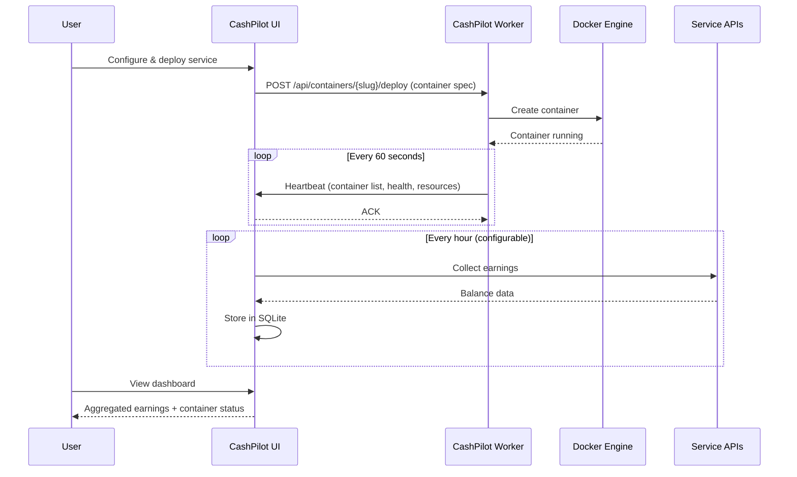

# So funktioniert es { #how-it-works }

CashPilot verwendet eine geteilte Architektur aus **UI + Worker**. Die UI berührt Docker nie -- alle Container-Operationen laufen über Worker. Diese Trennung ist ein Grundprinzip des Designs und ermöglicht die Verwaltung einer Flotte über mehrere Server.

## Komponenten { #components }

| Komponente | Image | Port | Docker-Zugriff | Zweck |
|-----------|-------|:----:|:-------------:|---------|
| **CashPilot UI** | `drumsergio/cashpilot` | 8080 | Nein | Web-Dashboard, Erfassung der Einnahmen, Dienstkatalog, Speicherung der Zugangsdaten, Zeitplanung |
| **CashPilot Worker** | `drumsergio/cashpilot-worker` | 8081 | Über `cashpilot-socket-proxy` | Lebenszyklus der Docker-Container, Zustandsmeldungen, Lebenszeichen an die UI |

Es gibt **keinen Standalone-Modus**. Jeder Server, auf dem Docker-Container laufen, braucht einen Worker. Die UI ist ein reines Dashboard mit Zeitplaner -- sie kann auf jedem Rechner laufen, auch auf einem ohne Docker.

## Designprinzipien { #design-principles }

1. **Trennung der Zuständigkeiten.** Die UI übernimmt: Dashboard, Erfassung der Einnahmen, Zeitplanung, Benutzeranmeldung. Worker übernehmen: Lebenszyklus der Docker-Container, Zustandsmeldungen. Sie überschneiden sich nie.
2. **Worker brauchen Docker, über den Socket-Proxy.** Ein Worker ohne Docker-Zugriff ist nutzlos. Mit den mitgelieferten Compose-Dateien bekommt er nie den rohen Socket: Er erreicht Docker über `cashpilot-socket-proxy`. Die Einträge für Unraid und TrueNAS binden weiterhin den rohen Socket ein ([App-Stores](app-stores.md)). Wenn du keine Docker-Verwaltung brauchst, betreibe einfach nur die UI, um Einnahmen zu verfolgen.
3. **Eine einzige Quelle der Wahrheit.** Die UI-Instanz ist die einzige, die Einnahmen erfasst, historische Daten speichert und das Dashboard ausliefert. Worker erfassen nie Einnahmen.
4. **Einnahmen werden nie doppelt gezählt.** Da nur die UI erfasst, besteht kein Risiko, dass dasselbe Konto zweimal gezählt wird.
5. **Worker sind zustandslose Satelliten.** Ein Worker weiß, welche Container er am Laufen halten soll, und kennt die URL der UI, an die er meldet. Er speichert nur seine eigene ID und seinen Flottenschlüssel in lokalen Dateien (`.worker_id`, `.worker_key`; keine Datenbank, keine Einnahmedaten).
6. **YAML ist die Wahrheit.** Jeder Dienst liegt in `services/{category}/{slug}.yml`. Die UI, die Bereitstellung, die Dokumentation und der Compose-Export leiten sich alle aus diesen Dateien ab.

## Verzeichnisstruktur { #directory-structure }

```
cashpilot/
  app/                      # FastAPI application
    main.py                 # App entrypoint, lifespan, container/fleet/earnings routes
    deps.py                 # Shared auth guards + Jinja2 template environment
    routers/                # Route groups split out of main.py: auth, pages, users
    catalog.py              # Loads YAML service definitions, caches, SIGHUP reload
    orchestrator.py         # Docker SDK: deploy, stop, restart, remove, logs
    database.py             # Async SQLite: earnings, config, deployments, users, workers
    worker_api.py           # Worker REST API: heartbeat, container commands, mini-UI
    setup_token.py          # First-run setup-token gate (owner-account creation)
    metrics.py              # Optional Prometheus metrics (/metrics)
    exchange_rates.py       # Crypto/fiat conversion via CoinGecko + Frankfurter
    collectors/             # Earnings collectors (one module per service, UI only)
      base.py               # BaseCollector ABC + EarningsResult dataclass
      honeygain.py          # Example: JWT auth + balance endpoint
      __init__.py           # COLLECTOR_MAP registry + make_collectors() factory
    templates/              # Jinja2: dashboard, fleet, catalog, setup wizard, payouts, settings
    static/
      css/style.css         # Classic night by default, plus dark, light, sunrise and warm
      js/app.js             # Vanilla JS, CP namespace, Chart.js, wizard state machine
  services/                 # YAML service definitions (SINGLE SOURCE OF TRUTH)
    _schema.yml             # Schema documentation
    bandwidth/              # Bandwidth sharing services
    depin/                  # DePIN services
    storage/                # Storage sharing services
    compute/                # GPU compute services
    mining/                 # Mining services
  docs/                     # Documentation and guides
    guides/                 # Per-service setup guides
  Dockerfile                # UI image: multi-stage python:3.15-alpine, su-exec, non-root
  Dockerfile.worker         # Worker image: minimal deps, no collectors/templates
  docker-compose.yml        # Single-server deployment
  docker-compose.fleet.yml  # Multi-server fleet deployment
```

## Datenfluss { #data-flow }



### Lebenszeichen (Worker an UI) { #heartbeat-worker-to-ui }

Alle 60 Sekunden sendet jeder Worker:

- Container-Liste mit Status (running, stopped, exited)
- Ressourcenverbrauch pro Container (CPU in Prozent, Speicher in MB)
- Systeminformationen (Betriebssystem, Architektur, Hostname, Verfügbarkeit von Docker)
- Seine selbst gemeldete URL (ausdrücklich `CASHPILOT_WORKER_URL` oder ein automatisch erkannter Ersatzwert)

Die UI speichert das in ihrer SQLite-Datenbank und zeigt es auf der Seite **Fleet** (Flotte) an.

### Befehle (UI an Worker) { #commands-ui-to-worker }

Die UI kann jeden Worker anweisen:

- einen Dienst-Container **bereitzustellen** (vollständige Spezifikation: Image, Umgebungsvariablen, Volumes, Ports)
- einen Container zu **stoppen**, zu **starten**, **neu zu starten** oder zu **entfernen**
- die **Protokolle** eines Containers **abzurufen**

Befehle werden als REST-API-Aufrufe von der UI an den Worker gesendet.

### Ablauf der Zugangsdaten { #credential-flow }

Der Worker **verarbeitet oder speichert nie Zugangsdaten**:

1. Der Benutzer konfiguriert die Zugangsdaten eines Dienstes in der UI (verschlüsselt in SQLite gespeichert).
2. Bei der Bereitstellung sendet die UI die vollständige Container-Spezifikation (einschließlich Umgebungsvariablen) an den Worker.
3. Der Worker reicht die Spezifikation an die Docker-API weiter. Docker speichert die Umgebungsvariablen in der Container-Konfiguration.
4. Bei Neustarts: `docker restart` behält die Umgebungsvariablen von sich aus.
5. Bei vollständigen Neubereitstellungen (entfernen + erstellen): Die UI sendet die vollständige Spezifikation erneut.

### Erfassung der Einnahmen { #earnings-collection }

Die UI führt für jeden konfigurierten Dienst geplante Collectors aus:

- **Automatische Collectors** holen Guthaben über die APIs der Dienste (JWT-Anmeldung, Cookie-Anmeldung, API-Schlüssel) bei den Anbietern, die eine solche API haben
- Ergebnisse werden in SQLite in der nativen Währung gespeichert (USD, MYST, GRASS, STORJ usw.)
- Wechselkurse kommen von CoinGecko (Krypto) und Frankfurter (Fiat) und werden 15 Minuten zwischengespeichert
- Jeder Messwert speichert den USD-Kurs des Tages, an dem er erfasst wurde. Ein Krypto-Messwert, der ohne Kurs gespeichert wurde (älter als die Kursspalte), bekommt beim Start und einmal täglich den Preis seines eigenen Tages aus der Tageshistorie von CoinGecko; ein Tag ohne Preis bleibt ohne Preis
- Das Dashboard rechnet um und zeigt alles in der bevorzugten Währung des Benutzers an

## Technologie-Stack { #tech-stack }

| Technologie | Zweck |
|---|---|
| FastAPI | Backend-Framework (Python 3.15, async) |
| Jinja2 | Serverseitig gerenderte HTML-Vorlagen |
| SQLite | Datenbank (aiosqlite, ohne Konfiguration, gespeichert in `/data`) |
| Docker SDK for Python | Verwaltung des Container-Lebenszyklus über den Socket |
| PyYAML | Einlesen der Dienstdefinitionen |
| APScheduler | Regelmäßige Erfassung der Einnahmen |
| httpx | Asynchroner HTTP-Client für die Collectors |
| cryptography (Fernet) | Verschlüsselung gespeicherter Zugangsdaten im Ruhezustand |
| Chart.js | Einnahmen-Diagramme im Frontend |
| su-exec | Wechselt nach der Einrichtung im Entrypoint von root zum Benutzer `cashpilot` (Dockerfile) |

## Datenbank { #database }

SQLite mit 400 Tagen Datenaufbewahrung. Wichtige Tabellen:

- **earnings** -- Historische Einnahmen pro Dienst (Zeitstempel, Slug, Guthaben, Währung)
- **deployments** -- Aktive Container-Bereitstellungen (Slug, Container-ID, verschlüsselte Umgebungsvariablen, Status)
- **config** -- Schlüssel-Wert-Einstellungen und verschlüsselte Zugangsdaten
- **users** -- Konten (Benutzername, bcrypt-Passwort-Hash, Rolle)
- **user_preferences** -- Onboarding-Zustand pro Benutzer (Einrichtungsmodus, gewählte Kategorien, Zeitzone)
- **health_events** -- Zustandsverlauf der Container (start, stop, crash, check_ok, check_down)
- **workers** -- Register der Worker in der Flotte (Client-ID, Name, URL, Status, letztes Lebenszeichen, verschlüsselter Flottenschlüssel pro Worker)

## Sicherheitsmodell { #security-model }

- Alle Zugangsdaten sind im Ruhezustand mit symmetrischer Fernet-Verschlüsselung verschlüsselt
- Anmeldung des Workers bei der UI über Flottenschlüssel pro Worker (`CASHPILOT_API_KEY` ist nur die Zugangsberechtigung für die Aufnahme)
- Verwaltete Container laufen mit `--security-opt no-new-privileges`
- Namenskonvention der Container: `cashpilot-{slug}` mit den Labels `cashpilot.managed=true`
- Der UI-Container hat **keinen** Zugriff auf den Docker-Socket
- Sitzungsbasierte Anmeldung mit Rollensystem (Eigentümer/Bearbeiter/Betrachter)
