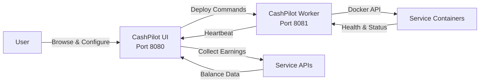

# Primeros pasos { #getting-started }

## Requisitos previos { #prerequisites }

- **Docker** con el **plugin Compose v2, versión 2.23.1 o posterior**. Compruébalo
  con `docker compose version`. Las versiones anteriores no pueden leer la configuración
  en línea del archivo compose. Docker Desktop incluye el plugin. En un Docker
  Engine sin más en Linux, instálalo desde el repositorio de paquetes de Docker
  (https://docs.docker.com/compose/install/linux/). En macOS con Colima,
  instálalo con Homebrew y enlázalo como plugin de Docker:

    ```sh
    brew install docker-compose
    mkdir -p ~/.docker/cli-plugins
    ln -sfn "$(brew --prefix)/opt/docker-compose/bin/docker-compose" ~/.docker/cli-plugins/docker-compose
    ```

- Un host Linux, macOS o Windows (amd64 o arm64)
- Al menos 1 GB de RAM libre para CashPilot y los servicios que gestiona
- **Un CashPilot por host de Docker.** Consulta la advertencia de abajo.

!!! warning "Un CashPilot por host de Docker"
    No ejecutes dos instalaciones de CashPilot en un mismo host de Docker. Los archivos compose
    usan nombres de contenedor fijos (`cashpilot-ui`, `cashpilot-worker`,
    `cashpilot-socket-proxy`), así que una segunda copia del archivo falla por un
    conflicto de nombres. Si los renombras para evitarlo, las dos instalaciones siguen
    compartiendo el host. Cada worker gestiona todos los contenedores que llevan
    las etiquetas de CashPilot, sea cual sea la instalación que los creó. Así, cada panel lista,
    detiene y sustituye las apps de ingresos de la otra. Las dos comparten además la
    red `cashpilot-isolated`, los nombres de las apps de ingresos (`cashpilot-<service>`),
    sus puertos del host y volúmenes como `mysterium-data`. Para una segunda
    instalación, usa otro host u otra VM. Para ejecutar apps de ingresos en más servidores, añade
    workers a un solo panel ([Flota](fleet.md)).

## Inicio rápido { #quick-start }

### 1. Descarga el archivo compose y arráncalo { #1-fetch-the-compose-file-and-launch }

```bash
curl -fsSLO https://raw.githubusercontent.com/GeiserX/CashPilot/main/docker-compose.yml
docker compose up -d
```

Esto arranca tres contenedores de larga duración. Antes que ellos, un contenedor de un solo uso,
`cashpilot-migrate`, se ejecuta y termina con código 0 en cada `up`, así que
`docker compose ps -a` lo muestra como `Exited (0)`. Es normal.

| Contenedor | Puerto | Función |
|-----------|------|---------|
| **cashpilot-migrate** | ninguno | Se ejecuta una vez y termina. Mueve los datos que dejó una versión anterior a volúmenes que el proxy del socket acepta, y en una instalación nueva no encuentra nada que hacer |
| **cashpilot-ui** | 8080 | Panel web, recolección de ganancias, catálogo de servicios |
| **cashpilot-worker** | 8081 | Agente de Docker que despliega y supervisa los contenedores de los servicios |
| **cashpilot-socket-proxy** | ninguno | Tiene el socket de Docker en solo lectura y da al worker una copia filtrada ([Valores de seguridad por defecto](security-defaults.md)) |

### 2. Abre el panel { #2-open-the-dashboard }

Abre [http://localhost:8080](http://localhost:8080) en tu navegador. Como aún no existe ninguna cuenta, llegas a la página de bienvenida, que crea la cuenta de propietario.

!!! tip "¿El puerto 8080 ya está en uso?"
    Elige otro puerto del host en un archivo `.env` junto a `docker-compose.yml`,
    en lugar de editar el archivo compose:

    ```bash
    printf '\nCASHPILOT_UI_PORT=8088\n' >> .env
    docker compose up -d
    ```

    Después abre http://localhost:8088. Mantén el valor en `.env`, porque la
    actualización desde la app lee ese archivo y no tu shell. (`printf` empieza con un
    salto de línea para que la línea nunca se una a la última de un `.env` existente).

    La variable necesita un `docker-compose.yml` cuya línea `ports:` diga
    `${CASHPILOT_UI_PORT:-8080}:8080`. El archivo de la v1.61 y anteriores fija
    `8080:8080` y la ignora. Descarga el archivo actual, o
    conserva tu propio mapeo de puertos editado: la actualización desde la app también lo acepta.

!!! warning "Se necesita un token de configuración inicial"
    En el primer arranque, CashPilot genera un token de configuración de un solo uso y lo escribe en los registros del contenedor **cashpilot-ui**:

    ```bash
    docker compose logs cashpilot-ui
    ```

    Busca una línea como esta:

    ```
    FIRST-RUN SETUP: no account exists yet. Open /register and enter this
    one-time setup token to create the owner account: <token>
    ```

    Copia ese token en el campo **Setup token** (token de configuración) del paso **Owner account** (cuenta de propietario) de la página de bienvenida, junto con un nombre de usuario y una contraseña, para crear la primera cuenta (la de propietario). Solo aparece en los registros, nunca en una URL, y se descarta para siempre en cuanto existe la cuenta de propietario.

### 3. Explora el catálogo de servicios { #3-browse-the-service-catalog }

La página **Catalog** (Catálogo) lista cada servicio con sus plataformas, una estimación mensual y lo que necesita (IP residencial, GPU). Filtra por categoría (Bandwidth, DePIN, Storage, Compute, Mining) o busca por nombre. **Add** (Añadir) abre el asistente de configuración en ese servicio, **Details** (Detalles) muestra su descripción, sus pagos y el riesgo del despliegue, y los servicios que no funcionan en Docker tienen en su lugar un enlace **Visit** (Visitar).

Hay dos tipos de servicio que conviene mirar antes con más atención: los que solo pagan después de que bloquees un stake de tokens, como Anyone Protocol, Sia y Flux, y los relays que publican tu IP, lo que puede reducir lo que te pagan las apps de ancho de banda residencial. Consulta [Comprueba dos cosas antes de desplegar](guides/index.md).

### 4. Añade servicios con el asistente { #4-add-services-with-the-wizard }

En cuanto existe la cuenta de propietario, **Add services** (Añadir servicios) abre el asistente de configuración; más adelante, el botón **+ Add service** (Añadir servicio) de la barra superior lo vuelve a abrir. Elige categorías y después servicios. Para cada servicio, el asistente muestra un enlace **Sign Up** (Registrarse), pide solo las credenciales que ese servicio necesita (correo y contraseña, token de API, etc.) y te deja elegir los workers donde ejecutarlo. Haz clic en **Deploy** (Desplegar) y CashPilot descarga la imagen, crea el contenedor y empieza a vigilarlo.

### 5. Síguelo en el panel { #5-watch-it-on-the-dashboard }

El panel muestra cada servicio desplegado con su estado y su saldo, y la página **Fleet** (Flota) muestra todos los workers.

## Cómo funciona { #how-it-works }



1. **Tú configuras** los servicios desde la interfaz web: eliges un servicio, introduces las credenciales y haces clic en desplegar.
2. **La UI envía** la especificación del contenedor (imagen, variables de entorno, volúmenes) al worker mediante una API REST.
3. **El worker crea** el contenedor de Docker y empieza a supervisar su salud.
4. **El worker informa** del estado del contenedor a la UI cada 60 segundos mediante señales de vida.
5. **La UI recoge** las ganancias de las API de los servicios según un horario configurable (por defecto, cada hora).
6. **El panel** muestra las ganancias agregadas, el desglose por servicio y la salud de los contenedores.

## Configuración { #configuration }

### Variables de entorno de la UI { #ui-environment-variables }

| Variable | Valor por defecto | Descripción |
|----------|---------|-------------|
| `TZ` | `UTC` | Zona horaria para la programación y la visualización |
| `CASHPILOT_SECRET_KEY` | *(generada automáticamente)* | Clave de firma de las sesiones de inicio de sesión. Se guarda en `/data/.secret_key`. **No cifra las credenciales** |
| `CASHPILOT_ENCRYPTION_KEY` | *(generada automáticamente)* | Clave Fernet que cifra en reposo las credenciales guardadas. Se guarda en `/data/.fernet_key`. Solo se adopta cuando ese archivo no existe, así que configúrala solo para restaurar una copia de seguridad |
| `CASHPILOT_API_KEY` | *(desde `/fleet`)* | Clave compartida para dar de alta los workers. Cada worker recibe su propia clave al darse de alta; consulta [Flota](fleet.md) |
| `CASHPILOT_COLLECT_INTERVAL` | `60` | Minutos entre ciclos de recolección de ganancias |
| `CASHPILOT_UI_PORT` | `8080` | Puerto del host en el que se publica la UI. Configúralo en `.env` cuando el 8080 esté ocupado |
| `CASHPILOT_BIND_ADDR` | `127.0.0.1` | Interfaz del host en la que se publica el puerto de la UI. **Loopback por defecto**: el panel puede dar órdenes al worker que tiene el socket de Docker, así que de serie no queda expuesto a tu red. Pon una IP concreta (p. ej. una dirección de Tailscale o de VPN) o `0.0.0.0` para exponerlo o, mejor aún, pon delante un proxy inverso con autenticación |

El puerto web de la UI dentro del contenedor es fijo, `8080` (lo fija el `CMD` del contenedor). `CASHPILOT_UI_PORT` y `CASHPILOT_BIND_ADDR` eligen solo el puerto y la interfaz del host en los que se publica.

### Variables de entorno del worker { #worker-environment-variables }

| Variable | Valor por defecto | Descripción |
|----------|---------|-------------|
| `TZ` | `UTC` | Zona horaria |
| `CASHPILOT_UI_URL` | -- | URL del contenedor de la UI, p. ej. `http://cashpilot-ui:8080` |
| `CASHPILOT_API_KEY` | -- | Debe coincidir con la clave de alta de la UI. Solo hace falta para dar de alta el worker; después el worker usa su propia clave |
| `CASHPILOT_WORKER_NAME` | *(nombre del host)* | Nombre que muestra este worker en el panel de la flota |
| `CASHPILOT_WORKER_URL` | *(detectada automáticamente)* | URL que usa la UI para llegar a este worker, p. ej. `http://192.168.1.50:8081`. Configúrala a mano en flotas con varios hosts: la detección automática puede dar una IP interna del contenedor que no es accesible |
| `CASHPILOT_WORKER_BIND_ADDR` | `127.0.0.1` | **Solo en el compose de flota y de worker remoto** (`docker-compose.fleet.yml`): interfaz del host en la que se publica el puerto de la API del worker con socket de Docker, loopback por defecto. El `docker-compose.yml` por defecto no publica el puerto 8081 en absoluto. La API del worker puede desplegar y detener cualquier contenedor (= root en el host), así que para un worker remoto enlázala a una interfaz privada o de VPN (p. ej. una IP de Tailscale), **nunca** a una IP pública |
| `CASHPILOT_PORT` | `8081` | Puerto que el worker **anuncia** a la UI. *No* cambia el puerto de escucha, que fija el `CMD` de la imagen; consulta la [referencia de configuración](configuration.md) |

### Ejemplo de Docker Compose { #docker-compose-example }

```yaml
--8<-- "docker-compose.yml"
```

!!! note "Este es el archivo real"

    El bloque de arriba se incluye tal cual desde `docker-compose.yml` en el
    repositorio, así que no puede desviarse de lo que de verdad se publica. Antes, una
    versión copiada a mano publicaba la API del worker con socket de Docker en todas
    las interfaces y fijaba `:latest`, dos cosas que la página de
    [valores de seguridad por defecto](security-defaults.md) te dice que no hagas.

!!! warning "Acceso al socket de Docker"
    El worker gestiona los contenedores de los servicios a través de Docker, pero no monta `/var/run/docker.sock`. El contenedor `cashpilot-socket-proxy` tiene el socket y solo deja pasar al worker las llamadas que este hace, y rechaza contenedores privilegiados y montajes de carpetas del host que no hayas incluido en la lista ([qué rechaza](security-defaults.md#docker-socket-proxy)). La actualización desde la app es opcional: solo funciona con `CASHPILOT_COMPOSE_DIR=<this folder>` en el `.env` junto al archivo compose, y ese ajuste deja que los contenedores monten la carpeta, lo que debilita el proxy ([lo que cuesta](security-defaults.md#docker-socket-proxy)). Déjalo sin configurar y actualiza con `docker compose pull && docker compose up -d`. El worker sigue controlando todos los contenedores del host, así que, para mayor seguridad, ejecuta CashPilot en una máquina o VLAN dedicada.

!!! tip "Persistencia de la clave secreta"
    Las credenciales se cifran con `CASHPILOT_ENCRYPTION_KEY`, **no** con `CASHPILOT_SECRET_KEY`, que solo firma las sesiones de inicio de sesión. La clave de cifrado se genera automáticamente en el primer arranque y se guarda en `/data/.fernet_key`. **Haz una copia de seguridad de ese archivo.** Si el volumen se vuelve a crear sin él, se genera una clave nueva y todas las credenciales guardadas quedan ilegibles para siempre. `CASHPILOT_ENCRYPTION_KEY` sirve para restaurar esa copia; el archivo de clave siempre tiene prioridad, así que configurarla en una instancia sana no cambia nada.

!!! tip "Contraseñas y secretos en la UI"
    Cambia tu contraseña cuando quieras desde el menú del avatar -> **Change password** (Cambiar contraseña), disponible para todos los roles; esto cierra tus otras sesiones. En **Settings** (Ajustes), los secretos guardados son de solo escritura: introduce un valor para cambiarlo o deja el campo vacío para conservar el actual. Las credenciales guardadas nunca se devuelven al navegador.

## Actualizar CashPilot { #updating-cashpilot }

El archivo compose fija una serie major.minor, como `drumsergio/cashpilot:X.Y`, así que `pull` descarga el parche más reciente de esa serie:

```bash
docker compose pull
docker compose up -d
```

`docker compose pull` descarga la imagen publicada más reciente y `up -d` vuelve a crear
solo los contenedores cuya imagen ha cambiado. Los archivos compose que se distribuyen fijan
`pull_policy: always`, así que incluso un simple `docker compose up -d` descarga antes
la imagen más reciente.

**Desde el panel.** **Settings**, **About and updates** (Acerca de y actualizaciones) ejecuta por ti los mismos dos
comandos desde un contenedor auxiliar de corta duración. El auxiliar lee tus
archivos compose y el `.env` que está junto a ellos (o los archivos que pasaste con
`--env-file`), nunca la shell desde la que arrancaste CashPilot. Supón que lo arrancaste con `CASHPILOT_UI_PORT=8088 docker compose up -d`.
La actualización volvería a poner el panel en el 8080, así que se detiene y te explica el motivo.
Pon ese valor en `.env` y el botón funciona.

!!! note "**No** necesitas recompilar"
    CashPilot distribuye imágenes multiarquitectura ya compiladas en Docker Hub
    ([`drumsergio/cashpilot`](https://hub.docker.com/r/drumsergio/cashpilot),
    [`drumsergio/cashpilot-worker`](https://hub.docker.com/r/drumsergio/cashpilot-worker)).
    `docker compose build` / `--build` solo importa si compilas a propósito
    desde el código fuente con `docker-compose.build.yml`. En una instalación normal,
    `pull` + `up -d` es el procedimiento de actualización completo y correcto.

### Fijar una versión concreta { #pinning-a-specific-version }

Para quedarte en una versión exacta, sustituye la etiqueta de serie `X.Y` en
`docker-compose.yml` por una etiqueta de versión completa `X.Y.Z` tanto en
`drumsergio/cashpilot` como en `drumsergio/cashpilot-worker` (siempre la misma etiqueta en
las dos), y quita `pull_policy: always`. Consulta las etiquetas en
[Docker Hub](https://hub.docker.com/r/drumsergio/cashpilot/tags).

Para pasar a una serie más reciente, edita las dos etiquetas: primero en el host de la UI y después en
cada host de worker. Lee antes
[UPGRADING.md](https://github.com/GeiserX/CashPilot/blob/main/UPGRADING.md),
porque una versión mayor como la 3.0 tiene sus propios pasos.

### Automatizar las actualizaciones (opcional) { #automating-updates-optional }

Si quieres actualizaciones sin intervenir, programa los mismos dos comandos,
por ejemplo con una entrada diaria de cron:

```cron
0 4 * * *  cd /path/to/cashpilot && docker compose pull && docker compose up -d
```

O usa un actualizador automático como [Watchtower](https://containrrr.dev/watchtower/)
o [Diun](https://crazymax.dev/diun/) sobre los contenedores de CashPilot. Son
opcionales. CashPilot no incluye ningún actualizador.

### Limpiar imágenes antiguas { #cleaning-up-old-images }

CashPilot descarga imágenes, pero nunca las borra. Cada actualización y cada nuevo despliegue
pueden dejar la imagen anterior en el disco. En una flota de prueba de tres servidores, las imágenes antiguas
de CashPilot y de las apps de ingresos sumaban unos 3 GB en total. Es poco comparado
con lo que suelen dejar otros programas en el mismo host, así que mira
el host entero:

```bash
docker system df
```

El valor `RECLAIMABLE` de la línea `Images` es lo que Docker podría liberar.

**Por qué CashPilot no lo hace por ti.** El worker llega a Docker a través del
proxy del socket. Con las imágenes, el proxy le deja descargar una y leer una por su nombre,
y nada más. No puede listar las imágenes del host ni borrar ninguna. Un worker que
pudiera hacerlo también vería y borraría las imágenes de cualquier otro programa del host.
Consulta [qué rechaza el proxy](security-defaults.md#docker-socket-proxy).

**Paso 1: elimina las imágenes huérfanas.** Una imagen huérfana (dangling) no tiene etiqueta y ningún
contenedor la usa, ni en marcha ni detenido. Una actualización sobre una etiqueta móvil como
`X.Y` (una serie como la que fijan los archivos compose), `latest` o un digest deja exactamente estas:

```bash
docker image prune
```

Esto también borra la imagen que usabas antes de una actualización sobre una etiqueta móvil: en cuanto
llega la imagen nueva de esa serie, la antigua se queda sin etiqueta. Para conservar una vuelta atrás, apunta
la versión exacta antes de actualizar (aparece al pie de la barra lateral), para
poder volver a descargar `drumsergio/cashpilot:<X.Y.Z>`. O fija el archivo compose a
una etiqueta exacta `X.Y.Z`; así la imagen antigua conserva su etiqueta y se aplica el paso 2.

Docker pregunta antes de borrar. En una entrada de cron, añade `--force` para saltarte la
pregunta. No cambia nada más:

```cron
30 4 * * 0  docker image prune --force
```

!!! warning "No añadas `-a`"
    `docker image prune -a` borra todas las imágenes que ningún contenedor usa en
    este momento, huérfanas o con etiqueta. Eso incluye imágenes de stacks que detuviste a
    propósito e imágenes que compilaste en local y que no puedes volver a descargar.

**Paso 2: elimina las etiquetas fijadas antiguas.** Una imagen fijada a una versión conserva su etiqueta
después de que pases a una más reciente, así que `prune` se la salta. Estas imágenes de CashPilot están
fijadas:

| Repositorio | Qué la fija |
|---|---|
| `drumsergio/cashpilot` | El archivo compose (una serie antigua o una versión exacta que fijaste) |
| `drumsergio/cashpilot-worker` | El archivo compose, igual que arriba |
| `drumsergio/cashpilot-tunnel` | El worker, una etiqueta por cada versión del worker |
| `drumsergio/cashpilot-earnapp` | La entrada de EarnApp en el catálogo |
| `drumsergio/cashpilot-anyone` | La entrada de Anyone Protocol en el catálogo |

Lo mismo pasa con la imagen de un servicio que eliminaste: su etiqueta se queda hasta que
la eliminas. Una imagen del catálogo fijada por digest, como MystNodes o ProxyBase,
pierde su etiqueta cuando la sustituye una más reciente, así que el paso 1 ya la cubre.

Primero lista las etiquetas que no usa ningún contenedor. Este ejemplo es para la imagen del worker.
Para otro repositorio de la tabla, cambia `repo`:

```bash
repo=drumsergio/cashpilot-worker
used=$(docker ps -a --format '{{.Image}}')
docker image ls "$repo" --format '{{.Repository}}:{{.Tag}}' | grep -vxF "$used"
```

Después elimina cada etiqueta antigua por su nombre, de una en una:

```bash
docker image rm drumsergio/cashpilot-worker:<old tag>
```

No añadas `-f`. Sin esa opción, Docker se niega a eliminar una imagen que un
contenedor todavía usa, en marcha o detenido, y muestra
`conflict: unable to delete`. Cuando lo veas, conserva la imagen. Conserva la etiqueta
que usas y la que usabas antes, para poder volver atrás una versión.
Elimina solo las etiquetas más antiguas que esas dos.

La columna **Host disk** (disco del host) del panel muestra el espacio libre del sistema de archivos que
contiene el `/data` del worker. Las imágenes suelen estar en el mismo sistema de archivos, dentro
del directorio de datos de Docker, pero no siempre. `docker info --format '{{.DockerRootDir}}'`
muestra el directorio de datos de Docker. Con el almacén de imágenes de containerd, el predeterminado en una
instalación nueva de Docker Engine 29, las imágenes están en el directorio raíz de containerd,
normalmente `/var/lib/containerd`. `docker info --format '{{.Driver}}'` muestra
`overlayfs` con el almacén de imágenes de containerd y `overlay2` con el clásico.
Comprueba el espacio libre del sistema de archivos que contiene el directorio que corresponda.

## Servicios compatibles { #supported-services }

CashPilot es compatible con **<!-- n:live -->50<!-- /n --> servicios** activos o en beta, en cinco categorías:

- **Compartir ancho de banda** (<!-- n:bandwidth -->18<!-- /n -->): comparte tu ancho de banda de internet para obtener ingresos pasivos
- **DePIN** (<!-- n:depin -->15<!-- /n -->): redes descentralizadas de infraestructura física
- **Cómputo con GPU** (<!-- n:compute -->7<!-- /n -->): alquila tu GPU para cargas de trabajo de IA y de cómputo
- **Almacenamiento** (<!-- n:storage -->2<!-- /n -->): comparte espacio en disco en redes de almacenamiento descentralizadas
- **Minería** (<!-- n:mining -->8<!-- /n -->): despliega un minero o sigue un pool por su dirección de pago ([Minería](mining.md))

De ellos, **<!-- n:docker -->21<!-- /n -->** se pueden desplegar y gestionar automáticamente con Docker. El catálogo sigue los otros <!-- n:tracked -->29<!-- /n --> (<!-- n:extension -->18<!-- /n --> apps de navegador o de escritorio, <!-- n:gpu -->7<!-- /n --> nodos de GPU, <!-- n:mining_pools -->4<!-- /n --> pools de minería). CashPilot lee sus saldos cuando existe un recolector.

Consulta el catálogo completo en la sección [Guías de servicios](guides/index.md).

## Siguientes pasos { #next-steps }

- [Cómo funciona](how-it-works.md): entiende el diseño dividido entre UI y worker
- [Gestión de la flota](fleet.md): despliega en varios servidores
- [Proteger tu red doméstica](home-network-security.md): mantén los contenedores fuera de tu LAN, y cuándo ayuda gVisor
- [Guías de servicios](guides/index.md): instrucciones detalladas de configuración de cada servicio
- [Eliminar CashPilot por completo](uninstall.md): elimina todo lo que creó, para empezar de cero o para dejarlo
