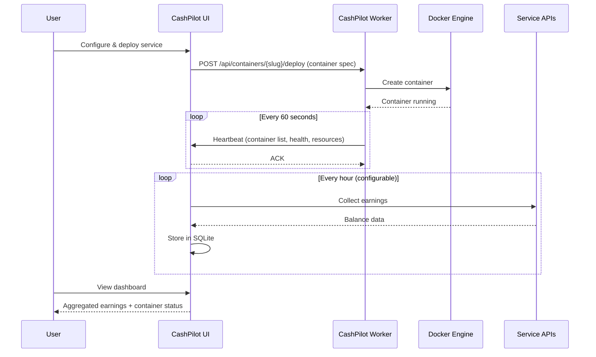

# Cómo funciona { #how-it-works }

CashPilot usa una arquitectura dividida en **UI + worker**. La UI nunca toca Docker: todas las operaciones con contenedores pasan por los workers. Esta separación es un principio central del diseño y es lo que permite gestionar una flota de varios servidores.

## Componentes { #components }

| Componente | Imagen | Puerto | Acceso a Docker | Función |
|-----------|-------|:----:|:-------------:|---------|
| **CashPilot UI** | `drumsergio/cashpilot` | 8080 | No | Panel web, recolección de ganancias, catálogo de servicios, almacenamiento de credenciales, programación |
| **CashPilot Worker** | `drumsergio/cashpilot-worker` | 8081 | A través de `cashpilot-socket-proxy` | Ciclo de vida de los contenedores de Docker, informe del estado de salud, señales de vida a la UI |

**No existe un modo independiente**. Cada servidor que ejecuta contenedores de Docker necesita un worker. La UI es solo un panel y un programador: puede funcionar en cualquier máquina, incluso en una sin Docker.

## Principios de diseño { #design-principles }

1. **Separación de responsabilidades.** La UI se encarga del panel, la recolección de ganancias, la programación y la autenticación de usuarios. Los workers se encargan del ciclo de vida de los contenedores de Docker y del informe del estado de salud. Nunca se solapan.
2. **Los workers necesitan Docker, a través del proxy del socket.** Un worker sin acceso a Docker no sirve para nada. Con los archivos compose que se distribuyen nunca recibe el socket directo: llega a Docker a través de `cashpilot-socket-proxy`. Las fichas de Unraid y TrueNAS siguen montando el socket directo ([tiendas de apps](app-stores.md)). Si no necesitas gestionar Docker, ejecuta solo la UI para seguir tus ganancias.
3. **Una única fuente de verdad.** La instancia de la UI es la única que recoge ganancias, guarda el historial y sirve el panel. Los workers nunca recogen ganancias.
4. **Las ganancias nunca se duplican.** Como solo recoge la UI, no hay riesgo de contar dos veces la misma cuenta.
5. **Los workers son satélites sin estado.** Un worker sabe qué contenedores mantener en marcha y la URL de la UI a la que informar. Solo guarda en archivos locales su propio id y su clave de flota (`.worker_id`, `.worker_key`; sin base de datos ni datos de ganancias).
6. **El YAML es la verdad.** Cada servicio vive en `services/{category}/{slug}.yml`. La UI, el despliegue, la documentación y la exportación a compose salen todos de estos archivos.

## Estructura de directorios { #directory-structure }

```
cashpilot/
  app/                      # FastAPI application
    main.py                 # App entrypoint, lifespan, container/fleet/earnings routes
    deps.py                 # Shared auth guards + Jinja2 template environment
    routers/                # Route groups split out of main.py: auth, pages, users
    catalog.py              # Loads YAML service definitions, caches, SIGHUP reload
    orchestrator.py         # Docker SDK: deploy, stop, restart, remove, logs
    database.py             # Async SQLite: earnings, config, deployments, users, workers
    worker_api.py           # Worker REST API: heartbeat, container commands, mini-UI
    setup_token.py          # First-run setup-token gate (owner-account creation)
    metrics.py              # Optional Prometheus metrics (/metrics)
    exchange_rates.py       # Crypto/fiat conversion via CoinGecko + Frankfurter
    collectors/             # Earnings collectors (one module per service, UI only)
      base.py               # BaseCollector ABC + EarningsResult dataclass
      honeygain.py          # Example: JWT auth + balance endpoint
      __init__.py           # COLLECTOR_MAP registry + make_collectors() factory
    templates/              # Jinja2: dashboard, fleet, catalog, setup wizard, payouts, settings
    static/
      css/style.css         # Classic night by default, plus dark, light, sunrise and warm
      js/app.js             # Vanilla JS, CP namespace, Chart.js, wizard state machine
  services/                 # YAML service definitions (SINGLE SOURCE OF TRUTH)
    _schema.yml             # Schema documentation
    bandwidth/              # Bandwidth sharing services
    depin/                  # DePIN services
    storage/                # Storage sharing services
    compute/                # GPU compute services
    mining/                 # Mining services
  docs/                     # Documentation and guides
    guides/                 # Per-service setup guides
  Dockerfile                # UI image: multi-stage python:3.15-alpine, su-exec, non-root
  Dockerfile.worker         # Worker image: minimal deps, no collectors/templates
  docker-compose.yml        # Single-server deployment
  docker-compose.fleet.yml  # Multi-server fleet deployment
```

## Flujo de datos { #data-flow }



### Señal de vida (del worker a la UI) { #heartbeat-worker-to-ui }

Cada 60 segundos, cada worker envía:

- La lista de contenedores con su estado (en marcha, detenido, terminado)
- El uso de recursos de cada contenedor (porcentaje de CPU, MB de memoria)
- Información del sistema (SO, arquitectura, nombre del host, disponibilidad de Docker)
- La URL que declara para sí mismo (`CASHPILOT_WORKER_URL` explícita o una alternativa detectada automáticamente)

La UI guarda esto en su base de datos SQLite y lo muestra en la página **Fleet** (Flota).

### Órdenes (de la UI al worker) { #commands-ui-to-worker }

La UI puede ordenar a cualquier worker que:

- **Despliegue** el contenedor de un servicio (especificación completa: imagen, variables de entorno, volúmenes, puertos)
- **Detenga**, **arranque**, **reinicie** o **elimine** un contenedor
- **Obtenga los registros** de un contenedor

Las órdenes se envían mediante llamadas a la API REST desde la UI al worker.

### Flujo de credenciales { #credential-flow }

El worker **nunca maneja ni guarda credenciales**:

1. El usuario configura las credenciales del servicio en la UI (se guardan cifradas en SQLite).
2. Al desplegar, la UI envía al worker la especificación completa del contenedor (incluidas las variables de entorno).
3. El worker pasa la especificación a la API de Docker. Docker guarda las variables de entorno en la configuración del contenedor.
4. En los reinicios: `docker restart` conserva las variables de entorno de forma nativa.
5. En los nuevos despliegues completos (eliminar + crear): la UI vuelve a enviar la especificación completa.

### Recolección de ganancias { #earnings-collection }

La UI ejecuta recolectores programados para cada servicio configurado:

- Los **recolectores automáticos** obtienen los saldos mediante las API de los servicios (autenticación JWT, por cookie, claves de API) en los proveedores que tienen una
- Los resultados se guardan en SQLite en su moneda nativa (USD, MYST, GRASS, STORJ, etc.)
- Los tipos de cambio se obtienen de CoinGecko (cripto) y Frankfurter (fiat), con caché de 15 minutos
- Cada lectura guarda el tipo en USD del día en que se tomó. Una lectura en cripto guardada sin él (anterior a la columna del tipo) recibe el precio de su propio día desde el historial diario de CoinGecko, al arrancar y una vez al día; un día sin precio se queda sin valorar
- El panel convierte y muestra los importes en la moneda que prefiera el usuario

## Tecnologías { #tech-stack }

| Tecnología | Función |
|---|---|
| FastAPI | Framework del backend (Python 3.15, asíncrono) |
| Jinja2 | Plantillas HTML renderizadas en el servidor |
| SQLite | Base de datos (aiosqlite, sin configuración, guardada en `/data`) |
| Docker SDK for Python | Gestión del ciclo de vida de los contenedores a través del socket |
| PyYAML | Lectura de las definiciones de servicios |
| APScheduler | Recolección periódica de ganancias |
| httpx | Cliente HTTP asíncrono para los recolectores de ganancias |
| cryptography (Fernet) | Cifrado en reposo de las credenciales guardadas |
| Chart.js | Gráficos de ganancias en el frontend |
| su-exec | Cambia de root al usuario `cashpilot` tras la configuración del entrypoint (Dockerfile) |

## Base de datos { #database }

SQLite con 400 días de retención de datos. Tablas principales:

- **earnings**: historial de ganancias por servicio (marca de tiempo, slug, saldo, moneda)
- **deployments**: despliegues de contenedores activos (slug, ID del contenedor, variables de entorno cifradas, estado)
- **config**: ajustes clave-valor y credenciales cifradas
- **users**: cuentas (nombre de usuario, hash bcrypt de la contraseña, rol)
- **user_preferences**: estado de incorporación de cada usuario (modo de configuración, categorías elegidas, zona horaria)
- **health_events**: historial de salud de los contenedores (start, stop, crash, check_ok, check_down)
- **workers**: registro de workers de la flota (ID de cliente, nombre, URL, estado, última señal de vida, clave de flota cifrada de cada worker)

## Modelo de seguridad { #security-model }

- Todas las credenciales se cifran en reposo con cifrado simétrico Fernet
- Autenticación del worker ante la UI con claves de flota propias de cada worker (`CASHPILOT_API_KEY` es solo la credencial de alta inicial)
- Los contenedores gestionados se ejecutan con `--security-opt no-new-privileges`
- Convención de nombres de los contenedores: `cashpilot-{slug}` con las etiquetas `cashpilot.managed=true`
- El contenedor de la UI **no** tiene acceso al socket de Docker
- Autenticación por sesión con un sistema de roles (owner/writer/viewer: propietario, editor y lector)
