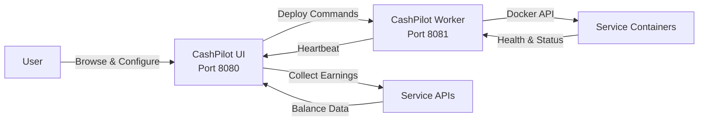

# Pagsisimula { #getting-started }

## Mga kailangan { #prerequisites }

- **Docker** na may **Compose v2 plugin, bersyon 2.23.1 o mas bago**. Tingnan
  gamit ang `docker compose version`. Hindi mabasa ng mas lumang bersyon ang inline na config
  sa compose file. Kasama na ang plugin sa Docker Desktop. Sa purong Docker
  Engine sa Linux, i-install ito mula sa package repository ng Docker
  (https://docs.docker.com/compose/install/linux/). Sa macOS na may Colima,
  i-install ito gamit ang Homebrew at i-link ito bilang Docker plugin:

    ```sh
    brew install docker-compose
    mkdir -p ~/.docker/cli-plugins
    ln -sfn "$(brew --prefix)/opt/docker-compose/bin/docker-compose" ~/.docker/cli-plugins/docker-compose
    ```

- Isang host na Linux, macOS o Windows (amd64 o arm64)
- Hindi bababa sa 1 GB na bakanteng RAM para sa CashPilot at sa mga serbisyong pinamamahalaan nito
- **Isang CashPilot bawat Docker host.** Tingnan ang babala sa ibaba.

!!! warning "Isang CashPilot bawat Docker host"
    Huwag magpatakbo ng dalawang install ng CashPilot sa iisang Docker host. Gumagamit ang
    mga compose file ng mga nakapirming pangalan ng container (`cashpilot-ui`, `cashpilot-worker`,
    `cashpilot-socket-proxy`), kaya pumapalya ang pangalawang kopya ng file dahil sa
    salungatan ng pangalan. Kung papalitan mo ang mga pangalan para malusutan iyon, magkasalo pa rin
    sa host ang dalawang install. Pinamamahalaan ng bawat worker ang bawat container na may
    mga label ng CashPilot, alinmang install ang gumawa nito. Kaya inililista, hinihinto
    at pinapalitan ng bawat dashboard ang mga earner app ng isa pa. Magkasalo rin ang dalawa sa
    network na `cashpilot-isolated`, sa mga pangalan ng earner app (`cashpilot-<service>`),
    sa mga host port nila at sa mga volume gaya ng `mysterium-data`. Para sa pangalawang
    install, gumamit ng ibang host o VM. Para magpatakbo ng mga earner app sa mas maraming server, magdagdag
    na lang ng mga worker sa iisang dashboard ([Fleet](fleet.md)).

## Mabilis na pagsisimula { #quick-start }

### 1. Kunin ang compose file at ilunsad { #1-fetch-the-compose-file-and-launch }

```bash
curl -fsSLO https://raw.githubusercontent.com/GeiserX/CashPilot/main/docker-compose.yml
docker compose up -d
```

Nagsisimula ito ng tatlong container na tuloy-tuloy na tumatakbo. Bago sila, tumatakbo nang isang beses ang
`cashpilot-migrate` at lumalabas ito nang may code 0 sa bawat `up`, kaya
ipinapakita ito ng `docker compose ps -a` bilang `Exited (0)`. Normal iyon.

| Container | Port | Layunin |
|-----------|------|---------|
| **cashpilot-migrate** | wala | Tumatakbo nang isang beses at lumalabas. Inililipat nito ang data na ginawa ng mas lumang release papunta sa mga volume na tinatanggap ng socket proxy, at wala itong ginagawa sa bagong install |
| **cashpilot-ui** | 8080 | Web dashboard, pagkolekta ng kita, katalogo ng serbisyo |
| **cashpilot-worker** | 8081 | Docker agent na nagde-deploy at nagbabantay sa mga container ng serbisyo |
| **cashpilot-socket-proxy** | wala | Hawak ang Docker socket nang read-only at binibigyan ang worker ng sinalang kopya ([Mga default sa seguridad](security-defaults.md)) |

### 2. Buksan ang dashboard { #2-open-the-dashboard }

Pumunta sa [http://localhost:8080](http://localhost:8080) sa iyong browser. Dahil wala pang account, mapupunta ka sa welcome page, na gumagawa ng account ng may-ari.

!!! tip "Gamit na ang port 8080?"
    Pumili ng ibang host port sa isang `.env` file katabi ng `docker-compose.yml`,
    sa halip na i-edit ang compose file:

    ```bash
    printf '\nCASHPILOT_UI_PORT=8088\n' >> .env
    docker compose up -d
    ```

    Pagkatapos, buksan ang http://localhost:8088. Panatilihin ang value sa `.env`, dahil
    ang in-app update ay bumabasa sa file na iyon at hindi sa iyong shell. (Nagsisimula ang `printf` sa
    newline para hindi kailanman madugtong ang linya sa huling linya ng dati nang `.env`.)

    Kailangan ng variable ang isang `docker-compose.yml` na ang linyang `ports:` ay
    `${CASHPILOT_UI_PORT:-8080}:8080`. Ang file mula v1.61 at mas luma ay naka-hard-code na
    `8080:8080` at hindi ito pinapansin. I-download ang kasalukuyang file, o
    panatilihin ang sarili mong in-edit na port mapping: tinatanggap din iyon ng in-app update.

!!! warning "Kailangan ang setup token sa unang takbo"
    Sa unang pagsisimula, gumagawa ang CashPilot ng isang beses na setup token at ipinapakita ito sa logs ng container na **cashpilot-ui**:

    ```bash
    docker compose logs cashpilot-ui
    ```

    Hanapin ang linyang ganito:

    ```
    FIRST-RUN SETUP: no account exists yet. Open /register and enter this
    one-time setup token to create the owner account: <token>
    ```

    Kopyahin ang token na iyon sa field na **Setup token** (Setup token) sa hakbang na **Owner account** (Account ng may-ari) ng welcome page, kasama ang username at password, para gawin ang unang account (ang may-ari). Sa logs lang ito ipinapakita, hindi kailanman sa URL, at permanente itong itinatapon kapag may account na ng may-ari.

### 3. Tingnan ang katalogo ng serbisyo { #3-browse-the-service-catalog }

Inililista ng pahinang **Catalog** (Katalogo) ang bawat serbisyo kasama ang mga platform nito, isang buwanang tantya at ang kailangan nito (residential IP, GPU). Mag-filter ayon sa kategorya (Bandwidth, DePIN, Storage, Compute, Mining) o maghanap ayon sa pangalan. Binubuksan ng **Add** (Idagdag) ang setup wizard sa serbisyong iyon, ipinapakita ng **Details** (Mga detalye) ang paglalarawan nito, mga payout at panganib sa pag-deploy, at ang mga serbisyong hindi tumatakbo sa Docker ay may link na **Visit** (Bisitahin) sa halip.

Dalawang uri ng serbisyo ang kailangang tingnang mabuti muna: mga serbisyong nagbabayad lang pagkatapos mong mag-lock ng token stake, gaya ng Anyone Protocol, Sia at Flux, at mga relay na naglalathala ng iyong IP, na maaaring magpababa sa ibinabayad sa iyo ng mga residential bandwidth app. Tingnan ang [Dalawang bagay na susuriin bago ka mag-deploy](guides/index.md).

### 4. Magdagdag ng mga serbisyo gamit ang wizard { #4-add-services-with-the-wizard }

Kapag may account na ng may-ari, binubuksan ng **Add services** (Magdagdag ng mga serbisyo) ang setup wizard; sa susunod, binubuksan itong muli ng button na **+ Add service** (+ Magdagdag ng serbisyo) sa itaas na bar. Pumili ng mga kategorya, pagkatapos ay mga serbisyo. Para sa bawat serbisyo, ipinapakita ng wizard ang link na **Sign Up** (Mag-sign up), hinihingi lang ang mga credential na kailangan ng serbisyong iyon (email at password, API token, at iba pa) at hinahayaan kang piliin ang mga worker na magpapatakbo nito. I-click ang **Deploy** (I-deploy) at kukunin ng CashPilot ang image, gagawin ang container at sisimulang bantayan ito.

### 5. Bantayan ito sa dashboard { #5-watch-it-on-the-dashboard }

Ipinapakita ng dashboard ang bawat na-deploy na serbisyo kasama ang status at balanse nito, at ipinapakita ng pahinang **Fleet** (Fleet) ang bawat worker.

## Paano ito gumagana { #how-it-works }



1. **Ikaw ang nagko-configure** ng mga serbisyo sa web UI -- pumili ng serbisyo, ilagay ang mga credential, i-click ang deploy.
2. **Ipinapadala ng UI** ang spec ng container (image, env vars, volumes) sa worker sa pamamagitan ng REST API.
3. **Ginagawa ng worker** ang Docker container at sinisimulang bantayan ang kalusugan nito.
4. **Iniuulat ng worker** ang status ng container pabalik sa UI bawat 60 segundo sa pamamagitan ng mga heartbeat.
5. **Kinokolekta ng UI** ang kita mula sa mga API ng serbisyo ayon sa iskedyul na maaaring i-configure (default: bawat oras).
6. **Ipinapakita ng dashboard** ang pinagsamang kita, ang hati ayon sa serbisyo, at ang kalusugan ng mga container.

## Configuration { #configuration }

### Mga environment variable ng UI { #ui-environment-variables }

| Variable | Default | Paglalarawan |
|----------|---------|-------------|
| `TZ` | `UTC` | Timezone para sa pag-iskedyul at pagpapakita |
| `CASHPILOT_SECRET_KEY` | *(awtomatikong ginagawa)* | Signing key para sa mga login session. Naka-save sa `/data/.secret_key`. **Hindi nito ine-encrypt ang mga credential** |
| `CASHPILOT_ENCRYPTION_KEY` | *(awtomatikong ginagawa)* | Fernet key na nag-e-encrypt sa mga naka-imbak na credential. Naka-save sa `/data/.fernet_key`. Ginagamit lang kapag wala ang file na iyon, kaya itakda lang ito para mag-restore ng backup |
| `CASHPILOT_API_KEY` | *(mula sa `/fleet`)* | Pinagsasaluhang enrolment key para sa mga worker. Nakakakuha ang bawat worker ng sarili nitong key kapag nag-enroll ito; tingnan ang [Fleet](fleet.md) |
| `CASHPILOT_COLLECT_INTERVAL` | `60` | Ilang minuto sa pagitan ng bawat ikot ng pagkolekta ng kita |
| `CASHPILOT_UI_PORT` | `8080` | Host port kung saan inilalathala ang UI. Itakda ito sa `.env` kapag gamit na ang 8080 |
| `CASHPILOT_BIND_ADDR` | `127.0.0.1` | Host interface kung saan inilalathala ang port ng UI. **Loopback bilang default**: kayang utusan ng dashboard ang worker na may Docker socket, kaya hindi ito bukas sa iyong network sa simula. Magtakda ng tiyak na IP (hal. Tailscale/VPN address) o `0.0.0.0` para buksan ito, o (mas mainam) magpatakbo ng reverse proxy na may authentication sa harap nito |

Nakapirmi sa `8080` ang web port ng UI sa loob ng container (itinakda sa `CMD` ng container). Pinipili lang ng `CASHPILOT_UI_PORT` at `CASHPILOT_BIND_ADDR` ang host port at interface kung saan ito inilalathala.

### Mga environment variable ng worker { #worker-environment-variables }

| Variable | Default | Paglalarawan |
|----------|---------|-------------|
| `TZ` | `UTC` | Timezone |
| `CASHPILOT_UI_URL` | -- | URL ng container ng UI, hal. `http://cashpilot-ui:8080` |
| `CASHPILOT_API_KEY` | -- | Dapat tumugma sa enrolment key ng UI. Kailangan lang para mag-enroll; pagkatapos, sariling key na ang ginagamit ng worker |
| `CASHPILOT_WORKER_NAME` | *(hostname)* | Pangalang ipinapakita para sa worker na ito sa fleet dashboard |
| `CASHPILOT_WORKER_URL` | *(awtomatikong natutukoy)* | URL na ginagamit ng UI para maabot ang worker na ito, hal. `http://192.168.1.50:8081`. Itakda ito nang tahasan para sa mga fleet na tumatawid ng host: maaaring mag-ulat ang awtomatikong pagtukoy ng IP na panloob sa container na hindi maaabot |
| `CASHPILOT_WORKER_BIND_ADDR` | `127.0.0.1` | **Sa fleet at remote-worker compose lang** (`docker-compose.fleet.yml`): host interface kung saan inilalathala ang API port ng worker na may Docker socket, loopback bilang default. Hindi talaga inilalathala ng default na `docker-compose.yml` ang port 8081. Kayang i-deploy/ihinto ng worker API ang kahit anong container (= root sa host), kaya para sa remote worker, i-bind sa pribado/VPN na interface (hal. Tailscale IP), **hindi kailanman** sa pampublikong IP |
| `CASHPILOT_PORT` | `8081` | Port na **inaanunsyo** ng worker sa UI. *Hindi* nito binabago ang listen port, na nakapirmi sa `CMD` ng image; tingnan ang [sanggunian sa configuration](configuration.md) |

### Halimbawa ng Docker Compose { #docker-compose-example }

```yaml
--8<-- "docker-compose.yml"
```

!!! note "Ito ang totoong file"

    Isinama nang buo ang block sa itaas mula sa `docker-compose.yml` sa
    repository, kaya hindi ito maaaring lumayo sa talagang inilalabas. Dati, isang
    kinopya-sa-kamay na bersyon nito ang naglathala sa Docker-socket API ng worker sa bawat
    interface at nag-pin ng `:latest`, na parehong sinasabi ng pahinang
    [mga default sa seguridad](security-defaults.md) na huwag gawin.

!!! warning "Access sa Docker socket"
    Pinamamahalaan ng worker ang mga container ng serbisyo sa pamamagitan ng Docker, pero hindi nito mina-mount ang `/var/run/docker.sock`. Ang container na `cashpilot-socket-proxy` ang may hawak ng socket at ipinapasa lang sa worker ang mga tawag na ginagawa nito, at tinatanggihan ang mga privileged container at ang pag-bind ng mga host folder na hindi mo inilista ([ano ang tinatanggihan nito](security-defaults.md#docker-socket-proxy)). Opt-in ang in-app update: tumatakbo lang ito kapag may `CASHPILOT_COMPOSE_DIR=<this folder>` sa `.env` katabi ng compose file, at hinahayaan ng setting na iyon ang mga container na i-bind ang folder, na nagpapahina sa proxy ([ano ang kapalit niyon](security-defaults.md#docker-socket-proxy)). Huwag itong itakda at mag-update gamit ang `docker compose pull && docker compose up -d`. Kontrolado pa rin ng worker ang bawat container sa host, kaya patakbuhin ang CashPilot sa nakalaang makina o VLAN para sa pinakamahusay na seguridad.

!!! tip "Pagpapanatili ng secret key"
    Ine-encrypt ang mga credential gamit ang `CASHPILOT_ENCRYPTION_KEY`, **hindi** ang `CASHPILOT_SECRET_KEY`, na nagsa-sign lang ng mga login session. Awtomatikong ginagawa ang encryption key sa unang takbo at iniimbak sa `/data/.fernet_key`. **I-backup ang file na iyon.** Kapag ginawang muli ang volume nang wala ito, gagawa ng bagong key at magiging permanenteng hindi mabasa ang bawat naka-imbak na credential. Ang pagtatakda ng `CASHPILOT_ENCRYPTION_KEY` ay para sa pag-restore ng backup na iyon; laging nananaig ang key file, kaya walang binabago ang pagtatakda nito sa isang maayos na instance.

!!! tip "Mga password at secret sa UI"
    Palitan ang sarili mong password kahit kailan mula sa avatar menu -> **Change password** (Palitan ang password) (available sa lahat ng role); nila-log out nito ang iba mo pang session. Sa **Settings** (Mga setting), write-only ang mga naka-imbak na secret: maglagay ng value para palitan ito, o iwanang blangko ang field para panatilihin ang dati. Hindi kailanman ibinabalik sa browser ang mga naka-save na credential.

## Pag-update ng CashPilot { #updating-cashpilot }

Nagpi-pin ang compose file ng isang major.minor na serye, gaya ng `drumsergio/cashpilot:X.Y`, kaya kinukuha ng `pull` ang pinakabagong patch ng seryeng iyon:

```bash
docker compose pull
docker compose up -d
```

Kinukuha ng `docker compose pull` ang pinakabagong nailathalang image at ginagawang muli ng `up -d`
ang mga container lang na nagbago ang image. Nagtatakda ang mga kasamang compose file ng
`pull_policy: always`, kaya kahit ang `docker compose up -d` lang ay kukuha muna ng
pinakabagong image.

**Mula sa dashboard.** Ang **Settings** (Mga setting), **About and updates** (Tungkol at mga update) ay nagpapatakbo ng parehong dalawang
command para sa iyo mula sa isang panandaliang helper container. Binabasa ng helper ang iyong
mga compose file at ang `.env` katabi nila (o ang mga file na ipinasa mo gamit ang
`--env-file`), hindi kailanman ang shell kung saan mo sinimulan ang CashPilot. Halimbawa, sinimulan mo ito gamit ang `CASHPILOT_UI_PORT=8088 docker compose up -d`.
Ibabalik ng update ang dashboard sa 8080, kaya humihinto ito at sinasabi sa iyo kung bakit
sa halip. Ilagay ang value na iyon sa `.env` at gagana ang button.

!!! note "**Hindi** mo kailangang mag-rebuild"
    Naglalabas ang CashPilot ng mga prebuilt na multi-arch image sa Docker Hub
    ([`drumsergio/cashpilot`](https://hub.docker.com/r/drumsergio/cashpilot),
    [`drumsergio/cashpilot-worker`](https://hub.docker.com/r/drumsergio/cashpilot-worker)).
    May kinalaman lang ang `docker compose build` / `--build` kung sinasadya mong
    mag-build mula sa source gamit ang `docker-compose.build.yml`. Para sa karaniwang install,
    ang `pull` + `up -d` ang buo at tamang proseso ng pag-update.

### Pag-pin ng tiyak na bersyon { #pinning-a-specific-version }

Para manatili sa iisang eksaktong release, palitan ang series tag na `X.Y` sa
`docker-compose.yml` ng buong release tag na `X.Y.Z` sa parehong
`drumsergio/cashpilot` at `drumsergio/cashpilot-worker` (laging parehong tag sa
dalawa), at alisin ang `pull_policy: always`. Tingnan ang mga tag sa
[Docker Hub](https://hub.docker.com/r/drumsergio/cashpilot/tags).

Para lumipat sa mas bagong serye, i-edit ang parehong tag: sa host ng UI muna, pagkatapos sa
bawat host ng worker. Basahin muna ang
[UPGRADING.md](https://github.com/GeiserX/CashPilot/blob/main/UPGRADING.md),
dahil may sariling mga hakbang ang isang major release gaya ng 3.0.

### Pag-automate ng mga update (opsyonal) { #automating-updates-optional }

Kung gusto mo ng mga update na hindi mo na kailangang galawin, ituro ang isang scheduler sa parehong dalawang command,
halimbawa gamit ang isang araw-araw na cron entry:

```cron
0 4 * * *  cd /path/to/cashpilot && docker compose pull && docker compose up -d
```

O magpatakbo ng auto-updater gaya ng [Watchtower](https://containrrr.dev/watchtower/)
o [Diun](https://crazymax.dev/diun/) sa mga container ng CashPilot. Opsyonal
ang mga ito. Walang kasamang updater ang CashPilot.

### Paglilinis ng mga lumang image { #cleaning-up-old-images }

Kumukuha ang CashPilot ng mga image pero hindi kailanman nagbubura ng mga ito. Bawat update at bawat redeploy
ay maaaring mag-iwan ng naunang image sa disk. Sa isang test fleet na may tatlong server, umabot sa mga 3 GB
lahat-lahat ang mga lumang image ng CashPilot at ng mga earner app. Maliit iyon kumpara
sa karaniwang iniiwan ng ibang program sa parehong host, kaya tingnan ang
buong host:

```bash
docker system df
```

Ang value na `RECLAIMABLE` sa linyang `Images` ang kayang palayain ng Docker.

**Bakit hindi ito ginagawa ng CashPilot para sa iyo.** Naaabot ng worker ang Docker sa pamamagitan ng
socket proxy. Para sa mga image, hinahayaan lang ito ng proxy na kumuha ng isa at magbasa ng isa ayon sa pangalan,
at wala nang iba. Hindi nito kayang ilista ang mga image ng host o magbura ng isa. Ang worker na
kayang gawin iyon ay makikita at mabubura rin ang mga image ng bawat iba pang program sa host.
Tingnan ang [ano ang tinatanggihan ng proxy](security-defaults.md#docker-socket-proxy).

**Hakbang 1: alisin ang mga dangling image.** Ang dangling image ay walang tag at walang
container na gumagamit nito, tumatakbo man o nakahinto. Ang update sa isang gumagalaw na tag gaya ng
`X.Y` (isang serye gaya ng pini-pin ng mga compose file), `latest` o isang digest ay nag-iiwan ng mismong mga ito:

```bash
docker image prune
```

Binubura rin nito ang image na pinatakbo mo bago ang update sa isang gumagalaw na tag: kapag
dumating na ang bagong image para sa seryeng iyon, wala nang tag ang luma. Para may madaanan pabalik, isulat
ang eksaktong bersyon bago ka mag-update (ipinapakita ito sa ibaba ng sidebar), para
makuha mo ulit ang `drumsergio/cashpilot:<X.Y.Z>`. O i-pin ang compose file sa
eksaktong tag na `X.Y.Z`; sa ganoon, nananatili ang tag ng lumang image at hakbang 2 ang angkop.

Nagtatanong ang Docker bago ito magbura. Sa isang cron entry, idagdag ang `--force` para laktawan ang
tanong. Wala itong ibang binabago:

```cron
30 4 * * 0  docker image prune --force
```

!!! warning "Huwag idagdag ang `-a`"
    Binubura ng `docker image prune -a` ang bawat image na hindi ginagamit ng kahit anong container
    ngayon, dangling man o may tag. Kasama roon ang mga image ng mga stack na sinadya mong ihinto
    at mga image na ikaw mismo ang nag-build at hindi mo na makukuha ulit.

**Hakbang 2: alisin ang mga lumang naka-pin na tag.** Ang image na naka-pin sa isang bersyon ay nananatili ang tag
pagkatapos mong lumipat sa mas bago, kaya nilalaktawan ito ng `prune`. Naka-pin ang mga image ng CashPilot
na ito:

| Repository | Ano ang nagpi-pin dito |
|---|---|
| `drumsergio/cashpilot` | Ang compose file (isang lumang serye, o isang eksaktong bersyon na pini-pin mo) |
| `drumsergio/cashpilot-worker` | Ang compose file, tulad ng nasa itaas |
| `drumsergio/cashpilot-tunnel` | Ang worker, isang tag bawat bersyon ng worker |
| `drumsergio/cashpilot-earnapp` | Ang entry ng EarnApp sa katalogo |
| `drumsergio/cashpilot-anyone` | Ang entry ng Anyone Protocol sa katalogo |

Ganoon din ang image ng serbisyong inalis mo: nananatili ang tag nito hanggang sa
alisin mo ito. Ang image sa katalogo na naka-pin ayon sa digest, gaya ng MystNodes o ProxyBase,
ay nawawalan ng tag kapag pinalitan ito ng mas bago, kaya sakop na ito ng hakbang 1.

Ilista muna ang mga tag na hindi ginagamit ng kahit anong container. Para sa image ng worker ang halimbawang ito.
Para sa ibang repository mula sa talahanayan, palitan ang `repo`:

```bash
repo=drumsergio/cashpilot-worker
used=$(docker ps -a --format '{{.Image}}')
docker image ls "$repo" --format '{{.Repository}}:{{.Tag}}' | grep -vxF "$used"
```

Pagkatapos, alisin ang bawat lumang tag ayon sa pangalan, isa-isa:

```bash
docker image rm drumsergio/cashpilot-worker:<old tag>
```

Huwag idagdag ang `-f`. Kung wala ito, tumatanggi ang Docker na alisin ang image na
ginagamit pa ng isang container, tumatakbo man o nakahinto, at ipinapakita nito ang
`conflict: unable to delete`. Kapag nakita mo iyon, panatilihin ang image. Panatilihin ang tag
na pinapatakbo mo at ang tag na pinatakbo mo bago nito, para makabalik ka pa rin ng isang bersyon.
Ang mga tag lang na mas luma kaysa sa dalawang iyon ang alisin.

Ipinapakita ng column na **Host disk** (Disk ng host) sa dashboard ang bakanteng espasyo sa filesystem na
naglalaman ng `/data` ng worker. Kadalasang nasa parehong filesystem ang mga image, sa ilalim ng
data root ng Docker, pero hindi palagi. Ipinapakita ng `docker info --format '{{.DockerRootDir}}'`
ang data root ng Docker. Sa containerd image store, ang default sa
bagong install ng Docker Engine 29, nasa ilalim ng root ng containerd ang mga image,
karaniwang `/var/lib/containerd`. Ipinapakita ng `docker info --format '{{.Driver}}'` ang
`overlayfs` para sa containerd image store at `overlay2` para sa klasiko.
Tingnan ang bakanteng espasyo sa filesystem na naglalaman ng directory na angkop.

## Mga suportadong serbisyo { #supported-services }

Sinusuportahan ng CashPilot ang **<!-- n:live -->50<!-- /n --> serbisyo** na aktibo o nasa beta, sa limang kategorya:

- **Bandwidth Sharing** (<!-- n:bandwidth -->18<!-- /n -->): ibahagi ang iyong internet bandwidth para sa passive income
- **DePIN** (<!-- n:depin -->15<!-- /n -->): mga decentralized physical infrastructure network
- **GPU Compute** (<!-- n:compute -->7<!-- /n -->): paupahan ang iyong GPU para sa AI at compute na trabaho
- **Storage** (<!-- n:storage -->2<!-- /n -->): ibahagi ang espasyo sa disk sa mga decentralized storage network
- **Mining** (<!-- n:mining -->8<!-- /n -->): mag-deploy ng miner o subaybayan ang isang pool ayon sa payout address ([Mining](mining.md))

Sa mga ito, **<!-- n:docker -->21<!-- /n -->** ang maaaring i-deploy at pamahalaan nang awtomatiko sa pamamagitan ng Docker. Sinusubaybayan ng katalogo ang iba pang <!-- n:tracked -->29<!-- /n --> (<!-- n:extension -->18<!-- /n --> browser o desktop app, <!-- n:gpu -->7<!-- /n --> GPU node, <!-- n:mining_pools -->4<!-- /n --> mining pool). Binabasa ng CashPilot ang mga balanse nila kung saan may collector.

Tingnan ang buong katalogo sa seksyong [Mga gabay sa serbisyo](guides/index.md).

## Mga susunod na hakbang { #next-steps }

- [Paano ito gumagana](how-it-works.md) -- Unawain ang disenyong hinati sa UI + Worker
- [Pamamahala ng fleet](fleet.md) -- Mag-deploy sa maraming server
- [Pagprotekta sa iyong home network](home-network-security.md) -- Ilayo ang mga container sa iyong LAN, at kung kailan nakakatulong ang gVisor
- [Mga gabay sa serbisyo](guides/index.md) -- Detalyadong tagubilin sa pag-setup para sa bawat serbisyo
- [Ganap na pag-alis ng CashPilot](uninstall.md) -- Alisin ang lahat ng ginawa nito, para magsimulang muli o para umalis
