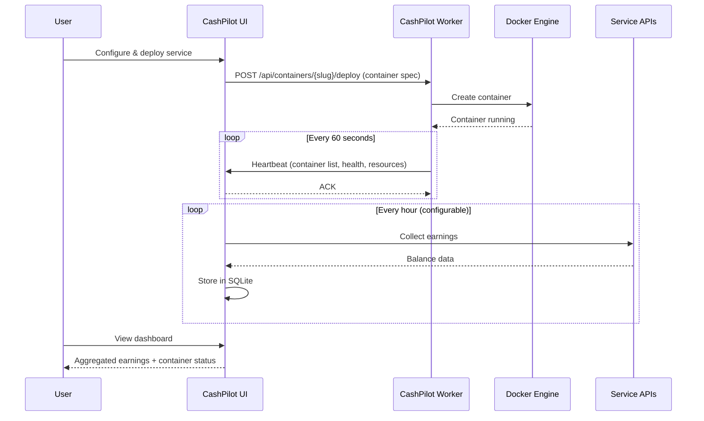

# Paano ito gumagana { #how-it-works }

Gumagamit ang CashPilot ng hinating arkitekturang **UI + Worker**. Hindi kailanman gumagalaw ang UI sa Docker -- dumadaan sa mga worker ang lahat ng operasyon sa container. Ang paghihiwalay na ito ay pangunahing prinsipyo ng disenyo at ito ang nagpapagana sa pamamahala ng fleet na may maraming server.

## Mga bahagi { #components }

| Bahagi | Image | Port | Access sa Docker | Layunin |
|-----------|-------|:----:|:-------------:|---------|
| **CashPilot UI** | `drumsergio/cashpilot` | 8080 | Wala | Web dashboard, pagkolekta ng kita, katalogo ng serbisyo, pag-iimbak ng credential, pag-iskedyul |
| **CashPilot Worker** | `drumsergio/cashpilot-worker` | 8081 | Sa pamamagitan ng `cashpilot-socket-proxy` | Lifecycle ng Docker container, pag-uulat ng kalusugan, mga heartbeat sa UI |

**Walang standalone mode**. Kailangan ng worker ang bawat server na nagpapatakbo ng mga Docker container. Purong dashboard/scheduler ang UI -- maaari itong tumakbo sa kahit anong makina, kasama ang walang Docker.

## Mga prinsipyo ng disenyo { #design-principles }

1. **Paghihiwalay ng mga gawain.** Hawak ng UI ang: dashboard, pagkolekta ng kita, pag-iskedyul, user auth. Hawak ng mga worker ang: lifecycle ng Docker container, pag-uulat ng kalusugan. Hindi sila kailanman nagsasapawan.
2. **Kailangan ng mga worker ang Docker, sa pamamagitan ng socket proxy.** Walang silbi ang worker na walang access sa Docker. Sa mga kasamang compose file, hindi nito kailanman nakukuha ang hilaw na socket: naaabot nito ang Docker sa pamamagitan ng `cashpilot-socket-proxy`. Ang mga listing ng Unraid at TrueNAS ay nagma-mount pa rin ng hilaw na socket ([mga app store](app-stores.md)). Kung hindi mo kailangan ang pamamahala ng Docker, patakbuhin na lang ang UI nang mag-isa para subaybayan ang kita.
3. **Iisang pinagmumulan ng katotohanan.** Ang instance ng UI lang ang nagkokolekta ng kita, nag-iimbak ng makasaysayang data, at naghahatid ng dashboard. Hindi kailanman nagkokolekta ng kita ang mga worker.
4. **Hindi kailanman nadodoble ang kita.** Dahil ang UI lang ang nagkokolekta, walang panganib na mabilang nang dalawang beses ang iisang account.
5. **Mga stateless na satellite ang mga worker.** Alam ng worker kung aling mga container ang panatilihing tumatakbo at ang URL ng UI na pag-uulatan. Ang sarili lang nitong id at fleet key ang sine-save nito sa mga lokal na file (`.worker_id`, `.worker_key`; walang database, walang data ng kita).
6. **Ang YAML ang katotohanan.** Nakatira ang bawat serbisyo sa `services/{category}/{slug}.yml`. Ang UI, ang pag-deploy, ang docs, at ang compose export ay lahat nagmumula sa mga file na ito.

## Istruktura ng directory { #directory-structure }

```
cashpilot/
  app/                      # FastAPI application
    main.py                 # App entrypoint, lifespan, container/fleet/earnings routes
    deps.py                 # Shared auth guards + Jinja2 template environment
    routers/                # Route groups split out of main.py: auth, pages, users
    catalog.py              # Loads YAML service definitions, caches, SIGHUP reload
    orchestrator.py         # Docker SDK: deploy, stop, restart, remove, logs
    database.py             # Async SQLite: earnings, config, deployments, users, workers
    worker_api.py           # Worker REST API: heartbeat, container commands, mini-UI
    setup_token.py          # First-run setup-token gate (owner-account creation)
    metrics.py              # Optional Prometheus metrics (/metrics)
    exchange_rates.py       # Crypto/fiat conversion via CoinGecko + Frankfurter
    collectors/             # Earnings collectors (one module per service, UI only)
      base.py               # BaseCollector ABC + EarningsResult dataclass
      honeygain.py          # Example: JWT auth + balance endpoint
      __init__.py           # COLLECTOR_MAP registry + make_collectors() factory
    templates/              # Jinja2: dashboard, fleet, catalog, setup wizard, payouts, settings
    static/
      css/style.css         # Classic night by default, plus dark, light, sunrise and warm
      js/app.js             # Vanilla JS, CP namespace, Chart.js, wizard state machine
  services/                 # YAML service definitions (SINGLE SOURCE OF TRUTH)
    _schema.yml             # Schema documentation
    bandwidth/              # Bandwidth sharing services
    depin/                  # DePIN services
    storage/                # Storage sharing services
    compute/                # GPU compute services
    mining/                 # Mining services
  docs/                     # Documentation and guides
    guides/                 # Per-service setup guides
  Dockerfile                # UI image: multi-stage python:3.15-alpine, su-exec, non-root
  Dockerfile.worker         # Worker image: minimal deps, no collectors/templates
  docker-compose.yml        # Single-server deployment
  docker-compose.fleet.yml  # Multi-server fleet deployment
```

## Daloy ng data { #data-flow }



### Heartbeat (mula worker papunta sa UI) { #heartbeat-worker-to-ui }

Bawat 60 segundo, ipinapadala ng bawat worker ang:

- Listahan ng mga container kasama ang status (tumatakbo, nakahinto, lumabas na)
- Paggamit ng resource bawat container (porsyento ng CPU, MB ng memory)
- Impormasyon ng system (OS, arkitektura, hostname, kung available ang Docker)
- Ang sarili nitong iniulat na URL (tahasang `CASHPILOT_WORKER_URL` o isang awtomatikong natukoy na fallback)

Iniimbak ito ng UI sa SQLite database nito at ipinapakita sa pahinang **Fleet** (Fleet).

### Mga command (mula UI papunta sa worker) { #commands-ui-to-worker }

Kayang utusan ng UI ang kahit anong worker na:

- **I-deploy** ang container ng isang serbisyo (buong spec: image, env vars, volumes, ports)
- **Ihinto**, **simulan**, **i-restart**, o **alisin** ang isang container
- **Kunin ang logs** mula sa isang container

Ipinapadala ang mga command sa pamamagitan ng mga REST API call mula sa UI papunta sa worker.

### Daloy ng credential { #credential-flow }

**Hindi kailanman humahawak o nag-iimbak ng mga credential** ang worker:

1. Kino-configure ng user ang mga credential ng serbisyo sa UI (naka-encrypt na iniimbak sa SQLite).
2. Sa pag-deploy, ipinapadala ng UI ang buong spec ng container (kasama ang env vars) sa worker.
3. Ipinapasa ng worker ang spec sa Docker API. Iniimbak ng Docker ang env vars sa config ng container.
4. Para sa mga restart: likas na pinapanatili ng `docker restart` ang env vars.
5. Para sa buong redeploy (alisin + gawin): ipinapadala muli ng UI ang buong spec.

### Pagkolekta ng kita { #earnings-collection }

Nagpapatakbo ang UI ng mga naka-iskedyul na collector para sa bawat naka-configure na serbisyo:

- **Mga automated na collector** ang kumukuha ng mga balanse sa pamamagitan ng mga API ng serbisyo (JWT auth, cookie auth, API keys) para sa mga provider na mayroon nito
- Iniimbak ang mga resulta sa SQLite sa katutubong currency (USD, MYST, GRASS, STORJ, atbp.)
- Kinukuha ang mga exchange rate mula sa CoinGecko (crypto) at Frankfurter (fiat), naka-cache nang 15 minuto
- Iniimbak ng bawat reading ang USD rate ng araw na kinuha ito. Ang crypto reading na naimbak nang wala nito (mas luma kaysa sa rate column) ay nakakakuha ng presyo ng sarili nitong araw mula sa araw-araw na history ng CoinGecko, sa startup at minsan sa isang araw; nananatiling walang presyo ang araw na walang presyo
- Kino-convert at ipinapakita ng dashboard sa gustong currency ng user

## Tech stack { #tech-stack }

| Teknolohiya | Layunin |
|---|---|
| FastAPI | Backend framework (Python 3.15, async) |
| Jinja2 | Mga HTML template na nire-render sa server |
| SQLite | Database (aiosqlite, walang kailangang config, iniimbak sa `/data`) |
| Docker SDK for Python | Pamamahala ng lifecycle ng container sa pamamagitan ng socket |
| PyYAML | Pag-parse ng mga definition ng serbisyo |
| APScheduler | Pana-panahong pagkolekta ng kita |
| httpx | Async HTTP client para sa mga collector ng kita |
| cryptography (Fernet) | Encryption ng mga naka-imbak na credential |
| Chart.js | Mga chart ng kita sa frontend |
| su-exec | Ibinababa ang root sa user na `cashpilot` pagkatapos ng setup ng entrypoint (Dockerfile) |

## Database { #database }

SQLite na may 400 araw na pagpapanatili ng data. Mga pangunahing table:

- **earnings** -- Makasaysayang kita bawat serbisyo (timestamp, slug, balanse, currency)
- **deployments** -- Mga aktibong deployment ng container (slug, container ID, naka-encrypt na env vars, status)
- **config** -- Mga key-value na setting at naka-encrypt na credential
- **users** -- Mga account (username, bcrypt password hash, role)
- **user_preferences** -- Onboarding state bawat user (setup mode, mga napiling kategorya, timezone)
- **health_events** -- History ng kalusugan ng container (start, stop, crash, check_ok, check_down)
- **workers** -- Talaan ng mga worker sa fleet (client ID, pangalan, URL, status, huling heartbeat, naka-encrypt na fleet key bawat worker)

## Modelo ng seguridad { #security-model }

- Naka-encrypt habang naka-imbak ang lahat ng credential gamit ang Fernet symmetric encryption
- Authentication mula worker papunta sa UI sa pamamagitan ng fleet key bawat worker (ang `CASHPILOT_API_KEY` ay credential lang para sa enrollment/bootstrap)
- Tumatakbo ang mga pinamamahalaang container nang may `--security-opt no-new-privileges`
- Kumbensyon sa pagpapangalan ng container: `cashpilot-{slug}` na may mga label na `cashpilot.managed=true`
- **Walang** access sa Docker socket ang container ng UI
- Authentication na nakabatay sa session na may sistema ng role (may-ari/editor/viewer)
