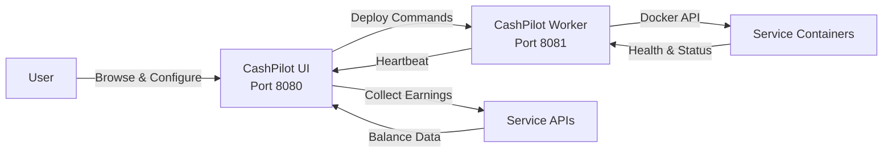

# Premiers pas { #getting-started }

## Prérequis { #prerequisites }

- **Docker** avec le **plugin Compose v2, version 2.23.1 ou plus récente**. Vérifiez
  avec `docker compose version`. Les versions plus anciennes ne savent pas lire la configuration
  intégrée au fichier compose. Docker Desktop inclut le plugin. Avec un Docker
  Engine seul sous Linux, installez-le depuis le dépôt de paquets de Docker
  (https://docs.docker.com/compose/install/linux/). Sous macOS avec Colima,
  installez-le avec Homebrew et liez-le comme plugin Docker :

    ```sh
    brew install docker-compose
    mkdir -p ~/.docker/cli-plugins
    ln -sfn "$(brew --prefix)/opt/docker-compose/bin/docker-compose" ~/.docker/cli-plugins/docker-compose
    ```

- Un hôte Linux, macOS ou Windows (amd64 ou arm64)
- Au moins 1 Go de RAM disponible pour CashPilot et les services qu'il gère
- **Un seul CashPilot par hôte Docker.** Lisez l'avertissement ci-dessous.

!!! warning "Un seul CashPilot par hôte Docker"
    N'exécutez pas deux installations de CashPilot sur un même hôte Docker. Les fichiers compose
    utilisent des noms de conteneur fixes (`cashpilot-ui`, `cashpilot-worker`,
    `cashpilot-socket-proxy`), donc une seconde copie du fichier échoue sur un conflit
    de noms. Si vous les renommez pour contourner ce conflit, les deux installations partagent
    toujours l'hôte. Chaque worker gère tous les conteneurs qui portent
    les étiquettes de CashPilot, quelle que soit l'installation qui les a créés. Chaque tableau de bord liste,
    arrête et remplace donc les apps de gains de l'autre. Les deux partagent aussi le
    réseau `cashpilot-isolated`, les noms des apps de gains (`cashpilot-<service>`),
    leurs ports sur l'hôte et des volumes comme `mysterium-data`. Pour une seconde
    installation, utilisez un autre hôte ou une autre VM. Pour exécuter des apps de gains sur plus de serveurs, ajoutez plutôt
    des workers à un seul tableau de bord ([Parc](fleet.md)).

## Démarrage rapide { #quick-start }

### 1. Récupérer le fichier compose et lancer { #1-fetch-the-compose-file-and-launch }

```bash
curl -fsSLO https://raw.githubusercontent.com/GeiserX/CashPilot/main/docker-compose.yml
docker compose up -d
```

Cela démarre trois conteneurs qui tournent en continu. Avant eux, un conteneur ponctuel
`cashpilot-migrate` s'exécute et se termine avec le code 0 à chaque `up`, donc
`docker compose ps -a` l'affiche comme `Exited (0)`. C'est normal.

| Conteneur | Port | Rôle |
|-----------|------|---------|
| **cashpilot-migrate** | aucun | S'exécute une fois et se termine. Il déplace les données qu'une ancienne version a créées vers des volumes que le proxy de socket accepte, et ne trouve rien à faire sur une nouvelle installation |
| **cashpilot-ui** | 8080 | Tableau de bord web, collecte des gains, catalogue des services |
| **cashpilot-worker** | 8081 | Agent Docker qui déploie et surveille les conteneurs des services |
| **cashpilot-socket-proxy** | aucun | Détient le socket Docker en lecture seule et donne au worker une copie filtrée ([Sécurité par défaut](security-defaults.md)) |

### 2. Ouvrir le tableau de bord { #2-open-the-dashboard }

Ouvrez [http://localhost:8080](http://localhost:8080) dans votre navigateur. Comme aucun compte n'existe encore, vous arrivez sur la page d'accueil, qui crée le compte propriétaire.

!!! tip "Le port 8080 est déjà utilisé ?"
    Choisissez un autre port d'hôte dans un fichier `.env` à côté de `docker-compose.yml`,
    au lieu de modifier le fichier compose :

    ```bash
    printf '\nCASHPILOT_UI_PORT=8088\n' >> .env
    docker compose up -d
    ```

    Ouvrez ensuite http://localhost:8088. Gardez la valeur dans `.env`, car la
    mise à jour depuis l'application lit ce fichier et pas votre shell. (`printf` commence par un
    saut de ligne pour que la ligne ne se colle jamais à la dernière ligne d'un `.env` existant.)

    La variable nécessite un `docker-compose.yml` dont la ligne `ports:` est
    `${CASHPILOT_UI_PORT:-8080}:8080`. Le fichier de la v1.61 et des versions antérieures code en dur
    `8080:8080` et l'ignore. Téléchargez le fichier actuel, ou
    gardez votre propre correspondance de port modifiée : la mise à jour depuis l'application l'accepte aussi.

!!! warning "Jeton de configuration initiale requis"
    Au premier démarrage, CashPilot génère un jeton de configuration à usage unique et l'écrit dans les journaux du conteneur **cashpilot-ui** :

    ```bash
    docker compose logs cashpilot-ui
    ```

    Cherchez une ligne comme celle-ci :

    ```
    FIRST-RUN SETUP: no account exists yet. Open /register and enter this
    one-time setup token to create the owner account: <token>
    ```

    Copiez ce jeton dans le champ **Setup token** (Jeton de configuration) de l'étape **Owner account** (Compte propriétaire) de la page d'accueil, avec un nom d'utilisateur et un mot de passe, pour créer le premier compte (propriétaire). Il n'apparaît jamais ailleurs que dans les journaux, jamais dans une URL, et il est supprimé définitivement dès que le compte propriétaire existe.

### 3. Parcourir le catalogue des services { #3-browse-the-service-catalog }

La page **Catalog** (Catalogue) liste chaque service avec ses plateformes, une estimation mensuelle et ce dont il a besoin (IP résidentielle, GPU). Filtrez par catégorie (bande passante, DePIN, stockage, calcul, minage) ou cherchez par nom. **Add** (Ajouter) ouvre l'assistant de configuration sur ce service, **Details** (Détails) affiche sa description, ses paiements et son risque de déploiement, et les services qui ne tournent pas dans Docker ont un lien **Visit** (Visiter) à la place.

Deux types de service demandent un examen plus attentif d'abord : les services qui ne paient qu'après le blocage d'une mise en jetons, comme Anyone Protocol, Sia et Flux, et les relais qui publient votre IP, ce qui peut réduire ce que les apps de bande passante résidentielle vous paient. Consultez [Vérifiez deux points avant de déployer](guides/index.md).

### 4. Ajouter des services avec l'assistant { #4-add-services-with-the-wizard }

Une fois le compte propriétaire créé, **Add services** (Ajouter des services) ouvre l'assistant de configuration ; plus tard, le bouton **+ Add service** (+ Ajouter un service) de la barre supérieure l'ouvre à nouveau. Choisissez des catégories, puis des services. Pour chaque service, l'assistant affiche un lien **Sign Up** (S'inscrire), ne demande que les identifiants dont ce service a besoin (e-mail et mot de passe, jeton d'API, etc.) et vous laisse choisir les workers sur lesquels l'exécuter. Cliquez sur **Deploy** (Déployer) et CashPilot télécharge l'image, crée le conteneur et commence à le surveiller.

### 5. Suivre le tout sur le tableau de bord { #5-watch-it-on-the-dashboard }

Le tableau de bord affiche chaque service déployé avec son état et son solde, et la page **Fleet** (Parc) affiche chaque worker.

## Fonctionnement { #how-it-works }



1. **Vous configurez** les services depuis l'interface web : choisissez un service, saisissez les identifiants, cliquez sur déployer.
2. **L'interface envoie** la spécification du conteneur (image, variables d'environnement, volumes) au worker par une API REST.
3. **Le worker crée** le conteneur Docker et commence à surveiller sa santé.
4. **Le worker renvoie** l'état des conteneurs à l'interface toutes les 60 secondes par des signaux de vie.
5. **L'interface collecte** les gains depuis les API des services selon une fréquence configurable (par défaut : toutes les heures).
6. **Le tableau de bord** affiche les gains agrégés, le détail par service et la santé des conteneurs.

## Configuration { #configuration }

### Variables d'environnement de l'interface { #ui-environment-variables }

| Variable | Valeur par défaut | Description |
|----------|---------|-------------|
| `TZ` | `UTC` | Fuseau horaire pour la planification et l'affichage |
| `CASHPILOT_SECRET_KEY` | *(générée automatiquement)* | Clé de signature des sessions de connexion. Conservée dans `/data/.secret_key`. **Ne chiffre pas les identifiants** |
| `CASHPILOT_ENCRYPTION_KEY` | *(générée automatiquement)* | Clé Fernet qui chiffre les identifiants stockés au repos. Conservée dans `/data/.fernet_key`. Adoptée seulement quand ce fichier est absent, donc ne la définissez que pour restaurer une sauvegarde |
| `CASHPILOT_API_KEY` | *(depuis `/fleet`)* | Clé d'enrôlement partagée pour les workers. Chaque worker reçoit sa propre clé quand il s'enrôle ; voir [Parc](fleet.md) |
| `CASHPILOT_COLLECT_INTERVAL` | `60` | Minutes entre deux cycles de collecte des gains |
| `CASHPILOT_UI_PORT` | `8080` | Port de l'hôte sur lequel l'interface est publiée. Définissez-le dans `.env` quand 8080 est déjà pris |
| `CASHPILOT_BIND_ADDR` | `127.0.0.1` | Interface de l'hôte sur laquelle le port de l'interface est publié. **Boucle locale par défaut** : le tableau de bord peut commander le worker qui a accès au socket Docker, il n'est donc pas exposé à votre réseau d'office. Indiquez une IP précise (par ex. une adresse Tailscale/VPN) ou `0.0.0.0` pour l'exposer, ou (de préférence) placez devant un reverse proxy qui authentifie |

Le port web de l'interface dans le conteneur est fixé à `8080` (défini par le `CMD` du conteneur). `CASHPILOT_UI_PORT` et `CASHPILOT_BIND_ADDR` ne choisissent que le port et l'interface de l'hôte sur lesquels il est publié.

### Variables d'environnement du worker { #worker-environment-variables }

| Variable | Valeur par défaut | Description |
|----------|---------|-------------|
| `TZ` | `UTC` | Fuseau horaire |
| `CASHPILOT_UI_URL` | -- | URL du conteneur de l'interface, par ex. `http://cashpilot-ui:8080` |
| `CASHPILOT_API_KEY` | -- | Doit correspondre à la clé d'enrôlement de l'interface. Nécessaire seulement pour s'enrôler ; le worker utilise ensuite sa propre clé |
| `CASHPILOT_WORKER_NAME` | *(nom d'hôte)* | Nom affiché pour ce worker dans le tableau de bord du parc |
| `CASHPILOT_WORKER_URL` | *(détectée automatiquement)* | URL que l'interface utilise pour joindre ce worker, par ex. `http://192.168.1.50:8081`. Définissez-la explicitement pour un parc réparti sur plusieurs hôtes : la détection automatique peut renvoyer une IP interne au conteneur, injoignable |
| `CASHPILOT_WORKER_BIND_ADDR` | `127.0.0.1` | **Compose du parc et des workers distants uniquement** (`docker-compose.fleet.yml`) : interface de l'hôte sur laquelle le port de l'API du worker, qui a accès au socket Docker, est publié, boucle locale par défaut. Le `docker-compose.yml` par défaut ne publie pas du tout le port 8081. L'API du worker peut déployer et arrêter n'importe quel conteneur (= root sur l'hôte), donc pour un worker distant, liez-la à une interface privée ou VPN (par ex. une IP Tailscale), **jamais** à une IP publique |
| `CASHPILOT_PORT` | `8081` | Port que le worker **annonce** à l'interface. Il ne change *pas* le port d'écoute, qui est fixé par le `CMD` de l'image ; voir la [référence de configuration](configuration.md) |

### Exemple Docker Compose { #docker-compose-example }

```yaml
--8<-- "docker-compose.yml"
```

!!! note "Voici le vrai fichier"

    Le bloc ci-dessus est inclus tel quel depuis le `docker-compose.yml` du
    dépôt, il ne peut donc pas s'écarter de ce qui est réellement livré. Auparavant, une
    version copiée à la main publiait l'API du worker, qui a accès au socket Docker, sur toutes les
    interfaces et épinglait `:latest`, deux choses que la page
    [sécurité par défaut](security-defaults.md) vous dit de ne pas faire.

!!! warning "Accès au socket Docker"
    Le worker gère les conteneurs des services via Docker, mais il ne monte pas `/var/run/docker.sock`. Le conteneur `cashpilot-socket-proxy` détient le socket et ne transmet au worker que les appels qu'il fait, en refusant les conteneurs privilégiés et les montages de dossiers de l'hôte que vous n'avez pas listés ([ce qu'il refuse](security-defaults.md#docker-socket-proxy)). La mise à jour depuis l'application est facultative : elle ne fonctionne qu'avec `CASHPILOT_COMPOSE_DIR=<this folder>` dans le `.env` à côté du fichier compose, et ce réglage permet aux conteneurs de monter ce dossier, ce qui affaiblit le proxy ([ce que cela coûte](security-defaults.md#docker-socket-proxy)). Laissez-le vide et mettez à jour avec `docker compose pull && docker compose up -d`. Le worker contrôle quand même tous les conteneurs de l'hôte, donc exécutez CashPilot sur une machine ou un VLAN dédié pour une meilleure sécurité.

!!! tip "Persistance de la clé secrète"
    Les identifiants sont chiffrés avec `CASHPILOT_ENCRYPTION_KEY`, **pas** avec `CASHPILOT_SECRET_KEY`, qui ne signe que les sessions de connexion. La clé de chiffrement est générée automatiquement au premier lancement et stockée dans `/data/.fernet_key`. **Sauvegardez ce fichier.** Si le volume est recréé sans lui, une nouvelle clé est générée et tous les identifiants stockés deviennent définitivement illisibles. `CASHPILOT_ENCRYPTION_KEY` sert à restaurer cette sauvegarde ; le fichier de clé l'emporte toujours, donc le définir sur une instance saine ne change rien.

!!! tip "Mots de passe et secrets dans l'interface"
    Changez votre propre mot de passe à tout moment depuis le menu de l'avatar -> **Change password** (Changer le mot de passe) (disponible pour tous les rôles) ; cela ferme vos autres sessions. Dans **Settings** (Paramètres), les secrets stockés sont en écriture seule : saisissez une valeur pour la changer, ou laissez le champ vide pour garder l'actuelle. Les identifiants enregistrés ne sont jamais renvoyés au navigateur.

## Mettre à jour CashPilot { #updating-cashpilot }

Le fichier compose épingle une série majeure.mineure, comme `drumsergio/cashpilot:X.Y`, donc `pull` récupère le correctif le plus récent de cette série :

```bash
docker compose pull
docker compose up -d
```

`docker compose pull` récupère la dernière image publiée et `up -d` ne recrée
que les conteneurs dont l'image a changé. Les fichiers compose livrés définissent
`pull_policy: always`, donc même un simple `docker compose up -d` télécharge d'abord
la dernière image.

**Depuis le tableau de bord.** **Settings** (Paramètres), **About and updates** (À propos et mises à jour) exécute ces deux mêmes
commandes pour vous depuis un conteneur d'aide à courte durée de vie. Ce conteneur lit vos
fichiers compose et le `.env` à côté d'eux (ou les fichiers que vous avez passés avec
`--env-file`), jamais le shell depuis lequel vous avez lancé CashPilot. Imaginons que vous l'ayez lancé avec `CASHPILOT_UI_PORT=8088 docker compose up -d`.
La mise à jour remettrait le tableau de bord sur 8080, donc elle s'arrête et vous explique pourquoi
à la place. Mettez cette valeur dans `.env` et le bouton fonctionne.

!!! note "Vous n'avez **pas** besoin de recompiler"
    CashPilot fournit des images multi-architectures précompilées sur Docker Hub
    ([`drumsergio/cashpilot`](https://hub.docker.com/r/drumsergio/cashpilot),
    [`drumsergio/cashpilot-worker`](https://hub.docker.com/r/drumsergio/cashpilot-worker)).
    `docker compose build` / `--build` ne sert que si vous compilez volontairement
    depuis les sources avec `docker-compose.build.yml`. Pour une installation normale,
    `pull` + `up -d` est la procédure de mise à jour complète et correcte.

### Épingler une version précise { #pinning-a-specific-version }

Pour rester sur une version exacte, remplacez le tag de série `X.Y` dans
`docker-compose.yml` par un tag de version complet `X.Y.Z` sur
`drumsergio/cashpilot` et sur `drumsergio/cashpilot-worker` (toujours le même tag sur
les deux), et supprimez `pull_policy: always`. Parcourez les tags sur
[Docker Hub](https://hub.docker.com/r/drumsergio/cashpilot/tags).

Pour passer à une série plus récente, modifiez les deux tags : d'abord sur l'hôte de l'interface, puis sur
chaque hôte de worker. Lisez d'abord
[UPGRADING.md](https://github.com/GeiserX/CashPilot/blob/main/UPGRADING.md),
car une version majeure comme la 3.0 a ses propres étapes.

### Automatiser les mises à jour (facultatif) { #automating-updates-optional }

Si vous voulez des mises à jour sans intervention, faites exécuter ces deux mêmes commandes par un planificateur,
par exemple avec une entrée cron quotidienne :

```cron
0 4 * * *  cd /path/to/cashpilot && docker compose pull && docker compose up -d
```

Ou faites tourner un outil de mise à jour automatique comme [Watchtower](https://containrrr.dev/watchtower/)
ou [Diun](https://crazymax.dev/diun/) sur les conteneurs de CashPilot. Ces outils
sont facultatifs. CashPilot n'intègre pas d'outil de mise à jour.

### Nettoyer les anciennes images { #cleaning-up-old-images }

CashPilot télécharge des images mais ne les supprime jamais. Chaque mise à jour et chaque redéploiement
peut laisser l'image précédente sur le disque. Sur un parc de test de trois serveurs, les anciennes
images de CashPilot et des apps de gains totalisaient environ 3 Go. C'est peu à côté
de ce que les autres programmes du même hôte laissent d'habitude derrière eux, alors examinez
l'hôte entier :

```bash
docker system df
```

La valeur `RECLAIMABLE` de la ligne `Images` correspond à ce que Docker pourrait libérer.

**Pourquoi CashPilot ne le fait pas pour vous.** Le worker accède à Docker via
le proxy de socket. Pour les images, le proxy lui permet d'en télécharger une et d'en lire une par son nom,
et rien d'autre. Il ne peut ni lister les images de l'hôte ni en supprimer une. Un worker qui
le pourrait verrait et supprimerait aussi les images de tous les autres programmes de l'hôte.
Consultez [ce que le proxy refuse](security-defaults.md#docker-socket-proxy).

**Étape 1 : supprimer les images orphelines (dangling).** Une image orpheline n'a pas de tag et aucun
conteneur ne l'utilise, en cours d'exécution ou arrêté. Une mise à jour sur un tag mobile comme
`X.Y` (une série comme celle qu'épinglent les fichiers compose), `latest` ou un digest laisse précisément ces images derrière elle :

```bash
docker image prune
```

Cette commande supprime aussi l'image que vous utilisiez avant une mise à jour sur un tag mobile :
dès que la nouvelle image de cette série arrive, l'ancienne n'a plus de tag. Pour garder un moyen de revenir en arrière, notez
la version exacte avant de mettre à jour (le bas de la barre latérale l'affiche), afin
de pouvoir télécharger à nouveau `drumsergio/cashpilot:<X.Y.Z>`. Ou épinglez le fichier compose sur
un tag exact `X.Y.Z` ; l'ancienne image garde alors son tag et l'étape 2 s'applique.

Docker demande confirmation avant de supprimer. Dans une entrée cron, ajoutez `--force` pour sauter la
question. Cela ne change rien d'autre :

```cron
30 4 * * 0  docker image prune --force
```

!!! warning "N'ajoutez pas `-a`"
    `docker image prune -a` supprime toutes les images qu'aucun conteneur n'utilise à
    ce moment, orphelines ou avec un tag. Cela inclut les images des stacks que vous avez arrêtées
    volontairement et les images que vous avez compilées localement et ne pouvez pas retélécharger.

**Étape 2 : supprimer les anciens tags épinglés.** Une image épinglée sur une version garde son tag
après votre passage à une version plus récente, donc `prune` l'ignore. Ces images de CashPilot sont
épinglées :

| Dépôt | Ce qui l'épingle |
|---|---|
| `drumsergio/cashpilot` | Le fichier compose (une ancienne série, ou une version exacte que vous avez épinglée) |
| `drumsergio/cashpilot-worker` | Le fichier compose, comme ci-dessus |
| `drumsergio/cashpilot-tunnel` | Le worker, un tag par version du worker |
| `drumsergio/cashpilot-earnapp` | L'entrée EarnApp du catalogue |
| `drumsergio/cashpilot-anyone` | L'entrée Anyone Protocol du catalogue |

Il en va de même pour l'image d'un service que vous avez supprimé : son tag reste jusqu'à ce que vous
la supprimiez. Une image du catalogue épinglée par digest, comme MystNodes ou ProxyBase,
perd son tag quand une plus récente la remplace, donc l'étape 1 la couvre déjà.

Listez d'abord les tags qu'aucun conteneur n'utilise. Cet exemple porte sur l'image du worker.
Pour un autre dépôt du tableau, changez `repo` :

```bash
repo=drumsergio/cashpilot-worker
used=$(docker ps -a --format '{{.Image}}')
docker image ls "$repo" --format '{{.Repository}}:{{.Tag}}' | grep -vxF "$used"
```

Supprimez ensuite chaque ancien tag par son nom, un à la fois :

```bash
docker image rm drumsergio/cashpilot-worker:<old tag>
```

N'ajoutez pas `-f`. Sans cette option, Docker refuse de supprimer une image qu'un
conteneur utilise encore, en cours d'exécution ou arrêté, et affiche
`conflict: unable to delete`. Quand vous voyez ce message, gardez l'image. Gardez le tag
que vous utilisez et celui que vous utilisiez avant, pour pouvoir encore revenir une version en arrière.
Ne supprimez que les tags plus anciens que ces deux-là.

La colonne **Host disk** (Disque de l'hôte) du tableau de bord affiche l'espace libre du système de fichiers qui
contient le `/data` du worker. Les images se trouvent en général sur le même système de fichiers, sous
la racine de données de Docker, mais pas toujours. `docker info --format '{{.DockerRootDir}}'`
affiche la racine de données de Docker. Avec le magasin d'images containerd, le choix par défaut d'une
nouvelle installation de Docker Engine 29, les images se trouvent sous la racine de containerd à la place,
normalement `/var/lib/containerd`. `docker info --format '{{.Driver}}'` affiche
`overlayfs` pour le magasin d'images containerd et `overlay2` pour le magasin classique.
Vérifiez l'espace libre du système de fichiers qui contient le répertoire concerné.

## Services pris en charge { #supported-services }

CashPilot prend en charge **<!-- n:live -->50<!-- /n --> services** actifs ou en bêta, répartis en cinq catégories :

- **Partage de bande passante** (<!-- n:bandwidth -->18<!-- /n -->) : partagez votre bande passante internet pour des revenus passifs
- **DePIN** (<!-- n:depin -->15<!-- /n -->) : réseaux d'infrastructure physique décentralisés
- **Calcul GPU** (<!-- n:compute -->7<!-- /n -->) : louez votre GPU pour des charges d'IA et de calcul
- **Stockage** (<!-- n:storage -->2<!-- /n -->) : partagez de l'espace disque sur des réseaux de stockage décentralisés
- **Minage** (<!-- n:mining -->8<!-- /n -->) : déployez un mineur ou suivez un pool par son adresse de paiement ([Minage](mining.md))

Parmi eux, **<!-- n:docker -->21<!-- /n -->** peuvent être déployés et gérés automatiquement via Docker. Le catalogue suit les <!-- n:tracked -->29<!-- /n --> autres (<!-- n:extension -->18<!-- /n --> apps de navigateur ou de bureau, <!-- n:gpu -->7<!-- /n --> nœuds GPU, <!-- n:mining_pools -->4<!-- /n --> pools de minage). CashPilot lit leurs soldes là où un collecteur existe.

Parcourez le catalogue complet dans la section [Guides des services](guides/index.md).

## Étapes suivantes { #next-steps }

- [Fonctionnement](how-it-works.md) -- Comprendre la séparation entre l'interface et le worker
- [Gestion du parc](fleet.md) -- Déployer sur plusieurs serveurs
- [Protéger votre réseau domestique](home-network-security.md) -- Tenir les conteneurs à l'écart de votre réseau local, et savoir quand gVisor aide
- [Guides des services](guides/index.md) -- Instructions de configuration détaillées pour chaque service
- [Supprimer complètement CashPilot](uninstall.md) -- Supprimer tout ce qu'il a créé, pour repartir de zéro ou pour partir
