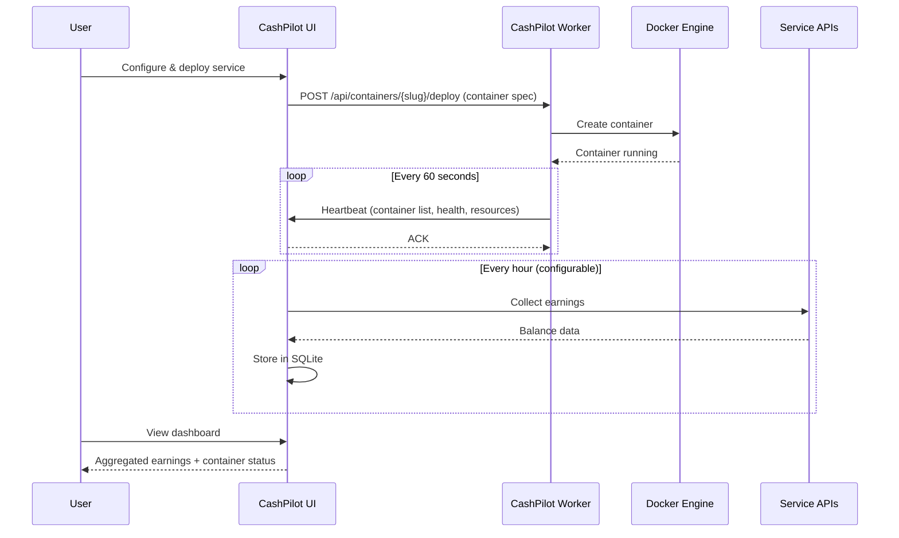

# Fonctionnement { #how-it-works }

CashPilot repose sur une architecture séparée **interface + worker**. L'interface ne touche jamais Docker : toutes les opérations sur les conteneurs passent par les workers. Cette séparation est un principe de conception central, et c'est elle qui permet de gérer un parc de plusieurs serveurs.

## Composants { #components }

| Composant | Image | Port | Accès à Docker | Rôle |
|-----------|-------|:----:|:-------------:|---------|
| **CashPilot UI** | `drumsergio/cashpilot` | 8080 | Non | Tableau de bord web, collecte des gains, catalogue des services, stockage des identifiants, planification |
| **CashPilot Worker** | `drumsergio/cashpilot-worker` | 8081 | Via `cashpilot-socket-proxy` | Cycle de vie des conteneurs Docker, remontée de leur santé, signaux de vie vers l'interface |

Il n'existe **pas de mode autonome**. Chaque serveur qui exécute des conteneurs Docker a besoin d'un worker. L'interface est uniquement un tableau de bord et un planificateur : elle peut tourner sur n'importe quelle machine, y compris une machine sans Docker.

## Principes de conception { #design-principles }

1. **Séparation des responsabilités.** L'interface gère : le tableau de bord, la collecte des gains, la planification, l'authentification des utilisateurs. Les workers gèrent : le cycle de vie des conteneurs Docker, la remontée de leur santé. Leurs rôles ne se chevauchent jamais.
2. **Les workers ont besoin de Docker, via le proxy de socket.** Un worker sans accès à Docker ne sert à rien. Avec les fichiers compose livrés, il ne reçoit jamais le socket brut : il accède à Docker via `cashpilot-socket-proxy`. Les fiches Unraid et TrueNAS montent encore le socket brut ([boutiques d'applications](app-stores.md)). Si vous n'avez pas besoin de gérer Docker, exécutez simplement l'interface seule pour suivre vos gains.
3. **Une seule source de vérité.** L'instance de l'interface est la seule qui collecte les gains, stocke l'historique et sert le tableau de bord. Les workers ne collectent jamais de gains.
4. **Les gains ne sont jamais comptés en double.** Comme seule l'interface collecte, un même compte ne risque pas d'être compté deux fois.
5. **Les workers sont des satellites sans état.** Un worker sait quels conteneurs maintenir en marche et à quelle URL de l'interface rendre compte. Il ne conserve dans des fichiers locaux que son propre ID et sa clé de parc (`.worker_id`, `.worker_key` ; pas de base de données, pas de données de gains).
6. **Le YAML fait foi.** Chaque service se trouve dans `services/{category}/{slug}.yml`. L'interface, le déploiement, la documentation et l'export compose dérivent tous de ces fichiers.

## Structure des répertoires { #directory-structure }

```
cashpilot/
  app/                      # FastAPI application
    main.py                 # App entrypoint, lifespan, container/fleet/earnings routes
    deps.py                 # Shared auth guards + Jinja2 template environment
    routers/                # Route groups split out of main.py: auth, pages, users
    catalog.py              # Loads YAML service definitions, caches, SIGHUP reload
    orchestrator.py         # Docker SDK: deploy, stop, restart, remove, logs
    database.py             # Async SQLite: earnings, config, deployments, users, workers
    worker_api.py           # Worker REST API: heartbeat, container commands, mini-UI
    setup_token.py          # First-run setup-token gate (owner-account creation)
    metrics.py              # Optional Prometheus metrics (/metrics)
    exchange_rates.py       # Crypto/fiat conversion via CoinGecko + Frankfurter
    collectors/             # Earnings collectors (one module per service, UI only)
      base.py               # BaseCollector ABC + EarningsResult dataclass
      honeygain.py          # Example: JWT auth + balance endpoint
      __init__.py           # COLLECTOR_MAP registry + make_collectors() factory
    templates/              # Jinja2: dashboard, fleet, catalog, setup wizard, payouts, settings
    static/
      css/style.css         # Classic night by default, plus dark, light, sunrise and warm
      js/app.js             # Vanilla JS, CP namespace, Chart.js, wizard state machine
  services/                 # YAML service definitions (SINGLE SOURCE OF TRUTH)
    _schema.yml             # Schema documentation
    bandwidth/              # Bandwidth sharing services
    depin/                  # DePIN services
    storage/                # Storage sharing services
    compute/                # GPU compute services
    mining/                 # Mining services
  docs/                     # Documentation and guides
    guides/                 # Per-service setup guides
  Dockerfile                # UI image: multi-stage python:3.15-alpine, su-exec, non-root
  Dockerfile.worker         # Worker image: minimal deps, no collectors/templates
  docker-compose.yml        # Single-server deployment
  docker-compose.fleet.yml  # Multi-server fleet deployment
```

## Flux de données { #data-flow }



### Signal de vie (du worker vers l'interface) { #heartbeat-worker-to-ui }

Toutes les 60 secondes, chaque worker envoie :

- La liste des conteneurs avec leur état (en cours d'exécution, arrêté, terminé)
- L'utilisation des ressources par conteneur (pourcentage de CPU, mémoire en Mo)
- Des informations système (OS, architecture, nom d'hôte, disponibilité de Docker)
- L'URL qu'il déclare lui-même (`CASHPILOT_WORKER_URL` explicite ou une valeur de repli détectée automatiquement)

L'interface stocke ces données dans sa base SQLite et les affiche sur la page **Fleet** (Parc).

### Commandes (de l'interface vers le worker) { #commands-ui-to-worker }

L'interface peut demander à n'importe quel worker de :

- **Déployer** le conteneur d'un service (spécification complète : image, variables d'environnement, volumes, ports)
- **Arrêter**, **démarrer**, **redémarrer** ou **supprimer** un conteneur
- **Récupérer les journaux** d'un conteneur

Les commandes sont envoyées par des appels d'API REST de l'interface vers le worker.

### Circulation des identifiants { #credential-flow }

Le worker **ne manipule ni ne stocke jamais d'identifiants** :

1. L'utilisateur configure les identifiants du service dans l'interface (stockés chiffrés dans SQLite).
2. Lors d'un déploiement, l'interface envoie au worker la spécification complète du conteneur (variables d'environnement comprises).
3. Le worker transmet la spécification à l'API Docker. Docker stocke les variables d'environnement dans la configuration du conteneur.
4. Pour les redémarrages : `docker restart` conserve nativement les variables d'environnement.
5. Pour les redéploiements complets (suppression + création) : l'interface renvoie la spécification complète.

### Collecte des gains { #earnings-collection }

L'interface exécute des collecteurs planifiés pour chaque service configuré :

- Les **collecteurs automatiques** récupèrent les soldes via les API des services (authentification JWT, par cookie, clés d'API) pour les fournisseurs qui en ont une
- Les résultats sont stockés dans SQLite dans leur devise d'origine (USD, MYST, GRASS, STORJ, etc.)
- Les taux de change viennent de CoinGecko (crypto) et de Frankfurter (monnaies fiat), mis en cache 15 minutes
- Chaque relevé stocke le taux en USD du jour où il a été pris. Un relevé crypto stocké sans taux (antérieur à la colonne des taux) reçoit le prix de son propre jour depuis l'historique quotidien de CoinGecko, au démarrage puis une fois par jour ; un jour sans prix reste sans prix
- Le tableau de bord convertit et affiche les montants dans la devise préférée de l'utilisateur

## Pile technique { #tech-stack }

| Technologie | Rôle |
|---|---|
| FastAPI | Framework backend (Python 3.15, asynchrone) |
| Jinja2 | Modèles HTML rendus côté serveur |
| SQLite | Base de données (aiosqlite, sans configuration, stockée dans `/data`) |
| Docker SDK for Python | Gestion du cycle de vie des conteneurs via le socket |
| PyYAML | Lecture des définitions de services |
| APScheduler | Collecte périodique des gains |
| httpx | Client HTTP asynchrone pour les collecteurs de gains |
| cryptography (Fernet) | Chiffrement au repos des identifiants stockés |
| Chart.js | Graphiques des gains côté frontend |
| su-exec | Abandonne root au profit de l'utilisateur `cashpilot` après la préparation par le point d'entrée (Dockerfile) |

## Base de données { #database }

SQLite avec une conservation des données de 400 jours. Tables principales :

- **earnings** -- Historique des gains par service (horodatage, slug, solde, devise)
- **deployments** -- Déploiements de conteneurs actifs (slug, ID du conteneur, variables d'environnement chiffrées, état)
- **config** -- Réglages clé-valeur et identifiants chiffrés
- **users** -- Comptes (nom d'utilisateur, empreinte bcrypt du mot de passe, rôle)
- **user_preferences** -- État de la prise en main par utilisateur (mode de configuration, catégories choisies, fuseau horaire)
- **health_events** -- Historique de santé des conteneurs (start, stop, crash, check_ok, check_down)
- **workers** -- Registre des workers du parc (ID client, nom, URL, état, dernier signal de vie, clé de parc chiffrée propre à chaque worker)

## Modèle de sécurité { #security-model }

- Tous les identifiants sont chiffrés au repos avec le chiffrement symétrique Fernet
- Authentification du worker auprès de l'interface par des clés de parc propres à chaque worker (`CASHPILOT_API_KEY` n'est que l'identifiant d'enrôlement initial)
- Les conteneurs gérés s'exécutent avec `--security-opt no-new-privileges`
- Convention de nommage des conteneurs : `cashpilot-{slug}` avec les étiquettes `cashpilot.managed=true`
- Le conteneur de l'interface n'a **aucun** accès au socket Docker
- Authentification par session avec un système de rôles (propriétaire/éditeur/lecteur)
