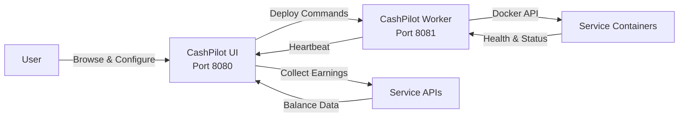

# शुरुआत करें { #getting-started }

## पूर्वापेक्षाएँ { #prerequisites }

- **Docker**, साथ में **Compose v2 plugin, संस्करण 2.23.1 या नया**। इसे
  `docker compose version` से जाँचें। पुराने संस्करण compose फ़ाइल में दी गई इनलाइन
  config नहीं पढ़ पाते। Docker Desktop में यह plugin शामिल है। Linux पर केवल Docker
  Engine हो, तो इसे Docker के पैकेज रिपॉज़िटरी से इंस्टॉल करें
  (https://docs.docker.com/compose/install/linux/)। Colima वाले macOS पर
  इसे Homebrew से इंस्टॉल करें और Docker plugin के रूप में लिंक करें:

    ```sh
    brew install docker-compose
    mkdir -p ~/.docker/cli-plugins
    ln -sfn "$(brew --prefix)/opt/docker-compose/bin/docker-compose" ~/.docker/cli-plugins/docker-compose
    ```

- एक Linux, macOS या Windows होस्ट (amd64 या arm64)
- CashPilot और उसकी चलाई सेवाओं के लिए कम से कम 1 GB खाली RAM
- **हर Docker होस्ट पर एक ही CashPilot।** नीचे दी गई चेतावनी देखें।

!!! warning "हर Docker होस्ट पर एक ही CashPilot"
    एक Docker होस्ट पर CashPilot के दो इंस्टॉल न चलाएँ। compose फ़ाइलें
    तय कंटेनर नाम इस्तेमाल करती हैं (`cashpilot-ui`, `cashpilot-worker`,
    `cashpilot-socket-proxy`), इसलिए फ़ाइल की दूसरी कॉपी नाम के टकराव
    पर विफल हो जाती है। अगर आप इससे बचने के लिए नाम बदल दें, तब भी दोनों इंस्टॉल
    एक ही होस्ट साझा करते हैं। हर वर्कर उन सभी कंटेनरों को संभालता है जिन पर
    CashPilot के लेबल लगे हैं, चाहे उन्हें किसी भी इंस्टॉल ने बनाया हो। इसलिए हर डैशबोर्ड
    दूसरे के कमाई ऐप दिखाता है, रोकता है और बदल देता है। दोनों
    `cashpilot-isolated` नेटवर्क, कमाई ऐप के नाम (`cashpilot-<service>`),
    उनके होस्ट पोर्ट और `mysterium-data` जैसे वॉल्यूम भी साझा करते हैं। दूसरे
    इंस्टॉल के लिए कोई दूसरा होस्ट या VM इस्तेमाल करें। ज़्यादा सर्वरों पर कमाई ऐप चलाने के लिए
    इसके बजाय एक ही डैशबोर्ड में वर्कर जोड़ें ([फ़्लीट](fleet.md))।

## त्वरित शुरुआत { #quick-start }

### 1. compose फ़ाइल डाउनलोड करें और चलाएँ { #1-fetch-the-compose-file-and-launch }

```bash
curl -fsSLO https://raw.githubusercontent.com/GeiserX/CashPilot/main/docker-compose.yml
docker compose up -d
```

इससे तीन लगातार चलने वाले कंटेनर शुरू होते हैं। उनसे पहले एक बार चलने वाला
`cashpilot-migrate` हर `up` पर चलता है और कोड 0 के साथ बंद हो जाता है, इसलिए
`docker compose ps -a` उसे `Exited (0)` दिखाता है। यह सामान्य है।

| कंटेनर | पोर्ट | उद्देश्य |
|-----------|------|---------|
| **cashpilot-migrate** | कोई नहीं | एक बार चलता है और बंद हो जाता है। यह किसी पुराने रिलीज़ के बनाए डेटा को उन वॉल्यूम पर ले जाता है जिन्हें socket proxy स्वीकार करता है, और नए इंस्टॉल पर इसे करने को कुछ नहीं मिलता |
| **cashpilot-ui** | 8080 | वेब डैशबोर्ड, कमाई का संग्रह, सेवा कैटलॉग |
| **cashpilot-worker** | 8081 | Docker एजेंट जो सेवा कंटेनरों को डिप्लॉय करता है और उन पर नज़र रखता है |
| **cashpilot-socket-proxy** | कोई नहीं | Docker socket को केवल-पढ़ने के मोड में रखता है और वर्कर को उसकी छनी हुई कॉपी देता है ([सुरक्षा डिफ़ॉल्ट](security-defaults.md)) |

### 2. डैशबोर्ड खोलें { #2-open-the-dashboard }

अपने ब्राउज़र में [http://localhost:8080](http://localhost:8080) पर जाएँ। अभी कोई खाता नहीं है, इसलिए आप स्वागत पेज पर पहुँचते हैं, जो स्वामी खाता बनाता है।

!!! tip "पोर्ट 8080 पहले से इस्तेमाल में है?"
    compose फ़ाइल बदलने के बजाय `docker-compose.yml` के बगल की `.env` फ़ाइल में
    कोई दूसरा होस्ट पोर्ट चुनें:

    ```bash
    printf '\nCASHPILOT_UI_PORT=8088\n' >> .env
    docker compose up -d
    ```

    फिर http://localhost:8088 खोलें। यह मान `.env` में ही रखें, क्योंकि
    ऐप के अंदर का अपडेट वही फ़ाइल पढ़ता है, आपका शेल नहीं। (`printf` एक नई
    लाइन से शुरू होता है, ताकि यह लाइन किसी मौजूदा `.env` की आख़िरी लाइन से कभी न जुड़े।)

    इस वेरिएबल के लिए ऐसी `docker-compose.yml` चाहिए जिसकी `ports:` लाइन
    `${CASHPILOT_UI_PORT:-8080}:8080` हो। v1.61 और उससे पुरानी फ़ाइल में
    `8080:8080` पक्का लिखा है और वह इसे अनदेखा करती है। मौजूदा फ़ाइल डाउनलोड करें, या
    अपना बदला हुआ पोर्ट मैपिंग रखें: ऐप के अंदर का अपडेट उसे भी स्वीकार करता है।

!!! warning "पहली बार के सेटअप के लिए सेटअप टोकन ज़रूरी है"
    पहली शुरुआत पर CashPilot एक बार इस्तेमाल होने वाला सेटअप टोकन बनाता है और उसे **cashpilot-ui** कंटेनर के लॉग में लिखता है:

    ```bash
    docker compose logs cashpilot-ui
    ```

    ऐसी लाइन खोजें:

    ```
    FIRST-RUN SETUP: no account exists yet. Open /register and enter this
    one-time setup token to create the owner account: <token>
    ```

    पहला (स्वामी) खाता बनाने के लिए वह टोकन स्वागत पेज के **Owner account** (स्वामी खाता) चरण में **Setup token** (सेटअप टोकन) फ़ील्ड में डालें, साथ में एक यूज़रनेम और पासवर्ड भी। यह केवल लॉग में दिखता है, कभी किसी URL में नहीं, और स्वामी खाता बनते ही हमेशा के लिए हटा दिया जाता है।

### 3. सेवा कैटलॉग देखें { #3-browse-the-service-catalog }

**Catalog** (कैटलॉग) पेज हर सेवा को उसके प्लेटफ़ॉर्म, एक मासिक अनुमान और उसकी ज़रूरतों (आवासीय IP, GPU) के साथ दिखाता है। श्रेणी (बैंडविड्थ, DePIN, स्टोरेज, कंप्यूट, माइनिंग) से छाँटें या नाम से खोजें। **Add** (जोड़ें) उस सेवा पर सेटअप विज़ार्ड खोलता है, **Details** (विवरण) उसका विवरण, भुगतान और डिप्लॉय का जोखिम दिखाता है, और जो सेवाएँ Docker में नहीं चलतीं उनके लिए इसके बजाय **Visit** (देखें) लिंक होता है।

दो तरह की सेवाओं को पहले ध्यान से देखना चाहिए: वे सेवाएँ जो तभी भुगतान करती हैं जब आप कोई टोकन स्टेक लॉक करते हैं, जैसे Anyone Protocol, Sia और Flux, और वे रिले जो आपका IP सार्वजनिक करते हैं, जिससे आवासीय बैंडविड्थ ऐप आपको कम भुगतान कर सकते हैं। देखें [डिप्लॉय करने से पहले दो बातें जाँचें](guides/index.md)।

### 4. विज़ार्ड से सेवाएँ जोड़ें { #4-add-services-with-the-wizard }

स्वामी खाता बन जाने के बाद **Add services** (सेवाएँ जोड़ें) सेटअप विज़ार्ड खोलता है; बाद में ऊपर की पट्टी का **+ Add service** (+ सेवा जोड़ें) बटन उसे फिर से खोलता है। श्रेणियाँ चुनें, फिर सेवाएँ। हर सेवा के लिए विज़ार्ड एक **Sign Up** (साइन अप करें) लिंक दिखाता है, केवल वही क्रेडेंशियल माँगता है जो उस सेवा को चाहिए (ईमेल और पासवर्ड, API टोकन आदि) और आपको वे वर्कर चुनने देता है जिन पर उसे चलाना है। **Deploy** (डिप्लॉय करें) पर क्लिक करें, और CashPilot इमेज खींचता है, कंटेनर बनाता है और उस पर नज़र रखना शुरू करता है।

### 5. डैशबोर्ड पर इसे देखें { #5-watch-it-on-the-dashboard }

डैशबोर्ड हर डिप्लॉय की गई सेवा को उसकी स्थिति और बैलेंस के साथ दिखाता है, और **Fleet** (फ़्लीट) पेज हर वर्कर दिखाता है।

## यह कैसे काम करता है { #how-it-works }



1. **आप सेवाएँ कॉन्फ़िगर करते हैं** वेब UI से -- एक सेवा चुनें, क्रेडेंशियल डालें, डिप्लॉय पर क्लिक करें।
2. **UI भेजता है** कंटेनर का विवरण (इमेज, env vars, वॉल्यूम) REST API से वर्कर को।
3. **वर्कर बनाता है** Docker कंटेनर और उसकी सेहत पर नज़र रखना शुरू करता है।
4. **वर्कर बताता है** कंटेनर की स्थिति UI को हर 60 सेकंड में, हार्टबीट के ज़रिए।
5. **UI इकट्ठा करता है** सेवाओं के API से कमाई, एक बदले जा सकने वाले समय-क्रम पर (डिफ़ॉल्ट: हर घंटे)।
6. **डैशबोर्ड दिखाता है** कुल कमाई, हर सेवा का ब्योरा और कंटेनरों की सेहत।

## कॉन्फ़िगरेशन { #configuration }

### UI के एनवायरनमेंट वेरिएबल { #ui-environment-variables }

| वेरिएबल | डिफ़ॉल्ट | विवरण |
|----------|---------|-------------|
| `TZ` | `UTC` | समय-क्रम और प्रदर्शन के लिए टाइमज़ोन |
| `CASHPILOT_SECRET_KEY` | *(अपने आप बनती है)* | लॉगिन सेशन पर हस्ताक्षर करने की कुंजी। `/data/.secret_key` में सहेजी जाती है। **क्रेडेंशियल एन्क्रिप्ट नहीं करती** |
| `CASHPILOT_ENCRYPTION_KEY` | *(अपने आप बनती है)* | Fernet कुंजी जो सहेजे गए क्रेडेंशियल को स्टोरेज में एन्क्रिप्ट करती है। `/data/.fernet_key` में सहेजी जाती है। केवल तब अपनाई जाती है जब वह फ़ाइल न हो, इसलिए इसे केवल बैकअप पुनर्स्थापित करने के लिए सेट करें |
| `CASHPILOT_API_KEY` | *(`/fleet` से)* | वर्करों के लिए साझा नामांकन कुंजी। हर वर्कर नामांकन पर अपनी कुंजी पाता है; देखें [फ़्लीट](fleet.md) |
| `CASHPILOT_COLLECT_INTERVAL` | `60` | कमाई संग्रह के दो चक्रों के बीच मिनट |
| `CASHPILOT_UI_PORT` | `8080` | होस्ट पोर्ट जिस पर UI प्रकाशित होता है। 8080 व्यस्त हो तो इसे `.env` में सेट करें |
| `CASHPILOT_BIND_ADDR` | `127.0.0.1` | होस्ट इंटरफ़ेस जिस पर UI पोर्ट प्रकाशित होता है। **डिफ़ॉल्ट रूप से loopback**: डैशबोर्ड Docker socket वाले वर्कर को आदेश दे सकता है, इसलिए शुरुआत में यह आपके नेटवर्क पर खुला नहीं होता। इसे खोलने के लिए कोई खास IP (जैसे Tailscale/VPN पता) या `0.0.0.0` सेट करें, या (बेहतर) इसके आगे प्रमाणीकरण करने वाला reverse proxy चलाएँ |

कंटेनर के अंदर UI का वेब पोर्ट `8080` पर तय है (कंटेनर के `CMD` से सेट)। `CASHPILOT_UI_PORT` और `CASHPILOT_BIND_ADDR` केवल वह होस्ट पोर्ट और इंटरफ़ेस चुनते हैं जिस पर यह प्रकाशित होता है।

### वर्कर के एनवायरनमेंट वेरिएबल { #worker-environment-variables }

| वेरिएबल | डिफ़ॉल्ट | विवरण |
|----------|---------|-------------|
| `TZ` | `UTC` | टाइमज़ोन |
| `CASHPILOT_UI_URL` | -- | UI कंटेनर का URL, जैसे `http://cashpilot-ui:8080` |
| `CASHPILOT_API_KEY` | -- | UI की नामांकन कुंजी से मेल खाना चाहिए। केवल नामांकन के लिए ज़रूरी; उसके बाद वर्कर अपनी कुंजी इस्तेमाल करता है |
| `CASHPILOT_WORKER_NAME` | *(hostname)* | फ़्लीट डैशबोर्ड में इस वर्कर का दिखने वाला नाम |
| `CASHPILOT_WORKER_URL` | *(अपने आप पहचाना जाता है)* | वह URL जिससे UI इस वर्कर तक पहुँचता है, जैसे `http://192.168.1.50:8081`। कई होस्ट वाले फ़्लीट में इसे साफ़ तौर पर सेट करें: अपने आप पहचान कंटेनर के अंदर का ऐसा IP बता सकती है जिस तक पहुँचा नहीं जा सकता |
| `CASHPILOT_WORKER_BIND_ADDR` | `127.0.0.1` | **केवल फ़्लीट और रिमोट-वर्कर compose** (`docker-compose.fleet.yml`): होस्ट इंटरफ़ेस जिस पर वर्कर का Docker socket वाला API पोर्ट प्रकाशित होता है, डिफ़ॉल्ट रूप से loopback। डिफ़ॉल्ट `docker-compose.yml` पोर्ट 8081 को प्रकाशित ही नहीं करता। वर्कर API कोई भी कंटेनर डिप्लॉय या बंद कर सकता है (= होस्ट पर root), इसलिए रिमोट वर्कर के लिए किसी निजी/VPN इंटरफ़ेस (जैसे Tailscale IP) से बाँधें, **कभी नहीं** किसी सार्वजनिक IP से |
| `CASHPILOT_PORT` | `8081` | वह पोर्ट जिसकी वर्कर UI को **घोषणा** करता है। यह सुनने वाले पोर्ट को *नहीं* बदलता, जो इमेज के `CMD` से तय है; देखें [कॉन्फ़िगरेशन संदर्भ](configuration.md) |

### Docker Compose उदाहरण { #docker-compose-example }

```yaml
--8<-- "docker-compose.yml"
```

!!! note "यह असली फ़ाइल है"

    ऊपर का ब्लॉक रिपॉज़िटरी की `docker-compose.yml` से ज्यों का त्यों शामिल किया गया है,
    इसलिए यह असल में शिप होने वाली फ़ाइल से अलग नहीं हो सकता। पहले इसका
    हाथ से कॉपी किया गया संस्करण वर्कर का Docker socket वाला API हर
    इंटरफ़ेस पर प्रकाशित करता था और `:latest` पिन करता था, और
    [सुरक्षा डिफ़ॉल्ट](security-defaults.md) पेज इन दोनों से मना करता है।

!!! warning "Docker socket तक पहुँच"
    वर्कर सेवा कंटेनरों को Docker से संभालता है, पर वह `/var/run/docker.sock` माउंट नहीं करता। `cashpilot-socket-proxy` कंटेनर socket रखता है और वर्कर को केवल वही कॉल आगे देता है जो वह करता है, privileged कंटेनरों और होस्ट के उन फ़ोल्डरों के bind को मना करता है जिन्हें आपने सूची में नहीं डाला ([यह क्या मना करता है](security-defaults.md#docker-socket-proxy))। ऐप के अंदर का अपडेट वैकल्पिक है: यह केवल तभी चलता है जब compose फ़ाइल के बगल की `.env` में `CASHPILOT_COMPOSE_DIR=<this folder>` हो, और यह सेटिंग कंटेनरों को उस फ़ोल्डर को bind करने देती है, जिससे proxy कमज़ोर होता है ([इसकी कीमत](security-defaults.md#docker-socket-proxy))। इसे सेट न करें और `docker compose pull && docker compose up -d` से अपडेट करें। वर्कर फिर भी होस्ट के हर कंटेनर को नियंत्रित करता है, इसलिए सबसे अच्छी सुरक्षा के लिए CashPilot को किसी अलग मशीन या VLAN पर चलाएँ।

!!! tip "सीक्रेट कुंजी को बनाए रखना"
    क्रेडेंशियल `CASHPILOT_ENCRYPTION_KEY` से एन्क्रिप्ट होते हैं, `CASHPILOT_SECRET_KEY` से **नहीं**, जो केवल लॉगिन सेशन पर हस्ताक्षर करती है। एन्क्रिप्शन कुंजी पहली बार चलने पर अपने आप बनती है और `/data/.fernet_key` में रखी जाती है। **उस फ़ाइल का बैकअप लें।** अगर वॉल्यूम उसके बिना फिर से बनाया जाता है, तो नई कुंजी बनती है और हर सहेजा गया क्रेडेंशियल हमेशा के लिए अपठनीय हो जाता है। `CASHPILOT_ENCRYPTION_KEY` सेट करना उस बैकअप को पुनर्स्थापित करने के लिए है; कुंजी फ़ाइल हमेशा जीतती है, इसलिए ठीक चल रहे इंस्टेंस पर इसे सेट करने से कुछ नहीं बदलता।

!!! tip "UI में पासवर्ड और सीक्रेट"
    अपना पासवर्ड कभी भी अवतार मेनू -> **Change password** (पासवर्ड बदलें) से बदलें (सभी भूमिकाओं के लिए उपलब्ध); इससे आपके दूसरे सेशन साइन आउट हो जाते हैं। **Settings** (सेटिंग्स) में सहेजे गए सीक्रेट केवल-लिखने वाले हैं: बदलने के लिए नया मान डालें, या मौजूदा मान रखने के लिए फ़ील्ड खाली छोड़ दें। सहेजे गए क्रेडेंशियल कभी ब्राउज़र को वापस नहीं भेजे जाते।

## CashPilot अपडेट करना { #updating-cashpilot }

compose फ़ाइल एक major.minor श्रृंखला पिन करती है, जैसे `drumsergio/cashpilot:X.Y`, इसलिए `pull` उस श्रृंखला का सबसे नया पैच लाता है:

```bash
docker compose pull
docker compose up -d
```

`docker compose pull` सबसे नई प्रकाशित इमेज लाता है और `up -d` केवल उन
कंटेनरों को फिर से बनाता है जिनकी इमेज बदली है। साथ आने वाली compose फ़ाइलें
`pull_policy: always` सेट करती हैं, इसलिए केवल `docker compose up -d` भी पहले
सबसे नई इमेज खींचेगा।

**डैशबोर्ड से।** **Settings** (सेटिंग्स), **About and updates** (परिचय और अपडेट) यही दो
कमांड आपके लिए एक अल्पकालिक सहायक कंटेनर से चलाता है। सहायक आपकी
compose फ़ाइलें और उनके बगल की `.env` पढ़ता है (या वे फ़ाइलें जो आपने
`--env-file` से दी थीं), कभी वह शेल नहीं जिससे आपने CashPilot शुरू किया था। मान लीजिए आपने इसे `CASHPILOT_UI_PORT=8088 docker compose up -d` से शुरू किया।
अपडेट डैशबोर्ड को वापस 8080 पर ले आता, इसलिए वह रुक जाता है और इसके बजाय
आपको कारण बताता है। वह मान `.env` में डालें और बटन काम करने लगेगा।

!!! note "आपको फिर से build करने की **ज़रूरत नहीं** है"
    CashPilot Docker Hub पर पहले से बनी multi-arch इमेज देता है
    ([`drumsergio/cashpilot`](https://hub.docker.com/r/drumsergio/cashpilot),
    [`drumsergio/cashpilot-worker`](https://hub.docker.com/r/drumsergio/cashpilot-worker))।
    `docker compose build` / `--build` तभी काम का है जब आप जानबूझकर
    `docker-compose.build.yml` से सोर्स से build करते हैं। सामान्य इंस्टॉल के लिए
    `pull` + `up -d` ही पूरी और सही अपडेट प्रक्रिया है।

### किसी खास संस्करण को पिन करना { #pinning-a-specific-version }

किसी एक सटीक रिलीज़ पर रहने के लिए `docker-compose.yml` में `X.Y` श्रृंखला टैग को
पूरे रिलीज़ टैग `X.Y.Z` से बदलें, `drumsergio/cashpilot` और
`drumsergio/cashpilot-worker` दोनों पर (दोनों पर हमेशा एक ही टैग),
और `pull_policy: always` हटा दें। टैग
[Docker Hub](https://hub.docker.com/r/drumsergio/cashpilot/tags) पर देखें।

किसी नई श्रृंखला पर जाने के लिए दोनों टैग बदलें: पहले UI होस्ट पर, फिर
हर वर्कर होस्ट पर। पहले
[UPGRADING.md](https://github.com/GeiserX/CashPilot/blob/main/UPGRADING.md)
पढ़ें, क्योंकि 3.0 जैसे major रिलीज़ के अपने चरण होते हैं।

### अपडेट को स्वचालित करना (वैकल्पिक) { #automating-updates-optional }

अगर आप बिना हाथ लगाए अपडेट चाहते हैं, तो किसी शेड्यूलर से यही दो कमांड चलवाएँ,
जैसे रोज़ की एक cron एंट्री से:

```cron
0 4 * * *  cd /path/to/cashpilot && docker compose pull && docker compose up -d
```

या CashPilot कंटेनरों पर [Watchtower](https://containrrr.dev/watchtower/)
या [Diun](https://crazymax.dev/diun/) जैसा कोई auto-updater चलाएँ। ये
वैकल्पिक हैं। CashPilot अपने साथ कोई updater नहीं देता।

### पुरानी इमेज साफ़ करना { #cleaning-up-old-images }

CashPilot इमेज खींचता है पर उन्हें कभी नहीं हटाता। हर अपडेट और हर फिर से डिप्लॉय
पिछली इमेज को डिस्क पर छोड़ सकता है। तीन सर्वर वाले एक टेस्ट फ़्लीट पर पुरानी
CashPilot और कमाई ऐप इमेज कुल मिलाकर लगभग 3 GB थीं। यह उसी होस्ट पर दूसरे
प्रोग्रामों के आम तौर पर छोड़े गए डेटा के मुकाबले कम है, इसलिए पूरे होस्ट को
देखें:

```bash
docker system df
```

`Images` लाइन पर `RECLAIMABLE` मान वह है जो Docker खाली कर सकता है।

**CashPilot यह आपके लिए क्यों नहीं करता।** वर्कर socket proxy के ज़रिए Docker तक
पहुँचता है। इमेज के मामले में proxy उसे एक इमेज खींचने और नाम से एक इमेज पढ़ने देता है,
और कुछ नहीं। वह होस्ट की इमेज की सूची नहीं देख सकता और किसी को हटा नहीं सकता। जो वर्कर
ऐसा कर पाता, वह होस्ट के हर दूसरे प्रोग्राम की इमेज भी देख और हटा पाता।
देखें [proxy क्या मना करता है](security-defaults.md#docker-socket-proxy)।

**चरण 1: dangling इमेज हटाएँ।** dangling इमेज का कोई टैग नहीं होता और कोई
कंटेनर उसे इस्तेमाल नहीं करता, न चलता हुआ न रुका हुआ। किसी बदलते टैग पर अपडेट, जैसे
`X.Y` (एक श्रृंखला, जैसी compose फ़ाइलें पिन करती हैं), `latest` या कोई digest, ठीक यही इमेज पीछे छोड़ता है:

```bash
docker image prune
```

यह उस इमेज को भी हटा देता है जिसे आप किसी बदलते टैग पर अपडेट से पहले चला रहे थे:
उस श्रृंखला की नई इमेज आते ही पुरानी का कोई टैग नहीं रहता। वापस जाने का रास्ता रखने के लिए
अपडेट से पहले सटीक संस्करण लिख लें (साइडबार के नीचे वह दिखता है), ताकि
आप `drumsergio/cashpilot:<X.Y.Z>` फिर से खींच सकें। या compose फ़ाइल को
किसी सटीक `X.Y.Z` टैग पर पिन करें; तब पुरानी इमेज अपना टैग रखती है और चरण 2 लागू होता है।

Docker हटाने से पहले पूछता है। cron एंट्री में सवाल छोड़ने के लिए `--force` जोड़ें।
इससे और कुछ नहीं बदलता:

```cron
30 4 * * 0  docker image prune --force
```

!!! warning "`-a` न जोड़ें"
    `docker image prune -a` हर वह इमेज हटा देता है जिसे अभी कोई कंटेनर इस्तेमाल
    नहीं कर रहा, dangling हो या टैग वाली। इसमें उन स्टैक की इमेज भी आती हैं जिन्हें आपने जानबूझकर
    रोका है और वे इमेज भी जिन्हें आपने स्थानीय रूप से build किया है और फिर से खींच नहीं सकते।

**चरण 2: पुराने पिन किए गए टैग हटाएँ।** किसी संस्करण पर पिन की गई इमेज नए संस्करण पर
जाने के बाद भी अपना टैग रखती है, इसलिए `prune` उसे छोड़ देता है। CashPilot की ये इमेज
पिन की हुई हैं:

| रिपॉज़िटरी | इसे क्या पिन करता है |
|---|---|
| `drumsergio/cashpilot` | compose फ़ाइल (कोई पुरानी श्रृंखला, या आपका पिन किया सटीक संस्करण) |
| `drumsergio/cashpilot-worker` | compose फ़ाइल, ऊपर की तरह |
| `drumsergio/cashpilot-tunnel` | वर्कर, हर वर्कर संस्करण का एक टैग |
| `drumsergio/cashpilot-earnapp` | EarnApp की कैटलॉग एंट्री |
| `drumsergio/cashpilot-anyone` | Anyone Protocol की कैटलॉग एंट्री |

यही बात उस सेवा की इमेज पर लागू होती है जिसे आपने हटा दिया: उसका टैग तब तक रहता है जब तक आप
उसे नहीं हटाते। digest से पिन की गई कैटलॉग इमेज, जैसे MystNodes या ProxyBase,
नई इमेज के आने पर अपना टैग खो देती है, इसलिए चरण 1 उसे पहले ही संभाल लेता है।

पहले वे टैग सूचीबद्ध करें जिन्हें कोई कंटेनर इस्तेमाल नहीं करता। यह उदाहरण वर्कर इमेज के लिए है।
तालिका की किसी दूसरी रिपॉज़िटरी के लिए `repo` बदलें:

```bash
repo=drumsergio/cashpilot-worker
used=$(docker ps -a --format '{{.Image}}')
docker image ls "$repo" --format '{{.Repository}}:{{.Tag}}' | grep -vxF "$used"
```

फिर हर पुराना टैग नाम से हटाएँ, एक बार में एक:

```bash
docker image rm drumsergio/cashpilot-worker:<old tag>
```

`-f` न जोड़ें। इसके बिना Docker ऐसी इमेज हटाने से मना करता है जिसे कोई
कंटेनर अभी भी इस्तेमाल करता है, चलता हुआ या रुका हुआ, और
`conflict: unable to delete` लिखता है। जब यह दिखे, तो इमेज रखें। जो टैग
आप चला रहे हैं और उससे पहले वाला टैग रखें, ताकि आप अब भी एक संस्करण पीछे जा सकें।
केवल उन दोनों से पुराने टैग हटाएँ।

डैशबोर्ड का **Host disk** (होस्ट डिस्क) कॉलम उस फ़ाइल सिस्टम की खाली जगह दिखाता है जिस पर
वर्कर का `/data` है। इमेज आम तौर पर उसी फ़ाइल सिस्टम पर, Docker के data root के नीचे
होती हैं, पर हमेशा नहीं। `docker info --format '{{.DockerRootDir}}'`
Docker का data root दिखाता है। containerd image store के साथ, जो नए
Docker Engine 29 इंस्टॉल पर डिफ़ॉल्ट है, इमेज इसके बजाय containerd के root के नीचे होती हैं,
आम तौर पर `/var/lib/containerd`। `docker info --format '{{.Driver}}'`
containerd image store के लिए `overlayfs` और पुराने वाले के लिए `overlay2` लिखता है।
उस फ़ाइल सिस्टम की खाली जगह जाँचें जिस पर लागू होने वाली डायरेक्टरी है।

## समर्थित सेवाएँ { #supported-services }

CashPilot पाँच श्रेणियों में **<!-- n:live -->50<!-- /n --> सेवाओं** का समर्थन करता है जो सक्रिय या बीटा में हैं:

- **बैंडविड्थ साझा करना** (<!-- n:bandwidth -->18<!-- /n -->): निष्क्रिय आय के लिए अपनी इंटरनेट बैंडविड्थ साझा करें
- **DePIN** (<!-- n:depin -->15<!-- /n -->): विकेंद्रीकृत भौतिक इन्फ्रास्ट्रक्चर नेटवर्क
- **GPU कंप्यूट** (<!-- n:compute -->7<!-- /n -->): AI और कंप्यूट कामों के लिए अपना GPU किराए पर दें
- **स्टोरेज** (<!-- n:storage -->2<!-- /n -->): विकेंद्रीकृत स्टोरेज नेटवर्क पर डिस्क स्पेस साझा करें
- **माइनिंग** (<!-- n:mining -->8<!-- /n -->): कोई miner डिप्लॉय करें या भुगतान पते से किसी pool पर नज़र रखें ([माइनिंग](mining.md))

इनमें से **<!-- n:docker -->21<!-- /n -->** को Docker के ज़रिए अपने आप डिप्लॉय और संभाला जा सकता है। कैटलॉग बाकी <!-- n:tracked -->29<!-- /n --> पर नज़र रखता है (<!-- n:extension -->18<!-- /n --> ब्राउज़र या डेस्कटॉप ऐप, <!-- n:gpu -->7<!-- /n --> GPU नोड, <!-- n:mining_pools -->4<!-- /n --> माइनिंग pool)। जहाँ कलेक्टर मौजूद है, वहाँ CashPilot उनके बैलेंस पढ़ता है।

पूरा कैटलॉग [सेवा गाइड](guides/index.md) सेक्शन में देखें।

## अगले कदम { #next-steps }

- [यह कैसे काम करता है](how-it-works.md) -- UI + वर्कर के बँटवारे वाला डिज़ाइन समझें
- [फ़्लीट प्रबंधन](fleet.md) -- कई सर्वरों पर डिप्लॉय करें
- [अपने घरेलू नेटवर्क की सुरक्षा](home-network-security.md) -- कंटेनरों को अपने LAN से दूर रखें, और जानें कि gVisor कब मदद करता है
- [सेवा गाइड](guides/index.md) -- हर सेवा के लिए विस्तृत सेटअप निर्देश
- [CashPilot को पूरी तरह हटाना](uninstall.md) -- इसकी बनाई हर चीज़ हटाएँ, फिर से शुरू करने के लिए या छोड़ने के लिए
