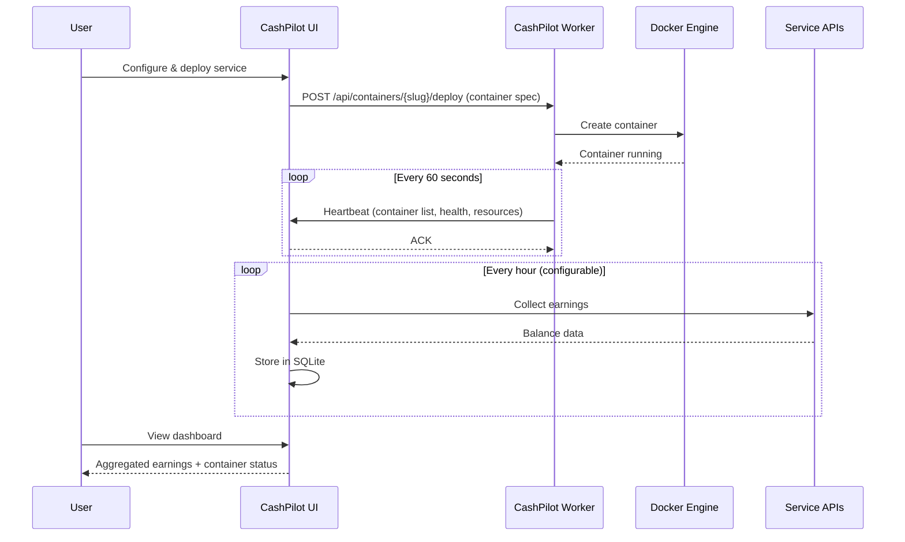

# यह कैसे काम करता है { #how-it-works }

CashPilot एक बँटे हुए **UI + वर्कर** आर्किटेक्चर का इस्तेमाल करता है। UI कभी Docker को नहीं छूता -- कंटेनर के सारे काम वर्करों के ज़रिए होते हैं। यह बँटवारा डिज़ाइन का एक मूल सिद्धांत है और इसी से कई सर्वरों वाले फ़्लीट का प्रबंधन संभव होता है।

## घटक { #components }

| घटक | इमेज | पोर्ट | Docker तक पहुँच | उद्देश्य |
|-----------|-------|:----:|:-------------:|---------|
| **CashPilot UI** | `drumsergio/cashpilot` | 8080 | नहीं | वेब डैशबोर्ड, कमाई का संग्रह, सेवा कैटलॉग, क्रेडेंशियल का भंडारण, समय-क्रम |
| **CashPilot Worker** | `drumsergio/cashpilot-worker` | 8081 | `cashpilot-socket-proxy` के ज़रिए | Docker कंटेनर का जीवनचक्र, सेहत की रिपोर्टिंग, UI को हार्टबीट |

कोई **अलग से चलने वाला मोड नहीं** है। Docker कंटेनर चलाने वाले हर सर्वर को एक वर्कर चाहिए। UI केवल एक डैशबोर्ड/शेड्यूलर है -- यह किसी भी मशीन पर चल सकता है, Docker के बिना वाली मशीन पर भी।

## डिज़ाइन के सिद्धांत { #design-principles }

1. **ज़िम्मेदारियों का बँटवारा।** UI संभालता है: डैशबोर्ड, कमाई का संग्रह, समय-क्रम, उपयोगकर्ता प्रमाणीकरण। वर्कर संभालते हैं: Docker कंटेनर का जीवनचक्र, सेहत की रिपोर्टिंग। इनके काम कभी एक-दूसरे पर नहीं चढ़ते।
2. **वर्करों को Docker चाहिए, socket proxy के ज़रिए।** Docker तक पहुँच के बिना वर्कर बेकार है। साथ आने वाली compose फ़ाइलों के साथ उसे कभी सीधा socket नहीं मिलता: वह `cashpilot-socket-proxy` के ज़रिए Docker तक पहुँचता है। Unraid और TrueNAS लिस्टिंग अब भी सीधा socket माउंट करती हैं ([ऐप स्टोर](app-stores.md))। अगर आपको Docker प्रबंधन नहीं चाहिए, तो कमाई पर नज़र रखने के लिए केवल UI चलाएँ।
3. **सच का एक ही स्रोत।** केवल UI इंस्टेंस ही कमाई इकट्ठा करता है, इतिहास का डेटा रखता है और डैशबोर्ड दिखाता है। वर्कर कभी कमाई इकट्ठा नहीं करते।
4. **कमाई कभी दोहराई नहीं जाती।** क्योंकि केवल UI इकट्ठा करता है, एक ही खाते के दो बार गिने जाने का कोई जोखिम नहीं है।
5. **वर्कर बिना स्थिति वाले उपग्रह हैं।** वर्कर जानता है कि कौन-से कंटेनर चालू रखने हैं और किस UI URL को रिपोर्ट करनी है। वह केवल अपनी id और फ़्लीट कुंजी स्थानीय फ़ाइलों में रखता है (`.worker_id`, `.worker_key`; कोई डेटाबेस नहीं, कमाई का कोई डेटा नहीं)।
6. **YAML ही सच है।** हर सेवा `services/{category}/{slug}.yml` में रहती है। UI, डिप्लॉयमेंट, docs और compose export सब इन्हीं फ़ाइलों से बनते हैं।

## डायरेक्टरी संरचना { #directory-structure }

```
cashpilot/
  app/                      # FastAPI application
    main.py                 # App entrypoint, lifespan, container/fleet/earnings routes
    deps.py                 # Shared auth guards + Jinja2 template environment
    routers/                # Route groups split out of main.py: auth, pages, users
    catalog.py              # Loads YAML service definitions, caches, SIGHUP reload
    orchestrator.py         # Docker SDK: deploy, stop, restart, remove, logs
    database.py             # Async SQLite: earnings, config, deployments, users, workers
    worker_api.py           # Worker REST API: heartbeat, container commands, mini-UI
    setup_token.py          # First-run setup-token gate (owner-account creation)
    metrics.py              # Optional Prometheus metrics (/metrics)
    exchange_rates.py       # Crypto/fiat conversion via CoinGecko + Frankfurter
    collectors/             # Earnings collectors (one module per service, UI only)
      base.py               # BaseCollector ABC + EarningsResult dataclass
      honeygain.py          # Example: JWT auth + balance endpoint
      __init__.py           # COLLECTOR_MAP registry + make_collectors() factory
    templates/              # Jinja2: dashboard, fleet, catalog, setup wizard, payouts, settings
    static/
      css/style.css         # Classic night by default, plus dark, light, sunrise and warm
      js/app.js             # Vanilla JS, CP namespace, Chart.js, wizard state machine
  services/                 # YAML service definitions (SINGLE SOURCE OF TRUTH)
    _schema.yml             # Schema documentation
    bandwidth/              # Bandwidth sharing services
    depin/                  # DePIN services
    storage/                # Storage sharing services
    compute/                # GPU compute services
    mining/                 # Mining services
  docs/                     # Documentation and guides
    guides/                 # Per-service setup guides
  Dockerfile                # UI image: multi-stage python:3.15-alpine, su-exec, non-root
  Dockerfile.worker         # Worker image: minimal deps, no collectors/templates
  docker-compose.yml        # Single-server deployment
  docker-compose.fleet.yml  # Multi-server fleet deployment
```

## डेटा का प्रवाह { #data-flow }



### हार्टबीट (वर्कर से UI को) { #heartbeat-worker-to-ui }

हर 60 सेकंड में हर वर्कर भेजता है:

- स्थिति के साथ कंटेनरों की सूची (running, stopped, exited)
- हर कंटेनर के संसाधन का उपयोग (CPU प्रतिशत, मेमोरी MB)
- सिस्टम की जानकारी (OS, आर्किटेक्चर, hostname, Docker की उपलब्धता)
- अपना खुद बताया URL (साफ़ तौर पर दिया गया `CASHPILOT_WORKER_URL`, या वह न हो तो अपने आप पहचाना गया URL)

UI इसे अपने SQLite डेटाबेस में रखता है और **Fleet** (फ़्लीट) पेज पर दिखाता है।

### आदेश (UI से वर्कर को) { #commands-ui-to-worker }

UI किसी भी वर्कर को ये निर्देश दे सकता है:

- किसी सेवा कंटेनर को **डिप्लॉय करना** (पूरा विवरण: इमेज, env vars, वॉल्यूम, पोर्ट)
- किसी कंटेनर को **रोकना**, **शुरू करना**, **फिर से शुरू करना** या **हटाना**
- किसी कंटेनर से **लॉग लाना**

आदेश UI से वर्कर को REST API कॉल के ज़रिए भेजे जाते हैं।

### क्रेडेंशियल का प्रवाह { #credential-flow }

वर्कर **कभी क्रेडेंशियल न संभालता है न रखता है**:

1. उपयोगकर्ता UI में सेवा के क्रेडेंशियल कॉन्फ़िगर करता है (SQLite में एन्क्रिप्ट करके रखे जाते हैं)।
2. डिप्लॉय करते समय UI पूरा कंटेनर विवरण (env vars सहित) वर्कर को भेजता है।
3. वर्कर वह विवरण Docker API को देता है। Docker env vars को कंटेनर config में रखता है।
4. फिर से शुरू करने पर: `docker restart` env vars को अपने आप बनाए रखता है।
5. पूरी तरह फिर से डिप्लॉय करने पर (हटाना + बनाना): UI पूरा विवरण फिर से भेजता है।

### कमाई का संग्रह { #earnings-collection }

UI हर कॉन्फ़िगर की गई सेवा के लिए तय समय पर कलेक्टर चलाता है:

- **स्वचालित कलेक्टर** सेवा के API से बैलेंस लाते हैं (JWT auth, cookie auth, API कुंजियाँ), उन प्रदाताओं के लिए जिनका ऐसा API है
- नतीजे मूल मुद्रा (USD, MYST, GRASS, STORJ आदि) के साथ SQLite में रखे जाते हैं
- विनिमय दरें CoinGecko (crypto) और Frankfurter (fiat) से लाई जाती हैं, 15 मिनट के लिए कैश की जाती हैं
- हर रीडिंग उस दिन की USD दर रखती है जिस दिन वह ली गई। बिना दर के रखी गई crypto रीडिंग (दर वाले कॉलम से पुरानी) को CoinGecko के दैनिक इतिहास से उसके अपने दिन की कीमत मिलती है, शुरुआत पर और दिन में एक बार; जिस दिन की कोई कीमत नहीं है, वह बिना कीमत के रहता है
- डैशबोर्ड उपयोगकर्ता की पसंदीदा मुद्रा में बदलकर दिखाता है

## तकनीकी स्टैक { #tech-stack }

| तकनीक | उद्देश्य |
|---|---|
| FastAPI | बैकएंड फ़्रेमवर्क (Python 3.15, async) |
| Jinja2 | सर्वर पर रेंडर होने वाले HTML टेम्पलेट |
| SQLite | डेटाबेस (aiosqlite, बिना config के, `/data` में रखा जाता है) |
| Docker SDK for Python | socket के ज़रिए कंटेनर के जीवनचक्र का प्रबंधन |
| PyYAML | सेवा परिभाषाओं को पढ़ना |
| APScheduler | समय-समय पर कमाई का संग्रह |
| httpx | कमाई कलेक्टरों के लिए async HTTP client |
| cryptography (Fernet) | सहेजे गए क्रेडेंशियल का स्टोरेज में एन्क्रिप्शन |
| Chart.js | फ़्रंटएंड पर कमाई के चार्ट |
| su-exec | entrypoint सेटअप के बाद root के अधिकार छोड़कर `cashpilot` उपयोगकर्ता पर आ जाता है (Dockerfile) |

## डेटाबेस { #database }

400 दिन तक डेटा रखने वाला SQLite। मुख्य तालिकाएँ:

- **earnings** -- हर सेवा की कमाई का इतिहास (timestamp, slug, बैलेंस, मुद्रा)
- **deployments** -- सक्रिय कंटेनर डिप्लॉयमेंट (slug, कंटेनर ID, एन्क्रिप्ट किए गए env vars, स्थिति)
- **config** -- key-value सेटिंग्स और एन्क्रिप्ट किए गए क्रेडेंशियल
- **users** -- खाते (यूज़रनेम, bcrypt पासवर्ड hash, भूमिका)
- **user_preferences** -- हर उपयोगकर्ता की ऑनबोर्डिंग स्थिति (सेटअप मोड, चुनी गई श्रेणियाँ, टाइमज़ोन)
- **health_events** -- कंटेनर की सेहत का इतिहास (start, stop, crash, check_ok, check_down)
- **workers** -- फ़्लीट के वर्करों की सूची (client ID, नाम, URL, स्थिति, आख़िरी हार्टबीट, हर वर्कर की एन्क्रिप्ट की गई फ़्लीट कुंजी)

## सुरक्षा मॉडल { #security-model }

- सभी क्रेडेंशियल Fernet symmetric एन्क्रिप्शन से स्टोरेज में एन्क्रिप्ट किए जाते हैं
- वर्कर से UI का प्रमाणीकरण हर वर्कर की अपनी फ़्लीट कुंजी से (`CASHPILOT_API_KEY` केवल नामांकन/bootstrap का क्रेडेंशियल है)
- प्रबंधित कंटेनर `--security-opt no-new-privileges` के साथ चलते हैं
- कंटेनर के नाम का नियम: `cashpilot-{slug}`, लेबल `cashpilot.managed=true` के साथ
- UI कंटेनर को Docker socket तक **कोई** पहुँच नहीं है
- भूमिका प्रणाली (स्वामी/संपादक/दर्शक) के साथ सेशन पर आधारित प्रमाणीकरण
