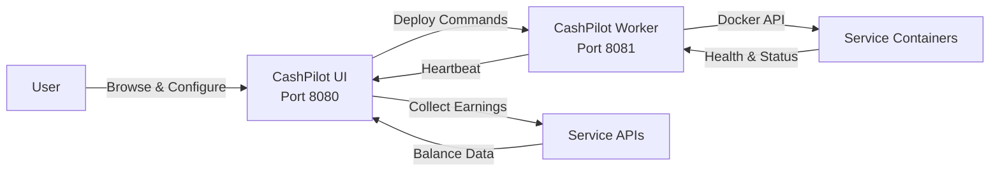

# Memulai { #getting-started }

## Prasyarat { #prerequisites }

- **Docker** dengan **plugin Compose v2, versi 2.23.1 atau lebih baru**. Periksa
  dengan `docker compose version`. Versi yang lebih lama tidak dapat membaca konfigurasi
  inline di file compose. Docker Desktop sudah menyertakan plugin ini. Pada Docker
  Engine biasa di Linux, pasang plugin dari repositori paket Docker
  (https://docs.docker.com/compose/install/linux/). Di macOS dengan Colima,
  pasang dengan Homebrew lalu tautkan sebagai plugin Docker:

    ```sh
    brew install docker-compose
    mkdir -p ~/.docker/cli-plugins
    ln -sfn "$(brew --prefix)/opt/docker-compose/bin/docker-compose" ~/.docker/cli-plugins/docker-compose
    ```

- Host Linux, macOS, atau Windows (amd64 atau arm64)
- Minimal 1 GB RAM yang tersedia untuk CashPilot dan layanan yang dikelolanya
- **Satu CashPilot per host Docker.** Lihat peringatan di bawah.

!!! warning "Satu CashPilot per host Docker"
    Jangan jalankan dua instalasi CashPilot di satu host Docker. File compose
    memakai nama kontainer yang tetap (`cashpilot-ui`, `cashpilot-worker`,
    `cashpilot-socket-proxy`), jadi salinan kedua dari file itu gagal karena
    nama bentrok. Jika Anda mengganti namanya agar lolos, kedua instalasi tetap
    berbagi host. Setiap worker mengelola semua kontainer yang membawa label
    CashPilot, instalasi mana pun yang membuatnya. Jadi setiap dasbor menampilkan,
    menghentikan, dan mengganti aplikasi penghasil milik instalasi lainnya. Keduanya juga berbagi
    jaringan `cashpilot-isolated`, nama aplikasi penghasil (`cashpilot-<service>`),
    port host, dan volume seperti `mysterium-data`. Untuk instalasi kedua,
    gunakan host atau VM lain. Untuk menjalankan aplikasi penghasil di lebih banyak server, tambahkan
    worker ke satu dasbor saja ([Armada](fleet.md)).

## Mulai cepat { #quick-start }

### 1. Unduh file compose dan jalankan { #1-fetch-the-compose-file-and-launch }

```bash
curl -fsSLO https://raw.githubusercontent.com/GeiserX/CashPilot/main/docker-compose.yml
docker compose up -d
```

Perintah ini menjalankan tiga kontainer yang terus berjalan. Sebelum itu, kontainer sekali jalan
`cashpilot-migrate` berjalan dan keluar dengan kode 0 pada setiap `up`, sehingga
`docker compose ps -a` menampilkannya sebagai `Exited (0)`. Itu normal.

| Kontainer | Port | Fungsi |
|-----------|------|---------|
| **cashpilot-migrate** | tidak ada | Berjalan sekali lalu keluar. Kontainer ini memindahkan data yang dibuat rilis lama ke volume yang diterima socket proxy, dan pada instalasi baru tidak menemukan apa pun untuk dikerjakan |
| **cashpilot-ui** | 8080 | Dasbor web, pengumpulan penghasilan, katalog layanan |
| **cashpilot-worker** | 8081 | Agen Docker yang menerapkan dan memantau kontainer layanan |
| **cashpilot-socket-proxy** | tidak ada | Memegang socket Docker dalam mode baca saja dan memberi worker salinan yang sudah difilter ([Pengaturan keamanan bawaan](security-defaults.md)) |

### 2. Buka dasbor { #2-open-the-dashboard }

Buka [http://localhost:8080](http://localhost:8080) di browser Anda. Karena belum ada akun, Anda akan masuk ke halaman sambutan, yang membuat akun pemilik.

!!! tip "Port 8080 sudah dipakai?"
    Pilih port host lain di file `.env` di samping `docker-compose.yml`,
    alih-alih mengedit file compose:

    ```bash
    printf '\nCASHPILOT_UI_PORT=8088\n' >> .env
    docker compose up -d
    ```

    Lalu buka http://localhost:8088. Simpan nilai itu di `.env`, karena
    pembaruan dari dalam aplikasi membaca file tersebut, bukan shell Anda. (`printf` diawali
    baris baru agar baris itu tidak pernah menyambung ke baris terakhir dari `.env` yang sudah ada.)

    Variabel ini memerlukan `docker-compose.yml` yang baris `ports:`-nya berbunyi
    `${CASHPILOT_UI_PORT:-8080}:8080`. File dari v1.61 dan yang lebih lama menulis langsung
    `8080:8080` dan mengabaikannya. Unduh file terbaru, atau
    pertahankan pemetaan port hasil edit Anda sendiri: pembaruan dari dalam aplikasi juga menerimanya.

!!! warning "Token penyiapan untuk proses pertama wajib ada"
    Saat pertama kali dijalankan, CashPilot membuat token penyiapan sekali pakai dan mencetaknya ke log kontainer **cashpilot-ui**:

    ```bash
    docker compose logs cashpilot-ui
    ```

    Cari baris seperti:

    ```
    FIRST-RUN SETUP: no account exists yet. Open /register and enter this
    one-time setup token to create the owner account: <token>
    ```

    Salin token itu ke kolom **Setup token** (Token penyiapan) pada langkah **Owner account** (Akun pemilik) di halaman sambutan, bersama nama pengguna dan kata sandi, untuk membuat akun pertama (pemilik). Token ini hanya pernah ditampilkan di log, tidak pernah di URL, dan dibuang selamanya begitu akun pemilik ada.

### 3. Jelajahi katalog layanan { #3-browse-the-service-catalog }

Halaman **Catalog** (Katalog) menampilkan setiap layanan beserta platformnya, perkiraan bulanan, dan apa yang dibutuhkannya (IP residensial, GPU). Filter menurut kategori (Bandwidth, DePIN, Penyimpanan, Komputasi, Penambangan) atau cari berdasarkan nama. **Add** (Tambah) membuka wizard penyiapan untuk layanan itu, **Details** (Detail) menampilkan deskripsi, pembayaran, dan risiko penerapannya, dan layanan yang tidak berjalan di Docker mendapat tautan **Visit** (Kunjungi) sebagai gantinya.

Dua jenis layanan perlu diperiksa lebih teliti terlebih dahulu: layanan yang baru membayar setelah Anda mengunci stake token, seperti Anyone Protocol, Sia, dan Flux, serta relay yang memublikasikan IP Anda, yang bisa menurunkan bayaran dari aplikasi bandwidth residensial. Lihat [Periksa dua hal sebelum Anda menerapkan](guides/index.md).

### 4. Tambahkan layanan dengan wizard { #4-add-services-with-the-wizard }

Setelah akun pemilik ada, **Add services** (Tambah layanan) membuka wizard penyiapan; setelah itu, tombol **+ Add service** (+ Tambah layanan) di bilah atas membukanya lagi. Pilih kategori, lalu layanan. Untuk setiap layanan, wizard menampilkan tautan **Sign Up** (Daftar), hanya meminta kredensial yang dibutuhkan layanan itu (email dan kata sandi, token API, dan sebagainya), dan membiarkan Anda memilih worker yang akan menjalankannya. Klik **Deploy** (Terapkan) dan CashPilot menarik image, membuat kontainer, dan mulai mengawasinya.

### 5. Pantau di dasbor { #5-watch-it-on-the-dashboard }

Dasbor menampilkan setiap layanan yang diterapkan beserta status dan saldonya, dan halaman **Fleet** (Armada) menampilkan setiap worker.

## Cara kerja { #how-it-works }



1. **Anda mengonfigurasi** layanan melalui UI web -- pilih layanan, masukkan kredensial, klik terapkan.
2. **UI mengirim** spesifikasi kontainer (image, variabel lingkungan, volume) ke worker melalui REST API.
3. **Worker membuat** kontainer Docker dan mulai memantau kesehatannya.
4. **Worker melaporkan** status kontainer kembali ke UI setiap 60 detik melalui sinyal aktif.
5. **UI mengumpulkan** penghasilan dari API layanan sesuai jadwal yang dapat dikonfigurasi (bawaan: setiap jam).
6. **Dasbor** menampilkan penghasilan gabungan, rincian per layanan, dan kesehatan kontainer.

## Konfigurasi { #configuration }

### Variabel lingkungan UI { #ui-environment-variables }

| Variabel | Bawaan | Deskripsi |
|----------|---------|-------------|
| `TZ` | `UTC` | Zona waktu untuk penjadwalan dan tampilan |
| `CASHPILOT_SECRET_KEY` | *(dibuat otomatis)* | Kunci penanda tangan untuk sesi login. Disimpan di `/data/.secret_key`. **Tidak mengenkripsi kredensial** |
| `CASHPILOT_ENCRYPTION_KEY` | *(dibuat otomatis)* | Kunci Fernet yang mengenkripsi kredensial tersimpan saat diam. Disimpan di `/data/.fernet_key`. Hanya dipakai jika file itu tidak ada, jadi setel hanya untuk memulihkan cadangan |
| `CASHPILOT_API_KEY` | *(dari `/fleet`)* | Kunci pendaftaran bersama untuk worker. Setiap worker mendapat kuncinya sendiri saat mendaftar; lihat [Armada](fleet.md) |
| `CASHPILOT_COLLECT_INTERVAL` | `60` | Menit di antara siklus pengumpulan penghasilan |
| `CASHPILOT_UI_PORT` | `8080` | Port host tempat UI dipublikasikan. Setel di `.env` jika 8080 sudah terpakai |
| `CASHPILOT_BIND_ADDR` | `127.0.0.1` | Antarmuka host tempat port UI dipublikasikan. **Loopback secara bawaan**: dasbor dapat memberi perintah ke worker yang memegang socket Docker, jadi secara bawaan dasbor tidak terbuka ke jaringan Anda. Setel IP tertentu (mis. alamat Tailscale/VPN) atau `0.0.0.0` untuk membukanya, atau (lebih disarankan) jalankan reverse proxy yang melakukan autentikasi di depannya |

Port web UI di dalam kontainer tetap di `8080` (diatur melalui `CMD` kontainer). `CASHPILOT_UI_PORT` dan `CASHPILOT_BIND_ADDR` hanya memilih port host dan antarmuka tempat port itu dipublikasikan.

### Variabel lingkungan worker { #worker-environment-variables }

| Variabel | Bawaan | Deskripsi |
|----------|---------|-------------|
| `TZ` | `UTC` | Zona waktu |
| `CASHPILOT_UI_URL` | -- | URL kontainer UI, mis. `http://cashpilot-ui:8080` |
| `CASHPILOT_API_KEY` | -- | Harus sama dengan kunci pendaftaran UI. Hanya diperlukan untuk mendaftar; setelah itu worker memakai kuncinya sendiri |
| `CASHPILOT_WORKER_NAME` | *(hostname)* | Nama tampilan worker ini di dasbor armada |
| `CASHPILOT_WORKER_URL` | *(terdeteksi otomatis)* | URL yang dipakai UI untuk menjangkau worker ini, mis. `http://192.168.1.50:8081`. Setel secara eksplisit untuk armada lintas host: deteksi otomatis bisa melaporkan IP internal kontainer yang tidak dapat dijangkau |
| `CASHPILOT_WORKER_BIND_ADDR` | `127.0.0.1` | **Hanya untuk compose armada dan worker jarak jauh** (`docker-compose.fleet.yml`): antarmuka host tempat port API worker yang memegang socket Docker dipublikasikan, loopback secara bawaan. `docker-compose.yml` bawaan sama sekali tidak memublikasikan port 8081. API worker dapat menerapkan/menghentikan kontainer apa pun (= root di host), jadi untuk worker jarak jauh, ikat ke antarmuka privat/VPN (mis. IP Tailscale), **jangan pernah** ke IP publik |
| `CASHPILOT_PORT` | `8081` | Port yang **diumumkan** worker ke UI. Variabel ini *tidak* mengubah port tempat worker mendengarkan, yang ditetapkan oleh `CMD` image; lihat [referensi konfigurasi](configuration.md) |

### Contoh Docker Compose { #docker-compose-example }

```yaml
--8<-- "docker-compose.yml"
```

!!! note "Ini file yang sebenarnya"

    Blok di atas disertakan apa adanya dari `docker-compose.yml` di
    repositori, sehingga tidak bisa menyimpang dari apa yang benar-benar dirilis. Dulu, versi
    yang disalin secara manual memublikasikan API worker yang memegang socket Docker di setiap
    antarmuka dan mengunci `:latest`, dua hal yang menurut halaman
    [pengaturan keamanan bawaan](security-defaults.md) tidak boleh Anda lakukan.

!!! warning "Akses socket Docker"
    Worker mengelola kontainer layanan melalui Docker, tetapi tidak memasang `/var/run/docker.sock`. Kontainer `cashpilot-socket-proxy` memegang socket itu dan hanya meneruskan ke worker panggilan yang memang dibuatnya, sambil menolak kontainer privileged dan bind folder host yang belum Anda daftarkan ([apa yang ditolaknya](security-defaults.md#docker-socket-proxy)). Pembaruan dari dalam aplikasi bersifat opsional: pembaruan itu hanya berjalan dengan `CASHPILOT_COMPOSE_DIR=<this folder>` di `.env` di samping file compose, dan pengaturan itu mengizinkan kontainer melakukan bind ke folder tersebut, yang melemahkan proxy ([apa harganya](security-defaults.md#docker-socket-proxy)). Biarkan tidak diatur dan perbarui dengan `docker compose pull && docker compose up -d`. Worker tetap mengendalikan setiap kontainer di host, jadi jalankan CashPilot di mesin atau VLAN khusus untuk keamanan terbaik.

!!! tip "Persistensi kunci rahasia"
    Kredensial dienkripsi dengan `CASHPILOT_ENCRYPTION_KEY`, **bukan** `CASHPILOT_SECRET_KEY`, yang hanya menandatangani sesi login. Kunci enkripsi dibuat otomatis saat pertama kali dijalankan dan disimpan di `/data/.fernet_key`. **Cadangkan file itu.** Jika volume dibuat ulang tanpa file itu, kunci baru akan dibuat dan setiap kredensial tersimpan menjadi tidak dapat dibaca selamanya. Menyetel `CASHPILOT_ENCRYPTION_KEY` berguna untuk memulihkan cadangan itu; file kunci selalu menang, jadi menyetelnya pada instans yang sehat tidak mengubah apa pun.

!!! tip "Kata sandi dan rahasia di UI"
    Ubah kata sandi Anda kapan saja dari menu avatar -> **Change password** (Ubah kata sandi) (tersedia untuk semua peran); tindakan ini mengeluarkan sesi Anda yang lain. Di **Settings** (Pengaturan), rahasia yang tersimpan bersifat hanya-tulis: masukkan nilai untuk mengubahnya, atau kosongkan kolom untuk mempertahankan nilai yang ada. Kredensial yang tersimpan tidak pernah dikirim kembali ke browser.

## Memperbarui CashPilot { #updating-cashpilot }

File compose mengunci satu seri major.minor, seperti `drumsergio/cashpilot:X.Y`, sehingga `pull` mengambil patch terbaru dari seri itu:

```bash
docker compose pull
docker compose up -d
```

`docker compose pull` mengambil image terbaru yang dipublikasikan dan `up -d` hanya membuat ulang
kontainer yang image-nya berubah. File compose yang dirilis menyetel
`pull_policy: always`, sehingga `docker compose up -d` saja pun akan menarik
image terbaru lebih dulu.

**Dari dasbor.** **Settings** (Pengaturan), **About and updates** (Tentang dan pembaruan) menjalankan dua
perintah yang sama untuk Anda dari kontainer pembantu yang berumur pendek. Kontainer pembantu itu membaca
file compose Anda dan `.env` di sampingnya (atau file yang Anda berikan dengan
`--env-file`), tidak pernah shell tempat Anda menjalankan CashPilot. Misalnya Anda menjalankannya dengan `CASHPILOT_UI_PORT=8088 docker compose up -d`.
Pembaruan akan mengembalikan dasbor ke 8080, jadi pembaruan berhenti dan memberi tahu alasannya
sebagai gantinya. Masukkan nilai itu ke `.env` dan tombolnya akan berfungsi.

!!! note "Anda **tidak** perlu membangun ulang"
    CashPilot merilis image multi-arsitektur yang sudah jadi di Docker Hub
    ([`drumsergio/cashpilot`](https://hub.docker.com/r/drumsergio/cashpilot),
    [`drumsergio/cashpilot-worker`](https://hub.docker.com/r/drumsergio/cashpilot-worker)).
    `docker compose build` / `--build` hanya relevan jika Anda sengaja
    membangun dari kode sumber dengan `docker-compose.build.yml`. Untuk instalasi normal,
    `pull` + `up -d` adalah prosedur pembaruan yang lengkap dan benar.

### Mengunci versi tertentu { #pinning-a-specific-version }

Untuk tetap di satu rilis yang persis, ganti tag seri `X.Y` di
`docker-compose.yml` dengan tag rilis lengkap `X.Y.Z` pada
`drumsergio/cashpilot` dan `drumsergio/cashpilot-worker` (selalu tag yang sama pada
keduanya), lalu hapus `pull_policy: always`. Telusuri tag di
[Docker Hub](https://hub.docker.com/r/drumsergio/cashpilot/tags).

Untuk pindah ke seri yang lebih baru, edit kedua tag: pertama di host UI, lalu di
setiap host worker. Baca
[UPGRADING.md](https://github.com/GeiserX/CashPilot/blob/main/UPGRADING.md)
terlebih dahulu, karena rilis major seperti 3.0 punya langkahnya sendiri.

### Mengotomatiskan pembaruan (opsional) { #automating-updates-optional }

Jika Anda ingin pembaruan tanpa campur tangan, arahkan penjadwal ke dua perintah yang sama,
misalnya dengan entri cron harian:

```cron
0 4 * * *  cd /path/to/cashpilot && docker compose pull && docker compose up -d
```

Atau jalankan pembaru otomatis seperti [Watchtower](https://containrrr.dev/watchtower/)
atau [Diun](https://crazymax.dev/diun/) terhadap kontainer CashPilot. Ini
opsional. CashPilot tidak menyertakan pembaru.

### Membersihkan image lama { #cleaning-up-old-images }

CashPilot menarik image tetapi tidak pernah menghapusnya. Setiap pembaruan dan setiap penerapan ulang
bisa meninggalkan image sebelumnya di disk. Pada armada uji tiga server, image lama
CashPilot dan aplikasi penghasil totalnya sekitar 3 GB. Itu kecil dibanding
apa yang biasanya ditinggalkan program lain di host yang sama, jadi periksa
seluruh host:

```bash
docker system df
```

Nilai `RECLAIMABLE` pada baris `Images` adalah ruang yang bisa dibebaskan Docker.

**Mengapa CashPilot tidak melakukannya untuk Anda.** Worker menjangkau Docker melalui
socket proxy. Untuk image, proxy hanya mengizinkannya menarik satu image dan membaca satu image berdasarkan nama,
tidak lebih. Worker tidak dapat menampilkan daftar image host atau menghapusnya. Worker yang
bisa melakukannya juga akan melihat dan menghapus image setiap program lain di host.
Lihat [apa yang ditolak proxy](security-defaults.md#docker-socket-proxy).

**Langkah 1: hapus image yang menggantung.** Image yang menggantung tidak punya tag dan tidak
dipakai kontainer mana pun, baik yang berjalan maupun yang berhenti. Pembaruan lewat tag bergerak seperti
`X.Y` (seri seperti yang dikunci file compose), `latest`, atau digest meninggalkan persis image seperti ini:

```bash
docker image prune
```

Perintah ini juga menghapus image yang Anda jalankan sebelum pembaruan lewat tag bergerak: begitu
image baru untuk seri itu tiba, image lama tidak lagi punya tag. Agar tetap punya jalan kembali, catat
versi persisnya sebelum Anda memperbarui (bagian bawah bilah samping menampilkannya), sehingga
Anda bisa menarik `drumsergio/cashpilot:<X.Y.Z>` lagi. Atau kunci file compose ke
tag `X.Y.Z` yang persis; maka image lama tetap punya tag dan langkah 2 berlaku.

Docker bertanya sebelum menghapus. Dalam entri cron, tambahkan `--force` untuk melewati
pertanyaan itu. Opsi ini tidak mengubah hal lain:

```cron
30 4 * * 0  docker image prune --force
```

!!! warning "Jangan tambahkan `-a`"
    `docker image prune -a` menghapus setiap image yang saat ini tidak dipakai kontainer mana pun,
    baik yang menggantung maupun yang bertag. Itu termasuk image dari stack yang sengaja Anda hentikan
    dan image yang Anda bangun secara lokal dan tidak bisa ditarik lagi.

**Langkah 2: hapus tag lama yang dikunci.** Image yang dikunci ke suatu versi tetap mempertahankan tagnya
setelah Anda pindah ke versi yang lebih baru, sehingga `prune` melewatinya. Image CashPilot berikut
dikunci:

| Repositori | Yang menguncinya |
|---|---|
| `drumsergio/cashpilot` | File compose (seri lama, atau versi persis yang Anda kunci) |
| `drumsergio/cashpilot-worker` | File compose, sama seperti di atas |
| `drumsergio/cashpilot-tunnel` | Worker, satu tag per versi worker |
| `drumsergio/cashpilot-earnapp` | Entri katalog EarnApp |
| `drumsergio/cashpilot-anyone` | Entri katalog Anyone Protocol |

Hal yang sama berlaku untuk image layanan yang sudah Anda hapus: tagnya tetap ada sampai Anda
menghapusnya. Image katalog yang dikunci dengan digest, seperti MystNodes atau ProxyBase,
kehilangan tagnya saat image yang lebih baru menggantikannya, sehingga langkah 1 sudah mencakupnya.

Pertama, tampilkan tag yang tidak dipakai kontainer mana pun. Contoh ini untuk image worker.
Untuk repositori lain dari tabel, ubah `repo`:

```bash
repo=drumsergio/cashpilot-worker
used=$(docker ps -a --format '{{.Image}}')
docker image ls "$repo" --format '{{.Repository}}:{{.Tag}}' | grep -vxF "$used"
```

Lalu hapus setiap tag lama berdasarkan nama, satu per satu:

```bash
docker image rm drumsergio/cashpilot-worker:<old tag>
```

Jangan tambahkan `-f`. Tanpa opsi itu, Docker menolak menghapus image yang
masih dipakai kontainer, baik yang berjalan maupun yang berhenti, dan mencetak
`conflict: unable to delete`. Jika Anda melihatnya, pertahankan image itu. Pertahankan tag
yang Anda jalankan dan tag yang Anda jalankan sebelumnya, agar Anda masih bisa mundur satu versi.
Hapus hanya tag yang lebih lama dari keduanya.

Kolom **Host disk** (Disk host) di dasbor menampilkan ruang kosong pada sistem file yang
menyimpan `/data` milik worker. Image biasanya berada di sistem file yang sama, di bawah
direktori data root Docker, tetapi tidak selalu. `docker info --format '{{.DockerRootDir}}'`
menampilkan data root Docker. Dengan containerd image store, bawaan pada
instalasi baru Docker Engine 29, image berada di bawah root containerd,
biasanya `/var/lib/containerd`. `docker info --format '{{.Driver}}'` mencetak
`overlayfs` untuk containerd image store dan `overlay2` untuk yang klasik.
Periksa ruang kosong pada sistem file yang menyimpan direktori yang berlaku.

## Layanan yang didukung { #supported-services }

CashPilot mendukung **<!-- n:live -->50<!-- /n --> layanan** yang aktif atau dalam beta, dalam lima kategori:

- **Berbagi bandwidth** (<!-- n:bandwidth -->18<!-- /n -->): bagikan bandwidth internet Anda untuk penghasilan pasif
- **DePIN** (<!-- n:depin -->15<!-- /n -->): jaringan infrastruktur fisik terdesentralisasi
- **Komputasi GPU** (<!-- n:compute -->7<!-- /n -->): sewakan GPU Anda untuk beban kerja AI dan komputasi
- **Penyimpanan** (<!-- n:storage -->2<!-- /n -->): bagikan ruang disk di jaringan penyimpanan terdesentralisasi
- **Penambangan** (<!-- n:mining -->8<!-- /n -->): terapkan penambang atau lacak pool berdasarkan alamat pembayaran ([Penambangan](mining.md))

Dari jumlah itu, **<!-- n:docker -->21<!-- /n -->** dapat diterapkan dan dikelola otomatis melalui Docker. Katalog melacak <!-- n:tracked -->29<!-- /n --> sisanya (<!-- n:extension -->18<!-- /n --> aplikasi browser atau desktop, <!-- n:gpu -->7<!-- /n --> node GPU, <!-- n:mining_pools -->4<!-- /n --> pool penambangan). CashPilot membaca saldonya jika kolektor untuknya tersedia.

Jelajahi katalog lengkap di bagian [Panduan layanan](guides/index.md).

## Langkah berikutnya { #next-steps }

- [Cara kerja](how-it-works.md) -- Pahami desain yang memisahkan UI dan Worker
- [Pengelolaan armada](fleet.md) -- Terapkan di beberapa server
- [Melindungi jaringan rumah Anda](home-network-security.md) -- Jauhkan kontainer dari LAN Anda, dan kapan gVisor membantu
- [Panduan layanan](guides/index.md) -- Petunjuk penyiapan terperinci untuk setiap layanan
- [Menghapus CashPilot sepenuhnya](uninstall.md) -- Hapus semua yang dibuatnya, untuk memulai dari awal atau untuk berhenti
