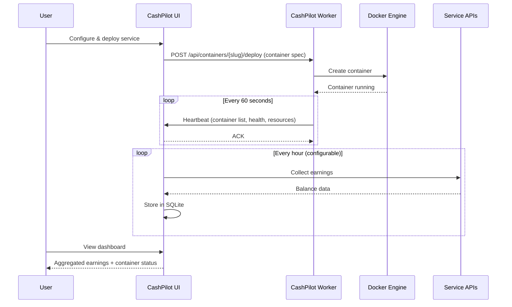

# Cara kerja { #how-it-works }

CashPilot memakai arsitektur terpisah **UI + Worker**. UI tidak pernah menyentuh Docker -- semua operasi kontainer berjalan melalui worker. Pemisahan ini adalah prinsip desain inti dan yang memungkinkan pengelolaan armada multi-server.

## Komponen { #components }

| Komponen | Image | Port | Akses Docker | Fungsi |
|-----------|-------|:----:|:-------------:|---------|
| **CashPilot UI** | `drumsergio/cashpilot` | 8080 | Tidak | Dasbor web, pengumpulan penghasilan, katalog layanan, penyimpanan kredensial, penjadwalan |
| **CashPilot Worker** | `drumsergio/cashpilot-worker` | 8081 | Melalui `cashpilot-socket-proxy` | Siklus hidup kontainer Docker, pelaporan kesehatan, sinyal aktif ke UI |

**Tidak ada mode mandiri**. Setiap server yang menjalankan kontainer Docker memerlukan worker. UI murni dasbor/penjadwal -- UI bisa berjalan di mesin apa pun, termasuk mesin tanpa Docker.

## Prinsip desain { #design-principles }

1. **Pemisahan tanggung jawab.** UI menangani: dasbor, pengumpulan penghasilan, penjadwalan, autentikasi pengguna. Worker menangani: siklus hidup kontainer Docker, pelaporan kesehatan. Keduanya tidak pernah tumpang tindih.
2. **Worker memerlukan Docker, melalui socket proxy.** Worker tanpa akses Docker tidak berguna. Dengan file compose yang dirilis, worker tidak pernah mendapat socket mentah: worker menjangkau Docker melalui `cashpilot-socket-proxy`. Listing Unraid dan TrueNAS masih memasang socket mentah ([toko aplikasi](app-stores.md)). Jika Anda tidak memerlukan pengelolaan Docker, cukup jalankan UI saja untuk melacak penghasilan.
3. **Satu sumber kebenaran.** Instans UI adalah satu-satunya yang mengumpulkan penghasilan, menyimpan data historis, dan menyajikan dasbor. Worker tidak pernah mengumpulkan penghasilan.
4. **Penghasilan tidak pernah tercatat ganda.** Karena hanya UI yang mengumpulkan, tidak ada risiko akun yang sama terhitung dua kali.
5. **Worker adalah satelit tanpa status.** Worker tahu kontainer mana yang harus tetap berjalan dan URL UI tempat ia melapor. Worker hanya menyimpan id dan kunci armadanya sendiri di file lokal (`.worker_id`, `.worker_key`; tanpa database, tanpa data penghasilan).
6. **YAML adalah kebenaran.** Setiap layanan berada di `services/{category}/{slug}.yml`. UI, penerapan, dokumentasi, dan ekspor compose semuanya berasal dari file-file ini.

## Struktur direktori { #directory-structure }

```
cashpilot/
  app/                      # FastAPI application
    main.py                 # App entrypoint, lifespan, container/fleet/earnings routes
    deps.py                 # Shared auth guards + Jinja2 template environment
    routers/                # Route groups split out of main.py: auth, pages, users
    catalog.py              # Loads YAML service definitions, caches, SIGHUP reload
    orchestrator.py         # Docker SDK: deploy, stop, restart, remove, logs
    database.py             # Async SQLite: earnings, config, deployments, users, workers
    worker_api.py           # Worker REST API: heartbeat, container commands, mini-UI
    setup_token.py          # First-run setup-token gate (owner-account creation)
    metrics.py              # Optional Prometheus metrics (/metrics)
    exchange_rates.py       # Crypto/fiat conversion via CoinGecko + Frankfurter
    collectors/             # Earnings collectors (one module per service, UI only)
      base.py               # BaseCollector ABC + EarningsResult dataclass
      honeygain.py          # Example: JWT auth + balance endpoint
      __init__.py           # COLLECTOR_MAP registry + make_collectors() factory
    templates/              # Jinja2: dashboard, fleet, catalog, setup wizard, payouts, settings
    static/
      css/style.css         # Classic night by default, plus dark, light, sunrise and warm
      js/app.js             # Vanilla JS, CP namespace, Chart.js, wizard state machine
  services/                 # YAML service definitions (SINGLE SOURCE OF TRUTH)
    _schema.yml             # Schema documentation
    bandwidth/              # Bandwidth sharing services
    depin/                  # DePIN services
    storage/                # Storage sharing services
    compute/                # GPU compute services
    mining/                 # Mining services
  docs/                     # Documentation and guides
    guides/                 # Per-service setup guides
  Dockerfile                # UI image: multi-stage python:3.15-alpine, su-exec, non-root
  Dockerfile.worker         # Worker image: minimal deps, no collectors/templates
  docker-compose.yml        # Single-server deployment
  docker-compose.fleet.yml  # Multi-server fleet deployment
```

## Alur data { #data-flow }



### Sinyal aktif (worker ke UI) { #heartbeat-worker-to-ui }

Setiap 60 detik, setiap worker mengirim:

- Daftar kontainer beserta statusnya (running, stopped, exited)
- Pemakaian sumber daya per kontainer (persen CPU, MB memori)
- Info sistem (OS, arsitektur, hostname, ketersediaan Docker)
- URL yang dilaporkannya sendiri (`CASHPILOT_WORKER_URL` yang eksplisit atau cadangan hasil deteksi otomatis)

UI menyimpan data ini di database SQLite-nya dan menampilkannya di halaman **Fleet** (Armada).

### Perintah (UI ke worker) { #commands-ui-to-worker }

UI dapat menginstruksikan worker mana pun untuk:

- **Deploy** (Terapkan) kontainer layanan (spesifikasi lengkap: image, variabel lingkungan, volume, port)
- **Stop** (Hentikan), **start** (Mulai), **restart** (Mulai ulang), atau **remove** (Hapus) kontainer
- **Fetch logs** (Ambil log) dari kontainer

Perintah dikirim melalui panggilan REST API dari UI ke worker.

### Alur kredensial { #credential-flow }

Worker **tidak pernah menangani atau menyimpan kredensial**:

1. Pengguna mengonfigurasi kredensial layanan di UI (disimpan terenkripsi di SQLite).
2. Saat menerapkan, UI mengirim spesifikasi kontainer lengkap (termasuk variabel lingkungan) ke worker.
3. Worker meneruskan spesifikasi itu ke API Docker. Docker menyimpan variabel lingkungan di konfigurasi kontainer.
4. Untuk restart: `docker restart` mempertahankan variabel lingkungan secara bawaan.
5. Untuk penerapan ulang penuh (hapus + buat): UI mengirim ulang spesifikasi lengkap.

### Pengumpulan penghasilan { #earnings-collection }

UI menjalankan kolektor terjadwal untuk setiap layanan yang dikonfigurasi:

- **Kolektor otomatis** mengambil saldo melalui API layanan (autentikasi JWT, autentikasi cookie, kunci API) untuk penyedia yang memilikinya
- Hasil disimpan di SQLite dalam mata uang aslinya (USD, MYST, GRASS, STORJ, dll.)
- Kurs diambil dari CoinGecko (kripto) dan Frankfurter (fiat), di-cache selama 15 menit
- Setiap pembacaan menyimpan kurs USD pada hari pembacaan itu diambil. Pembacaan kripto yang disimpan tanpa kurs (lebih lama dari kolom kurs) mendapat harga pada harinya sendiri dari riwayat harian CoinGecko, saat startup dan sekali sehari; hari tanpa harga tetap tanpa harga
- Dasbor mengonversi dan menampilkan dalam mata uang pilihan pengguna

## Teknologi { #tech-stack }

| Teknologi | Fungsi |
|---|---|
| FastAPI | Framework backend (Python 3.15, async) |
| Jinja2 | Template HTML yang dirender di server |
| SQLite | Database (aiosqlite, tanpa konfigurasi, disimpan di `/data`) |
| Docker SDK for Python | Pengelolaan siklus hidup kontainer melalui socket |
| PyYAML | Parsing definisi layanan |
| APScheduler | Pengumpulan penghasilan berkala |
| httpx | Klien HTTP async untuk kolektor penghasilan |
| cryptography (Fernet) | Enkripsi saat diam untuk kredensial tersimpan |
| Chart.js | Grafik penghasilan di frontend |
| su-exec | Menurunkan root ke pengguna `cashpilot` setelah penyiapan entrypoint (Dockerfile) |

## Database { #database }

SQLite dengan retensi data 400 hari. Tabel utama:

- **earnings** -- Riwayat penghasilan per layanan (timestamp, slug, saldo, mata uang)
- **deployments** -- Penerapan kontainer yang aktif (slug, ID kontainer, variabel lingkungan terenkripsi, status)
- **config** -- Pengaturan key-value dan kredensial terenkripsi
- **users** -- Akun (nama pengguna, hash kata sandi bcrypt, peran)
- **user_preferences** -- Status orientasi per pengguna (mode penyiapan, kategori terpilih, zona waktu)
- **health_events** -- Riwayat kesehatan kontainer (start, stop, crash, check_ok, check_down)
- **workers** -- Registri worker armada (ID klien, nama, URL, status, sinyal aktif terakhir, kunci armada per worker yang terenkripsi)

## Model keamanan { #security-model }

- Semua kredensial dienkripsi saat diam dengan enkripsi simetris Fernet
- Autentikasi worker ke UI melalui kunci armada per worker (`CASHPILOT_API_KEY` hanya kredensial pendaftaran/bootstrap)
- Kontainer yang dikelola berjalan dengan `--security-opt no-new-privileges`
- Konvensi penamaan kontainer: `cashpilot-{slug}` dengan label `cashpilot.managed=true`
- Kontainer UI **tidak** punya akses ke socket Docker
- Autentikasi berbasis sesi dengan sistem peran (owner/writer/viewer: pemilik, editor, dan penonton)
