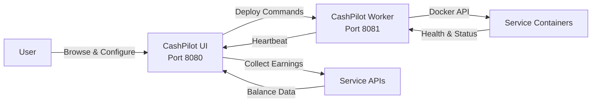

# Primi passi { #getting-started }

## Prerequisiti { #prerequisites }

- **Docker** con il **plugin Compose v2, versione 2.23.1 o successiva**. Controlla
  con `docker compose version`. Le versioni più vecchie non sanno leggere la
  configurazione inline del file compose. Docker Desktop include il plugin. Su un
  Docker Engine senza extra su Linux, installalo dal repository dei pacchetti di Docker
  (<https://docs.docker.com/compose/install/linux/>). Su macOS con Colima,
  installalo con Homebrew e collegalo come plugin di Docker:

    ```sh
    brew install docker-compose
    mkdir -p ~/.docker/cli-plugins
    ln -sfn "$(brew --prefix)/opt/docker-compose/bin/docker-compose" ~/.docker/cli-plugins/docker-compose
    ```

- Un host Linux, macOS o Windows (amd64 o arm64)
- Almeno 1 GB di RAM libera per CashPilot e i servizi che gestisce
- **Un solo CashPilot per host Docker.** Leggi l'avviso qui sotto.

!!! warning "Un solo CashPilot per host Docker"
    Non eseguire due installazioni di CashPilot sullo stesso host Docker. I file
    compose usano nomi di container fissi (`cashpilot-ui`, `cashpilot-worker`,
    `cashpilot-socket-proxy`), quindi una seconda copia del file fallisce per un
    conflitto di nomi. Se li rinomini per aggirare il problema, le due installazioni
    condividono comunque l'host. Ogni worker gestisce tutti i container che portano
    le etichette di CashPilot, qualunque installazione li abbia creati. Così ogni
    dashboard elenca, ferma e sostituisce le app di guadagno dell'altra. Le due
    condividono anche la rete `cashpilot-isolated`, i nomi delle app di guadagno
    (`cashpilot-<service>`), le loro porte sull'host e volumi come `mysterium-data`.
    Per una seconda installazione usa un altro host o una VM. Per eseguire app di
    guadagno su più server, aggiungi invece dei worker a un'unica dashboard ([Flotta](fleet.md)).

## Avvio rapido { #quick-start }

### 1. Scarica il file compose e avvialo { #1-fetch-the-compose-file-and-launch }

```bash
curl -fsSLO https://raw.githubusercontent.com/GeiserX/CashPilot/main/docker-compose.yml
docker compose up -d
```

Questo avvia tre container di lunga durata. Prima di loro, un `cashpilot-migrate`
monouso viene eseguito ed esce con codice 0 a ogni `up`, quindi
`docker compose ps -a` lo mostra come `Exited (0)`. È normale.

| Container | Porta | Scopo |
|-----------|------|---------|
| **cashpilot-migrate** | nessuna | Viene eseguito una volta ed esce. Sposta i dati che una release precedente aveva messo su volumi che il socket proxy accetta, e su una nuova installazione non trova nulla da fare |
| **cashpilot-ui** | 8080 | Dashboard web, raccolta dei guadagni, catalogo dei servizi |
| **cashpilot-worker** | 8081 | Agente Docker che distribuisce e monitora i container dei servizi |
| **cashpilot-socket-proxy** | nessuna | Tiene il socket Docker in sola lettura e dà al worker una copia filtrata ([Impostazioni di sicurezza predefinite](security-defaults.md)) |

### 2. Apri la dashboard { #2-open-the-dashboard }

Apri [http://localhost:8080](http://localhost:8080) nel browser. Poiché non esiste ancora nessun account, arrivi alla pagina di benvenuto, che crea l'account proprietario.

!!! tip "La porta 8080 è già occupata?"
    Scegli un'altra porta dell'host in un file `.env` accanto a `docker-compose.yml`,
    invece di modificare il file compose:

    ```bash
    printf '\nCASHPILOT_UI_PORT=8088\n' >> .env
    docker compose up -d
    ```

    Poi apri http://localhost:8088. Lascia il valore in `.env`, perché
    l'aggiornamento dall'app legge quel file e non la tua shell. (`printf` inizia con
    un a capo, così la riga non si unisce mai all'ultima di un `.env` esistente.)

    La variabile richiede un `docker-compose.yml` la cui riga `ports:` sia
    `${CASHPILOT_UI_PORT:-8080}:8080`. Il file della v1.61 e precedenti ha scritto fisso
    `8080:8080` e la ignora. Scarica il file attuale, oppure
    tieni la tua mappatura delle porte modificata: anche quella è accettata dall'aggiornamento dall'app.

!!! warning "Serve il token di configurazione del primo avvio"
    Al primo avvio CashPilot genera un token di configurazione monouso e lo stampa nei log del container **cashpilot-ui**:

    ```bash
    docker compose logs cashpilot-ui
    ```

    Cerca una riga come questa:

    ```
    FIRST-RUN SETUP: no account exists yet. Open /register and enter this
    one-time setup token to create the owner account: <token>
    ```

    Copia quel token nel campo **Setup token** (Token di configurazione) del passaggio **Owner account** (Account proprietario) della pagina di benvenuto, insieme a un nome utente e una password, per creare il primo account (proprietario). Viene mostrato solo nei log, mai in un URL, e viene scartato per sempre non appena l'account proprietario esiste.

### 3. Sfoglia il catalogo dei servizi { #3-browse-the-service-catalog }

La pagina **Catalog** (Catalogo) elenca ogni servizio con le sue piattaforme, una stima mensile e ciò che richiede (IP residenziale, GPU). Filtra per categoria (Banda, DePIN, Archiviazione, Calcolo, Mining) o cerca per nome. **Add** (Aggiungi) apre la procedura guidata su quel servizio, **Details** (Dettagli) mostra la descrizione, i pagamenti e il rischio di distribuzione, e i servizi che non girano in Docker hanno invece un link **Visit** (Visita).

Due tipi di servizio vanno guardati con più attenzione prima: i servizi che pagano solo dopo che hai bloccato uno stake di token, come Anyone Protocol, Sia e Flux, e i relay che pubblicano il tuo IP, il che può ridurre quanto ti pagano le app di banda residenziale. Leggi [Controlla due cose prima di distribuire](guides/index.md).

### 4. Aggiungi servizi con la procedura guidata { #4-add-services-with-the-wizard }

Una volta che l'account proprietario esiste, **Add services** (Aggiungi servizi) apre la procedura guidata; in seguito la riapre il pulsante **+ Add service** (+ Aggiungi servizio) nella barra in alto. Scegli le categorie, poi i servizi. Per ogni servizio la procedura guidata mostra un link **Sign Up** (Registrati), chiede solo le credenziali che servono a quel servizio (email e password, token API e così via) e ti fa scegliere i worker su cui eseguirlo. Fai clic su **Deploy** (Distribuisci) e CashPilot scarica l'immagine, crea il container e inizia a sorvegliarlo.

### 5. Seguilo sulla dashboard { #5-watch-it-on-the-dashboard }

La dashboard mostra ogni servizio distribuito con il suo stato e il suo saldo, e la pagina **Fleet** (Flotta) mostra ogni worker.

## Come funziona { #how-it-works }



1. **Tu configuri** i servizi dalla UI web: scegli un servizio, inserisci le credenziali, fai clic su distribuisci.
2. **La UI invia** la specifica del container (immagine, variabili d'ambiente, volumi) al worker tramite API REST.
3. **Il worker crea** il container Docker e inizia a monitorarne l'integrità.
4. **Il worker riporta** lo stato del container alla UI ogni 60 secondi tramite segnali di vita.
5. **La UI raccoglie** i guadagni dalle API dei servizi con una pianificazione configurabile (predefinita: ogni ora).
6. **La dashboard** mostra i guadagni aggregati, il dettaglio per servizio e l'integrità dei container.

## Configurazione { #configuration }

### Variabili d'ambiente della UI { #ui-environment-variables }

| Variabile | Predefinito | Descrizione |
|----------|---------|-------------|
| `TZ` | `UTC` | Fuso orario per la pianificazione e la visualizzazione |
| `CASHPILOT_SECRET_KEY` | *(generata automaticamente)* | Chiave di firma per le sessioni di accesso. Salvata in `/data/.secret_key`. **Non cifra le credenziali** |
| `CASHPILOT_ENCRYPTION_KEY` | *(generata automaticamente)* | Chiave Fernet che cifra a riposo le credenziali salvate. Salvata in `/data/.fernet_key`. Viene adottata solo quando quel file manca, quindi impostala solo per ripristinare un backup |
| `CASHPILOT_API_KEY` | *(da `/fleet`)* | Chiave di registrazione condivisa per i worker. Ogni worker riceve la propria chiave quando si registra; vedi [Flotta](fleet.md) |
| `CASHPILOT_COLLECT_INTERVAL` | `60` | Minuti tra un ciclo di raccolta dei guadagni e il successivo |
| `CASHPILOT_UI_PORT` | `8080` | Porta dell'host su cui è pubblicata la UI. Impostala in `.env` quando la 8080 è occupata |
| `CASHPILOT_BIND_ADDR` | `127.0.0.1` | Interfaccia dell'host su cui è pubblicata la porta della UI. **Loopback per impostazione predefinita**: la dashboard può comandare il worker che ha il socket Docker, quindi di serie non è esposta alla tua rete. Imposta un IP specifico (ad es. un indirizzo Tailscale/VPN) o `0.0.0.0` per esporla, oppure (preferibile) metti davanti un reverse proxy con autenticazione |

La porta web della UI dentro il container è fissa a `8080` (impostata dal `CMD` del container). `CASHPILOT_UI_PORT` e `CASHPILOT_BIND_ADDR` scelgono solo la porta e l'interfaccia dell'host su cui è pubblicata.

### Variabili d'ambiente del worker { #worker-environment-variables }

| Variabile | Predefinito | Descrizione |
|----------|---------|-------------|
| `TZ` | `UTC` | Fuso orario |
| `CASHPILOT_UI_URL` | -- | URL del container della UI, ad es. `http://cashpilot-ui:8080` |
| `CASHPILOT_API_KEY` | -- | Deve corrispondere alla chiave di registrazione della UI. Serve solo per registrarsi; poi il worker usa la propria chiave |
| `CASHPILOT_WORKER_NAME` | *(nome host)* | Nome visualizzato di questo worker nella dashboard della flotta |
| `CASHPILOT_WORKER_URL` | *(rilevato automaticamente)* | URL che la UI usa per raggiungere questo worker, ad es. `http://192.168.1.50:8081`. Impostalo esplicitamente per flotte su più host: il rilevamento automatico può riportare un IP interno al container non raggiungibile |
| `CASHPILOT_WORKER_BIND_ADDR` | `127.0.0.1` | **Solo compose della flotta e del worker remoto** (`docker-compose.fleet.yml`): interfaccia dell'host su cui è pubblicata la porta dell'API del worker con il socket Docker, loopback per impostazione predefinita. Il `docker-compose.yml` predefinito non pubblica affatto la porta 8081. L'API del worker può distribuire/fermare qualsiasi container (= root sull'host), quindi per un worker remoto collegala a un'interfaccia privata/VPN (ad es. un IP Tailscale), **mai** a un IP pubblico |
| `CASHPILOT_PORT` | `8081` | Porta che il worker **annuncia** alla UI. *Non* cambia la porta di ascolto, che è fissata dal `CMD` dell'immagine; vedi il [riferimento della configurazione](configuration.md) |

### Esempio di Docker Compose { #docker-compose-example }

```yaml
--8<-- "docker-compose.yml"
```

!!! note "Questo è il file reale"

    Il blocco qui sopra è incluso alla lettera da `docker-compose.yml` nel
    repository, quindi non può allontanarsi da ciò che viene davvero distribuito. In passato, una
    sua versione copiata a mano pubblicava l'API del worker con il socket Docker su ogni
    interfaccia e fissava `:latest`, due cose che la pagina
    [impostazioni di sicurezza predefinite](security-defaults.md) ti dice di non fare.

!!! warning "Accesso al socket Docker"
    Il worker gestisce i container dei servizi tramite Docker, ma non monta `/var/run/docker.sock`. Il container `cashpilot-socket-proxy` tiene il socket e passa al worker solo le chiamate che fa, rifiutando i container privilegiati e i bind di cartelle dell'host che non hai elencato ([cosa rifiuta](security-defaults.md#docker-socket-proxy)). L'aggiornamento dall'app è facoltativo: funziona solo con `CASHPILOT_COMPOSE_DIR=<this folder>` nel `.env` accanto al file compose, e quell'impostazione permette ai container di montare la cartella, il che indebolisce il proxy ([quanto costa](security-defaults.md#docker-socket-proxy)). Lasciala non impostata e aggiorna con `docker compose pull && docker compose up -d`. Il worker controlla comunque ogni container dell'host, quindi per la massima sicurezza esegui CashPilot su una macchina o una VLAN dedicata.

!!! tip "Persistenza della chiave segreta"
    Le credenziali sono cifrate con `CASHPILOT_ENCRYPTION_KEY`, **non** con `CASHPILOT_SECRET_KEY`, che firma solo le sessioni di accesso. La chiave di cifratura viene generata automaticamente al primo avvio e salvata in `/data/.fernet_key`. **Fai un backup di quel file.** Se il volume viene ricreato senza di esso, viene generata una nuova chiave e ogni credenziale salvata diventa illeggibile per sempre. Impostare `CASHPILOT_ENCRYPTION_KEY` serve a ripristinare quel backup; il file della chiave vince sempre, quindi impostarla su un'istanza sana non cambia nulla.

!!! tip "Password e segreti nella UI"
    Cambia la tua password in qualsiasi momento dal menu dell'avatar -> **Change password** (Cambia password) (disponibile per tutti i ruoli); questo chiude le tue altre sessioni. In **Settings** (Impostazioni), i segreti salvati sono in sola scrittura: inserisci un valore per cambiarlo, oppure lascia il campo vuoto per tenere quello esistente. Le credenziali salvate non vengono mai rimandate al browser.

## Aggiornare CashPilot { #updating-cashpilot }

Il file compose fissa una serie major.minor, come `drumsergio/cashpilot:X.Y`, quindi `pull` scarica la patch più recente di quella serie:

```bash
docker compose pull
docker compose up -d
```

`docker compose pull` scarica l'immagine pubblicata più recente e `up -d` ricrea
solo i container la cui immagine è cambiata. I file compose forniti impostano
`pull_policy: always`, quindi anche un semplice `docker compose up -d` scarica
prima l'immagine più recente.

**Dalla dashboard.** **Settings** (Impostazioni), **About and updates** (Informazioni e aggiornamenti) esegue per te gli stessi due
comandi da un container di supporto di breve durata. Il container di supporto legge i tuoi
file compose e il `.env` accanto a loro (o i file che hai passato con
`--env-file`), mai la shell da cui hai avviato CashPilot. Supponi di averlo avviato con `CASHPILOT_UI_PORT=8088 docker compose up -d`.
L'aggiornamento riporterebbe la dashboard sulla 8080, quindi si ferma e ti spiega il motivo.
Metti quel valore in `.env` e il pulsante funziona.

!!! note "**Non** devi ricompilare"
    CashPilot distribuisce immagini multi-arch precompilate su Docker Hub
    ([`drumsergio/cashpilot`](https://hub.docker.com/r/drumsergio/cashpilot),
    [`drumsergio/cashpilot-worker`](https://hub.docker.com/r/drumsergio/cashpilot-worker)).
    `docker compose build` / `--build` serve solo se di proposito
    compili dai sorgenti con `docker-compose.build.yml`. Per le installazioni normali,
    `pull` + `up -d` è la procedura di aggiornamento completa e corretta.

### Fissare una versione specifica { #pinning-a-specific-version }

Per restare su una release esatta, sostituisci il tag di serie `X.Y` in
`docker-compose.yml` con un tag di release completo `X.Y.Z` sia su
`drumsergio/cashpilot` sia su `drumsergio/cashpilot-worker` (sempre lo stesso tag su
entrambi), e rimuovi `pull_policy: always`. Sfoglia i tag su
[Docker Hub](https://hub.docker.com/r/drumsergio/cashpilot/tags).

Per passare a una serie più recente, modifica entrambi i tag: prima sull'host della UI, poi su
ogni host dei worker. Leggi prima
[UPGRADING.md](https://github.com/GeiserX/CashPilot/blob/main/UPGRADING.md),
perché una release major come la 3.0 ha i suoi passaggi.

### Automatizzare gli aggiornamenti (facoltativo) { #automating-updates-optional }

Se vuoi aggiornamenti senza intervento, fai eseguire gli stessi due comandi a un pianificatore,
per esempio con una voce cron giornaliera:

```cron
0 4 * * *  cd /path/to/cashpilot && docker compose pull && docker compose up -d
```

Oppure usa sui container di CashPilot un aggiornatore automatico come [Watchtower](https://containrrr.dev/watchtower/)
o [Diun](https://crazymax.dev/diun/). Sono
facoltativi. CashPilot non include un aggiornatore.

### Pulire le vecchie immagini { #cleaning-up-old-images }

CashPilot scarica le immagini ma non le elimina mai. Ogni aggiornamento e ogni ridistribuzione
possono lasciare sul disco l'immagine precedente. Su una flotta di prova di tre server le vecchie
immagini di CashPilot e delle app di guadagno arrivavano a circa 3 GB in totale. È poco rispetto
a ciò che gli altri programmi sullo stesso host di solito lasciano indietro, quindi guarda
l'intero host:

```bash
docker system df
```

Il valore `RECLAIMABLE` sulla riga `Images` è quanto Docker potrebbe liberare.

**Perché CashPilot non lo fa per te.** Il worker raggiunge Docker tramite
il socket proxy. Per le immagini, il proxy gli permette di scaricarne una e di leggerne una per nome,
e nient'altro. Non può elencare le immagini dell'host né eliminarne una. Un worker che
potesse farlo vedrebbe ed eliminerebbe anche le immagini di ogni altro programma sull'host.
Vedi [cosa rifiuta il proxy](security-defaults.md#docker-socket-proxy).

**Passaggio 1: rimuovi le immagini orfane.** Un'immagine orfana non ha tag e nessun
container la usa, né in esecuzione né fermo. Un aggiornamento su un tag mobile come
`X.Y` (una serie come quella che fissano i file compose), `latest` o un digest lascia indietro esattamente queste:

```bash
docker image prune
```

Questo elimina anche l'immagine che usavi prima di un aggiornamento su un tag mobile: appena
arriva la nuova immagine di quella serie, la vecchia non ha più tag. Per tenerti una via di ritorno, annota
la versione esatta prima di aggiornare (la mostra il fondo della barra laterale), così
puoi scaricare di nuovo `drumsergio/cashpilot:<X.Y.Z>`. Oppure fissa il file compose a
un tag esatto `X.Y.Z`; allora la vecchia immagine tiene il suo tag e vale il passaggio 2.

Docker chiede conferma prima di eliminare. In una voce cron, aggiungi `--force` per saltare la
domanda. Non cambia nient'altro:

```cron
30 4 * * 0  docker image prune --force
```

!!! warning "Non aggiungere `-a`"
    `docker image prune -a` elimina ogni immagine che nessun container usa in questo
    momento, orfana o con tag. Questo include le immagini degli stack che hai fermato di
    proposito e le immagini che hai compilato in locale e non puoi scaricare di nuovo.

**Passaggio 2: rimuovi i vecchi tag fissati.** Un'immagine fissata a una versione tiene il suo tag
dopo che passi a una più recente, quindi `prune` la salta. Queste immagini di CashPilot sono
fissate:

| Repository | Cosa la fissa |
|---|---|
| `drumsergio/cashpilot` | Il file compose (una vecchia serie, o una versione esatta che hai fissato) |
| `drumsergio/cashpilot-worker` | Il file compose, come sopra |
| `drumsergio/cashpilot-tunnel` | Il worker, un tag per ogni versione del worker |
| `drumsergio/cashpilot-earnapp` | La voce del catalogo di EarnApp |
| `drumsergio/cashpilot-anyone` | La voce del catalogo di Anyone Protocol |

Lo stesso vale per l'immagine di un servizio che hai rimosso: il suo tag resta finché non
la rimuovi. Un'immagine del catalogo fissata per digest, come MystNodes o ProxyBase,
perde il suo tag quando una più recente la sostituisce, quindi la copre già il passaggio 1.

Per prima cosa elenca i tag che nessun container usa. Questo esempio è per l'immagine del worker.
Per un altro repository della tabella, cambia `repo`:

```bash
repo=drumsergio/cashpilot-worker
used=$(docker ps -a --format '{{.Image}}')
docker image ls "$repo" --format '{{.Repository}}:{{.Tag}}' | grep -vxF "$used"
```

Poi rimuovi ogni vecchio tag per nome, uno alla volta:

```bash
docker image rm drumsergio/cashpilot-worker:<old tag>
```

Non aggiungere `-f`. Senza, Docker rifiuta di rimuovere un'immagine che un
container usa ancora, in esecuzione o fermo, e stampa
`conflict: unable to delete`. Quando lo vedi, tieni l'immagine. Tieni il tag
che usi e il tag che usavi prima, così puoi ancora tornare indietro di una versione.
Rimuovi solo i tag più vecchi di questi due.

La colonna **Host disk** (Disco dell'host) della dashboard mostra lo spazio libero sul filesystem che
contiene la `/data` del worker. Le immagini di solito stanno sullo stesso filesystem, sotto
la radice dei dati di Docker, ma non sempre. `docker info --format '{{.DockerRootDir}}'`
mostra la radice dei dati di Docker. Con l'archivio immagini di containerd, il predefinito su una
nuova installazione di Docker Engine 29, le immagini stanno invece sotto la radice di containerd,
di norma `/var/lib/containerd`. `docker info --format '{{.Driver}}'` stampa
`overlayfs` per l'archivio immagini di containerd e `overlay2` per quello classico.
Controlla lo spazio libero sul filesystem che contiene la directory che ti riguarda.

## Servizi supportati { #supported-services }

CashPilot supporta **<!-- n:live -->50<!-- /n --> servizi** attivi o in beta, in cinque categorie:

- **Condivisione di banda** (<!-- n:bandwidth -->18<!-- /n -->): condividi la banda della tua connessione internet per un reddito passivo
- **DePIN** (<!-- n:depin -->15<!-- /n -->): reti decentralizzate di infrastrutture fisiche
- **Calcolo su GPU** (<!-- n:compute -->7<!-- /n -->): noleggia la tua GPU per carichi di lavoro di IA e di calcolo
- **Archiviazione** (<!-- n:storage -->2<!-- /n -->): condividi spazio su disco su reti di archiviazione decentralizzate
- **Mining** (<!-- n:mining -->8<!-- /n -->): distribuisci un miner o segui un pool tramite l'indirizzo di pagamento ([Mining](mining.md))

Di questi, **<!-- n:docker -->21<!-- /n -->** si possono distribuire e gestire automaticamente tramite Docker. Il catalogo segue gli altri <!-- n:tracked -->29<!-- /n --> (<!-- n:extension -->18<!-- /n --> app per browser o desktop, <!-- n:gpu -->7<!-- /n --> nodi GPU, <!-- n:mining_pools -->4<!-- /n --> pool di mining). CashPilot legge i loro saldi dove esiste un collettore.

Sfoglia il catalogo completo nella sezione [Guide dei servizi](guides/index.md).

## Prossimi passi { #next-steps }

- [Come funziona](how-it-works.md) -- Capire la divisione tra UI e worker
- [Gestione della flotta](fleet.md) -- Distribuire su più server
- [Proteggere la rete di casa](home-network-security.md) -- Tenere i container fuori dalla tua LAN, e quando gVisor aiuta
- [Guide dei servizi](guides/index.md) -- Istruzioni di configurazione dettagliate per ogni servizio
- [Rimuovere completamente CashPilot](uninstall.md) -- Rimuovere tutto ciò che ha creato, per ricominciare o per andartene
