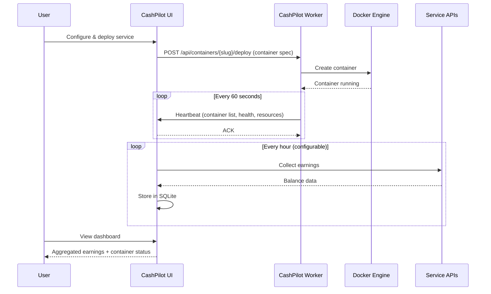

# Come funziona { #how-it-works }

CashPilot usa un'architettura divisa in **UI + worker**. La UI non tocca mai Docker: tutte le operazioni sui container passano dai worker. Questa separazione è un principio di progettazione centrale ed è ciò che rende possibile gestire una flotta di più server.

## Componenti { #components }

| Componente | Immagine | Porta | Accesso a Docker | Scopo |
|-----------|-------|:----:|:-------------:|---------|
| **CashPilot UI** | `drumsergio/cashpilot` | 8080 | No | Dashboard web, raccolta dei guadagni, catalogo dei servizi, archiviazione delle credenziali, pianificazione |
| **CashPilot Worker** | `drumsergio/cashpilot-worker` | 8081 | Tramite `cashpilot-socket-proxy` | Ciclo di vita dei container Docker, segnalazione dell'integrità, segnali di vita verso la UI |

Non esiste **nessuna modalità autonoma**. Ogni server che esegue container Docker ha bisogno di un worker. La UI è solo una dashboard e un pianificatore: può girare su qualsiasi macchina, anche una senza Docker.

## Principi di progettazione { #design-principles }

1. **Separazione delle responsabilità.** La UI si occupa di: dashboard, raccolta dei guadagni, pianificazione, autenticazione degli utenti. I worker si occupano di: ciclo di vita dei container Docker, segnalazione dell'integrità. Non si sovrappongono mai.
2. **I worker hanno bisogno di Docker, tramite il socket proxy.** Un worker senza accesso a Docker è inutile. Con i file compose forniti non riceve mai il socket grezzo: raggiunge Docker tramite `cashpilot-socket-proxy`. Le schede di Unraid e TrueNAS montano ancora il socket grezzo ([app store](app-stores.md)). Se non ti serve la gestione di Docker, esegui solo la UI per seguire i guadagni.
3. **Un'unica fonte di verità.** L'istanza della UI è l'unica che raccoglie i guadagni, conserva i dati storici e serve la dashboard. I worker non raccolgono mai guadagni.
4. **I guadagni non vengono mai duplicati.** Poiché raccoglie solo la UI, non c'è rischio che lo stesso account venga contato due volte.
5. **I worker sono satelliti senza stato.** Un worker sa quali container tenere in esecuzione e a quale URL della UI riferire. Salva in file locali solo il proprio id e la propria chiave di flotta (`.worker_id`, `.worker_key`; niente database, niente dati sui guadagni).
6. **Lo YAML è la verità.** Ogni servizio sta in `services/{category}/{slug}.yml`. La UI, la distribuzione, la documentazione e l'esportazione compose derivano tutte da questi file.

## Struttura delle directory { #directory-structure }

```
cashpilot/
  app/                      # FastAPI application
    main.py                 # App entrypoint, lifespan, container/fleet/earnings routes
    deps.py                 # Shared auth guards + Jinja2 template environment
    routers/                # Route groups split out of main.py: auth, pages, users
    catalog.py              # Loads YAML service definitions, caches, SIGHUP reload
    orchestrator.py         # Docker SDK: deploy, stop, restart, remove, logs
    database.py             # Async SQLite: earnings, config, deployments, users, workers
    worker_api.py           # Worker REST API: heartbeat, container commands, mini-UI
    setup_token.py          # First-run setup-token gate (owner-account creation)
    metrics.py              # Optional Prometheus metrics (/metrics)
    exchange_rates.py       # Crypto/fiat conversion via CoinGecko + Frankfurter
    collectors/             # Earnings collectors (one module per service, UI only)
      base.py               # BaseCollector ABC + EarningsResult dataclass
      honeygain.py          # Example: JWT auth + balance endpoint
      __init__.py           # COLLECTOR_MAP registry + make_collectors() factory
    templates/              # Jinja2: dashboard, fleet, catalog, setup wizard, payouts, settings
    static/
      css/style.css         # Classic night by default, plus dark, light, sunrise and warm
      js/app.js             # Vanilla JS, CP namespace, Chart.js, wizard state machine
  services/                 # YAML service definitions (SINGLE SOURCE OF TRUTH)
    _schema.yml             # Schema documentation
    bandwidth/              # Bandwidth sharing services
    depin/                  # DePIN services
    storage/                # Storage sharing services
    compute/                # GPU compute services
    mining/                 # Mining services
  docs/                     # Documentation and guides
    guides/                 # Per-service setup guides
  Dockerfile                # UI image: multi-stage python:3.15-alpine, su-exec, non-root
  Dockerfile.worker         # Worker image: minimal deps, no collectors/templates
  docker-compose.yml        # Single-server deployment
  docker-compose.fleet.yml  # Multi-server fleet deployment
```

## Flusso dei dati { #data-flow }



### Segnale di vita (dal worker alla UI) { #heartbeat-worker-to-ui }

Ogni 60 secondi, ogni worker invia:

- L'elenco dei container con il loro stato (in esecuzione, fermo, terminato)
- L'uso di risorse di ogni container (percentuale di CPU, MB di memoria)
- Le informazioni di sistema (SO, architettura, nome host, disponibilità di Docker)
- L'URL che dichiara per sé (`CASHPILOT_WORKER_URL` esplicito o un valore di ripiego rilevato automaticamente)

La UI salva questi dati nel suo database SQLite e li mostra nella pagina **Fleet** (Flotta).

### Comandi (dalla UI al worker) { #commands-ui-to-worker }

La UI può ordinare a qualsiasi worker di:

- **Distribuire** il container di un servizio (specifica completa: immagine, variabili d'ambiente, volumi, porte)
- **Fermare**, **avviare**, **riavviare** o **rimuovere** un container
- **Recuperare i log** di un container

I comandi vengono inviati con chiamate all'API REST dalla UI al worker.

### Flusso delle credenziali { #credential-flow }

Il worker **non gestisce né conserva mai credenziali**:

1. L'utente configura le credenziali del servizio nella UI (salvate cifrate in SQLite).
2. Quando distribuisce, la UI invia al worker la specifica completa del container (comprese le variabili d'ambiente).
3. Il worker passa la specifica all'API di Docker. Docker salva le variabili d'ambiente nella configurazione del container.
4. Per i riavvii: `docker restart` conserva le variabili d'ambiente in modo nativo.
5. Per le ridistribuzioni complete (rimozione + creazione): la UI invia di nuovo la specifica completa.

### Raccolta dei guadagni { #earnings-collection }

La UI esegue collettori pianificati per ogni servizio configurato:

- I **collettori automatici** leggono i saldi tramite le API dei servizi (autenticazione JWT, autenticazione con cookie, chiavi API) per i fornitori che ne hanno una
- I risultati vengono salvati in SQLite nella valuta nativa (USD, MYST, GRASS, STORJ, ecc.)
- I tassi di cambio vengono presi da CoinGecko (cripto) e Frankfurter (fiat) e tenuti in cache 15 minuti
- Ogni lettura salva il tasso in USD del giorno in cui è stata fatta. Una lettura in cripto salvata senza tasso (più vecchia della colonna del tasso) riceve il prezzo del proprio giorno dallo storico giornaliero di CoinGecko, all'avvio e una volta al giorno; un giorno senza prezzo resta senza prezzo
- La dashboard converte e mostra gli importi nella valuta preferita dell'utente

## Stack tecnologico { #tech-stack }

| Tecnologia | Scopo |
|---|---|
| FastAPI | Framework del backend (Python 3.15, asincrono) |
| Jinja2 | Template HTML generati dal server |
| SQLite | Database (aiosqlite, nessuna configurazione, salvato in `/data`) |
| Docker SDK for Python | Gestione del ciclo di vita dei container tramite socket |
| PyYAML | Lettura delle definizioni dei servizi |
| APScheduler | Raccolta periodica dei guadagni |
| httpx | Client HTTP asincrono per i collettori dei guadagni |
| cryptography (Fernet) | Cifratura a riposo delle credenziali salvate |
| Chart.js | Grafici dei guadagni nel frontend |
| su-exec | Passa da root all'utente `cashpilot` dopo la preparazione dell'entrypoint (Dockerfile) |

## Database { #database }

SQLite con conservazione dei dati per 400 giorni. Tabelle principali:

- **earnings** -- Storico dei guadagni per servizio (marca temporale, slug, saldo, valuta)
- **deployments** -- Distribuzioni attive di container (slug, ID del container, variabili d'ambiente cifrate, stato)
- **config** -- Impostazioni chiave-valore e credenziali cifrate
- **users** -- Account (nome utente, hash bcrypt della password, ruolo)
- **user_preferences** -- Stato del primo utilizzo di ogni utente (modalità di configurazione, categorie scelte, fuso orario)
- **health_events** -- Storico dell'integrità dei container (start, stop, crash, check_ok, check_down)
- **workers** -- Registro dei worker della flotta (ID client, nome, URL, stato, ultimo segnale di vita, chiave di flotta cifrata di ogni worker)

## Modello di sicurezza { #security-model }

- Tutte le credenziali sono cifrate a riposo con la cifratura simmetrica Fernet
- Autenticazione del worker verso la UI con chiavi di flotta proprie di ogni worker (`CASHPILOT_API_KEY` è solo la credenziale di registrazione iniziale)
- I container gestiti girano con `--security-opt no-new-privileges`
- Convenzione per i nomi dei container: `cashpilot-{slug}` con le etichette `cashpilot.managed=true`
- Il container della UI **non** ha accesso al socket Docker
- Autenticazione basata su sessioni con un sistema di ruoli (owner/writer/viewer: proprietario, editor e visualizzatore)
