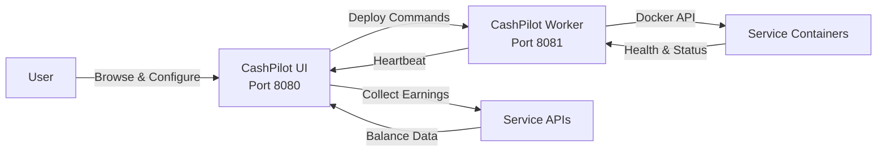

# はじめに { #getting-started }

## 前提条件 { #prerequisites }

- **Docker** と **Compose v2 プラグインのバージョン 2.23.1 以降**。
  `docker compose version` で確認してください。これより古いバージョンは、compose
  ファイル内のインライン設定を読み込めません。Docker Desktop にはこのプラグインが含まれています。
  Linux の素の Docker Engine では、Docker のパッケージリポジトリからインストールしてください
  (https://docs.docker.com/compose/install/linux/)。macOS で Colima を使う場合は、
  Homebrew でインストールし、Docker プラグインとしてリンクします。

    ```sh
    brew install docker-compose
    mkdir -p ~/.docker/cli-plugins
    ln -sfn "$(brew --prefix)/opt/docker-compose/bin/docker-compose" ~/.docker/cli-plugins/docker-compose
    ```

- Linux、macOS、または Windows のホスト(amd64 または arm64)
- CashPilot と管理対象のサービス用に、1 GB 以上の空き RAM
- **Docker ホストごとに CashPilot は 1 つだけ。** 下の警告を参照してください。

!!! warning "Docker ホストごとに CashPilot は 1 つだけ"
    1 台の Docker ホストで CashPilot を 2 つインストールして動かさないでください。compose ファイルは
    固定のコンテナ名(`cashpilot-ui`、`cashpilot-worker`、
    `cashpilot-socket-proxy`)を使うため、ファイルの 2 つ目のコピーは名前の
    衝突で失敗します。これを避けるために名前を変えても、2 つのインストールは
    同じホストを共有したままです。各ワーカーは、CashPilot のラベルが付いたすべてのコンテナを、
    どちらのインストールが作ったかに関係なく管理します。そのため、それぞれのダッシュボードが
    もう一方の収益アプリを一覧に表示し、停止し、置き換えてしまいます。2 つは
    `cashpilot-isolated` ネットワーク、収益アプリの名前(`cashpilot-<service>`)、
    ホストのポート、`mysterium-data` などのボリュームも共有します。2 つ目の
    インストールには、別のホストか VM を使ってください。より多くのサーバーで収益アプリを動かすには、
    代わりに 1 つのダッシュボードにワーカーを追加してください([フリート](fleet.md))。

## クイックスタート { #quick-start }

### 1. compose ファイルを取得して起動する { #1-fetch-the-compose-file-and-launch }

```bash
curl -fsSLO https://raw.githubusercontent.com/GeiserX/CashPilot/main/docker-compose.yml
docker compose up -d
```

これで常駐するコンテナが 3 つ起動します。その前に、1 回だけ動く
`cashpilot-migrate` が `up` のたびに実行され、コード 0 で終了します。そのため
`docker compose ps -a` では `Exited (0)` と表示されます。これは正常です。

| コンテナ | ポート | 役割 |
|-----------|------|---------|
| **cashpilot-migrate** | なし | 1 回だけ実行されて終了します。古いリリースが作ったデータを、ソケットプロキシが受け入れるボリュームへ移します。新規インストールでは何もすることがありません |
| **cashpilot-ui** | 8080 | Web ダッシュボード、収益の収集、サービスカタログ |
| **cashpilot-worker** | 8081 | サービスのコンテナをデプロイして監視する Docker エージェント |
| **cashpilot-socket-proxy** | なし | Docker ソケットを読み取り専用で保持し、ワーカーにはフィルターをかけたコピーを渡します([セキュリティの既定値](security-defaults.md)) |

### 2. ダッシュボードを開く { #2-open-the-dashboard }

ブラウザーで [http://localhost:8080](http://localhost:8080) を開いてください。まだアカウントがないので、ウェルカムページが表示されます。このページでオーナーアカウントを作成します。

!!! tip "ポート 8080 がすでに使われている場合"
    compose ファイルを編集する代わりに、`docker-compose.yml` と同じ場所にある `.env`
    ファイルで別のホストポートを選んでください。

    ```bash
    printf '\nCASHPILOT_UI_PORT=8088\n' >> .env
    docker compose up -d
    ```

    その後、http://localhost:8088 を開きます。値は `.env` に残しておいてください。
    アプリ内の更新はシェルではなくこのファイルを読むからです。(`printf` が
    改行から始まるのは、既存の `.env` の最後の行とつながらないようにするためです。)

    この変数を使うには、`ports:` の行が
    `${CASHPILOT_UI_PORT:-8080}:8080` となっている `docker-compose.yml` が必要です。v1.61 以前のファイルは
    `8080:8080` を固定で書いており、この変数を無視します。最新のファイルをダウンロードするか、
    自分で編集したポートの対応付けをそのまま使ってください。アプリ内の更新はそれも受け入れます。

!!! warning "初回起動時のセットアップトークンが必要です"
    初回起動時に、CashPilot は 1 回限りのセットアップトークンを生成し、**cashpilot-ui** コンテナのログに出力します。

    ```bash
    docker compose logs cashpilot-ui
    ```

    次のような行を探してください。

    ```
    FIRST-RUN SETUP: no account exists yet. Open /register and enter this
    one-time setup token to create the owner account: <token>
    ```

    ウェルカムページの **Owner account** (オーナーアカウント)ステップにある **Setup token** (セットアップトークン)欄にこのトークンをコピーし、ユーザー名とパスワードも入力して、最初の(オーナーの)アカウントを作成します。トークンはログにだけ表示され、URL に出ることはありません。オーナーアカウントができた時点で完全に破棄されます。

### 3. サービスカタログを見る { #3-browse-the-service-catalog }

**Catalog** (カタログ)ページには、すべてのサービスが、対応プラットフォーム、月ごとの見込み額、必要なもの(住宅用 IP、GPU)とともに表示されます。カテゴリー(帯域、DePIN、ストレージ、コンピュート、マイニング)で絞り込むか、名前で検索してください。**Add** (追加)はそのサービスでセットアップウィザードを開き、**Details** (詳細)はその説明、支払い、デプロイのリスクを表示します。Docker で動かないサービスには、代わりに **Visit** (開く)リンクがあります。

2 種類のサービスは、先によく確認してください。トークンをステークとしてロックしないと支払われないサービス(Anyone Protocol、Sia、Flux など)と、あなたの IP を公開するリレーです。後者は、住宅用の帯域アプリから受け取る額を下げることがあります。[デプロイ前に確認する 2 つのこと](guides/index.md)を参照してください。

### 4. ウィザードでサービスを追加する { #4-add-services-with-the-wizard }

オーナーアカウントができると、**Add services** (サービスを追加)でセットアップウィザードが開きます。その後は、上部バーの **+ Add service** (+ サービスを追加)ボタンでもう一度開けます。カテゴリーを選び、次にサービスを選びます。ウィザードはサービスごとに **Sign Up** (登録)リンクを表示し、そのサービスに必要な認証情報だけ(メールアドレスとパスワード、API トークンなど)を尋ね、それを動かすワーカーを選ばせます。**Deploy** (デプロイ)をクリックすると、CashPilot がイメージを取得し、コンテナを作成して監視を始めます。

### 5. ダッシュボードで確認する { #5-watch-it-on-the-dashboard }

ダッシュボードには、デプロイした各サービスが状態と残高とともに表示されます。**Fleet** (フリート)ページにはすべてのワーカーが表示されます。

## 仕組み { #how-it-works }



1. **あなたが** Web UI でサービスを設定します。サービスを選び、認証情報を入力し、デプロイをクリックします。
2. **UI が** コンテナの仕様(イメージ、環境変数、ボリューム)を REST API でワーカーに送ります。
3. **ワーカーが** Docker コンテナを作成し、その正常性の監視を始めます。
4. **ワーカーが** 60 秒ごとにハートビートでコンテナの状態を UI に報告します。
5. **UI が** 設定可能なスケジュール(既定は 1 時間ごと)でサービスの API から収益を収集します。
6. **ダッシュボードが** 合計の収益、サービスごとの内訳、コンテナの正常性を表示します。

## 設定 { #configuration }

### UI の環境変数 { #ui-environment-variables }

| 変数 | 既定値 | 説明 |
|----------|---------|-------------|
| `TZ` | `UTC` | スケジュールと表示に使うタイムゾーン |
| `CASHPILOT_SECRET_KEY` | *(自動生成)* | ログインセッションの署名鍵。`/data/.secret_key` に保存されます。**認証情報は暗号化しません** |
| `CASHPILOT_ENCRYPTION_KEY` | *(自動生成)* | 保存された認証情報を暗号化する Fernet 鍵。`/data/.fernet_key` に保存されます。そのファイルがないときだけ採用されるので、設定するのはバックアップを復元するときだけにしてください |
| `CASHPILOT_API_KEY` | *(`/fleet` から)* | ワーカー共通の参加用キー。各ワーカーは参加時に自分専用のキーを受け取ります。[フリート](fleet.md)を参照してください |
| `CASHPILOT_COLLECT_INTERVAL` | `60` | 収益収集サイクルの間隔(分) |
| `CASHPILOT_UI_PORT` | `8080` | UI を公開するホストポート。8080 が使用中のときは `.env` で設定します |
| `CASHPILOT_BIND_ADDR` | `127.0.0.1` | UI のポートを公開するホストのインターフェース。**既定はループバックです**。ダッシュボードは Docker ソケットを持つワーカーに命令できるため、初期状態ではネットワークに公開されません。公開するには特定の IP(Tailscale や VPN のアドレスなど)か `0.0.0.0` を設定するか、(推奨)認証付きのリバースプロキシを前に置いてください |

コンテナ内の UI の Web ポートは `8080` で固定です(コンテナの `CMD` で設定)。`CASHPILOT_UI_PORT` と `CASHPILOT_BIND_ADDR` が選ぶのは、公開先のホストポートとインターフェースだけです。

### ワーカーの環境変数 { #worker-environment-variables }

| 変数 | 既定値 | 説明 |
|----------|---------|-------------|
| `TZ` | `UTC` | タイムゾーン |
| `CASHPILOT_UI_URL` | -- | UI コンテナの URL。例: `http://cashpilot-ui:8080` |
| `CASHPILOT_API_KEY` | -- | UI の参加用キーと一致する必要があります。必要なのは参加時だけで、その後ワーカーは自分専用のキーを使います |
| `CASHPILOT_WORKER_NAME` | *(ホスト名)* | フリートのダッシュボードに表示されるこのワーカーの名前 |
| `CASHPILOT_WORKER_URL` | *(自動検出)* | UI がこのワーカーに接続するための URL。例: `http://192.168.1.50:8081`。ホストをまたぐフリートでは明示的に設定してください。自動検出では、到達できないコンテナ内部の IP が報告されることがあります |
| `CASHPILOT_WORKER_BIND_ADDR` | `127.0.0.1` | **フリートとリモートワーカーの compose のみ**(`docker-compose.fleet.yml`): ワーカーの Docker ソケット API ポートを公開するホストのインターフェース。既定はループバックです。既定の `docker-compose.yml` はポート 8081 をまったく公開しません。ワーカー API は任意のコンテナをデプロイ・停止できる(= ホストの root 権限)ため、リモートワーカーではプライベートまたは VPN のインターフェース(Tailscale の IP など)にバインドし、パブリック IP には**絶対に**バインドしないでください |
| `CASHPILOT_PORT` | `8081` | ワーカーが UI に**通知する**ポート。待ち受けポートは変わり*ません*。待ち受けポートはイメージの `CMD` で固定されています。[設定リファレンス](configuration.md)を参照してください |

### Docker Compose の例 { #docker-compose-example }

```yaml
--8<-- "docker-compose.yml"
```

!!! note "これが実際のファイルです"

    上のブロックはリポジトリの `docker-compose.yml` をそのまま取り込んでいるので、
    実際に配布されるものとずれることはありません。以前は手でコピーした版があり、
    ワーカーの Docker ソケット API をすべてのインターフェースで公開し、`:latest` を指定していました。
    どちらも[セキュリティの既定値](security-defaults.md)のページでやめるよう求めていることです。

!!! warning "Docker ソケットへのアクセス"
    ワーカーは Docker を通じてサービスのコンテナを管理しますが、`/var/run/docker.sock` はマウントしません。`cashpilot-socket-proxy` コンテナがソケットを保持し、ワーカーが行う呼び出しだけを通します。特権コンテナと、あなたが指定していないホストのフォルダーのバインドは拒否します([何を拒否するか](security-defaults.md#docker-socket-proxy))。アプリ内の更新はオプトインです。compose ファイルと同じ場所の `.env` に `CASHPILOT_COMPOSE_DIR=<this folder>` があるときだけ動きます。この設定によりコンテナがそのフォルダーをバインドできるようになり、プロキシの保護が弱まります([その代償](security-defaults.md#docker-socket-proxy))。設定しないままにして、`docker compose pull && docker compose up -d` で更新してください。それでもワーカーはホスト上のすべてのコンテナを制御するので、セキュリティを最大にするには CashPilot を専用のマシンか VLAN で動かしてください。

!!! tip "シークレットキーの保持"
    認証情報は `CASHPILOT_ENCRYPTION_KEY` で暗号化されます。`CASHPILOT_SECRET_KEY` では**ありません**。こちらはログインセッションに署名するだけです。暗号化キーは初回起動時に自動生成され、`/data/.fernet_key` に保存されます。**このファイルをバックアップしてください。** ボリュームをこのファイルなしで作り直すと、新しいキーが生成され、保存済みのすべての認証情報が永久に読めなくなります。`CASHPILOT_ENCRYPTION_KEY` を設定するのは、そのバックアップを復元するためです。キーファイルが常に優先されるので、正常なインスタンスで設定しても何も変わりません。

!!! tip "UI でのパスワードとシークレット"
    自分のパスワードは、アバターメニュー -> **Change password** (パスワードを変更)からいつでも変更できます(すべてのロールで利用可能)。変更すると、ほかのセッションはサインアウトされます。**Settings** (設定)では、保存済みのシークレットは書き込み専用です。変更するには値を入力し、今の値を残すには欄を空のままにします。保存された認証情報がブラウザーに送り返されることはありません。

## CashPilot の更新 { #updating-cashpilot }

compose ファイルは `drumsergio/cashpilot:X.Y` のようにメジャー.マイナーのシリーズを固定しているので、`pull` はそのシリーズの最新パッチを取得します。

```bash
docker compose pull
docker compose up -d
```

`docker compose pull` は公開されている最新のイメージを取得し、`up -d` は
イメージが変わったコンテナだけを作り直します。配布している compose ファイルは
`pull_policy: always` を設定しているので、`docker compose up -d` だけでも
先に最新のイメージを取得します。

**ダッシュボードから。** **Settings** (設定)の **About and updates** (情報と更新)は、
短時間だけ動くヘルパーコンテナから同じ 2 つのコマンドを実行します。ヘルパーが読むのは
compose ファイルとその隣の `.env`(または `--env-file` で渡したファイル)で、
CashPilot を起動したシェルは読みません。たとえば `CASHPILOT_UI_PORT=8088 docker compose up -d` で起動したとします。
更新するとダッシュボードが 8080 に戻ってしまうので、更新は止まり、その理由を表示します。
その値を `.env` に書けば、ボタンは動きます。

!!! note "再ビルドは**必要ありません**"
    CashPilot はビルド済みのマルチアーキテクチャのイメージを Docker Hub で配布しています
    ([`drumsergio/cashpilot`](https://hub.docker.com/r/drumsergio/cashpilot)、
    [`drumsergio/cashpilot-worker`](https://hub.docker.com/r/drumsergio/cashpilot-worker))。
    `docker compose build` / `--build` が関係するのは、`docker-compose.build.yml` を使って
    意図的にソースからビルドする場合だけです。通常のインストールでは、
    `pull` + `up -d` が完全で正しい更新手順です。

### 特定のバージョンに固定する { #pinning-a-specific-version }

1 つのリリースにとどまるには、`docker-compose.yml` の `X.Y` シリーズのタグを、
`drumsergio/cashpilot` と `drumsergio/cashpilot-worker` の両方で完全なリリースタグ `X.Y.Z` に
置き換え(両方で必ず同じタグにします)、`pull_policy: always` を削除してください。タグは
[Docker Hub](https://hub.docker.com/r/drumsergio/cashpilot/tags) で確認できます。

新しいシリーズに移るには、両方のタグを編集します。まず UI のホストで、次に
すべてのワーカーのホストで行います。先に
[UPGRADING.md](https://github.com/GeiserX/CashPilot/blob/main/UPGRADING.md)
を読んでください。3.0 のようなメジャーリリースには独自の手順があるからです。

### 更新の自動化(任意) { #automating-updates-optional }

手間をかけずに更新したい場合は、スケジューラーに同じ 2 つのコマンドを実行させます。
たとえば毎日の cron エントリーにします。

```cron
0 4 * * *  cd /path/to/cashpilot && docker compose pull && docker compose up -d
```

または、[Watchtower](https://containrrr.dev/watchtower/) や
[Diun](https://crazymax.dev/diun/) などの自動更新ツールを CashPilot のコンテナに対して動かします。これらは
任意です。CashPilot には更新ツールは同梱されていません。

### 古いイメージの削除 { #cleaning-up-old-images }

CashPilot はイメージを取得しますが、削除はしません。更新や再デプロイのたびに、
前のイメージがディスクに残ることがあります。3 台のサーバーのテスト用フリートでは、古い
CashPilot と収益アプリのイメージは合計で約 3 GB でした。これは同じホストのほかのプログラムが
ふつう残していく量に比べれば小さいので、ホスト全体を確認してください。

```bash
docker system df
```

`Images` の行の `RECLAIMABLE` の値が、Docker が解放できる量です。

**CashPilot がこれを代わりにやらない理由。** ワーカーはソケットプロキシを通じて Docker に
接続します。イメージについてプロキシが許可するのは、1 つを取得することと、1 つを名前で読むことだけです。
ホストのイメージを一覧表示することも、削除することもできません。それができるワーカーは、
ホスト上のほかのすべてのプログラムのイメージも見て削除できてしまいます。
[プロキシが拒否するもの](security-defaults.md#docker-socket-proxy)を参照してください。

**ステップ 1: ダングリングイメージを削除する。** ダングリングイメージとは、タグがなく、
実行中か停止中かを問わずどのコンテナも使っていないイメージです。`X.Y`(compose ファイルが固定しているようなシリーズ)、
`latest`、ダイジェストのような動くタグでの更新は、まさにこれを残します。

```bash
docker image prune
```

これは、動くタグで更新する前に使っていたイメージも削除します。そのシリーズの新しい
イメージが届くと、古いものはタグを失うからです。戻れるようにしておくには、更新前に
正確なバージョンを控えておいてください(サイドバーの下部に表示されます)。そうすれば
`drumsergio/cashpilot:<X.Y.Z>` をもう一度取得できます。または compose ファイルを
正確な `X.Y.Z` タグに固定します。その場合、古いイメージはタグを保ち、ステップ 2 が当てはまります。

Docker は削除する前に確認を求めます。cron エントリーでは `--force` を付けて確認を
省略してください。ほかには何も変わりません。

```cron
30 4 * * 0  docker image prune --force
```

!!! warning "`-a` は付けないでください"
    `docker image prune -a` は、今どのコンテナも使っていないすべてのイメージを、
    ダングリングでもタグ付きでも削除します。意図的に停止したスタックのイメージや、
    ローカルでビルドして再取得できないイメージも含まれます。

**ステップ 2: 古い固定タグを削除する。** バージョンに固定したイメージは、新しいものに移った後も
タグを保つので、`prune` はそれを飛ばします。次の CashPilot のイメージは固定されています。

| リポジトリ | 何が固定しているか |
|---|---|
| `drumsergio/cashpilot` | compose ファイル(古いシリーズ、または自分で固定した正確なバージョン) |
| `drumsergio/cashpilot-worker` | compose ファイル(上と同じ) |
| `drumsergio/cashpilot-tunnel` | ワーカー(ワーカーのバージョンごとに 1 つのタグ) |
| `drumsergio/cashpilot-earnapp` | EarnApp のカタログエントリー |
| `drumsergio/cashpilot-anyone` | Anyone Protocol のカタログエントリー |

削除したサービスのイメージも同じです。そのタグは、あなたが削除するまで残ります。
MystNodes や ProxyBase のようにダイジェストで固定されたカタログのイメージは、
新しいものに置き換わるとタグを失うので、ステップ 1 ですでに対処できます。

まず、どのコンテナも使っていないタグを一覧表示します。この例はワーカーのイメージ用です。
表のほかのリポジトリでは `repo` を変えてください。

```bash
repo=drumsergio/cashpilot-worker
used=$(docker ps -a --format '{{.Image}}')
docker image ls "$repo" --format '{{.Repository}}:{{.Tag}}' | grep -vxF "$used"
```

次に、古いタグを名前で 1 つずつ削除します。

```bash
docker image rm drumsergio/cashpilot-worker:<old tag>
```

`-f` は付けないでください。付けなければ、Docker は実行中か停止中かを問わずコンテナがまだ使っている
イメージの削除を拒否し、`conflict: unable to delete` と表示します。これが出たら、そのイメージは
残してください。今使っているタグと、その前に使っていたタグは残し、1 つ前のバージョンに戻れるようにします。
削除するのは、その 2 つより古いタグだけにしてください。

ダッシュボードの **Host disk** (ホストのディスク)列には、ワーカーの `/data` があるファイルシステムの
空き容量が表示されます。イメージはふつう同じファイルシステムの Docker のデータルートの下にありますが、
いつもそうとは限りません。`docker info --format '{{.DockerRootDir}}'`
で Docker のデータルートがわかります。新しい Docker Engine 29 のインストールで既定になっている
containerd イメージストアでは、イメージは代わりに containerd のルートの下、ふつうは
`/var/lib/containerd` にあります。`docker info --format '{{.Driver}}'` は、containerd イメージストアでは
`overlayfs`、従来のものでは `overlay2` と表示します。
当てはまるディレクトリがあるファイルシステムの空き容量を確認してください。

## 対応サービス { #supported-services }

CashPilot は、稼働中またはベータ版の **<!-- n:live -->50<!-- /n --> のサービス**に対応しています。カテゴリーは 5 つです。

- **帯域共有**(<!-- n:bandwidth -->18<!-- /n -->): インターネットの帯域を共有して不労所得を得ます
- **DePIN**(<!-- n:depin -->15<!-- /n -->): 分散型物理インフラネットワーク
- **GPU コンピュート**(<!-- n:compute -->7<!-- /n -->): AI やコンピュートの処理向けに GPU を貸し出します
- **ストレージ**(<!-- n:storage -->2<!-- /n -->): 分散型ストレージネットワークでディスク容量を共有します
- **マイニング**(<!-- n:mining -->8<!-- /n -->): マイナーをデプロイするか、支払い先アドレスでプールを追跡します([マイニング](mining.md))

このうち **<!-- n:docker -->21<!-- /n -->** は、Docker で自動的にデプロイ・管理できます。残りの <!-- n:tracked -->29<!-- /n --> はカタログで追跡します(ブラウザーまたはデスクトップのアプリが <!-- n:extension -->18<!-- /n -->、GPU ノードが <!-- n:gpu -->7<!-- /n -->、マイニングプールが <!-- n:mining_pools -->4<!-- /n -->)。コレクターがあるものは、CashPilot がその残高を読み取ります。

カタログ全体は[サービスガイド](guides/index.md)のセクションで見られます。

## 次のステップ { #next-steps }

- [仕組み](how-it-works.md) -- UI とワーカーに分けた設計を理解する
- [フリートの管理](fleet.md) -- 複数のサーバーにデプロイする
- [ホームネットワークを守る](home-network-security.md) -- コンテナを LAN から切り離す方法と、gVisor が役立つ場面
- [サービスガイド](guides/index.md) -- サービスごとの詳しいセットアップ手順
- [CashPilot を完全に削除する](uninstall.md) -- 作成されたものをすべて削除して、やり直すか使うのをやめる
