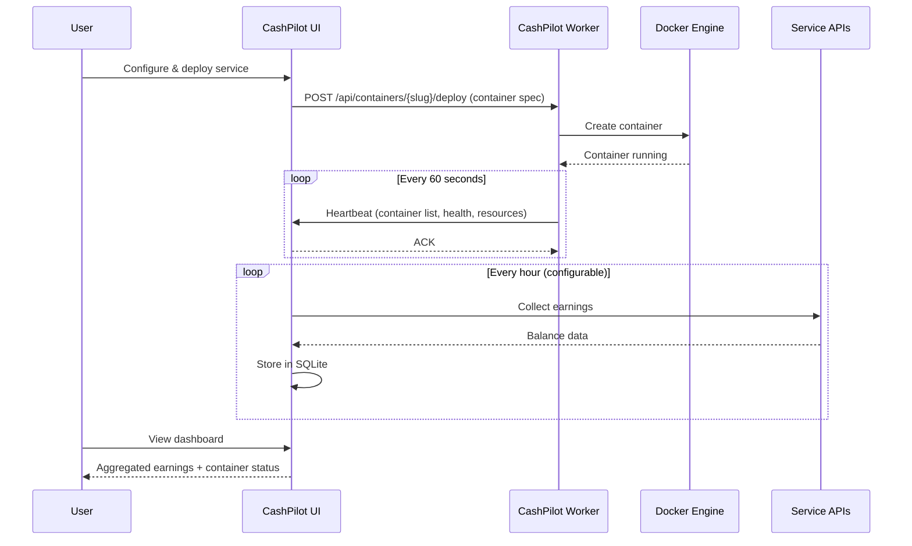

# 仕組み { #how-it-works }

CashPilot は **UI とワーカー** に分けたアーキテクチャを採用しています。UI は Docker にまったく触れません。コンテナの操作はすべてワーカーを通じて行われます。この分離は設計の中心となる原則であり、複数サーバーのフリート管理を可能にしているものです。

## コンポーネント { #components }

| コンポーネント | イメージ | ポート | Docker へのアクセス | 役割 |
|-----------|-------|:----:|:-------------:|---------|
| **CashPilot UI** | `drumsergio/cashpilot` | 8080 | なし | Web ダッシュボード、収益の収集、サービスカタログ、認証情報の保管、スケジュール |
| **CashPilot Worker** | `drumsergio/cashpilot-worker` | 8081 | `cashpilot-socket-proxy` 経由 | Docker コンテナのライフサイクル、正常性の報告、UI へのハートビート |

**スタンドアロンモードはありません**。Docker コンテナを動かすすべてのサーバーにワーカーが必要です。UI は純粋なダッシュボード兼スケジューラーで、Docker のないマシンを含め、どのマシンでも動かせます。

## 設計の原則 { #design-principles }

1. **関心の分離。** UI が担当するのは、ダッシュボード、収益の収集、スケジュール、ユーザー認証です。ワーカーが担当するのは、Docker コンテナのライフサイクルと正常性の報告です。両者が重なることはありません。
2. **ワーカーには Docker が必要で、ソケットプロキシを通じて使います。** Docker にアクセスできないワーカーは役に立ちません。配布している compose ファイルでは、ワーカーが生のソケットを受け取ることはなく、`cashpilot-socket-proxy` を通じて Docker に接続します。Unraid と TrueNAS のリスティングは今も生のソケットをマウントします([アプリストア](app-stores.md))。Docker の管理が必要なければ、UI だけを動かして収益を追跡できます。
3. **唯一の信頼できる情報源。** 収益を収集し、履歴データを保存し、ダッシュボードを提供するのは UI のインスタンスだけです。ワーカーが収益を収集することはありません。
4. **収益が重複することはありません。** 収集するのは UI だけなので、同じアカウントが 2 回数えられるおそれはありません。
5. **ワーカーは状態を持たない衛星です。** ワーカーが知っているのは、動かし続けるコンテナと、報告先の UI の URL だけです。ローカルファイルに保存するのは自分の ID とフリートキーだけです(`.worker_id`、`.worker_key`。データベースも収益データもありません)。
6. **YAML が信頼できる情報源です。** すべてのサービスは `services/{category}/{slug}.yml` にあります。UI、デプロイ、ドキュメント、compose のエクスポートは、すべてこれらのファイルから作られます。

## ディレクトリ構成 { #directory-structure }

```
cashpilot/
  app/                      # FastAPI application
    main.py                 # App entrypoint, lifespan, container/fleet/earnings routes
    deps.py                 # Shared auth guards + Jinja2 template environment
    routers/                # Route groups split out of main.py: auth, pages, users
    catalog.py              # Loads YAML service definitions, caches, SIGHUP reload
    orchestrator.py         # Docker SDK: deploy, stop, restart, remove, logs
    database.py             # Async SQLite: earnings, config, deployments, users, workers
    worker_api.py           # Worker REST API: heartbeat, container commands, mini-UI
    setup_token.py          # First-run setup-token gate (owner-account creation)
    metrics.py              # Optional Prometheus metrics (/metrics)
    exchange_rates.py       # Crypto/fiat conversion via CoinGecko + Frankfurter
    collectors/             # Earnings collectors (one module per service, UI only)
      base.py               # BaseCollector ABC + EarningsResult dataclass
      honeygain.py          # Example: JWT auth + balance endpoint
      __init__.py           # COLLECTOR_MAP registry + make_collectors() factory
    templates/              # Jinja2: dashboard, fleet, catalog, setup wizard, payouts, settings
    static/
      css/style.css         # Classic night by default, plus dark, light, sunrise and warm
      js/app.js             # Vanilla JS, CP namespace, Chart.js, wizard state machine
  services/                 # YAML service definitions (SINGLE SOURCE OF TRUTH)
    _schema.yml             # Schema documentation
    bandwidth/              # Bandwidth sharing services
    depin/                  # DePIN services
    storage/                # Storage sharing services
    compute/                # GPU compute services
    mining/                 # Mining services
  docs/                     # Documentation and guides
    guides/                 # Per-service setup guides
  Dockerfile                # UI image: multi-stage python:3.15-alpine, su-exec, non-root
  Dockerfile.worker         # Worker image: minimal deps, no collectors/templates
  docker-compose.yml        # Single-server deployment
  docker-compose.fleet.yml  # Multi-server fleet deployment
```

## データの流れ { #data-flow }



### ハートビート(ワーカーから UI へ) { #heartbeat-worker-to-ui }

60 秒ごとに、各ワーカーは次のものを送ります。

- 状態(running、stopped、exited)付きのコンテナの一覧
- コンテナごとのリソース使用量(CPU の割合、メモリーの MB)
- システム情報(OS、アーキテクチャ、ホスト名、Docker が使えるかどうか)
- 自分で報告する URL(明示的な `CASHPILOT_WORKER_URL`、または自動検出した代替の値)

UI はこれを SQLite データベースに保存し、**Fleet** (フリート)ページに表示します。

### コマンド(UI からワーカーへ) { #commands-ui-to-worker }

UI はどのワーカーにも次のことを指示できます。

- サービスのコンテナを **Deploy** (デプロイ)する(完全な仕様: イメージ、環境変数、ボリューム、ポート)
- コンテナを **Stop** (停止)、**start** (開始)、**restart** (再起動)、または **remove** (削除)する
- コンテナから **Fetch logs** (ログを取得)する

コマンドは、UI からワーカーへの REST API 呼び出しで送られます。

### 認証情報の流れ { #credential-flow }

ワーカーは**認証情報を扱うことも保存することもありません**。

1. ユーザーが UI でサービスの認証情報を設定します(SQLite に暗号化して保存されます)。
2. デプロイ時に、UI が完全なコンテナの仕様(環境変数を含む)をワーカーに送ります。
3. ワーカーはその仕様を Docker API に渡します。Docker が環境変数をコンテナの設定に保存します。
4. 再起動の場合: `docker restart` では、Docker 自身が環境変数を保持します。
5. 完全な再デプロイ(削除して作成)の場合: UI が完全な仕様をもう一度送ります。

### 収益の収集 { #earnings-collection }

UI は、設定された各サービスについて、スケジュールに従ってコレクターを実行します。

- **自動コレクター**は、コレクターがあるプロバイダーについて、サービスの API(JWT 認証、Cookie 認証、API キー)で残高を取得します
- 結果は元の通貨(USD、MYST、GRASS、STORJ など)で SQLite に保存されます
- 為替レートは CoinGecko(暗号資産)と Frankfurter(法定通貨)から取得し、15 分間キャッシュします
- 各読み取り値には、取得した日の USD レートが保存されます。レートなしで保存された暗号資産の読み取り値(レートの列より古いもの)は、起動時と 1 日 1 回、CoinGecko の日次履歴からその日の価格を受け取ります。価格のない日は価格なしのままです
- ダッシュボードは、ユーザーが選んだ通貨に換算して表示します

## 技術スタック { #tech-stack }

| 技術 | 用途 |
|---|---|
| FastAPI | バックエンドのフレームワーク(Python 3.15、非同期) |
| Jinja2 | サーバー側でレンダリングする HTML テンプレート |
| SQLite | データベース(aiosqlite、設定不要、`/data` に保存) |
| Docker SDK for Python | ソケット経由のコンテナのライフサイクル管理 |
| PyYAML | サービス定義の解析 |
| APScheduler | 定期的な収益の収集 |
| httpx | 収益コレクター用の非同期 HTTP クライアント |
| cryptography (Fernet) | 保存された認証情報の保存時暗号化 |
| Chart.js | フロントエンドの収益グラフ |
| su-exec | エントリーポイントの設定後に root から `cashpilot` ユーザーに切り替える(Dockerfile) |

## データベース { #database }

SQLite で、データの保持期間は 400 日です。主なテーブル:

- **earnings** -- サービスごとの収益の履歴(タイムスタンプ、slug、残高、通貨)
- **deployments** -- 稼働中のコンテナのデプロイ(slug、コンテナ ID、暗号化された環境変数、状態)
- **config** -- キーと値の設定と、暗号化された認証情報
- **users** -- アカウント(ユーザー名、bcrypt のパスワードハッシュ、ロール)
- **user_preferences** -- ユーザーごとのオンボーディングの状態(セットアップモード、選んだカテゴリー、タイムゾーン)
- **health_events** -- コンテナの正常性の履歴(start、stop、crash、check_ok、check_down)
- **workers** -- フリートのワーカーの登録簿(クライアント ID、名前、URL、状態、最後のハートビート、暗号化されたワーカーごとのフリートキー)

## セキュリティモデル { #security-model }

- すべての認証情報は、Fernet の対称暗号で保存時に暗号化されます
- ワーカーから UI への認証は、ワーカーごとのフリートキーで行います(`CASHPILOT_API_KEY` は参加・初期設定用の認証情報にすぎません)
- 管理対象のコンテナは `--security-opt no-new-privileges` 付きで動きます
- コンテナの命名規則: `cashpilot-{slug}`、ラベルは `cashpilot.managed=true`
- UI のコンテナは Docker ソケットに**アクセスできません**
- ロールの仕組み(owner/writer/viewer)を持つセッションベースの認証
