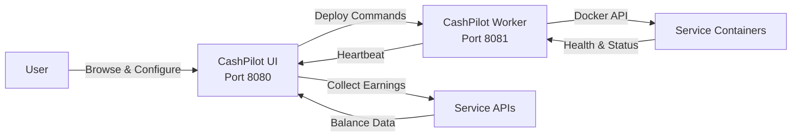

# 시작하기 { #getting-started }

## 사전 요구 사항 { #prerequisites }

- **Docker**와 **Compose v2 플러그인 2.23.1 이상 버전**이 필요합니다.
  `docker compose version`으로 확인합니다. 이전 버전은 compose 파일 안의 인라인 설정을
  읽지 못합니다. Docker Desktop에는 이 플러그인이 포함되어 있습니다. Linux의 기본
  Docker Engine에서는 Docker의 패키지 저장소에서 설치합니다
  (https://docs.docker.com/compose/install/linux/). Colima를 사용하는 macOS에서는
  Homebrew로 설치한 다음 Docker 플러그인으로 연결합니다:

    ```sh
    brew install docker-compose
    mkdir -p ~/.docker/cli-plugins
    ln -sfn "$(brew --prefix)/opt/docker-compose/bin/docker-compose" ~/.docker/cli-plugins/docker-compose
    ```

- Linux, macOS 또는 Windows 호스트(amd64 또는 arm64)
- CashPilot과 관리 대상 서비스에 쓸 수 있는 1 GB 이상의 RAM
- **Docker 호스트 하나에 CashPilot 하나.** 아래 경고를 참고하십시오.

!!! warning "Docker 호스트 하나에 CashPilot 하나"
    Docker 호스트 하나에 CashPilot 설치를 두 개 실행하지 마십시오. compose 파일은
    고정된 컨테이너 이름(`cashpilot-ui`, `cashpilot-worker`,
    `cashpilot-socket-proxy`)을 사용하므로, 파일의 두 번째 사본은 이름
    충돌로 실패합니다. 이를 피하려고 이름을 바꾸어도 두 설치는 여전히
    호스트를 공유합니다. 각 워커는 어느 설치가 만들었든 CashPilot의 레이블이 붙은
    모든 컨테이너를 관리합니다. 그래서 각 대시보드가 다른 설치의 수익 앱을 표시하고,
    중지하고, 교체합니다. 두 설치는 `cashpilot-isolated` 네트워크, 수익 앱 이름
    (`cashpilot-<service>`), 호스트 포트, 그리고 `mysterium-data` 같은 볼륨도
    공유합니다. 두 번째 설치에는 다른 호스트나 VM을 사용하십시오. 더 많은 서버에서
    수익 앱을 실행하려면 대신 대시보드 하나에 워커를 추가하십시오([플릿](fleet.md)).

## 빠른 시작 { #quick-start }

### 1. compose 파일을 받아 실행하기 { #1-fetch-the-compose-file-and-launch }

```bash
curl -fsSLO https://raw.githubusercontent.com/GeiserX/CashPilot/main/docker-compose.yml
docker compose up -d
```

이 명령은 장기 실행 컨테이너 세 개를 시작합니다. 그 전에 일회성
`cashpilot-migrate`가 `up`할 때마다 실행되고 코드 0으로 종료되므로,
`docker compose ps -a`에는 `Exited (0)`으로 표시됩니다. 이는 정상입니다.

| 컨테이너 | 포트 | 용도 |
|-----------|------|---------|
| **cashpilot-migrate** | 없음 | 한 번 실행되고 종료됩니다. 이전 릴리스가 만든 데이터를 소켓 프록시가 허용하는 볼륨으로 옮기며, 새 설치에서는 할 일이 없습니다 |
| **cashpilot-ui** | 8080 | 웹 대시보드, 수익 수집, 서비스 카탈로그 |
| **cashpilot-worker** | 8081 | 서비스 컨테이너를 배포하고 모니터링하는 Docker 에이전트 |
| **cashpilot-socket-proxy** | 없음 | Docker 소켓을 읽기 전용으로 보유하고 워커에게 필터링된 사본을 제공합니다([보안 기본값](security-defaults.md)) |

### 2. 대시보드 열기 { #2-open-the-dashboard }

브라우저에서 [http://localhost:8080](http://localhost:8080)으로 이동합니다. 아직 계정이 없으므로 환영 페이지가 열리며, 이 페이지에서 소유자 계정을 만듭니다.

!!! tip "포트 8080이 이미 사용 중입니까?"
    compose 파일을 편집하는 대신 `docker-compose.yml` 옆의 `.env` 파일에서
    다른 호스트 포트를 지정하십시오:

    ```bash
    printf '\nCASHPILOT_UI_PORT=8088\n' >> .env
    docker compose up -d
    ```

    그런 다음 http://localhost:8088 주소를 엽니다. 앱 내 업데이트는 셸이 아니라
    그 파일을 읽으므로 값을 `.env`에 그대로 두십시오. (`printf`가 줄바꿈으로
    시작하므로, 이 줄이 기존 `.env`의 마지막 줄에 붙는 일이 없습니다.)

    이 변수를 쓰려면 `ports:` 줄이
    `${CASHPILOT_UI_PORT:-8080}:8080`인 `docker-compose.yml`이 필요합니다. v1.61 이하의 파일은
    `8080:8080`이 하드코딩되어 있어 이 변수를 무시합니다. 현재 파일을 내려받거나,
    직접 편집한 포트 매핑을 유지하십시오. 앱 내 업데이트는 그것도 허용합니다.

!!! warning "최초 실행 설정 토큰 필요"
    처음 시작할 때 CashPilot은 일회용 설정 토큰을 생성하여 **cashpilot-ui** 컨테이너 로그에 출력합니다:

    ```bash
    docker compose logs cashpilot-ui
    ```

    다음과 같은 줄을 찾으십시오:

    ```
    FIRST-RUN SETUP: no account exists yet. Open /register and enter this
    one-time setup token to create the owner account: <token>
    ```

    환영 페이지의 **Owner account** (소유자 계정) 단계에 있는 **Setup token** (설정 토큰) 필드에 이 토큰을 사용자 이름, 비밀번호와 함께 복사해 넣어 첫 번째 (소유자) 계정을 만듭니다. 이 토큰은 로그에만 표시되고 URL에는 절대 나타나지 않으며, 소유자 계정이 생기면 영구히 폐기됩니다.

### 3. 서비스 카탈로그 둘러보기 { #3-browse-the-service-catalog }

**Catalog** (카탈로그) 페이지는 모든 서비스를 플랫폼, 월 예상 수익, 필요한 것(가정용 IP, GPU)과 함께 나열합니다. 카테고리(**Bandwidth** (대역폭), **DePIN** (DePIN), **Storage** (스토리지), **Compute** (컴퓨팅), **Mining** (채굴))로 필터링하거나 이름으로 검색합니다. **Add** (추가)는 해당 서비스로 설정 마법사를 열고, **Details** (세부 정보)는 서비스 설명, 지급, 배포 위험을 보여 줍니다. Docker에서 실행되지 않는 서비스에는 대신 **Visit** (방문) 링크가 표시됩니다.

두 종류의 서비스는 먼저 자세히 살펴봐야 합니다. 하나는 Anyone Protocol, Sia, Flux처럼 토큰을 스테이킹해 묶어 둔 뒤에만 지급하는 서비스이고, 다른 하나는 IP를 공개하는 릴레이입니다. 릴레이는 가정용 대역폭 앱이 지급하는 금액을 낮출 수 있습니다. [배포 전에 확인할 두 가지](guides/index.md)를 참고하십시오.

### 4. 마법사로 서비스 추가하기 { #4-add-services-with-the-wizard }

소유자 계정이 생기면 **Add services** (서비스 추가)가 설정 마법사를 엽니다. 이후에는 상단 표시줄의 **+ Add service** (+ 서비스 추가) 버튼으로 다시 열 수 있습니다. 카테고리를 고른 다음 서비스를 고릅니다. 마법사는 서비스마다 **Sign Up** (가입) 링크를 보여 주고, 해당 서비스에 필요한 자격 증명(이메일과 비밀번호, API 토큰 등)만 요청하며, 서비스를 실행할 워커를 선택하게 합니다. **Deploy** (배포)를 클릭하면 CashPilot이 이미지를 가져오고, 컨테이너를 만들고, 감시를 시작합니다.

### 5. 대시보드에서 지켜보기 { #5-watch-it-on-the-dashboard }

대시보드는 배포된 각 서비스를 상태, 잔액과 함께 보여 주고, **Fleet** (플릿) 페이지는 모든 워커를 보여 줍니다.

## 작동 방식 { #how-it-works }



1. **사용자가 설정합니다**: 웹 UI에서 서비스를 고르고, 자격 증명을 입력하고, 배포를 클릭합니다.
2. **UI가 보냅니다**: 컨테이너 사양(이미지, 환경 변수, 볼륨)을 REST API로 워커에 보냅니다.
3. **워커가 만듭니다**: Docker 컨테이너를 만들고 헬스 모니터링을 시작합니다.
4. **워커가 보고합니다**: 하트비트로 60초마다 컨테이너 상태를 UI에 보고합니다.
5. **UI가 수집합니다**: 설정 가능한 일정(기본값: 1시간마다)에 따라 서비스 API에서 수익을 수집합니다.
6. **대시보드가 보여 줍니다**: 합산 수익, 서비스별 내역, 컨테이너 헬스를 보여 줍니다.

## 설정 { #configuration }

### UI 환경 변수 { #ui-environment-variables }

| 변수 | 기본값 | 설명 |
|----------|---------|-------------|
| `TZ` | `UTC` | 일정과 표시에 쓰는 시간대 |
| `CASHPILOT_SECRET_KEY` | *(자동 생성)* | 로그인 세션 서명 키. `/data/.secret_key`에 저장됩니다. **자격 증명을 암호화하지 않습니다** |
| `CASHPILOT_ENCRYPTION_KEY` | *(자동 생성)* | 저장된 자격 증명을 저장 상태에서 암호화하는 Fernet 키. `/data/.fernet_key`에 저장됩니다. 그 파일이 없을 때만 채택되므로, 백업을 복원할 때만 설정하십시오 |
| `CASHPILOT_API_KEY` | *(`/fleet`에서)* | 워커용 공유 등록 키. 각 워커는 등록할 때 자체 키를 받습니다. [플릿](fleet.md)을 참고하십시오 |
| `CASHPILOT_COLLECT_INTERVAL` | `60` | 수익 수집 주기 사이의 분 |
| `CASHPILOT_UI_PORT` | `8080` | UI가 게시되는 호스트 포트. 8080이 사용 중이면 `.env`에서 설정하십시오 |
| `CASHPILOT_BIND_ADDR` | `127.0.0.1` | UI 포트가 게시되는 호스트 인터페이스. **기본값은 루프백입니다**: 대시보드는 Docker 소켓 워커에 명령할 수 있으므로, 처음 설치한 상태에서는 네트워크에 노출되지 않습니다. 노출하려면 특정 IP(예: Tailscale/VPN 주소)나 `0.0.0.0`을 설정하거나, (권장) 앞단에 인증을 수행하는 리버스 프록시를 두십시오 |

컨테이너 안의 UI 웹 포트는 `8080`으로 고정되어 있습니다(컨테이너의 `CMD`로 설정). `CASHPILOT_UI_PORT`와 `CASHPILOT_BIND_ADDR`은 그 포트가 게시되는 호스트 포트와 인터페이스만 선택합니다.

### 워커 환경 변수 { #worker-environment-variables }

| 변수 | 기본값 | 설명 |
|----------|---------|-------------|
| `TZ` | `UTC` | 시간대 |
| `CASHPILOT_UI_URL` | -- | UI 컨테이너의 URL. 예: `http://cashpilot-ui:8080` |
| `CASHPILOT_API_KEY` | -- | UI의 등록 키와 일치해야 합니다. 등록할 때만 필요하며, 그 뒤 워커는 자체 키를 사용합니다 |
| `CASHPILOT_WORKER_NAME` | *(호스트 이름)* | 플릿 대시보드에서 이 워커의 표시 이름 |
| `CASHPILOT_WORKER_URL` | *(자동 감지)* | UI가 이 워커에 접속할 때 쓰는 URL. 예: `http://192.168.1.50:8081`. 여러 호스트에 걸친 플릿에서는 명시적으로 설정하십시오. 자동 감지는 접속할 수 없는 컨테이너 내부 IP를 보고할 수 있습니다 |
| `CASHPILOT_WORKER_BIND_ADDR` | `127.0.0.1` | **플릿 및 원격 워커 compose 전용** (`docker-compose.fleet.yml`): 워커의 Docker 소켓 API 포트가 게시되는 호스트 인터페이스로, 기본값은 루프백입니다. 기본 `docker-compose.yml`은 포트 8081을 전혀 게시하지 않습니다. 워커 API는 어떤 컨테이너든 배포하거나 중지할 수 있으므로(= 호스트의 root), 원격 워커에서는 사설/VPN 인터페이스(예: Tailscale IP)에 바인딩하고 공인 IP에는 **절대** 바인딩하지 마십시오 |
| `CASHPILOT_PORT` | `8081` | 워커가 UI에 **알리는** 포트. 수신 포트는 이미지의 `CMD`로 고정되어 있으며 이 값으로 바뀌지 *않습니다*. [설정 레퍼런스](configuration.md)를 참고하십시오 |

### Docker Compose 예시 { #docker-compose-example }

```yaml
--8<-- "docker-compose.yml"
```

!!! note "이것이 실제 파일입니다"

    위 블록은 저장소의 `docker-compose.yml`을 그대로 포함한 것이므로,
    실제로 배포되는 내용과 어긋날 수 없습니다. 예전에 손으로 복사한 버전은
    워커의 Docker 소켓 API를 모든 인터페이스에 게시하고 `:latest`를
    고정했는데, 둘 다 [보안 기본값](security-defaults.md) 페이지에서 하지 말라고
    안내하는 일입니다.

!!! warning "Docker 소켓 접근"
    워커는 Docker를 통해 서비스 컨테이너를 관리하지만 `/var/run/docker.sock`을 마운트하지 않습니다. `cashpilot-socket-proxy` 컨테이너가 소켓을 보유하고 워커가 하는 호출만 전달하며, 특권 컨테이너와 목록에 없는 호스트 폴더의 바인드는 거부합니다([거부하는 항목](security-defaults.md#docker-socket-proxy)). 앱 내 업데이트는 선택 사항입니다. compose 파일 옆의 `.env`에 `CASHPILOT_COMPOSE_DIR=<this folder>`가 있을 때만 실행되며, 이 설정은 컨테이너가 그 폴더를 바인드하도록 허용하므로 프록시가 약해집니다([그 대가](security-defaults.md#docker-socket-proxy)). 설정하지 않은 채로 두고 `docker compose pull && docker compose up -d`로 업데이트하십시오. 워커는 여전히 호스트의 모든 컨테이너를 제어하므로, 최상의 보안을 위해 CashPilot을 전용 머신이나 VLAN에서 실행하십시오.

!!! tip "비밀 키 유지"
    자격 증명은 `CASHPILOT_SECRET_KEY`가 **아니라** `CASHPILOT_ENCRYPTION_KEY`로 암호화됩니다. `CASHPILOT_SECRET_KEY`는 로그인 세션에 서명할 뿐입니다. 암호화 키는 첫 실행 때 자동 생성되어 `/data/.fernet_key`에 저장됩니다. **그 파일을 백업하십시오.** 그 파일 없이 볼륨이 다시 만들어지면 새 키가 생성되고, 저장된 모든 자격 증명을 영구히 읽을 수 없게 됩니다. `CASHPILOT_ENCRYPTION_KEY` 설정은 그 백업을 복원하기 위한 것입니다. 키 파일이 항상 우선하므로, 정상 인스턴스에서 설정해도 아무것도 바뀌지 않습니다.

!!! tip "UI의 비밀번호와 비밀 값"
    아바타 메뉴 -> **Change password** (비밀번호 변경)에서 언제든 자신의 비밀번호를 바꿀 수 있습니다(모든 역할에서 사용 가능). 이렇게 하면 다른 세션은 로그아웃됩니다. **Settings** (설정)에서 저장된 비밀 값은 쓰기 전용입니다. 바꾸려면 값을 입력하고, 기존 값을 유지하려면 필드를 비워 두십시오. 저장된 자격 증명은 브라우저로 다시 전송되지 않습니다.

## CashPilot 업데이트 { #updating-cashpilot }

compose 파일은 `drumsergio/cashpilot:X.Y` 같은 major.minor 시리즈를 고정하므로, `pull`은 그 시리즈의 최신 패치를 가져옵니다:

```bash
docker compose pull
docker compose up -d
```

`docker compose pull`은 게시된 최신 이미지를 가져오고, `up -d`는 이미지가 바뀐
컨테이너만 다시 만듭니다. 배포되는 compose 파일에는
`pull_policy: always`가 설정되어 있으므로, `docker compose up -d`만 실행해도
먼저 최신 이미지를 가져옵니다.

**대시보드에서.** **Settings** (설정)의 **About and updates** (정보 및 업데이트)는 수명이 짧은 도우미 컨테이너에서
같은 두 명령을 대신 실행합니다. 도우미는 compose 파일과 그 옆의 `.env`
(또는 `--env-file`로 전달한 파일)를 읽으며, CashPilot을 시작한 셸은 절대 읽지 않습니다. 예를 들어 `CASHPILOT_UI_PORT=8088 docker compose up -d`로 시작했다고 합시다.
업데이트는 대시보드를 8080으로 되돌리게 되므로, 업데이트를 중지하고 그 이유를
알려 줍니다. 그 값을 `.env`에 넣으면 버튼이 작동합니다.

!!! note "다시 빌드할 필요가 **없습니다**"
    CashPilot은 미리 빌드된 멀티 아키텍처 이미지를 Docker Hub에서 제공합니다
    ([`drumsergio/cashpilot`](https://hub.docker.com/r/drumsergio/cashpilot),
    [`drumsergio/cashpilot-worker`](https://hub.docker.com/r/drumsergio/cashpilot-worker)).
    `docker compose build` / `--build`는 `docker-compose.build.yml`로 일부러
    소스에서 빌드할 때만 관련이 있습니다. 일반 설치에서는
    `pull` + `up -d`가 완전하고 올바른 업데이트 절차입니다.

### 특정 버전 고정하기 { #pinning-a-specific-version }

정확히 한 릴리스에 머물려면 `docker-compose.yml`에서 `X.Y` 시리즈 태그를
`drumsergio/cashpilot`과 `drumsergio/cashpilot-worker` 모두에서 전체 릴리스 태그 `X.Y.Z`로
바꾸고(두 곳 모두 항상 같은 태그), `pull_policy: always`를 제거하십시오. 태그는
[Docker Hub](https://hub.docker.com/r/drumsergio/cashpilot/tags)에서 볼 수 있습니다.

더 새로운 시리즈로 옮기려면 두 태그를 모두 편집합니다. UI 호스트에서 먼저, 그다음
모든 워커 호스트에서 합니다. 3.0 같은 메이저 릴리스에는 자체 단계가 있으므로
먼저 [UPGRADING.md](https://github.com/GeiserX/CashPilot/blob/main/UPGRADING.md)를
읽으십시오.

### 업데이트 자동화(선택 사항) { #automating-updates-optional }

손대지 않고 업데이트하려면 스케줄러가 같은 두 명령을 실행하게 하십시오.
예를 들어 매일 실행되는 cron 항목을 씁니다:

```cron
0 4 * * *  cd /path/to/cashpilot && docker compose pull && docker compose up -d
```

또는 [Watchtower](https://containrrr.dev/watchtower/)나
[Diun](https://crazymax.dev/diun/) 같은 자동 업데이트 도구를 CashPilot 컨테이너에 대해 실행하십시오. 이것들은
선택 사항입니다. CashPilot에는 업데이트 도구가 포함되어 있지 않습니다.

### 오래된 이미지 정리하기 { #cleaning-up-old-images }

CashPilot은 이미지를 가져오지만 절대 삭제하지 않습니다. 업데이트와 재배포를 할 때마다
이전 이미지가 디스크에 남을 수 있습니다. 서버 세 대로 된 테스트 플릿에서는 오래된
CashPilot 이미지와 수익 앱 이미지가 합쳐서 약 3 GB였습니다. 이는 같은 호스트의 다른
프로그램이 보통 남기는 양에 비하면 작으므로, 호스트 전체를 살펴보십시오:

```bash
docker system df
```

`Images` 줄의 `RECLAIMABLE` 값이 Docker가 확보할 수 있는 용량입니다.

**CashPilot이 이 작업을 대신하지 않는 이유.** 워커는 소켓 프록시를 통해
Docker에 접근합니다. 이미지에 대해 프록시는 이름으로 이미지를 하나 가져오고 하나 읽는 것만
허용하고, 그 밖에는 아무것도 허용하지 않습니다. 워커는 호스트의 이미지를 나열하거나 삭제할 수 없습니다. 그렇게 할 수 있는 워커라면
호스트의 다른 모든 프로그램의 이미지도 보고 삭제할 수 있게 됩니다.
[프록시가 거부하는 항목](security-defaults.md#docker-socket-proxy)을 참고하십시오.

**1단계: 댕글링 이미지 제거.** 댕글링 이미지는 태그가 없고, 실행 중이든 중지되었든
어떤 컨테이너도 사용하지 않는 이미지입니다. `X.Y`(compose 파일이 고정하는 것 같은 시리즈),
`latest` 또는 다이제스트처럼 움직이는 태그로 업데이트하면 정확히 이런 이미지가 남습니다:

```bash
docker image prune
```

이 명령은 움직이는 태그로 업데이트하기 전에 실행하던 이미지도 삭제합니다. 그 시리즈의
새 이미지가 도착하면 이전 이미지에는 태그가 없기 때문입니다. 되돌아갈 방법을 남기려면
업데이트 전에 정확한 버전을 적어 두십시오(사이드바 하단에 표시됩니다). 그러면
`drumsergio/cashpilot:<X.Y.Z>`를 다시 가져올 수 있습니다. 또는 compose 파일을
정확한 `X.Y.Z` 태그로 고정하십시오. 그러면 이전 이미지가 태그를 유지하므로 2단계가 적용됩니다.

Docker는 삭제하기 전에 확인을 요청합니다. cron 항목에서는 `--force`를 추가해 질문을
건너뜁니다. 그 밖에는 아무것도 바뀌지 않습니다:

```cron
30 4 * * 0  docker image prune --force
```

!!! warning "`-a`를 추가하지 마십시오"
    `docker image prune -a`는 댕글링이든 태그가 있든, 지금 어떤 컨테이너도 사용하지
    않는 모든 이미지를 삭제합니다. 여기에는 일부러 중지한 스택의 이미지와, 로컬에서
    빌드해서 다시 가져올 수 없는 이미지도 포함됩니다.

**2단계: 오래된 고정 태그 제거.** 버전에 고정된 이미지는 더 새로운 버전으로 옮긴 뒤에도
태그를 유지하므로 `prune`이 건너뜁니다. 다음 CashPilot 이미지는
고정되어 있습니다:

| 저장소 | 고정하는 주체 |
|---|---|
| `drumsergio/cashpilot` | compose 파일(이전 시리즈, 또는 직접 고정한 정확한 버전) |
| `drumsergio/cashpilot-worker` | compose 파일, 위와 같음 |
| `drumsergio/cashpilot-tunnel` | 워커, 워커 버전마다 태그 하나 |
| `drumsergio/cashpilot-earnapp` | EarnApp 카탈로그 항목 |
| `drumsergio/cashpilot-anyone` | Anyone Protocol 카탈로그 항목 |

제거한 서비스의 이미지도 마찬가지입니다. 그 태그는 직접 제거할 때까지 남습니다.
MystNodes나 ProxyBase처럼 다이제스트로 고정된 카탈로그 이미지는 더 새로운 이미지로
교체되면 태그를 잃으므로, 1단계에서 이미 처리됩니다.

먼저 어떤 컨테이너도 사용하지 않는 태그를 나열합니다. 이 예시는 워커 이미지용입니다.
표의 다른 저장소에는 `repo`를 바꾸십시오:

```bash
repo=drumsergio/cashpilot-worker
used=$(docker ps -a --format '{{.Image}}')
docker image ls "$repo" --format '{{.Repository}}:{{.Tag}}' | grep -vxF "$used"
```

그런 다음 오래된 태그를 이름으로 하나씩 제거합니다:

```bash
docker image rm drumsergio/cashpilot-worker:<old tag>
```

`-f`를 추가하지 마십시오. 이 옵션이 없으면 Docker는 실행 중이든 중지되었든 컨테이너가
아직 사용하는 이미지의 제거를 거부하고
`conflict: unable to delete`를 출력합니다. 이 메시지가 보이면 그 이미지를 유지하십시오. 실행 중인 태그와
그 직전에 실행하던 태그는 유지해야 한 버전 뒤로 되돌아갈 수 있습니다.
그 두 태그보다 오래된 태그만 제거하십시오.

대시보드의 **Host disk** (호스트 디스크) 열은 워커의 `/data`가 있는 파일 시스템의 여유 공간을 보여 줍니다.
이미지는 보통 같은 파일 시스템의 Docker 데이터 루트 아래에 있지만, 항상 그렇지는 않습니다.
`docker info --format '{{.DockerRootDir}}'`는
Docker의 데이터 루트를 보여 줍니다. 새로 설치한 Docker Engine 29의 기본값인 containerd 이미지 저장소를 쓰면
이미지는 대신 containerd의 루트 아래, 보통 `/var/lib/containerd`에 있습니다.
`docker info --format '{{.Driver}}'`는 containerd 이미지 저장소에서는
`overlayfs`를, 기존 저장소에서는 `overlay2`를 출력합니다.
해당하는 디렉터리가 있는 파일 시스템의 여유 공간을 확인하십시오.

## 지원 서비스 { #supported-services }

CashPilot은 다섯 카테고리에 걸쳐 활성 또는 베타 상태인 **<!-- n:live -->50<!-- /n -->개 서비스**를 지원합니다:

- **대역폭 공유** (<!-- n:bandwidth -->18<!-- /n -->): 인터넷 대역폭을 공유해 패시브 인컴을 얻습니다
- **DePIN** (<!-- n:depin -->15<!-- /n -->): 탈중앙화 물리 인프라 네트워크
- **GPU 컴퓨팅** (<!-- n:compute -->7<!-- /n -->): AI 및 컴퓨팅 작업에 GPU를 대여합니다
- **스토리지** (<!-- n:storage -->2<!-- /n -->): 탈중앙화 스토리지 네트워크에 디스크 공간을 공유합니다
- **채굴** (<!-- n:mining -->8<!-- /n -->): 채굴기를 배포하거나 지급 주소로 풀을 추적합니다([채굴](mining.md))

이 중 **<!-- n:docker -->21<!-- /n -->개**는 Docker로 자동 배포하고 관리할 수 있습니다. 카탈로그는 나머지 <!-- n:tracked -->29<!-- /n -->개(<!-- n:extension -->18<!-- /n -->개 브라우저 또는 데스크톱 앱, <!-- n:gpu -->7<!-- /n -->개 GPU 노드, <!-- n:mining_pools -->4<!-- /n -->개 채굴 풀)를 추적합니다. CashPilot은 수집기가 있는 경우 그 잔액을 읽습니다.

전체 카탈로그는 [서비스 가이드](guides/index.md) 섹션에서 둘러보십시오.

## 다음 단계 { #next-steps }

- [작동 방식](how-it-works.md) -- UI + 워커 분리 설계 이해하기
- [플릿 관리](fleet.md) -- 여러 서버에 배포하기
- [홈 네트워크 보호](home-network-security.md) -- 컨테이너를 LAN에서 떼어 두는 방법과 gVisor가 도움이 되는 경우
- [서비스 가이드](guides/index.md) -- 서비스별 자세한 설정 안내
- [CashPilot 완전히 제거하기](uninstall.md) -- 다시 시작하거나 떠나기 위해 CashPilot이 만든 모든 것 제거하기
