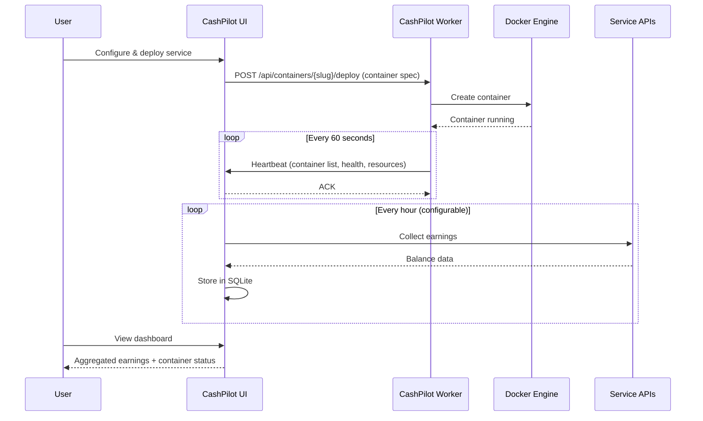

# 작동 방식 { #how-it-works }

CashPilot은 **UI + 워커** 분리 아키텍처를 사용합니다. UI는 Docker를 절대 건드리지 않으며, 모든 컨테이너 작업은 워커를 거칩니다. 이 분리는 핵심 설계 원칙이며, 여러 서버로 된 플릿 관리를 가능하게 하는 요소입니다.

## 구성 요소 { #components }

| 구성 요소 | 이미지 | 포트 | Docker 접근 | 용도 |
|-----------|-------|:----:|:-------------:|---------|
| **CashPilot UI** | `drumsergio/cashpilot` | 8080 | 없음 | 웹 대시보드, 수익 수집, 서비스 카탈로그, 자격 증명 저장, 일정 관리 |
| **CashPilot Worker** | `drumsergio/cashpilot-worker` | 8081 | `cashpilot-socket-proxy`를 통해 | Docker 컨테이너 수명 주기, 헬스 보고, UI로 보내는 하트비트 |

**독립 실행 모드는 없습니다**. Docker 컨테이너를 실행하는 모든 서버에는 워커가 필요합니다. UI는 순수한 대시보드/스케줄러이므로, Docker가 없는 머신을 포함해 어떤 머신에서든 실행할 수 있습니다.

## 설계 원칙 { #design-principles }

1. **관심사의 분리.** UI가 담당하는 것: 대시보드, 수익 수집, 일정 관리, 사용자 인증. 워커가 담당하는 것: Docker 컨테이너 수명 주기, 헬스 보고. 둘은 절대 겹치지 않습니다.
2. **워커에는 소켓 프록시를 통한 Docker 접근이 필요합니다.** Docker에 접근할 수 없는 워커는 쓸모가 없습니다. 배포되는 compose 파일에서 워커는 원시 소켓을 절대 받지 않으며, `cashpilot-socket-proxy`를 통해 Docker에 접근합니다. Unraid와 TrueNAS 등록 항목은 여전히 원시 소켓을 마운트합니다([앱 스토어](app-stores.md)). Docker 관리가 필요 없다면 수익 추적용으로 UI만 실행하면 됩니다.
3. **단일 진실 공급원.** 수익을 수집하고, 과거 데이터를 저장하고, 대시보드를 제공하는 것은 UI 인스턴스뿐입니다. 워커는 수익을 절대 수집하지 않습니다.
4. **수익은 절대 중복되지 않습니다.** UI만 수집하므로 같은 계정이 두 번 집계될 위험이 없습니다.
5. **워커는 상태가 없는 위성입니다.** 워커는 계속 실행할 컨테이너와 보고할 UI URL을 압니다. 로컬 파일에는 자신의 id와 플릿 키만 저장합니다(`.worker_id`, `.worker_key`; 데이터베이스도, 수익 데이터도 없습니다).
6. **YAML이 진실입니다.** 모든 서비스는 `services/{category}/{slug}.yml`에 있습니다. UI, 배포, 문서, compose 내보내기는 모두 이 파일에서 파생됩니다.

## 디렉터리 구조 { #directory-structure }

```
cashpilot/
  app/                      # FastAPI application
    main.py                 # App entrypoint, lifespan, container/fleet/earnings routes
    deps.py                 # Shared auth guards + Jinja2 template environment
    routers/                # Route groups split out of main.py: auth, pages, users
    catalog.py              # Loads YAML service definitions, caches, SIGHUP reload
    orchestrator.py         # Docker SDK: deploy, stop, restart, remove, logs
    database.py             # Async SQLite: earnings, config, deployments, users, workers
    worker_api.py           # Worker REST API: heartbeat, container commands, mini-UI
    setup_token.py          # First-run setup-token gate (owner-account creation)
    metrics.py              # Optional Prometheus metrics (/metrics)
    exchange_rates.py       # Crypto/fiat conversion via CoinGecko + Frankfurter
    collectors/             # Earnings collectors (one module per service, UI only)
      base.py               # BaseCollector ABC + EarningsResult dataclass
      honeygain.py          # Example: JWT auth + balance endpoint
      __init__.py           # COLLECTOR_MAP registry + make_collectors() factory
    templates/              # Jinja2: dashboard, fleet, catalog, setup wizard, payouts, settings
    static/
      css/style.css         # Classic night by default, plus dark, light, sunrise and warm
      js/app.js             # Vanilla JS, CP namespace, Chart.js, wizard state machine
  services/                 # YAML service definitions (SINGLE SOURCE OF TRUTH)
    _schema.yml             # Schema documentation
    bandwidth/              # Bandwidth sharing services
    depin/                  # DePIN services
    storage/                # Storage sharing services
    compute/                # GPU compute services
    mining/                 # Mining services
  docs/                     # Documentation and guides
    guides/                 # Per-service setup guides
  Dockerfile                # UI image: multi-stage python:3.15-alpine, su-exec, non-root
  Dockerfile.worker         # Worker image: minimal deps, no collectors/templates
  docker-compose.yml        # Single-server deployment
  docker-compose.fleet.yml  # Multi-server fleet deployment
```

## 데이터 흐름 { #data-flow }



### 하트비트(워커에서 UI로) { #heartbeat-worker-to-ui }

각 워커는 60초마다 다음을 보냅니다:

- 상태(실행 중, 중지됨, 종료됨)가 포함된 컨테이너 목록
- 컨테이너별 리소스 사용량(CPU 퍼센트, 메모리 MB)
- 시스템 정보(OS, 아키텍처, 호스트 이름, Docker 사용 가능 여부)
- 스스로 보고하는 URL(명시적인 `CASHPILOT_WORKER_URL` 또는 자동 감지된 대체 값)

UI는 이를 SQLite 데이터베이스에 저장하고 **Fleet** (플릿) 페이지에 표시합니다.

### 명령(UI에서 워커로) { #commands-ui-to-worker }

UI는 어떤 워커에든 다음을 지시할 수 있습니다:

- 서비스 컨테이너 **Deploy** (배포)(전체 사양: 이미지, 환경 변수, 볼륨, 포트)
- 컨테이너 **Stop** (중지), **start** (시작), **restart** (재시작) 또는 **remove** (제거)
- 컨테이너에서 **Fetch logs** (로그 가져오기)

명령은 UI가 워커로 보내는 REST API 호출로 전송됩니다.

### 자격 증명 흐름 { #credential-flow }

워커는 **자격 증명을 절대 다루거나 저장하지 않습니다**:

1. 사용자가 UI에서 서비스 자격 증명을 설정합니다(SQLite에 암호화되어 저장).
2. 배포할 때 UI는 전체 컨테이너 사양(환경 변수 포함)을 워커에 보냅니다.
3. 워커는 그 사양을 Docker API에 전달합니다. Docker는 환경 변수를 컨테이너 설정에 저장합니다.
4. 재시작할 때: `docker restart`는 환경 변수를 그대로 유지합니다.
5. 전체 재배포(제거 + 생성)할 때: UI가 전체 사양을 다시 보냅니다.

### 수익 수집 { #earnings-collection }

UI는 설정된 각 서비스에 대해 예약된 수집기를 실행합니다:

- **자동 수집기**는 수집기가 있는 제공업체에 대해 서비스 API(JWT 인증, 쿠키 인증, API 키)로 잔액을 가져옵니다
- 결과는 원래 통화(USD, MYST, GRASS, STORJ 등)로 SQLite에 저장됩니다
- 환율은 CoinGecko(암호화폐)와 Frankfurter(법정 화폐)에서 가져오며, 15분 동안 캐시됩니다
- 각 측정값은 측정한 날의 USD 환율을 함께 저장합니다. 환율 없이 저장된 암호화폐 측정값(환율 열보다 오래된 것)은 시작 시와 하루에 한 번 CoinGecko의 일별 기록에서 그날의 가격을 받습니다. 가격이 없는 날은 가격 없이 남습니다
- 대시보드는 사용자가 선호하는 통화로 변환해 표시합니다

## 기술 스택 { #tech-stack }

| 기술 | 용도 |
|---|---|
| FastAPI | 백엔드 프레임워크(Python 3.15, 비동기) |
| Jinja2 | 서버 렌더링 HTML 템플릿 |
| SQLite | 데이터베이스(aiosqlite, 설정 불필요, `/data`에 저장) |
| Docker SDK for Python | 소켓을 통한 컨테이너 수명 주기 관리 |
| PyYAML | 서비스 정의 파싱 |
| APScheduler | 주기적인 수익 수집 |
| httpx | 수익 수집기용 비동기 HTTP 클라이언트 |
| cryptography (Fernet) | 저장된 자격 증명의 저장 상태 암호화 |
| Chart.js | 프런트엔드 수익 차트 |
| su-exec | 엔트리포인트 설정 후 root에서 `cashpilot` 사용자로 권한을 낮춤(Dockerfile) |

## 데이터베이스 { #database }

400일 데이터 보존 기간을 둔 SQLite입니다. 주요 테이블:

- **earnings** -- 서비스별 과거 수익(타임스탬프, slug, 잔액, 통화)
- **deployments** -- 활성 컨테이너 배포(slug, 컨테이너 ID, 암호화된 환경 변수, 상태)
- **config** -- 키-값 설정과 암호화된 자격 증명
- **users** -- 계정(사용자 이름, bcrypt 비밀번호 해시, 역할)
- **user_preferences** -- 사용자별 온보딩 상태(설정 모드, 선택한 카테고리, 시간대)
- **health_events** -- 컨테이너 헬스 기록(start, stop, crash, check_ok, check_down)
- **workers** -- 플릿 워커 레지스트리(클라이언트 ID, 이름, URL, 상태, 마지막 하트비트, 암호화된 워커별 플릿 키)

## 보안 모델 { #security-model }

- 모든 자격 증명은 Fernet 대칭 암호화로 저장 상태에서 암호화됩니다
- 워커에서 UI로의 인증은 워커별 플릿 키를 사용합니다(`CASHPILOT_API_KEY`는 등록/부트스트랩용 자격 증명일 뿐입니다)
- 관리 대상 컨테이너는 `--security-opt no-new-privileges`로 실행됩니다
- 컨테이너 이름 규칙: `cashpilot.managed=true` 레이블이 붙은 `cashpilot-{slug}`
- UI 컨테이너에는 Docker 소켓 접근 권한이 **없습니다**
- 역할 시스템(소유자 owner, 편집자 writer, 뷰어 viewer)을 갖춘 세션 기반 인증
