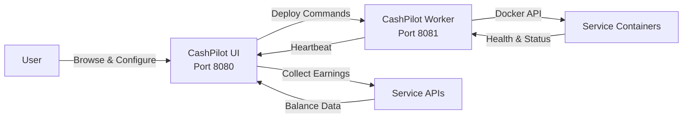

# Aan de slag { #getting-started }

## Vereisten { #prerequisites }

- **Docker** met de **Compose v2-plugin, versie 2.23.1 of nieuwer**. Controleer
  dat met `docker compose version`. Oudere versies kunnen de inline configuratie
  in het compose-bestand niet lezen. Docker Desktop bevat de plugin. Op een kale Docker
  Engine op Linux installeer je hem uit de pakketrepository van Docker
  (https://docs.docker.com/compose/install/linux/). Op macOS met Colima
  installeer je hem met Homebrew en koppel je hem als Docker-plugin:

    ```sh
    brew install docker-compose
    mkdir -p ~/.docker/cli-plugins
    ln -sfn "$(brew --prefix)/opt/docker-compose/bin/docker-compose" ~/.docker/cli-plugins/docker-compose
    ```

- Een Linux-, macOS- of Windows-host (amd64 of arm64)
- Minstens 1 GB vrij RAM voor CashPilot en de diensten die het beheert
- **Eén CashPilot per Docker-host.** Zie de waarschuwing hieronder.

!!! warning "Eén CashPilot per Docker-host"
    Draai geen twee CashPilot-installaties op één Docker-host. De compose-bestanden
    gebruiken vaste containernamen (`cashpilot-ui`, `cashpilot-worker`,
    `cashpilot-socket-proxy`), dus een tweede kopie van het bestand mislukt op een
    naamconflict. Hernoem je ze om dat te omzeilen, dan delen de twee installaties nog steeds
    de host. Elke worker beheert elke container die de labels van CashPilot
    draagt, welke installatie hem ook heeft gemaakt. Elk dashboard toont,
    stopt en vervangt dus de verdien-apps van de andere. De twee delen ook het
    netwerk `cashpilot-isolated`, de namen van de verdien-apps (`cashpilot-<service>`),
    hun hostpoorten en volumes zoals `mysterium-data`. Gebruik voor een tweede
    installatie een andere host of VM. Wil je verdien-apps op meer servers draaien, voeg dan
    workers toe aan één dashboard ([Vloot](fleet.md)).

## Snel starten { #quick-start }

### 1. Haal het compose-bestand op en start { #1-fetch-the-compose-file-and-launch }

```bash
curl -fsSLO https://raw.githubusercontent.com/GeiserX/CashPilot/main/docker-compose.yml
docker compose up -d
```

Dit start drie containers die blijven draaien. Daarvoor draait een eenmalige
`cashpilot-migrate`, die bij elke `up` stopt met code 0, dus
`docker compose ps -a` toont hem als `Exited (0)`. Dat is normaal.

| Container | Poort | Doel |
|-----------|------|---------|
| **cashpilot-migrate** | geen | Draait één keer en stopt. Hij verplaatst gegevens die een oudere release maakte naar volumes die de socket-proxy accepteert, en vindt op een nieuwe installatie niets te doen |
| **cashpilot-ui** | 8080 | Webdashboard, verzamelen van inkomsten, dienstencatalogus |
| **cashpilot-worker** | 8081 | Docker-agent die dienstcontainers uitrolt en bewaakt |
| **cashpilot-socket-proxy** | geen | Houdt de Docker-socket alleen-lezen vast en geeft de worker een gefilterde kopie ([Standaard beveiligingsinstellingen](security-defaults.md)) |

### 2. Open het dashboard { #2-open-the-dashboard }

Ga in je browser naar [http://localhost:8080](http://localhost:8080). Omdat er nog geen account bestaat, kom je op de welkomstpagina, die het eigenaarsaccount aanmaakt.

!!! tip "Poort 8080 al in gebruik?"
    Kies een andere hostpoort in een `.env`-bestand naast `docker-compose.yml`,
    in plaats van het compose-bestand te bewerken:

    ```bash
    printf '\nCASHPILOT_UI_PORT=8088\n' >> .env
    docker compose up -d
    ```

    Open daarna http://localhost:8088. Laat de waarde in `.env` staan, want de
    update in de app leest dat bestand en niet je shell. (`printf` begint met een
    nieuwe regel, zodat de regel nooit aan de laatste regel van een bestaande `.env` vastplakt.)

    De variabele heeft een `docker-compose.yml` nodig waarvan de `ports:`-regel luidt:
    `${CASHPILOT_UI_PORT:-8080}:8080`. Het bestand van v1.61 en ouder zet vast
    `8080:8080` en negeert hem. Download het huidige bestand, of
    houd je eigen aangepaste poorttoewijzing: de update in de app accepteert die ook.

!!! warning "Installatietoken voor de eerste start vereist"
    Bij de eerste start maakt CashPilot een eenmalig installatietoken en schrijft het naar de logboeken van de container **cashpilot-ui**:

    ```bash
    docker compose logs cashpilot-ui
    ```

    Zoek een regel zoals:

    ```
    FIRST-RUN SETUP: no account exists yet. Open /register and enter this
    one-time setup token to create the owner account: <token>
    ```

    Kopieer dat token in het veld **Setup token** (Installatietoken) bij de stap **Owner account** (Eigenaarsaccount) van de welkomstpagina, samen met een gebruikersnaam en wachtwoord, om het eerste account (de eigenaar) aan te maken. Het staat alleen in de logboeken, nooit in een URL, en wordt voorgoed weggegooid zodra het eigenaarsaccount bestaat.

### 3. Blader door de dienstencatalogus { #3-browse-the-service-catalog }

De pagina **Catalog** (Catalogus) toont elke dienst met zijn platforms, een maandelijkse schatting en wat hij nodig heeft (residentieel IP-adres, GPU). Filter op categorie (Bandbreedte, DePIN, Opslag, Rekenkracht, Mining) of zoek op naam. **Add** (Toevoegen) opent de installatiewizard op die dienst, **Details** (Details) toont de beschrijving, de uitbetalingen en het risico van het uitrollen, en diensten die niet in Docker draaien krijgen in plaats daarvan een link **Visit** (Bezoeken).

Twee soorten diensten verdienen eerst een nadere blik: diensten die pas betalen nadat je een token-inzet vastzet, zoals Anyone Protocol, Sia en Flux, en relays die je IP-adres publiceren, wat kan verlagen wat residentiële bandbreedte-apps je betalen. Zie [Controleer twee dingen voordat je uitrolt](guides/index.md).

### 4. Voeg diensten toe met de wizard { #4-add-services-with-the-wizard }

Zodra het eigenaarsaccount bestaat, opent **Add services** (Diensten toevoegen) de installatiewizard; later opent de knop **+ Add service** (+ Dienst toevoegen) in de bovenbalk hem opnieuw. Kies categorieën en daarna diensten. Voor elke dienst toont de wizard een link **Sign Up** (Aanmelden), vraagt hij alleen de inloggegevens die die dienst nodig heeft (e-mail en wachtwoord, API-token, enzovoort) en laat hij je de workers kiezen waarop hij draait. Klik op **Deploy** (Uitrollen) en CashPilot haalt de image op, maakt de container en begint hem te bewaken.

### 5. Volg het op het dashboard { #5-watch-it-on-the-dashboard }

Het dashboard toont elke uitgerolde dienst met zijn status en saldo, en de pagina **Fleet** (Vloot) toont elke worker.

## Hoe het werkt { #how-it-works }



1. **Jij configureert** diensten via de web-UI -- kies een dienst, vul inloggegevens in, klik op uitrollen.
2. **De UI stuurt** de containerspecificatie (image, omgevingsvariabelen, volumes) via de REST API naar de worker.
3. **De worker maakt** de Docker-container en begint zijn gezondheid te bewaken.
4. **De worker meldt** de containerstatus elke 60 seconden via levenssignalen terug aan de UI.
5. **De UI verzamelt** inkomsten uit de API's van de diensten volgens een instelbaar schema (standaard: elk uur).
6. **Het dashboard** toont opgetelde inkomsten, een uitsplitsing per dienst en de gezondheid van de containers.

## Configuratie { #configuration }

### Omgevingsvariabelen van de UI { #ui-environment-variables }

| Variabele | Standaard | Beschrijving |
|----------|---------|-------------|
| `TZ` | `UTC` | Tijdzone voor planning en weergave |
| `CASHPILOT_SECRET_KEY` | *(automatisch gemaakt)* | Ondertekeningssleutel voor inlogsessies. Bewaard in `/data/.secret_key`. **Versleutelt geen inloggegevens** |
| `CASHPILOT_ENCRYPTION_KEY` | *(automatisch gemaakt)* | Fernet-sleutel die opgeslagen inloggegevens in rust versleutelt. Bewaard in `/data/.fernet_key`. Wordt alleen overgenomen als dat bestand ontbreekt, dus stel hem alleen in om een back-up terug te zetten |
| `CASHPILOT_API_KEY` | *(uit `/fleet`)* | Gedeelde aanmeldsleutel voor workers. Elke worker krijgt zijn eigen sleutel wanneer hij zich aanmeldt; zie [Vloot](fleet.md) |
| `CASHPILOT_COLLECT_INTERVAL` | `60` | Minuten tussen de rondes waarin inkomsten worden verzameld |
| `CASHPILOT_UI_PORT` | `8080` | Hostpoort waarop de UI wordt gepubliceerd. Stel hem in `.env` in als 8080 bezet is |
| `CASHPILOT_BIND_ADDR` | `127.0.0.1` | Hostinterface waarop de UI-poort wordt gepubliceerd. **Standaard loopback**: het dashboard kan de worker met de Docker-socket aansturen, dus het staat niet zomaar open voor je netwerk. Stel een specifiek IP-adres in (bijv. een Tailscale-/VPN-adres) of `0.0.0.0` om het open te zetten, of (bij voorkeur) zet er een reverse proxy met authenticatie voor |

De webpoort van de UI in de container staat vast op `8080` (ingesteld via de `CMD` van de container). `CASHPILOT_UI_PORT` en `CASHPILOT_BIND_ADDR` kiezen alleen de hostpoort en de interface waarop hij wordt gepubliceerd.

### Omgevingsvariabelen van de worker { #worker-environment-variables }

| Variabele | Standaard | Beschrijving |
|----------|---------|-------------|
| `TZ` | `UTC` | Tijdzone |
| `CASHPILOT_UI_URL` | -- | URL van de UI-container, bijv. `http://cashpilot-ui:8080` |
| `CASHPILOT_API_KEY` | -- | Moet overeenkomen met de aanmeldsleutel van de UI. Alleen nodig om zich aan te melden; daarna gebruikt de worker zijn eigen sleutel |
| `CASHPILOT_WORKER_NAME` | *(hostnaam)* | Weergavenaam van deze worker in het vlootdashboard |
| `CASHPILOT_WORKER_URL` | *(automatisch gedetecteerd)* | URL waarmee de UI deze worker bereikt, bijv. `http://192.168.1.50:8081`. Stel hem expliciet in voor vloten over meerdere hosts: automatische detectie kan een onbereikbaar IP-adres binnen de container melden |
| `CASHPILOT_WORKER_BIND_ADDR` | `127.0.0.1` | **Alleen voor de compose van de vloot en van workers op afstand** (`docker-compose.fleet.yml`): hostinterface waarop de API-poort met de Docker-socket van de worker wordt gepubliceerd, standaard loopback. De standaard `docker-compose.yml` publiceert poort 8081 helemaal niet. De worker-API kan elke container uitrollen en stoppen (= root op de host), dus bind voor een worker op afstand een privé-/VPN-interface (bijv. een Tailscale-IP-adres), **nooit** een publiek IP-adres |
| `CASHPILOT_PORT` | `8081` | Poort die de worker aan de UI **doorgeeft**. Hij verandert de luisterpoort *niet*; die ligt vast in de `CMD` van de image; zie de [configuratiereferentie](configuration.md) |

### Voorbeeld van Docker Compose { #docker-compose-example }

```yaml
--8<-- "docker-compose.yml"
```

!!! note "Dit is het echte bestand"

    Het blok hierboven komt letterlijk uit `docker-compose.yml` in de
    repository, dus het kan niet afwijken van wat echt wordt geleverd. Vroeger publiceerde een
    met de hand gekopieerde versie de API met de Docker-socket van de worker op elke
    interface en pinde hij `:latest`, twee dingen die de pagina
    [standaard beveiligingsinstellingen](security-defaults.md) je afraadt.

!!! warning "Toegang tot de Docker-socket"
    De worker beheert dienstcontainers via Docker, maar mount `/var/run/docker.sock` niet. De container `cashpilot-socket-proxy` houdt de socket vast en geeft de worker alleen de aanroepen door die hij doet. Hij weigert geprivilegieerde containers en binds van hostmappen die je niet hebt opgegeven ([wat hij weigert](security-defaults.md#docker-socket-proxy)). De update in de app is opt-in: hij draait alleen met `CASHPILOT_COMPOSE_DIR=<this folder>` in de `.env` naast het compose-bestand, en die instelling laat containers de map binden, wat de proxy verzwakt ([wat dat kost](security-defaults.md#docker-socket-proxy)). Laat hem leeg en update met `docker compose pull && docker compose up -d`. De worker beheert nog steeds elke container op de host, dus draai CashPilot voor de beste beveiliging op een eigen machine of VLAN.

!!! tip "De geheime sleutel bewaren"
    Inloggegevens worden versleuteld met `CASHPILOT_ENCRYPTION_KEY`, **niet** met `CASHPILOT_SECRET_KEY`, die alleen inlogsessies ondertekent. De versleutelingssleutel wordt bij de eerste start automatisch gemaakt en bewaard in `/data/.fernet_key`. **Maak een back-up van dat bestand.** Wordt het volume zonder dat bestand opnieuw gemaakt, dan komt er een nieuwe sleutel en worden alle opgeslagen inloggegevens voorgoed onleesbaar. `CASHPILOT_ENCRYPTION_KEY` instellen is bedoeld om die back-up terug te zetten; het sleutelbestand wint altijd, dus hem instellen op een gezonde installatie verandert niets.

!!! tip "Wachtwoorden en geheimen in de UI"
    Wijzig je eigen wachtwoord wanneer je wilt via het avatarmenu -> **Change password** (Wachtwoord wijzigen) (voor alle rollen beschikbaar); daarmee word je uit je andere sessies uitgelogd. In **Settings** (Instellingen) zijn opgeslagen geheimen alleen-schrijven: vul een waarde in om hem te wijzigen, of laat het veld leeg om de bestaande te houden. Opgeslagen inloggegevens worden nooit naar de browser teruggestuurd.

## CashPilot bijwerken { #updating-cashpilot }

Het compose-bestand pint een major.minor-reeks, zoals `drumsergio/cashpilot:X.Y`, dus `pull` haalt de nieuwste patch van die reeks op:

```bash
docker compose pull
docker compose up -d
```

`docker compose pull` haalt de nieuwste gepubliceerde image op en `up -d` maakt
alleen de containers opnieuw waarvan de image veranderde. De meegeleverde compose-bestanden zetten
`pull_policy: always`, dus zelfs een kale `docker compose up -d` haalt eerst de
nieuwste image op.

**Vanuit het dashboard.** **Settings** (Instellingen), **About and updates** (Over en updates) voert dezelfde twee
commando's voor je uit vanuit een kortlevende hulpcontainer. De hulpcontainer leest je
compose-bestanden en de `.env` ernaast (of de bestanden die je met
`--env-file` meegaf), nooit de shell waaruit je CashPilot startte. Stel dat je het startte met `CASHPILOT_UI_PORT=8088 docker compose up -d`.
De update zou het dashboard terugzetten op 8080, dus hij stopt en vertelt je waarom
in plaats daarvan. Zet die waarde in `.env` en de knop werkt.

!!! note "Je hoeft **niet** opnieuw te bouwen"
    CashPilot levert kant-en-klare multi-arch-images op Docker Hub
    ([`drumsergio/cashpilot`](https://hub.docker.com/r/drumsergio/cashpilot),
    [`drumsergio/cashpilot-worker`](https://hub.docker.com/r/drumsergio/cashpilot-worker)).
    `docker compose build` / `--build` is alleen van belang als je bewust
    vanuit de broncode bouwt met `docker-compose.build.yml`. Voor normale installaties is
    `pull` + `up -d` de volledige en juiste updateprocedure.

### Een specifieke versie pinnen { #pinning-a-specific-version }

Wil je op één exacte release blijven, vervang dan de reekstag `X.Y` in
`docker-compose.yml` door een volledige releasetag `X.Y.Z` op zowel
`drumsergio/cashpilot` als `drumsergio/cashpilot-worker` (altijd dezelfde tag op
beide), en verwijder `pull_policy: always`. Blader door de tags op
[Docker Hub](https://hub.docker.com/r/drumsergio/cashpilot/tags).

Wil je naar een nieuwere reeks, bewerk dan beide tags: eerst op de UI-host, daarna op
elke worker-host. Lees eerst
[UPGRADING.md](https://github.com/GeiserX/CashPilot/blob/main/UPGRADING.md),
want een major release zoals 3.0 heeft eigen stappen.

### Updates automatiseren (optioneel) { #automating-updates-optional }

Wil je updates zonder omkijken, laat dan een planner dezelfde twee commando's uitvoeren,
bijvoorbeeld met een dagelijkse cron-regel:

```cron
0 4 * * *  cd /path/to/cashpilot && docker compose pull && docker compose up -d
```

Of laat een auto-updater zoals [Watchtower](https://containrrr.dev/watchtower/)
of [Diun](https://crazymax.dev/diun/) op de CashPilot-containers los. Die
zijn optioneel. CashPilot levert geen updater mee.

### Oude images opruimen { #cleaning-up-old-images }

CashPilot haalt images op maar verwijdert ze nooit. Elke update en elke keer opnieuw uitrollen
kan de vorige image op de schijf achterlaten. Op een testvloot van drie servers kwamen de oude
CashPilot- en verdien-app-images samen op ongeveer 3 GB. Dat is weinig naast
wat andere programma's op dezelfde host meestal achterlaten, dus kijk naar de
hele host:

```bash
docker system df
```

De waarde `RECLAIMABLE` op de regel `Images` is wat Docker zou kunnen vrijmaken.

**Waarom CashPilot dit niet voor je doet.** De worker bereikt Docker via
de socket-proxy. Voor images laat de proxy hem er één ophalen en er één op naam lezen,
en niets anders. Hij kan de images van de host niet opsommen en er geen verwijderen. Een worker die
dat wel kon, zou ook de images van elk ander programma op de host zien en verwijderen.
Zie [wat de proxy weigert](security-defaults.md#docker-socket-proxy).

**Stap 1: verwijder zwevende images.** Een zwevende (dangling) image heeft geen tag en geen
container gebruikt hem, draaiend of gestopt. Een update via een meebewegende tag zoals
`X.Y` (een reeks zoals die welke de compose-bestanden pinnen), `latest` of een digest laat precies deze achter:

```bash
docker image prune
```

Dit verwijdert ook de image die je vóór een update via een meebewegende tag draaide: zodra
de nieuwe image voor die reeks binnenkomt, heeft de oude geen tag meer. Wil je een weg terug houden, noteer
dan de exacte versie voordat je bijwerkt (onderaan de zijbalk staat hij), zodat
je `drumsergio/cashpilot:<X.Y.Z>` opnieuw kunt ophalen. Of pin het compose-bestand op
een exacte tag `X.Y.Z`; dan houdt de oude image zijn tag en geldt stap 2.

Docker vraagt het voordat het verwijdert. Voeg in een cron-regel `--force` toe om de
vraag over te slaan. Het verandert verder niets:

```cron
30 4 * * 0  docker image prune --force
```

!!! warning "Voeg `-a` niet toe"
    `docker image prune -a` verwijdert elke image die op dit moment door geen container
    wordt gebruikt, zwevend of met tag. Daaronder vallen images van stacks die je met opzet
    stopte en images die je lokaal bouwde en niet opnieuw kunt ophalen.

**Stap 2: verwijder oude gepinde tags.** Een image die op een versie is gepind, houdt zijn tag
nadat je naar een nieuwere bent gegaan, dus `prune` slaat hem over. Deze CashPilot-images zijn
gepind:

| Repository | Wat hem pint |
|---|---|
| `drumsergio/cashpilot` | Het compose-bestand (een oude reeks, of een exacte versie die je pinde) |
| `drumsergio/cashpilot-worker` | Het compose-bestand, net als hierboven |
| `drumsergio/cashpilot-tunnel` | De worker, één tag per workerversie |
| `drumsergio/cashpilot-earnapp` | De catalogusvermelding van EarnApp |
| `drumsergio/cashpilot-anyone` | De catalogusvermelding van Anyone Protocol |

Hetzelfde geldt voor de image van een dienst die je verwijderde: zijn tag blijft tot je
hem verwijdert. Een catalogusimage die op digest is gepind, zoals MystNodes of ProxyBase,
verliest zijn tag wanneer een nieuwere hem vervangt, dus stap 1 dekt die al.

Toon eerst de tags die geen container gebruikt. Dit voorbeeld is voor de worker-image.
Verander `repo` voor een andere repository uit de tabel:

```bash
repo=drumsergio/cashpilot-worker
used=$(docker ps -a --format '{{.Image}}')
docker image ls "$repo" --format '{{.Repository}}:{{.Tag}}' | grep -vxF "$used"
```

Verwijder daarna elke oude tag op naam, één voor één:

```bash
docker image rm drumsergio/cashpilot-worker:<old tag>
```

Voeg `-f` niet toe. Zonder die optie weigert Docker een image te verwijderen die een
container nog gebruikt, draaiend of gestopt, en toont het
`conflict: unable to delete`. Zie je dat, houd de image dan. Houd de tag
die je draait en de tag die je daarvoor draaide, zodat je nog één versie terug kunt.
Verwijder alleen tags die ouder zijn dan die twee.

De kolom **Host disk** (Hostschijf) van het dashboard toont de vrije ruimte op het bestandssysteem dat
de `/data` van de worker bevat. Images staan meestal op hetzelfde bestandssysteem, onder
de data-root van Docker, maar niet altijd. `docker info --format '{{.DockerRootDir}}'`
toont de data-root van Docker. Met de containerd-image-store, de standaard op een
nieuwe installatie van Docker Engine 29, staan images in plaats daarvan onder de root van containerd,
normaal `/var/lib/containerd`. `docker info --format '{{.Driver}}'` toont
`overlayfs` voor de containerd-image-store en `overlay2` voor de klassieke.
Controleer de vrije ruimte op het bestandssysteem dat de map bevat die van toepassing is.

## Ondersteunde diensten { #supported-services }

CashPilot ondersteunt **<!-- n:live -->50<!-- /n --> diensten** die actief of in bèta zijn, verdeeld over vijf categorieën:

- **Bandbreedte delen** (<!-- n:bandwidth -->18<!-- /n -->): deel je internetbandbreedte voor passief inkomen
- **DePIN** (<!-- n:depin -->15<!-- /n -->): gedecentraliseerde fysieke infrastructuurnetwerken
- **GPU-rekenkracht** (<!-- n:compute -->7<!-- /n -->): verhuur je GPU voor AI- en rekenwerk
- **Opslag** (<!-- n:storage -->2<!-- /n -->): deel schijfruimte op gedecentraliseerde opslagnetwerken
- **Mining** (<!-- n:mining -->8<!-- /n -->): rol een miner uit of volg een pool via het uitbetalingsadres ([Mining](mining.md))

Daarvan kunnen er **<!-- n:docker -->21<!-- /n -->** automatisch via Docker worden uitgerold en beheerd. De catalogus volgt de andere <!-- n:tracked -->29<!-- /n --> (<!-- n:extension -->18<!-- /n --> browser- of desktop-apps, <!-- n:gpu -->7<!-- /n --> GPU-nodes, <!-- n:mining_pools -->4<!-- /n --> miningpools). CashPilot leest hun saldo waar een collector bestaat.

Blader door de volledige catalogus in het onderdeel [Handleidingen per dienst](guides/index.md).

## Volgende stappen { #next-steps }

- [Hoe het werkt](how-it-works.md) -- Begrijp het ontwerp met de splitsing tussen UI en worker
- [Vlootbeheer](fleet.md) -- Rol uit over meerdere servers
- [Je thuisnetwerk beschermen](home-network-security.md) -- Houd de containers van je LAN af, en wanneer gVisor helpt
- [Handleidingen per dienst](guides/index.md) -- Gedetailleerde installatie-instructies voor elke dienst
- [CashPilot volledig verwijderen](uninstall.md) -- Verwijder alles wat het maakte, om opnieuw te beginnen of om te stoppen
