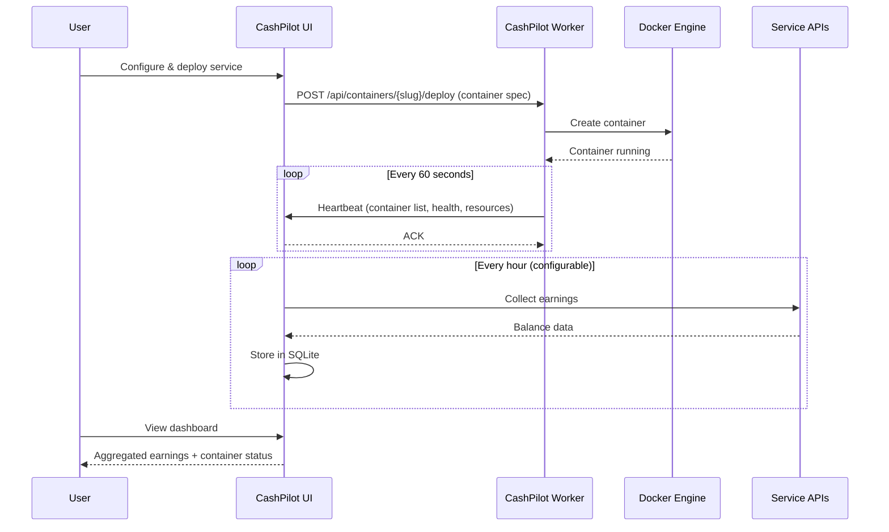

# Hoe het werkt { #how-it-works }

CashPilot gebruikt een gesplitste architectuur van **UI + worker**. De UI raakt Docker nooit aan -- alle containerbewerkingen lopen via workers. Deze scheiding is een kernprincipe van het ontwerp en maakt vlootbeheer over meerdere servers mogelijk.

## Onderdelen { #components }

| Onderdeel | Image | Poort | Toegang tot Docker | Doel |
|-----------|-------|:----:|:-------------:|---------|
| **CashPilot UI** | `drumsergio/cashpilot` | 8080 | Nee | Webdashboard, verzamelen van inkomsten, dienstencatalogus, opslag van inloggegevens, planning |
| **CashPilot Worker** | `drumsergio/cashpilot-worker` | 8081 | Via `cashpilot-socket-proxy` | Levenscyclus van Docker-containers, gezondheidsrapportage, levenssignalen naar de UI |

Er is **geen zelfstandige modus**. Elke server die Docker-containers draait, heeft een worker nodig. De UI is puur een dashboard en planner -- hij kan op elke machine draaien, ook op een zonder Docker.

## Ontwerpprincipes { #design-principles }

1. **Scheiding van verantwoordelijkheden.** De UI regelt: dashboard, verzamelen van inkomsten, planning, gebruikersauthenticatie. Workers regelen: levenscyclus van Docker-containers, gezondheidsrapportage. Ze overlappen nooit.
2. **Workers hebben Docker nodig, via de socket-proxy.** Een worker zonder toegang tot Docker is nutteloos. Met de meegeleverde compose-bestanden krijgt hij nooit de kale socket: hij bereikt Docker via `cashpilot-socket-proxy`. De Unraid- en TrueNAS-vermeldingen mounten nog steeds de kale socket ([app stores](app-stores.md)). Heb je geen Docker-beheer nodig, draai dan alleen de UI om inkomsten te volgen.
3. **Eén bron van waarheid.** De UI-instantie is de enige die inkomsten verzamelt, historische gegevens opslaat en het dashboard serveert. Workers verzamelen nooit inkomsten.
4. **Inkomsten worden nooit dubbel geteld.** Omdat alleen de UI verzamelt, is er geen risico dat hetzelfde account twee keer wordt meegeteld.
5. **Workers zijn staatloze satellieten.** Een worker weet welke containers hij draaiend moet houden en naar welke UI-URL hij moet rapporteren. Hij bewaart alleen zijn eigen id en vlootsleutel in lokale bestanden (`.worker_id`, `.worker_key`; geen database, geen inkomstengegevens).
6. **YAML is de waarheid.** Elke dienst staat in `services/{category}/{slug}.yml`. De UI, het uitrollen, de documentatie en de compose-export komen allemaal uit deze bestanden.

## Mapstructuur { #directory-structure }

```
cashpilot/
  app/                      # FastAPI application
    main.py                 # App entrypoint, lifespan, container/fleet/earnings routes
    deps.py                 # Shared auth guards + Jinja2 template environment
    routers/                # Route groups split out of main.py: auth, pages, users
    catalog.py              # Loads YAML service definitions, caches, SIGHUP reload
    orchestrator.py         # Docker SDK: deploy, stop, restart, remove, logs
    database.py             # Async SQLite: earnings, config, deployments, users, workers
    worker_api.py           # Worker REST API: heartbeat, container commands, mini-UI
    setup_token.py          # First-run setup-token gate (owner-account creation)
    metrics.py              # Optional Prometheus metrics (/metrics)
    exchange_rates.py       # Crypto/fiat conversion via CoinGecko + Frankfurter
    collectors/             # Earnings collectors (one module per service, UI only)
      base.py               # BaseCollector ABC + EarningsResult dataclass
      honeygain.py          # Example: JWT auth + balance endpoint
      __init__.py           # COLLECTOR_MAP registry + make_collectors() factory
    templates/              # Jinja2: dashboard, fleet, catalog, setup wizard, payouts, settings
    static/
      css/style.css         # Classic night by default, plus dark, light, sunrise and warm
      js/app.js             # Vanilla JS, CP namespace, Chart.js, wizard state machine
  services/                 # YAML service definitions (SINGLE SOURCE OF TRUTH)
    _schema.yml             # Schema documentation
    bandwidth/              # Bandwidth sharing services
    depin/                  # DePIN services
    storage/                # Storage sharing services
    compute/                # GPU compute services
    mining/                 # Mining services
  docs/                     # Documentation and guides
    guides/                 # Per-service setup guides
  Dockerfile                # UI image: multi-stage python:3.15-alpine, su-exec, non-root
  Dockerfile.worker         # Worker image: minimal deps, no collectors/templates
  docker-compose.yml        # Single-server deployment
  docker-compose.fleet.yml  # Multi-server fleet deployment
```

## Gegevensstroom { #data-flow }



### Levenssignaal (worker naar UI) { #heartbeat-worker-to-ui }

Elke 60 seconden stuurt elke worker:

- De lijst met containers en hun status (running, stopped, exited)
- Het brongebruik per container (CPU-percentage, geheugen in MB)
- Systeeminformatie (besturingssysteem, architectuur, hostnaam, of Docker beschikbaar is)
- De URL die hij zelf opgeeft (een expliciete `CASHPILOT_WORKER_URL` of een automatisch gedetecteerde terugvaloptie)

De UI slaat dit op in zijn SQLite-database en toont het op de pagina **Fleet** (Vloot).

### Opdrachten (UI naar worker) { #commands-ui-to-worker }

De UI kan elke worker opdragen om:

- Een dienstcontainer **uit te rollen** (volledige specificatie: image, omgevingsvariabelen, volumes, poorten)
- Een container te **stoppen**, **starten**, **herstarten** of **verwijderen**
- **Logboeken op te halen** uit een container

Opdrachten gaan als REST API-aanroepen van de UI naar de worker.

### Stroom van inloggegevens { #credential-flow }

De worker **verwerkt of bewaart nooit inloggegevens**:

1. De gebruiker stelt de inloggegevens van een dienst in de UI in (versleuteld opgeslagen in SQLite).
2. Bij het uitrollen stuurt de UI de volledige containerspecificatie (inclusief omgevingsvariabelen) naar de worker.
3. De worker geeft de specificatie door aan de Docker API. Docker bewaart de omgevingsvariabelen in de containerconfiguratie.
4. Bij herstarts: `docker restart` behoudt de omgevingsvariabelen vanzelf.
5. Bij volledig opnieuw uitrollen (verwijderen + aanmaken): de UI stuurt de volledige specificatie opnieuw.

### Verzamelen van inkomsten { #earnings-collection }

De UI draait geplande collectors voor elke ingestelde dienst:

- **Automatische collectors** halen saldi op via de API's van de diensten (JWT-authenticatie, cookie-authenticatie, API-sleutels) voor de aanbieders die er een hebben
- Resultaten worden in SQLite opgeslagen in de eigen valuta (USD, MYST, GRASS, STORJ, enz.)
- Wisselkoersen komen van CoinGecko (crypto) en Frankfurter (fiat), 15 minuten in de cache
- Elke meting bewaart de USD-koers van de dag waarop hij is gedaan. Een cryptometing die zonder koers is opgeslagen (ouder dan de koerskolom), krijgt de prijs van zijn eigen dag uit de daggeschiedenis van CoinGecko, bij het opstarten en één keer per dag; een dag zonder prijs blijft zonder prijs
- Het dashboard rekent om en toont alles in de voorkeursvaluta van de gebruiker

## Technologie { #tech-stack }

| Technologie | Doel |
|---|---|
| FastAPI | Backendframework (Python 3.15, async) |
| Jinja2 | HTML-templates die op de server worden gerenderd |
| SQLite | Database (aiosqlite, zonder configuratie, opgeslagen in `/data`) |
| Docker SDK for Python | Beheer van de levenscyclus van containers via de socket |
| PyYAML | Inlezen van dienstdefinities |
| APScheduler | Periodiek verzamelen van inkomsten |
| httpx | Async HTTP-client voor de collectors van inkomsten |
| cryptography (Fernet) | Versleuteling in rust van opgeslagen inloggegevens |
| Chart.js | Inkomstengrafieken in de frontend |
| su-exec | Schakelt na de entrypoint-setup over van root naar de gebruiker `cashpilot` (Dockerfile) |

## Database { #database }

SQLite met een bewaartermijn van 400 dagen. Belangrijkste tabellen:

- **earnings** -- Historische inkomsten per dienst (tijdstempel, slug, saldo, valuta)
- **deployments** -- Actieve uitgerolde containers (slug, container-ID, versleutelde omgevingsvariabelen, status)
- **config** -- Instellingen als sleutel-waarde en versleutelde inloggegevens
- **users** -- Accounts (gebruikersnaam, bcrypt-wachtwoordhash, rol)
- **user_preferences** -- Onboardingstatus per gebruiker (installatiemodus, gekozen categorieën, tijdzone)
- **health_events** -- Gezondheidsgeschiedenis van containers (start, stop, crash, check_ok, check_down)
- **workers** -- Register van de workers in de vloot (client-ID, naam, URL, status, laatste levenssignaal, versleutelde vlootsleutel per worker)

## Beveiligingsmodel { #security-model }

- Alle inloggegevens zijn in rust versleuteld met symmetrische Fernet-versleuteling
- Authenticatie van worker naar UI via vlootsleutels per worker (`CASHPILOT_API_KEY` is alleen het gedeelde geheim voor aanmelden en opstarten)
- Beheerde containers draaien met `--security-opt no-new-privileges`
- Naamgevingsconventie voor containers: `cashpilot-{slug}` met labels `cashpilot.managed=true`
- De UI-container heeft **geen** toegang tot de Docker-socket
- Authenticatie op basis van sessies met een rollensysteem (owner/writer/viewer: eigenaar/bewerker/kijker)
