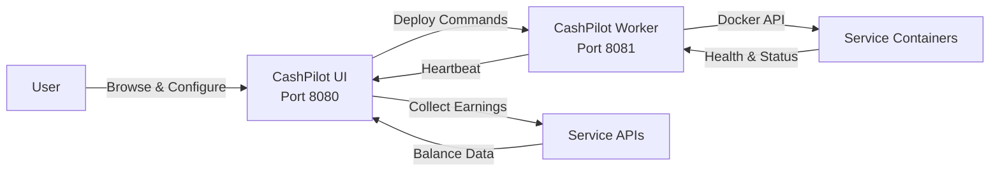

# Pierwsze kroki { #getting-started }

## Wymagania wstępne { #prerequisites }

- **Docker** z **wtyczką Compose v2 w wersji 2.23.1 lub nowszej**. Sprawdź to
  poleceniem `docker compose version`. Starsze wersje nie potrafią odczytać konfiguracji
  wpisanej bezpośrednio w pliku compose. Docker Desktop zawiera tę wtyczkę. Na samym Docker
  Engine w Linuksie zainstaluj ją z repozytorium pakietów Dockera
  (<https://docs.docker.com/compose/install/linux/>). Na macOS z Colimą
  zainstaluj ją przez Homebrew i podlinkuj jako wtyczkę Dockera:

    ```sh
    brew install docker-compose
    mkdir -p ~/.docker/cli-plugins
    ln -sfn "$(brew --prefix)/opt/docker-compose/bin/docker-compose" ~/.docker/cli-plugins/docker-compose
    ```

- Host z Linuksem, macOS lub Windows (amd64 lub arm64)
- Co najmniej 1 GB wolnej pamięci RAM na CashPilot i zarządzane usługi
- **Jeden CashPilot na host Dockera.** Zobacz ostrzeżenie poniżej.

!!! warning "Jeden CashPilot na host Dockera"
    Nie uruchamiaj dwóch instalacji CashPilot na jednym hoście Dockera. Pliki compose
    używają stałych nazw kontenerów (`cashpilot-ui`, `cashpilot-worker`,
    `cashpilot-socket-proxy`), więc druga kopia pliku kończy się błędem z powodu
    konfliktu nazw. Jeśli zmienisz nazwy, żeby to obejść, obie instalacje nadal
    dzielą host. Każdy worker zarządza każdym kontenerem, który ma
    etykiety CashPilot, niezależnie od tego, która instalacja go utworzyła. Każdy panel wyświetla więc,
    zatrzymuje i zastępuje aplikacje zarobkowe drugiego. Obie instalacje dzielą też
    sieć `cashpilot-isolated`, nazwy aplikacji zarobkowych (`cashpilot-<service>`),
    ich porty hosta i wolumeny, takie jak `mysterium-data`. Na drugą
    instalację użyj innego hosta lub maszyny wirtualnej. Aby uruchamiać aplikacje zarobkowe na większej liczbie serwerów, dodaj
    workery do jednego panelu ([Flota](fleet.md)).

## Szybki start { #quick-start }

### 1. Pobierz plik compose i uruchom { #1-fetch-the-compose-file-and-launch }

```bash
curl -fsSLO https://raw.githubusercontent.com/GeiserX/CashPilot/main/docker-compose.yml
docker compose up -d
```

To polecenie uruchamia trzy długo działające kontenery. Przed nimi jednorazowy
`cashpilot-migrate` uruchamia się i kończy z kodem 0 przy każdym `up`, więc
`docker compose ps -a` pokazuje go jako `Exited (0)`. To normalne.

| Kontener | Port | Zadanie |
|-----------|------|---------|
| **cashpilot-migrate** | brak | Uruchamia się raz i kończy. Przenosi dane, które starsze wydanie zapisało, na wolumeny akceptowane przez socket proxy; przy nowej instalacji nie ma nic do zrobienia |
| **cashpilot-ui** | 8080 | Panel webowy, zbieranie zarobków, katalog usług |
| **cashpilot-worker** | 8081 | Agent Dockera, który wdraża i monitoruje kontenery usług |
| **cashpilot-socket-proxy** | brak | Trzyma gniazdo Dockera tylko do odczytu i daje workerowi przefiltrowaną kopię ([Domyślne ustawienia bezpieczeństwa](security-defaults.md)) |

### 2. Otwórz panel { #2-open-the-dashboard }

Otwórz w przeglądarce [http://localhost:8080](http://localhost:8080). Ponieważ nie ma jeszcze żadnego konta, trafiasz na stronę powitalną, która tworzy konto właściciela.

!!! tip "Port 8080 jest już zajęty?"
    Wybierz inny port hosta w pliku `.env` obok `docker-compose.yml`,
    zamiast edytować plik compose:

    ```bash
    printf '\nCASHPILOT_UI_PORT=8088\n' >> .env
    docker compose up -d
    ```

    Potem otwórz http://localhost:8088. Zostaw tę wartość w `.env`, ponieważ
    aktualizacja z poziomu aplikacji czyta ten plik, a nie twoją powłokę. (`printf` zaczyna się od
    znaku nowej linii, żeby wpis nigdy nie skleił się z ostatnią linią istniejącego `.env`.)

    Zmienna wymaga pliku `docker-compose.yml`, w którym linia `ports:` brzmi
    `${CASHPILOT_UI_PORT:-8080}:8080`. Plik z wersji v1.61 i starszych ma na sztywno wpisane
    `8080:8080` i ją ignoruje. Pobierz aktualny plik albo
    zachowaj własne, edytowane mapowanie portu: aktualizacja z poziomu aplikacji to też akceptuje.

!!! warning "Przy pierwszym uruchomieniu wymagany jest token konfiguracji"
    Przy pierwszym starcie CashPilot generuje jednorazowy token konfiguracji i wypisuje go w logach kontenera **cashpilot-ui**:

    ```bash
    docker compose logs cashpilot-ui
    ```

    Szukaj linii podobnej do tej:

    ```
    FIRST-RUN SETUP: no account exists yet. Open /register and enter this
    one-time setup token to create the owner account: <token>
    ```

    Skopiuj ten token do pola **Setup token** (Token konfiguracji) w kroku **Owner account** (Konto właściciela) strony powitalnej, razem z nazwą użytkownika i hasłem, aby utworzyć pierwsze konto (właściciela). Token pojawia się wyłącznie w logach, nigdy w adresie URL, i zostaje trwale usunięty, gdy tylko konto właściciela istnieje.

### 3. Przejrzyj katalog usług { #3-browse-the-service-catalog }

Strona **Catalog** (Katalog) wymienia każdą usługę z jej platformami, miesięcznym szacunkiem i wymaganiami (IP domowy, GPU). Filtruj według kategorii (przepustowość, DePIN, przestrzeń dyskowa, moc obliczeniowa, kopanie) albo szukaj po nazwie. **Add** (Dodaj) otwiera kreator konfiguracji dla tej usługi, **Details** (Szczegóły) pokazuje jej opis, wypłaty i ryzyko wdrożenia, a usługi, które nie działają w Dockerze, mają zamiast tego link **Visit** (Odwiedź).

Dwa rodzaje usług wymagają najpierw bliższego przyjrzenia się: usługi, które płacą dopiero po zablokowaniu stawki w tokenach, takie jak Anyone Protocol, Sia i Flux, oraz przekaźniki, które publikują twój IP, co może obniżyć to, ile płacą ci aplikacje za przepustowość z IP domowego. Zobacz [Sprawdź dwie rzeczy przed wdrożeniem](guides/index.md).

### 4. Dodaj usługi kreatorem { #4-add-services-with-the-wizard }

Gdy konto właściciela już istnieje, **Add services** (Dodaj usługi) otwiera kreator konfiguracji; później otwiera go ponownie przycisk **+ Add service** (+ Dodaj usługę) na górnym pasku. Wybierz kategorie, a potem usługi. Dla każdej usługi kreator pokazuje link **Sign Up** (Zarejestruj się), prosi tylko o dane logowania, których ta usługa potrzebuje (e-mail i hasło, token API i tak dalej), i pozwala wybrać workery, na których ma działać. Kliknij **Deploy** (Wdróż), a CashPilot pobierze obraz, utworzy kontener i zacznie go obserwować.

### 5. Obserwuj go w panelu { #5-watch-it-on-the-dashboard }

Panel pokazuje każdą wdrożoną usługę z jej stanem i saldem, a strona **Fleet** (Flota) pokazuje każdy worker.

## Jak to działa { #how-it-works }



1. **Konfigurujesz** usługi przez interfejs webowy -- wybierasz usługę, wpisujesz dane logowania, klikasz wdrożenie.
2. **UI wysyła** specyfikację kontenera (obraz, zmienne środowiskowe, wolumeny) do workera przez REST API.
3. **Worker tworzy** kontener Dockera i zaczyna monitorować jego kondycję.
4. **Worker raportuje** stan kontenera do UI co 60 sekund przez sygnały życia.
5. **UI zbiera** zarobki z API usług według konfigurowalnego harmonogramu (domyślnie: co godzinę).
6. **Panel** pokazuje zsumowane zarobki, podział na usługi i kondycję kontenerów.

## Konfiguracja { #configuration }

### Zmienne środowiskowe UI { #ui-environment-variables }

| Zmienna | Domyślnie | Opis |
|----------|---------|-------------|
| `TZ` | `UTC` | Strefa czasowa harmonogramu i wyświetlania |
| `CASHPILOT_SECRET_KEY` | *(generowany automatycznie)* | Klucz podpisujący sesje logowania. Zapisywany w `/data/.secret_key`. **Nie szyfruje danych logowania** |
| `CASHPILOT_ENCRYPTION_KEY` | *(generowany automatycznie)* | Klucz Fernet, który szyfruje zapisane dane logowania. Zapisywany w `/data/.fernet_key`. Przyjmowany tylko wtedy, gdy tego pliku nie ma, więc ustawiaj go tylko po to, by przywrócić kopię zapasową |
| `CASHPILOT_API_KEY` | *(z `/fleet`)* | Wspólny klucz dołączania dla workerów. Każdy worker dostaje własny klucz, gdy dołącza; zobacz [Flota](fleet.md) |
| `CASHPILOT_COLLECT_INTERVAL` | `60` | Minuty między cyklami zbierania zarobków |
| `CASHPILOT_UI_PORT` | `8080` | Port hosta, na którym publikowany jest UI. Ustaw go w `.env`, gdy 8080 jest zajęty |
| `CASHPILOT_BIND_ADDR` | `127.0.0.1` | Interfejs hosta, na którym publikowany jest port UI. **Domyślnie loopback**: panel może wydawać polecenia workerowi z dostępem do gniazda Dockera, więc od razu po instalacji nie jest wystawiony do twojej sieci. Ustaw konkretny IP (np. adres Tailscale/VPN) albo `0.0.0.0`, aby go wystawić, albo (lepiej) postaw przed nim reverse proxy z uwierzytelnianiem |

Port webowy UI wewnątrz kontenera jest stały i wynosi `8080` (ustawiony przez `CMD` kontenera). `CASHPILOT_UI_PORT` i `CASHPILOT_BIND_ADDR` wybierają tylko port hosta i interfejs, na którym jest publikowany.

### Zmienne środowiskowe workera { #worker-environment-variables }

| Zmienna | Domyślnie | Opis |
|----------|---------|-------------|
| `TZ` | `UTC` | Strefa czasowa |
| `CASHPILOT_UI_URL` | -- | URL kontenera UI, np. `http://cashpilot-ui:8080` |
| `CASHPILOT_API_KEY` | -- | Musi pasować do klucza dołączania UI. Potrzebny tylko do dołączenia; potem worker używa własnego klucza |
| `CASHPILOT_WORKER_NAME` | *(nazwa hosta)* | Wyświetlana nazwa tego workera w panelu floty |
| `CASHPILOT_WORKER_URL` | *(wykrywany automatycznie)* | URL, pod którym UI łączy się z tym workerem, np. `http://192.168.1.50:8081`. Ustaw go jawnie we flotach na wielu hostach: automatyczne wykrywanie może zgłosić nieosiągalny wewnętrzny IP kontenera |
| `CASHPILOT_WORKER_BIND_ADDR` | `127.0.0.1` | **Tylko compose floty i zdalnego workera** (`docker-compose.fleet.yml`): interfejs hosta, na którym publikowany jest port API workera z dostępem do gniazda Dockera, domyślnie loopback. Domyślny `docker-compose.yml` w ogóle nie publikuje portu 8081. API workera może wdrożyć/zatrzymać dowolny kontener (= root na hoście), więc dla zdalnego workera powiąż go z prywatnym interfejsem lub interfejsem VPN (np. IP Tailscale), **nigdy** z publicznym IP |
| `CASHPILOT_PORT` | `8081` | Port, który worker **ogłasza** UI. *Nie* zmienia portu nasłuchu, który jest ustalony przez `CMD` obrazu; zobacz [dokumentację konfiguracji](configuration.md) |

### Przykład Docker Compose { #docker-compose-example }

```yaml
--8<-- "docker-compose.yml"
```

!!! note "To jest prawdziwy plik"

    Powyższy blok jest dołączany dosłownie z `docker-compose.yml` w
    repozytorium, więc nie może rozjechać się z tym, co faktycznie trafia do wydania. Wcześniej ręcznie
    skopiowana wersja publikowała API workera z dostępem do gniazda Dockera na każdym
    interfejsie i przypinała `:latest`, a strona
    [domyślnych ustawień bezpieczeństwa](security-defaults.md) odradza obie te rzeczy.

!!! warning "Dostęp do gniazda Dockera"
    Worker zarządza kontenerami usług przez Dockera, ale nie montuje `/var/run/docker.sock`. Gniazdo trzyma kontener `cashpilot-socket-proxy` i przekazuje workerowi tylko te wywołania, których worker używa; odrzuca kontenery uprzywilejowane i montowanie folderów hosta, których nie wymieniłeś ([co odrzuca](security-defaults.md#docker-socket-proxy)). Aktualizacja z poziomu aplikacji jest opcjonalna: działa tylko z `CASHPILOT_COMPOSE_DIR=<this folder>` w pliku `.env` obok pliku compose, a to ustawienie pozwala kontenerom montować ten folder, co osłabia proxy ([ile to kosztuje](security-defaults.md#docker-socket-proxy)). Zostaw je nieustawione i aktualizuj poleceniem `docker compose pull && docker compose up -d`. Worker nadal kontroluje każdy kontener na hoście, więc dla najlepszego bezpieczeństwa uruchamiaj CashPilot na dedykowanej maszynie lub w osobnym VLAN-ie.

!!! tip "Trwałość klucza tajnego"
    Dane logowania są szyfrowane kluczem `CASHPILOT_ENCRYPTION_KEY`, **a nie** `CASHPILOT_SECRET_KEY`, który tylko podpisuje sesje logowania. Klucz szyfrowania jest generowany automatycznie przy pierwszym uruchomieniu i zapisywany w `/data/.fernet_key`. **Zrób kopię zapasową tego pliku.** Jeśli wolumen zostanie utworzony od nowa bez niego, generowany jest nowy klucz, a wszystkie zapisane dane logowania stają się na zawsze nieczytelne. Ustawienie `CASHPILOT_ENCRYPTION_KEY` służy do przywrócenia tej kopii; plik klucza zawsze wygrywa, więc ustawienie zmiennej na sprawnej instancji niczego nie zmienia.

!!! tip "Hasła i sekrety w UI"
    Swoje hasło zmienisz w każdej chwili z menu awatara -> **Change password** (Zmień hasło) (dostępne dla wszystkich ról); to wylogowuje twoje pozostałe sesje. W **Settings** (Ustawienia) zapisane sekrety są tylko do zapisu: wpisz wartość, aby ją zmienić, albo zostaw pole puste, aby zachować obecną. Zapisane dane logowania nigdy nie wracają do przeglądarki.

## Aktualizacja CashPilot { #updating-cashpilot }

Plik compose przypina serię major.minor, np. `drumsergio/cashpilot:X.Y`, więc `pull` pobiera najnowszą poprawkę tej serii:

```bash
docker compose pull
docker compose up -d
```

`docker compose pull` pobiera najnowszy opublikowany obraz, a `up -d` tworzy od nowa
tylko te kontenery, których obraz się zmienił. Dostarczane pliki compose ustawiają
`pull_policy: always`, więc nawet samo `docker compose up -d` najpierw pobierze
najnowszy obraz.

**Z panelu.** **Settings** (Ustawienia), **About and updates** (Informacje i aktualizacje) uruchamia za ciebie te same dwa
polecenia z krótko żyjącego kontenera pomocniczego. Kontener pomocniczy czyta twoje
pliki compose i plik `.env` obok nich (albo pliki przekazane przez
`--env-file`), nigdy powłokę, z której uruchomiłeś CashPilot. Załóżmy, że uruchomiłeś go poleceniem `CASHPILOT_UI_PORT=8088 docker compose up -d`.
Aktualizacja przeniosłaby panel z powrotem na 8080, więc zamiast tego zatrzymuje się i mówi ci dlaczego.
Wpisz tę wartość do `.env`, a przycisk zadziała.

!!! note "**Nie** musisz niczego budować od nowa"
    CashPilot dostarcza gotowe obrazy wieloarchitekturowe na Docker Hub
    ([`drumsergio/cashpilot`](https://hub.docker.com/r/drumsergio/cashpilot),
    [`drumsergio/cashpilot-worker`](https://hub.docker.com/r/drumsergio/cashpilot-worker)).
    `docker compose build` / `--build` ma znaczenie tylko wtedy, gdy celowo
    budujesz ze źródeł z `docker-compose.build.yml`. Przy zwykłych instalacjach
    `pull` + `up -d` to pełna i prawidłowa procedura aktualizacji.

### Przypinanie konkretnej wersji { #pinning-a-specific-version }

Aby zostać na jednym konkretnym wydaniu, zastąp tag serii `X.Y` w
`docker-compose.yml` pełnym tagiem wydania `X.Y.Z` zarówno w
`drumsergio/cashpilot`, jak i w `drumsergio/cashpilot-worker` (zawsze tym samym tagiem w
obu) i usuń `pull_policy: always`. Tagi przejrzysz na
[Docker Hub](https://hub.docker.com/r/drumsergio/cashpilot/tags).

Aby przejść na nowszą serię, zmień oba tagi: najpierw na hoście UI, potem na
każdym hoście workera. Najpierw przeczytaj
[UPGRADING.md](https://github.com/GeiserX/CashPilot/blob/main/UPGRADING.md),
ponieważ wydanie główne, takie jak 3.0, ma własne kroki.

### Automatyzacja aktualizacji (opcjonalnie) { #automating-updates-optional }

Jeśli chcesz aktualizacji bez ręcznej pracy, skieruj harmonogram na te same dwa polecenia,
na przykład codziennym wpisem crona:

```cron
0 4 * * *  cd /path/to/cashpilot && docker compose pull && docker compose up -d
```

Możesz też uruchomić narzędzie do automatycznych aktualizacji, takie jak [Watchtower](https://containrrr.dev/watchtower/)
lub [Diun](https://crazymax.dev/diun/), na kontenerach CashPilot. Są one
opcjonalne. CashPilot nie zawiera własnego narzędzia do aktualizacji.

### Sprzątanie starych obrazów { #cleaning-up-old-images }

CashPilot pobiera obrazy, ale nigdy ich nie usuwa. Każda aktualizacja i każde ponowne wdrożenie
może zostawić poprzedni obraz na dysku. Na testowej flocie z trzech serwerów stare
obrazy CashPilot i aplikacji zarobkowych zajęły łącznie około 3 GB. To niewiele w porównaniu
z tym, co inne programy na tym samym hoście zwykle zostawiają, więc sprawdź
cały host:

```bash
docker system df
```

Wartość `RECLAIMABLE` w linii `Images` to to, co Docker mógłby zwolnić.

**Dlaczego CashPilot nie robi tego za ciebie.** Worker łączy się z Dockerem przez
socket proxy. W przypadku obrazów proxy pozwala mu pobrać obraz i odczytać obraz po nazwie,
i nic więcej. Worker nie może wylistować obrazów hosta ani żadnego usunąć. Worker, który
by to potrafił, widziałby i usuwał też obrazy każdego innego programu na hoście.
Zobacz [co odrzuca proxy](security-defaults.md#docker-socket-proxy).

**Krok 1: usuń wiszące obrazy.** Wiszący obraz (dangling) nie ma tagu i nie używa go żaden
kontener, ani działający, ani zatrzymany. Aktualizacja przez ruchomy tag, taki jak
`X.Y` (seria, taka jak ta, którą przypinają pliki compose), `latest` lub digest, zostawia dokładnie takie obrazy:

```bash
docker image prune
```

To polecenie usuwa też obraz, którego używałeś przed aktualizacją przez ruchomy tag: gdy
pojawi się nowy obraz tej serii, stary traci tag. Aby zachować drogę powrotu, zapisz
dokładną wersję przed aktualizacją (pokazuje ją stopka paska bocznego), żeby
móc znowu pobrać `drumsergio/cashpilot:<X.Y.Z>`. Albo przypnij plik compose do
dokładnego tagu `X.Y.Z`; wtedy stary obraz zachowuje swój tag i dotyczy go krok 2.

Docker pyta przed usunięciem. We wpisie crona dodaj `--force`, aby pominąć
pytanie. Nic poza tym nie zmienia:

```cron
30 4 * * 0  docker image prune --force
```

!!! warning "Nie dodawaj `-a`"
    `docker image prune -a` usuwa każdy obraz, którego w tej chwili nie używa żaden kontener,
    wiszący czy otagowany. Obejmuje to obrazy stosów, które celowo zatrzymałeś,
    i obrazy zbudowane lokalnie, których nie da się ponownie pobrać.

**Krok 2: usuń stare przypięte tagi.** Obraz przypięty do wersji zachowuje swój tag
po przejściu na nowszą, więc `prune` go pomija. Te obrazy CashPilot są
przypięte:

| Repozytorium | Co go przypina |
|---|---|
| `drumsergio/cashpilot` | Plik compose (stara seria albo przypięta przez ciebie dokładna wersja) |
| `drumsergio/cashpilot-worker` | Plik compose, jak wyżej |
| `drumsergio/cashpilot-tunnel` | Worker, jeden tag na wersję workera |
| `drumsergio/cashpilot-earnapp` | Wpis EarnApp w katalogu |
| `drumsergio/cashpilot-anyone` | Wpis Anyone Protocol w katalogu |

To samo dotyczy obrazu usługi, którą usunąłeś: jego tag zostaje, dopóki go
nie usuniesz. Obraz z katalogu przypięty przez digest, taki jak MystNodes lub ProxyBase,
traci tag, gdy zastąpi go nowszy, więc obejmuje go już krok 1.

Najpierw wylistuj tagi, których nie używa żaden kontener. Ten przykład dotyczy obrazu workera.
Dla innego repozytorium z tabeli zmień `repo`:

```bash
repo=drumsergio/cashpilot-worker
used=$(docker ps -a --format '{{.Image}}')
docker image ls "$repo" --format '{{.Repository}}:{{.Tag}}' | grep -vxF "$used"
```

Potem usuwaj każdy stary tag po nazwie, po jednym:

```bash
docker image rm drumsergio/cashpilot-worker:<old tag>
```

Nie dodawaj `-f`. Bez tej flagi Docker odmawia usunięcia obrazu, którego
kontener nadal używa, działający lub zatrzymany, i wypisuje
`conflict: unable to delete`. Gdy to zobaczysz, zachowaj obraz. Zachowaj tag,
którego używasz, i tag, którego używałeś przed nim, żeby nadal móc cofnąć się o jedną wersję.
Usuwaj tylko tagi starsze od tych dwóch.

Kolumna **Host disk** (Dysk hosta) w panelu pokazuje wolne miejsce w systemie plików, na którym
leży `/data` workera. Obrazy zwykle leżą w tym samym systemie plików, w katalogu
danych Dockera, ale nie zawsze. `docker info --format '{{.DockerRootDir}}'`
pokazuje katalog danych Dockera. Przy magazynie obrazów containerd, domyślnym w
nowej instalacji Docker Engine 29, obrazy leżą zamiast tego w katalogu głównym containerd,
zwykle `/var/lib/containerd`. `docker info --format '{{.Driver}}'` wypisuje
`overlayfs` dla magazynu obrazów containerd i `overlay2` dla klasycznego.
Sprawdź wolne miejsce w systemie plików, na którym leży właściwy katalog.

## Obsługiwane usługi { #supported-services }

CashPilot obsługuje **<!-- n:live -->50<!-- /n --> usług**, aktywnych lub w wersji beta, w pięciu kategoriach:

- **Udostępnianie przepustowości** (<!-- n:bandwidth -->18<!-- /n -->): udostępniaj przepustowość swojego internetu, aby uzyskać dochód pasywny
- **DePIN** (<!-- n:depin -->15<!-- /n -->): zdecentralizowane sieci infrastruktury fizycznej
- **Moc obliczeniowa GPU** (<!-- n:compute -->7<!-- /n -->): wynajmuj swoje GPU do zadań AI i obliczeniowych
- **Przestrzeń dyskowa** (<!-- n:storage -->2<!-- /n -->): udostępniaj miejsce na dysku w zdecentralizowanych sieciach przechowywania
- **Kopanie** (<!-- n:mining -->8<!-- /n -->): wdróż koparkę albo śledź pulę po adresie wypłat ([Kopanie](mining.md))

Spośród nich **<!-- n:docker -->21<!-- /n -->** można wdrażać i zarządzać nimi automatycznie przez Dockera. Katalog śledzi pozostałe <!-- n:tracked -->29<!-- /n --> (<!-- n:extension -->18<!-- /n --> aplikacji przeglądarkowych lub desktopowych, <!-- n:gpu -->7<!-- /n --> węzłów GPU, <!-- n:mining_pools -->4<!-- /n --> pule wydobywcze). CashPilot odczytuje ich salda tam, gdzie istnieje kolektor.

Pełny katalog przejrzysz w sekcji [Przewodniki po usługach](guides/index.md).

## Kolejne kroki { #next-steps }

- [Jak to działa](how-it-works.md) -- Zrozum projekt z podziałem na UI i workera
- [Zarządzanie flotą](fleet.md) -- Wdrażaj na wielu serwerach
- [Ochrona sieci domowej](home-network-security.md) -- Trzymaj kontenery z dala od LAN-u i dowiedz się, kiedy pomaga gVisor
- [Przewodniki po usługach](guides/index.md) -- Szczegółowe instrukcje konfiguracji każdej usługi
- [Całkowite usuwanie CashPilot](uninstall.md) -- Usuń wszystko, co utworzył, aby zacząć od nowa lub odejść
