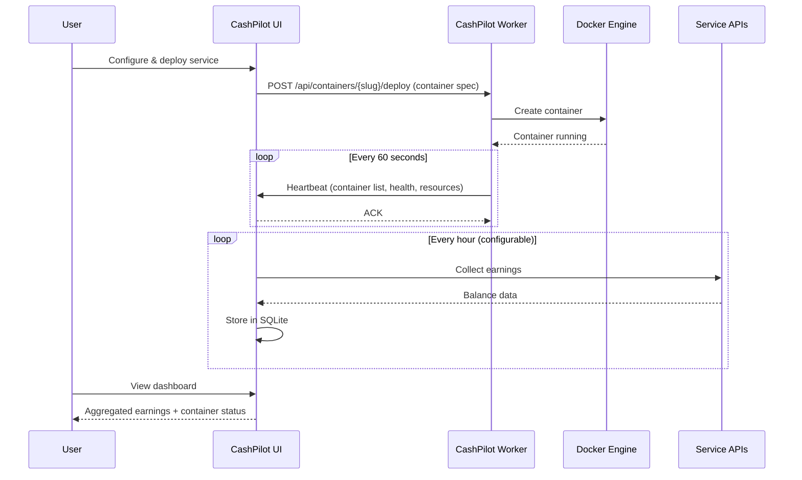

# Jak to działa { #how-it-works }

CashPilot ma architekturę podzieloną na **UI + workera**. UI nigdy nie dotyka Dockera -- wszystkie operacje na kontenerach przechodzą przez workery. Ten podział to podstawowa zasada projektu i to on umożliwia zarządzanie flotą wielu serwerów.

## Komponenty { #components }

| Komponent | Obraz | Port | Dostęp do Dockera | Zadanie |
|-----------|-------|:----:|:-------------:|---------|
| **CashPilot UI** | `drumsergio/cashpilot` | 8080 | Nie | Panel webowy, zbieranie zarobków, katalog usług, przechowywanie danych logowania, harmonogram |
| **CashPilot Worker** | `drumsergio/cashpilot-worker` | 8081 | Przez `cashpilot-socket-proxy` | Cykl życia kontenerów Dockera, raportowanie kondycji, sygnały życia do UI |

Nie ma **trybu samodzielnego**. Każdy serwer, który uruchamia kontenery Dockera, potrzebuje workera. UI to wyłącznie panel i harmonogram -- może działać na dowolnej maszynie, także bez Dockera.

## Zasady projektu { #design-principles }

1. **Rozdział odpowiedzialności.** UI zajmuje się: panelem, zbieraniem zarobków, harmonogramem, uwierzytelnianiem użytkowników. Workery zajmują się: cyklem życia kontenerów Dockera, raportowaniem kondycji. Te zakresy nigdy się nie pokrywają.
2. **Workery potrzebują Dockera, przez socket proxy.** Worker bez dostępu do Dockera jest bezużyteczny. Z dostarczanymi plikami compose nigdy nie dostaje surowego gniazda: łączy się z Dockerem przez `cashpilot-socket-proxy`. Wpisy Unraid i TrueNAS nadal montują surowe gniazdo ([sklepy z aplikacjami](app-stores.md)). Jeśli nie potrzebujesz zarządzania Dockerem, uruchom sam UI, aby śledzić zarobki.
3. **Jedno źródło prawdy.** Instancja UI jako jedyna zbiera zarobki, przechowuje dane historyczne i serwuje panel. Workery nigdy nie zbierają zarobków.
4. **Zarobki nigdy się nie dublują.** Ponieważ zbiera tylko UI, nie ma ryzyka, że to samo konto zostanie policzone dwa razy.
5. **Workery to bezstanowe satelity.** Worker wie, które kontenery ma utrzymywać uruchomione, i zna URL UI, do którego raportuje. Zapisuje w lokalnych plikach tylko własny identyfikator i klucz floty (`.worker_id`, `.worker_key`; bez bazy danych, bez danych o zarobkach).
6. **YAML jest prawdą.** Każda usługa żyje w `services/{category}/{slug}.yml`. UI, wdrażanie, dokumentacja i eksport compose wywodzą się z tych plików.

## Struktura katalogów { #directory-structure }

```
cashpilot/
  app/                      # FastAPI application
    main.py                 # App entrypoint, lifespan, container/fleet/earnings routes
    deps.py                 # Shared auth guards + Jinja2 template environment
    routers/                # Route groups split out of main.py: auth, pages, users
    catalog.py              # Loads YAML service definitions, caches, SIGHUP reload
    orchestrator.py         # Docker SDK: deploy, stop, restart, remove, logs
    database.py             # Async SQLite: earnings, config, deployments, users, workers
    worker_api.py           # Worker REST API: heartbeat, container commands, mini-UI
    setup_token.py          # First-run setup-token gate (owner-account creation)
    metrics.py              # Optional Prometheus metrics (/metrics)
    exchange_rates.py       # Crypto/fiat conversion via CoinGecko + Frankfurter
    collectors/             # Earnings collectors (one module per service, UI only)
      base.py               # BaseCollector ABC + EarningsResult dataclass
      honeygain.py          # Example: JWT auth + balance endpoint
      __init__.py           # COLLECTOR_MAP registry + make_collectors() factory
    templates/              # Jinja2: dashboard, fleet, catalog, setup wizard, payouts, settings
    static/
      css/style.css         # Classic night by default, plus dark, light, sunrise and warm
      js/app.js             # Vanilla JS, CP namespace, Chart.js, wizard state machine
  services/                 # YAML service definitions (SINGLE SOURCE OF TRUTH)
    _schema.yml             # Schema documentation
    bandwidth/              # Bandwidth sharing services
    depin/                  # DePIN services
    storage/                # Storage sharing services
    compute/                # GPU compute services
    mining/                 # Mining services
  docs/                     # Documentation and guides
    guides/                 # Per-service setup guides
  Dockerfile                # UI image: multi-stage python:3.15-alpine, su-exec, non-root
  Dockerfile.worker         # Worker image: minimal deps, no collectors/templates
  docker-compose.yml        # Single-server deployment
  docker-compose.fleet.yml  # Multi-server fleet deployment
```

## Przepływ danych { #data-flow }



### Sygnał życia (od workera do UI) { #heartbeat-worker-to-ui }

Co 60 sekund każdy worker wysyła:

- Listę kontenerów z ich stanem (uruchomiony, zatrzymany, zakończony)
- Zużycie zasobów przez każdy kontener (procent CPU, pamięć w MB)
- Informacje o systemie (system operacyjny, architektura, nazwa hosta, dostępność Dockera)
- Zgłaszany przez siebie URL (jawny `CASHPILOT_WORKER_URL` albo wykryty automatycznie zapasowy)

UI zapisuje to w swojej bazie SQLite i wyświetla na stronie **Fleet** (Flota).

### Polecenia (od UI do workera) { #commands-ui-to-worker }

UI może polecić dowolnemu workerowi:

- **wdrożyć** kontener usługi (pełna specyfikacja: obraz, zmienne środowiskowe, wolumeny, porty)
- **zatrzymać**, **uruchomić**, **zrestartować** lub **usunąć** kontener
- **pobrać logi** z kontenera

Polecenia są wysyłane jako wywołania REST API z UI do workera.

### Przepływ danych logowania { #credential-flow }

Worker **nigdy nie obsługuje ani nie przechowuje danych logowania**:

1. Użytkownik konfiguruje dane logowania usługi w UI (przechowywane w SQLite w postaci zaszyfrowanej).
2. Przy wdrażaniu UI wysyła workerowi pełną specyfikację kontenera (razem ze zmiennymi środowiskowymi).
3. Worker przekazuje specyfikację do API Dockera. Docker zapisuje zmienne środowiskowe w konfiguracji kontenera.
4. Przy restartach: `docker restart` sam zachowuje zmienne środowiskowe.
5. Przy pełnych ponownych wdrożeniach (usunięcie + utworzenie): UI wysyła pełną specyfikację ponownie.

### Zbieranie zarobków { #earnings-collection }

UI uruchamia według harmonogramu kolektory dla każdej skonfigurowanej usługi:

- **Automatyczne kolektory** pobierają salda przez API usług (uwierzytelnianie JWT, przez ciasteczka, klucze API) u tych dostawców, którzy takie API mają
- Wyniki są zapisywane w SQLite w walucie natywnej (USD, MYST, GRASS, STORJ itd.)
- Kursy wymiany są pobierane z CoinGecko (kryptowaluty) i Frankfurter (waluty fiat) i przechowywane w pamięci podręcznej przez 15 minut
- Każdy odczyt zapisuje kurs USD z dnia, w którym go wykonano. Odczyt kryptowaluty zapisany bez kursu (starszy niż kolumna kursu) dostaje cenę ze swojego dnia z dziennej historii CoinGecko, przy starcie i raz dziennie; dzień bez ceny pozostaje bez wyceny
- Panel przelicza kwoty i wyświetla je w walucie preferowanej przez użytkownika

## Stos technologiczny { #tech-stack }

| Technologia | Zadanie |
|---|---|
| FastAPI | Framework backendu (Python 3.15, async) |
| Jinja2 | Szablony HTML renderowane po stronie serwera |
| SQLite | Baza danych (aiosqlite, bez konfiguracji, zapisywana w `/data`) |
| Docker SDK for Python | Zarządzanie cyklem życia kontenerów przez gniazdo |
| PyYAML | Parsowanie definicji usług |
| APScheduler | Okresowe zbieranie zarobków |
| httpx | Asynchroniczny klient HTTP dla kolektorów zarobków |
| cryptography (Fernet) | Szyfrowanie zapisanych danych logowania |
| Chart.js | Wykresy zarobków na frontendzie |
| su-exec | Przełącza z roota na użytkownika `cashpilot` po konfiguracji w entrypoincie (Dockerfile) |

## Baza danych { #database }

SQLite z 400-dniowym okresem przechowywania danych. Najważniejsze tabele:

- **earnings** -- Historia zarobków na usługę (znacznik czasu, slug, saldo, waluta)
- **deployments** -- Aktywne wdrożenia kontenerów (slug, identyfikator kontenera, zaszyfrowane zmienne środowiskowe, stan)
- **config** -- Ustawienia klucz-wartość i zaszyfrowane dane logowania
- **users** -- Konta (nazwa użytkownika, hash hasła bcrypt, rola)
- **user_preferences** -- Stan wprowadzenia każdego użytkownika do aplikacji (tryb konfiguracji, wybrane kategorie, strefa czasowa)
- **health_events** -- Historia kondycji kontenerów (start, stop, crash, check_ok, check_down)
- **workers** -- Rejestr workerów floty (identyfikator klienta, nazwa, URL, stan, ostatni sygnał życia, zaszyfrowany klucz floty danego workera)

## Model bezpieczeństwa { #security-model }

- Wszystkie dane logowania są szyfrowane w spoczynku symetrycznym szyfrowaniem Fernet
- Uwierzytelnianie workera wobec UI przez klucze floty przypisane do każdego workera (`CASHPILOT_API_KEY` to tylko dane do dołączenia/uruchomienia)
- Zarządzane kontenery działają z `--security-opt no-new-privileges`
- Konwencja nazw kontenerów: `cashpilot-{slug}` z etykietami `cashpilot.managed=true`
- Kontener UI **nie ma** dostępu do gniazda Dockera
- Uwierzytelnianie oparte na sesjach z systemem ról (właściciel/edytor/przeglądający)
