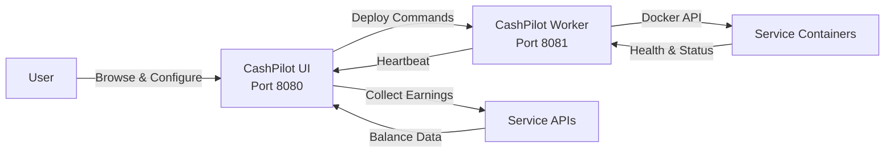

# Primeiros passos { #getting-started }

## Pré-requisitos { #prerequisites }

- **Docker** com o **plugin Compose v2, versão 2.23.1 ou mais recente**. Verifique
  com `docker compose version`. Versões mais antigas não conseguem ler a configuração
  inline do arquivo compose. O Docker Desktop já inclui o plugin. Em um Docker
  Engine puro no Linux, instale-o pelo repositório de pacotes do Docker
  (<https://docs.docker.com/compose/install/linux/>). No macOS com Colima,
  instale-o com o Homebrew e vincule-o como plugin do Docker:

    ```sh
    brew install docker-compose
    mkdir -p ~/.docker/cli-plugins
    ln -sfn "$(brew --prefix)/opt/docker-compose/bin/docker-compose" ~/.docker/cli-plugins/docker-compose
    ```

- Um host Linux, macOS ou Windows (amd64 ou arm64)
- Pelo menos 1 GB de RAM livre para o CashPilot e os serviços que ele gerencia
- **Um CashPilot por host Docker.** Veja o aviso abaixo.

!!! warning "Um CashPilot por host Docker"
    Não execute duas instalações do CashPilot no mesmo host Docker. Os arquivos compose
    usam nomes de contêiner fixos (`cashpilot-ui`, `cashpilot-worker`,
    `cashpilot-socket-proxy`), então uma segunda cópia do arquivo falha por um
    conflito de nomes. Se você renomeá-los para contornar isso, as duas instalações continuam
    compartilhando o host. Cada worker gerencia todos os contêineres que têm
    os rótulos do CashPilot, não importa qual instalação os criou. Assim, cada painel lista,
    para e substitui os apps de renda da outra. As duas também compartilham a
    rede `cashpilot-isolated`, os nomes dos apps de renda (`cashpilot-<service>`),
    as portas do host e volumes como `mysterium-data`. Para uma segunda
    instalação, use outro host ou outra VM. Para executar apps de renda em mais servidores, adicione
    workers a um único painel ([Frota](fleet.md)).

## Início rápido { #quick-start }

### 1. Baixe o arquivo compose e inicie { #1-fetch-the-compose-file-and-launch }

```bash
curl -fsSLO https://raw.githubusercontent.com/GeiserX/CashPilot/main/docker-compose.yml
docker compose up -d
```

Isso inicia três contêineres de longa duração. Antes deles, um contêiner avulso
`cashpilot-migrate` roda e termina com código 0 a cada `up`, então
`docker compose ps -a` o mostra como `Exited (0)`. Isso é normal.

| Contêiner | Porta | Função |
|-----------|-------|--------|
| **cashpilot-migrate** | nenhuma | Roda uma vez e termina. Move os dados que uma versão mais antiga criou para volumes que o socket proxy aceita, e não encontra nada a fazer em uma instalação nova |
| **cashpilot-ui** | 8080 | Painel web, coleta de ganhos, catálogo de serviços |
| **cashpilot-worker** | 8081 | Agente Docker que implanta e monitora os contêineres dos serviços |
| **cashpilot-socket-proxy** | nenhuma | Mantém o socket do Docker como somente leitura e entrega ao worker uma cópia filtrada ([Padrões de segurança](security-defaults.md)) |

### 2. Abra o painel { #2-open-the-dashboard }

Acesse [http://localhost:8080](http://localhost:8080) no seu navegador. Como ainda não existe nenhuma conta, você cai na página de boas-vindas, que cria a conta do proprietário.

!!! tip "A porta 8080 já está em uso?"
    Escolha outra porta do host em um arquivo `.env` ao lado do `docker-compose.yml`,
    em vez de editar o arquivo compose:

    ```bash
    printf '\nCASHPILOT_UI_PORT=8088\n' >> .env
    docker compose up -d
    ```

    Depois abra http://localhost:8088. Mantenha o valor no `.env`, porque a
    atualização pelo app lê esse arquivo, e não o seu shell. (O `printf` começa com uma
    quebra de linha para que a linha nunca se junte à última de um `.env` existente.)

    A variável precisa de um `docker-compose.yml` cuja linha `ports:` seja
    `${CASHPILOT_UI_PORT:-8080}:8080`. O arquivo da v1.61 e anteriores fixa
    `8080:8080` e a ignora. Baixe o arquivo atual ou
    mantenha o seu próprio mapeamento de porta editado: a atualização pelo app também o aceita.

!!! warning "Token de configuração inicial obrigatório"
    Na primeira inicialização, o CashPilot gera um token de configuração de uso único e o imprime nos logs do contêiner **cashpilot-ui**:

    ```bash
    docker compose logs cashpilot-ui
    ```

    Procure uma linha como esta:

    ```
    FIRST-RUN SETUP: no account exists yet. Open /register and enter this
    one-time setup token to create the owner account: <token>
    ```

    Copie esse token no campo **Setup token** (Token de configuração) da etapa **Owner account** (Conta do proprietário) da página de boas-vindas, junto com um nome de usuário e uma senha, para criar a primeira conta (a do proprietário). Ele só aparece nos logs, nunca em uma URL, e é descartado para sempre assim que a conta do proprietário existe.

### 3. Explore o catálogo de serviços { #3-browse-the-service-catalog }

A página **Catalog** (Catálogo) lista cada serviço com suas plataformas, uma estimativa mensal e o que ele exige (IP residencial, GPU). Filtre por categoria (Bandwidth, DePIN, Storage, Compute, Mining) ou pesquise pelo nome. **Add** (Adicionar) abre o assistente de configuração nesse serviço, **Details** (Detalhes) mostra a descrição, os pagamentos e o risco de implantação, e os serviços que não rodam no Docker ganham um link **Visit** (Visitar) no lugar.

Dois tipos de serviço merecem um olhar mais atento antes: os que só pagam depois que você bloqueia um stake de tokens, como Anyone Protocol, Sia e Flux, e os relays que publicam o seu IP, o que pode reduzir o que os apps de largura de banda residencial pagam a você. Veja [Verifique duas coisas antes de implantar](guides/index.md).

### 4. Adicione serviços com o assistente { #4-add-services-with-the-wizard }

Depois que a conta do proprietário existe, **Add services** (Adicionar serviços) abre o assistente de configuração; mais tarde, o botão **+ Add service** (+ Adicionar serviço) na barra superior o abre de novo. Escolha as categorias e depois os serviços. Para cada serviço, o assistente mostra um link **Sign Up** (Cadastrar-se), pede apenas as credenciais de que esse serviço precisa (e-mail e senha, token de API etc.) e deixa você escolher os workers em que ele vai rodar. Clique em **Deploy** (Implantar) e o CashPilot baixa a imagem, cria o contêiner e passa a monitorá-lo.

### 5. Acompanhe no painel { #5-watch-it-on-the-dashboard }

O painel mostra cada serviço implantado com seu status e saldo, e a página **Fleet** (Frota) mostra todos os workers.

## Como funciona { #how-it-works }



1. **Você configura** os serviços pela interface web -- escolhe um serviço, informa as credenciais, clica em implantar.
2. **A UI envia** a especificação do contêiner (imagem, variáveis de ambiente, volumes) ao worker pela API REST.
3. **O worker cria** o contêiner Docker e começa a monitorar a saúde dele.
4. **O worker informa** o status do contêiner à UI a cada 60 segundos por meio de sinais de vida.
5. **A UI coleta** os ganhos das APIs dos serviços em um intervalo configurável (padrão: a cada hora).
6. **O painel** mostra os ganhos agregados, o detalhamento por serviço e a saúde dos contêineres.

## Configuração { #configuration }

### Variáveis de ambiente da UI { #ui-environment-variables }

| Variável | Padrão | Descrição |
|----------|--------|-----------|
| `TZ` | `UTC` | Fuso horário para agendamento e exibição |
| `CASHPILOT_SECRET_KEY` | *(gerada automaticamente)* | Chave de assinatura das sessões de login. Persistida em `/data/.secret_key`. **Não criptografa as credenciais** |
| `CASHPILOT_ENCRYPTION_KEY` | *(gerada automaticamente)* | Chave Fernet que criptografa as credenciais armazenadas em repouso. Persistida em `/data/.fernet_key`. Só é adotada quando esse arquivo não existe, então defina-a apenas para restaurar um backup |
| `CASHPILOT_API_KEY` | *(em `/fleet`)* | Chave de registro compartilhada dos workers. Cada worker recebe a própria chave ao se registrar; veja [Frota](fleet.md) |
| `CASHPILOT_COLLECT_INTERVAL` | `60` | Minutos entre os ciclos de coleta de ganhos |
| `CASHPILOT_UI_PORT` | `8080` | Porta do host em que a UI é publicada. Defina-a no `.env` quando a 8080 estiver ocupada |
| `CASHPILOT_BIND_ADDR` | `127.0.0.1` | Interface do host em que a porta da UI é publicada. **Loopback por padrão**: o painel pode comandar o worker que tem acesso ao socket do Docker, então ele não fica exposto à sua rede logo de início. Defina um IP específico (por exemplo, um endereço do Tailscale/VPN) ou `0.0.0.0` para expô-lo, ou (preferível) coloque na frente um proxy reverso com autenticação |

A porta web da UI dentro do contêiner é fixa em `8080` (definida pelo `CMD` do contêiner). `CASHPILOT_UI_PORT` e `CASHPILOT_BIND_ADDR` escolhem apenas a porta e a interface do host em que ela é publicada.

### Variáveis de ambiente do worker { #worker-environment-variables }

| Variável | Padrão | Descrição |
|----------|--------|-----------|
| `TZ` | `UTC` | Fuso horário |
| `CASHPILOT_UI_URL` | -- | URL do contêiner da UI, por exemplo `http://cashpilot-ui:8080` |
| `CASHPILOT_API_KEY` | -- | Precisa ser igual à chave de registro da UI. Só é necessária para o registro; depois o worker usa a própria chave |
| `CASHPILOT_WORKER_NAME` | *(hostname)* | Nome de exibição deste worker no painel da frota |
| `CASHPILOT_WORKER_URL` | *(detectada automaticamente)* | URL que a UI usa para alcançar este worker, por exemplo `http://192.168.1.50:8081`. Defina-a explicitamente em frotas com vários hosts: a detecção automática pode informar um IP interno do contêiner que não é alcançável |
| `CASHPILOT_WORKER_BIND_ADDR` | `127.0.0.1` | **Somente nos compose de frota e de worker remoto** (`docker-compose.fleet.yml`): interface do host em que a porta da API do worker com acesso ao socket do Docker é publicada, loopback por padrão. O `docker-compose.yml` padrão não publica a porta 8081. A API do worker pode implantar/parar qualquer contêiner (= root no host), então, para um worker remoto, vincule uma interface privada/de VPN (por exemplo, um IP do Tailscale), **nunca** um IP público |
| `CASHPILOT_PORT` | `8081` | Porta que o worker **anuncia** à UI. Ela *não* muda a porta de escuta, que é fixada pelo `CMD` da imagem; veja a [referência de configuração](configuration.md) |

### Exemplo de Docker Compose { #docker-compose-example }

```yaml
--8<-- "docker-compose.yml"
```

!!! note "Este é o arquivo real"

    O bloco acima é incluído literalmente a partir do `docker-compose.yml` do
    repositório, então não tem como divergir do que realmente é distribuído. Antes, uma
    versão copiada à mão publicava a API do worker com acesso ao socket do Docker em todas as
    interfaces e fixava `:latest`, duas coisas que a página de
    [padrões de segurança](security-defaults.md) diz para você não fazer.

!!! warning "Acesso ao socket do Docker"
    O worker gerencia os contêineres dos serviços pelo Docker, mas não monta `/var/run/docker.sock`. O contêiner `cashpilot-socket-proxy` mantém o socket e repassa ao worker apenas as chamadas que ele faz, recusando contêineres privilegiados e binds de pastas do host que você não listou ([o que ele recusa](security-defaults.md#docker-socket-proxy)). A atualização pelo app é opcional: só roda com `CASHPILOT_COMPOSE_DIR=<this folder>` no `.env` ao lado do arquivo compose, e essa configuração deixa os contêineres fazerem bind da pasta, o que enfraquece o proxy ([o que isso custa](security-defaults.md#docker-socket-proxy)). Deixe-a sem definir e atualize com `docker compose pull && docker compose up -d`. O worker ainda controla todos os contêineres do host, então execute o CashPilot em uma máquina ou VLAN dedicada para ter a melhor segurança.

!!! tip "Persistência da chave secreta"
    As credenciais são criptografadas com `CASHPILOT_ENCRYPTION_KEY`, **não** com `CASHPILOT_SECRET_KEY`, que apenas assina as sessões de login. A chave de criptografia é gerada automaticamente na primeira execução e armazenada em `/data/.fernet_key`. **Faça backup desse arquivo.** Se o volume for recriado sem ele, uma chave nova é gerada e todas as credenciais armazenadas ficam ilegíveis para sempre. Definir `CASHPILOT_ENCRYPTION_KEY` serve para restaurar esse backup; o arquivo de chave sempre prevalece, então defini-la em uma instância saudável não muda nada.

!!! tip "Senhas e segredos na UI"
    Altere a sua própria senha a qualquer momento pelo menu do avatar -> **Change password** (Alterar senha) (disponível para todos os papéis); isso encerra as suas outras sessões. Em **Settings** (Configurações), os segredos armazenados são somente de escrita: digite um valor para alterá-lo ou deixe o campo em branco para manter o existente. As credenciais salvas nunca são enviadas de volta ao navegador.

## Atualizar o CashPilot { #updating-cashpilot }

O arquivo compose fixa uma série major.minor, como `drumsergio/cashpilot:X.Y`, então o `pull` baixa o patch mais recente dessa série:

```bash
docker compose pull
docker compose up -d
```

`docker compose pull` baixa a imagem publicada mais recente e `up -d` recria
apenas os contêineres cuja imagem mudou. Os arquivos compose distribuídos definem
`pull_policy: always`, então até um simples `docker compose up -d` baixa a
imagem mais recente primeiro.

**Pelo painel.** **Settings** (Configurações), **About and updates** (Sobre e atualizações) executa os mesmos dois
comandos para você a partir de um contêiner auxiliar de vida curta. O auxiliar lê os seus
arquivos compose e o `.env` ao lado deles (ou os arquivos que você passou com
`--env-file`), nunca o shell a partir do qual você iniciou o CashPilot. Suponha que você o iniciou com `CASHPILOT_UI_PORT=8088 docker compose up -d`.
A atualização colocaria o painel de volta na 8080, então ela para e explica o motivo
em vez disso. Coloque esse valor no `.env` e o botão funciona.

!!! note "Você **não** precisa recompilar"
    O CashPilot distribui imagens multi-arquitetura pré-compiladas no Docker Hub
    ([`drumsergio/cashpilot`](https://hub.docker.com/r/drumsergio/cashpilot),
    [`drumsergio/cashpilot-worker`](https://hub.docker.com/r/drumsergio/cashpilot-worker)).
    `docker compose build` / `--build` só importa se você compilar de propósito
    a partir do código-fonte com `docker-compose.build.yml`. Em instalações normais,
    `pull` + `up -d` é o procedimento de atualização completo e correto.

### Fixar uma versão específica { #pinning-a-specific-version }

Para ficar em uma versão exata, substitua a tag de série `X.Y` no
`docker-compose.yml` por uma tag de versão completa `X.Y.Z` em
`drumsergio/cashpilot` e em `drumsergio/cashpilot-worker` (sempre a mesma tag nos
dois) e remova `pull_policy: always`. Veja as tags no
[Docker Hub](https://hub.docker.com/r/drumsergio/cashpilot/tags).

Para passar a uma série mais nova, edite as duas tags: primeiro no host da UI, depois em
cada host de worker. Leia o
[UPGRADING.md](https://github.com/GeiserX/CashPilot/blob/main/UPGRADING.md)
antes, porque uma versão major como a 3.0 tem etapas próprias.

### Automatizar as atualizações (opcional) { #automating-updates-optional }

Se quiser atualizações sem intervenção, aponte um agendador para os mesmos dois comandos,
por exemplo com uma entrada diária no cron:

```cron
0 4 * * *  cd /path/to/cashpilot && docker compose pull && docker compose up -d
```

Ou rode um atualizador automático como o [Watchtower](https://containrrr.dev/watchtower/)
ou o [Diun](https://crazymax.dev/diun/) sobre os contêineres do CashPilot. Eles
são opcionais. O CashPilot não inclui um atualizador.

### Limpar imagens antigas { #cleaning-up-old-images }

O CashPilot baixa imagens, mas nunca as apaga. Cada atualização e cada reimplantação
pode deixar a imagem anterior no disco. Em uma frota de teste com três servidores, as imagens antigas
do CashPilot e dos apps de renda somaram cerca de 3 GB no total. Isso é pouco perto
do que outros programas no mesmo host costumam deixar para trás, então olhe o
host inteiro:

```bash
docker system df
```

O valor `RECLAIMABLE` na linha `Images` é o que o Docker poderia liberar.

**Por que o CashPilot não faz isso por você.** O worker alcança o Docker pelo
socket proxy. Para imagens, o proxy deixa que ele baixe uma e leia uma pelo nome,
e nada mais. Ele não consegue listar as imagens do host nem apagar nenhuma. Um worker que
conseguisse também veria e apagaria as imagens de todos os outros programas do host.
Veja [o que o proxy recusa](security-defaults.md#docker-socket-proxy).

**Passo 1: remova as imagens dangling.** Uma imagem dangling não tem tag e nenhum
contêiner a usa, esteja ele rodando ou parado. Uma atualização sobre uma tag móvel como
`X.Y` (uma série como a que os arquivos compose fixam), `latest` ou um digest deixa exatamente essas para trás:

```bash
docker image prune
```

Isso também apaga a imagem que você rodava antes de uma atualização sobre uma tag móvel: assim
que a nova imagem dessa série chega, a antiga fica sem tag. Para ter um caminho de volta, anote
a versão exata antes de atualizar (o rodapé da barra lateral a mostra), para
poder baixar `drumsergio/cashpilot:<X.Y.Z>` de novo. Ou fixe o arquivo compose em
uma tag exata `X.Y.Z`; aí a imagem antiga mantém a tag e o passo 2 se aplica.

O Docker pergunta antes de apagar. Em uma entrada do cron, adicione `--force` para pular a
pergunta. Isso não muda mais nada:

```cron
30 4 * * 0  docker image prune --force
```

!!! warning "Não adicione `-a`"
    `docker image prune -a` apaga todas as imagens que nenhum contêiner usa neste
    momento, dangling ou com tag. Isso inclui imagens de stacks que você parou de
    propósito e imagens que você compilou localmente e não consegue baixar de novo.

**Passo 2: remova as tags fixadas antigas.** Uma imagem fixada em uma versão mantém a tag
depois que você passa para uma mais nova, então o `prune` a ignora. Estas imagens do CashPilot são
fixadas:

| Repositório | O que a fixa |
|---|---|
| `drumsergio/cashpilot` | O arquivo compose (uma série antiga ou uma versão exata que você fixou) |
| `drumsergio/cashpilot-worker` | O arquivo compose, como acima |
| `drumsergio/cashpilot-tunnel` | O worker, uma tag por versão do worker |
| `drumsergio/cashpilot-earnapp` | A entrada do EarnApp no catálogo |
| `drumsergio/cashpilot-anyone` | A entrada do Anyone Protocol no catálogo |

O mesmo vale para a imagem de um serviço que você removeu: a tag dela fica até você
removê-la. Uma imagem do catálogo fixada por digest, como MystNodes ou ProxyBase,
perde a tag quando uma mais nova a substitui, então o passo 1 já cobre esse caso.

Primeiro liste as tags que nenhum contêiner usa. Este exemplo é para a imagem do worker.
Para outro repositório da tabela, mude `repo`:

```bash
repo=drumsergio/cashpilot-worker
used=$(docker ps -a --format '{{.Image}}')
docker image ls "$repo" --format '{{.Repository}}:{{.Tag}}' | grep -vxF "$used"
```

Depois remova cada tag antiga pelo nome, uma de cada vez:

```bash
docker image rm drumsergio/cashpilot-worker:<old tag>
```

Não adicione `-f`. Sem ele, o Docker se recusa a remover uma imagem que um
contêiner ainda usa, rodando ou parado, e imprime
`conflict: unable to delete`. Quando você vir isso, mantenha a imagem. Mantenha a tag
que você roda e a tag que rodava antes dela, para ainda poder voltar uma versão.
Remova apenas as tags mais antigas que essas duas.

A coluna **Host disk** (Disco do host) do painel mostra o espaço livre no sistema de arquivos que
contém o `/data` do worker. As imagens costumam ficar no mesmo sistema de arquivos, sob a
raiz de dados do Docker, mas nem sempre. `docker info --format '{{.DockerRootDir}}'`
mostra a raiz de dados do Docker. Com o armazenamento de imagens do containerd, o padrão em uma
instalação nova do Docker Engine 29, as imagens ficam sob a raiz do containerd,
normalmente `/var/lib/containerd`. `docker info --format '{{.Driver}}'` imprime
`overlayfs` para o armazenamento de imagens do containerd e `overlay2` para o clássico.
Verifique o espaço livre no sistema de arquivos que contém o diretório aplicável.

## Serviços compatíveis { #supported-services }

O CashPilot oferece suporte a **<!-- n:live -->50<!-- /n --> serviços** ativos ou em beta, em cinco categorias:

- **Compartilhamento de largura de banda** (<!-- n:bandwidth -->18<!-- /n -->): compartilhe a sua largura de banda de internet para obter renda passiva
- **DePIN** (<!-- n:depin -->15<!-- /n -->): redes descentralizadas de infraestrutura física
- **Computação com GPU** (<!-- n:compute -->7<!-- /n -->): alugue a sua GPU para cargas de trabalho de IA e computação
- **Armazenamento** (<!-- n:storage -->2<!-- /n -->): compartilhe espaço em disco em redes de armazenamento descentralizadas
- **Mineração** (<!-- n:mining -->8<!-- /n -->): implante um minerador ou acompanhe um pool pelo endereço de pagamento ([Mineração](mining.md))

Desses, **<!-- n:docker -->21<!-- /n -->** podem ser implantados e gerenciados automaticamente pelo Docker. O catálogo acompanha os outros <!-- n:tracked -->29<!-- /n --> (<!-- n:extension -->18<!-- /n --> apps de navegador ou desktop, <!-- n:gpu -->7<!-- /n --> nós de GPU, <!-- n:mining_pools -->4<!-- /n --> pools de mineração). O CashPilot lê os saldos deles onde existe um coletor.

Veja o catálogo completo na seção [Guias de serviços](guides/index.md).

## Próximos passos { #next-steps }

- [Como funciona](how-it-works.md) -- Entenda o design que separa a UI e o worker
- [Gerenciamento da frota](fleet.md) -- Implante em vários servidores
- [Proteger a sua rede doméstica](home-network-security.md) -- Mantenha os contêineres fora da sua LAN, e quando o gVisor ajuda
- [Guias de serviços](guides/index.md) -- Instruções detalhadas de configuração para cada serviço
- [Remover o CashPilot por completo](uninstall.md) -- Remova tudo o que ele criou, para recomeçar ou para sair
