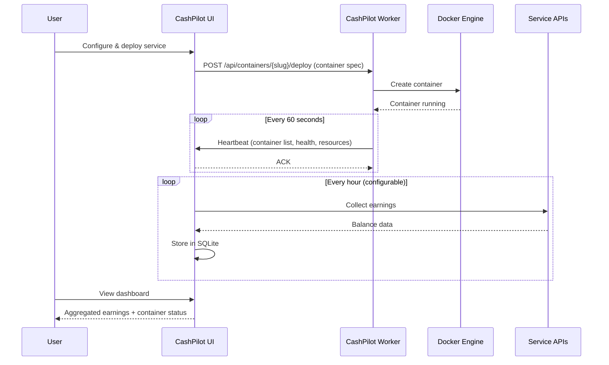

# Como funciona { #how-it-works }

O CashPilot usa uma arquitetura dividida em **UI + worker**. A UI nunca toca no Docker -- todas as operações com contêineres passam pelos workers. Essa separação é um princípio central do design e é o que permite gerenciar uma frota com vários servidores.

## Componentes { #components }

| Componente | Imagem | Porta | Acesso ao Docker | Função |
|-----------|-------|:----:|:-------------:|---------|
| **CashPilot UI** | `drumsergio/cashpilot` | 8080 | Não | Painel web, coleta de ganhos, catálogo de serviços, armazenamento de credenciais, agendamento |
| **CashPilot Worker** | `drumsergio/cashpilot-worker` | 8081 | Por meio do `cashpilot-socket-proxy` | Ciclo de vida dos contêineres Docker, relatório de saúde, sinais de vida para a UI |

Não existe **modo autônomo**. Todo servidor que executa contêineres Docker precisa de um worker. A UI é puramente um painel/agendador -- ela pode rodar em qualquer máquina, inclusive em uma sem Docker.

## Princípios de design { #design-principles }

1. **Separação de responsabilidades.** A UI cuida de: painel, coleta de ganhos, agendamento, autenticação de usuários. Os workers cuidam de: ciclo de vida dos contêineres Docker, relatório de saúde. As duas funções nunca se sobrepõem.
2. **Os workers precisam do Docker, pelo socket proxy.** Um worker sem acesso ao Docker não serve para nada. Com os arquivos compose distribuídos, ele nunca recebe o socket bruto: alcança o Docker pelo `cashpilot-socket-proxy`. As listagens do Unraid e do TrueNAS ainda montam o socket bruto ([lojas de apps](app-stores.md)). Se você não precisa gerenciar o Docker, basta rodar só a UI para acompanhar os ganhos.
3. **Fonte única da verdade.** A instância da UI é a única que coleta ganhos, guarda o histórico e serve o painel. Os workers nunca coletam ganhos.
4. **Os ganhos nunca são duplicados.** Como só a UI coleta, não há risco de a mesma conta ser contada duas vezes.
5. **Os workers são satélites sem estado.** Um worker sabe quais contêineres manter rodando e a URL da UI para a qual reportar. Ele persiste em arquivos locais apenas o próprio id e a chave da frota (`.worker_id`, `.worker_key`; sem banco de dados, sem dados de ganhos).
6. **O YAML é a verdade.** Cada serviço fica em `services/{category}/{slug}.yml`. A UI, a implantação, a documentação e a exportação para compose derivam todas desses arquivos.

## Estrutura de diretórios { #directory-structure }

```
cashpilot/
  app/                      # FastAPI application
    main.py                 # App entrypoint, lifespan, container/fleet/earnings routes
    deps.py                 # Shared auth guards + Jinja2 template environment
    routers/                # Route groups split out of main.py: auth, pages, users
    catalog.py              # Loads YAML service definitions, caches, SIGHUP reload
    orchestrator.py         # Docker SDK: deploy, stop, restart, remove, logs
    database.py             # Async SQLite: earnings, config, deployments, users, workers
    worker_api.py           # Worker REST API: heartbeat, container commands, mini-UI
    setup_token.py          # First-run setup-token gate (owner-account creation)
    metrics.py              # Optional Prometheus metrics (/metrics)
    exchange_rates.py       # Crypto/fiat conversion via CoinGecko + Frankfurter
    collectors/             # Earnings collectors (one module per service, UI only)
      base.py               # BaseCollector ABC + EarningsResult dataclass
      honeygain.py          # Example: JWT auth + balance endpoint
      __init__.py           # COLLECTOR_MAP registry + make_collectors() factory
    templates/              # Jinja2: dashboard, fleet, catalog, setup wizard, payouts, settings
    static/
      css/style.css         # Classic night by default, plus dark, light, sunrise and warm
      js/app.js             # Vanilla JS, CP namespace, Chart.js, wizard state machine
  services/                 # YAML service definitions (SINGLE SOURCE OF TRUTH)
    _schema.yml             # Schema documentation
    bandwidth/              # Bandwidth sharing services
    depin/                  # DePIN services
    storage/                # Storage sharing services
    compute/                # GPU compute services
    mining/                 # Mining services
  docs/                     # Documentation and guides
    guides/                 # Per-service setup guides
  Dockerfile                # UI image: multi-stage python:3.15-alpine, su-exec, non-root
  Dockerfile.worker         # Worker image: minimal deps, no collectors/templates
  docker-compose.yml        # Single-server deployment
  docker-compose.fleet.yml  # Multi-server fleet deployment
```

## Fluxo de dados { #data-flow }



### Sinal de vida (do worker para a UI) { #heartbeat-worker-to-ui }

A cada 60 segundos, cada worker envia:

- A lista de contêineres com o status (rodando, parado, encerrado)
- O uso de recursos por contêiner (porcentagem de CPU, memória em MB)
- Informações do sistema (SO, arquitetura, hostname, disponibilidade do Docker)
- A URL que ele mesmo informa (`CASHPILOT_WORKER_URL` explícita ou um fallback detectado automaticamente)

A UI guarda isso no seu banco de dados SQLite e exibe na página **Fleet** (Frota).

### Comandos (da UI para o worker) { #commands-ui-to-worker }

A UI pode instruir qualquer worker a:

- **Deploy** (Implantar) um contêiner de serviço (especificação completa: imagem, variáveis de ambiente, volumes, portas)
- **Stop** (Parar), **start** (iniciar), **restart** (reiniciar) ou **remove** (remover) um contêiner
- **Buscar os logs** de um contêiner

Os comandos são enviados por chamadas à API REST da UI para o worker.

### Fluxo de credenciais { #credential-flow }

O worker **nunca manipula nem armazena credenciais**:

1. O usuário configura as credenciais do serviço na UI (armazenadas criptografadas no SQLite).
2. Ao implantar, a UI envia ao worker a especificação completa do contêiner (incluindo as variáveis de ambiente).
3. O worker repassa a especificação à API do Docker. O Docker guarda as variáveis de ambiente na configuração do contêiner.
4. Nas reinicializações: `docker restart` preserva as variáveis de ambiente nativamente.
5. Nas reimplantações completas (remover + criar): a UI reenvia a especificação completa.

### Coleta de ganhos { #earnings-collection }

A UI executa coletores agendados para cada serviço configurado:

- **Coletores automáticos** buscam os saldos pelas APIs dos serviços (autenticação por JWT, por cookie, chaves de API) para os provedores que têm uma
- Os resultados são armazenados no SQLite na moeda nativa (USD, MYST, GRASS, STORJ etc.)
- As taxas de câmbio vêm do CoinGecko (cripto) e do Frankfurter (moedas fiduciárias), com cache de 15 minutos
- Cada leitura guarda a cotação em USD do dia em que foi feita. Uma leitura em cripto armazenada sem cotação (anterior à coluna de cotação) recebe o preço do próprio dia a partir do histórico diário do CoinGecko, na inicialização e uma vez por dia; um dia sem preço fica sem cotação
- O painel converte e exibe os valores na moeda preferida do usuário

## Stack tecnológica { #tech-stack }

| Tecnologia | Função |
|---|---|
| FastAPI | Framework de backend (Python 3.15, assíncrono) |
| Jinja2 | Templates HTML renderizados no servidor |
| SQLite | Banco de dados (aiosqlite, sem configuração, armazenado em `/data`) |
| Docker SDK for Python | Gerenciamento do ciclo de vida dos contêineres pelo socket |
| PyYAML | Leitura das definições de serviço |
| APScheduler | Coleta periódica de ganhos |
| httpx | Cliente HTTP assíncrono para os coletores de ganhos |
| cryptography (Fernet) | Criptografia em repouso das credenciais armazenadas |
| Chart.js | Gráficos de ganhos no frontend |
| su-exec | Troca root pelo usuário `cashpilot` depois da configuração do entrypoint (Dockerfile) |

## Banco de dados { #database }

SQLite com retenção de dados de 400 dias. Tabelas principais:

- **earnings** -- Histórico de ganhos por serviço (timestamp, slug, saldo, moeda)
- **deployments** -- Implantações de contêineres ativas (slug, ID do contêiner, variáveis de ambiente criptografadas, status)
- **config** -- Configurações chave-valor e credenciais criptografadas
- **users** -- Contas (nome de usuário, hash bcrypt da senha, papel)
- **user_preferences** -- Estado de onboarding por usuário (modo de configuração, categorias selecionadas, fuso horário)
- **health_events** -- Histórico de saúde dos contêineres (start, stop, crash, check_ok, check_down)
- **workers** -- Registro dos workers da frota (ID do cliente, nome, URL, status, último sinal de vida, chave da frota de cada worker criptografada)

## Modelo de segurança { #security-model }

- Todas as credenciais são criptografadas em repouso com criptografia simétrica Fernet
- Autenticação do worker na UI por chaves de frota próprias de cada worker (`CASHPILOT_API_KEY` é apenas a credencial de registro/bootstrap)
- Os contêineres gerenciados rodam com `--security-opt no-new-privileges`
- Convenção de nomes dos contêineres: `cashpilot-{slug}` com os rótulos `cashpilot.managed=true`
- O contêiner da UI **não** tem acesso ao socket do Docker
- Autenticação baseada em sessão com sistema de papéis (owner/writer/viewer)
