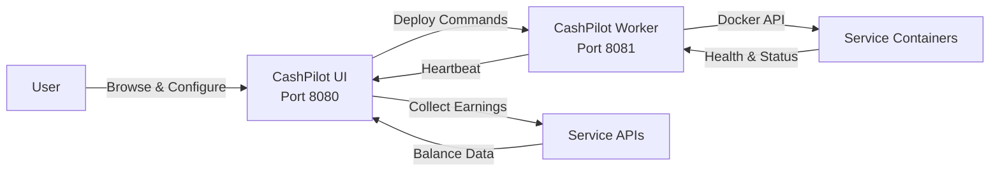

# Начало работы { #getting-started }

## Требования { #prerequisites }

- **Docker** с **плагином Compose v2 версии 2.23.1 или новее**. Проверьте
  командой `docker compose version`. Более старые версии не умеют читать встроенную конфигурацию
  в файле compose. Docker Desktop уже включает этот плагин. На голом Docker
  Engine в Linux установите его из репозитория пакетов Docker
  (<https://docs.docker.com/compose/install/linux/>). На macOS с Colima
  установите его через Homebrew и подключите как плагин Docker:

    ```sh
    brew install docker-compose
    mkdir -p ~/.docker/cli-plugins
    ln -sfn "$(brew --prefix)/opt/docker-compose/bin/docker-compose" ~/.docker/cli-plugins/docker-compose
    ```

- Хост с Linux, macOS или Windows (amd64 или arm64)
- Не менее 1 GB свободной RAM для CashPilot и сервисов, которыми он управляет
- **Один CashPilot на один хост Docker.** См. предупреждение ниже.

!!! warning "Один CashPilot на один хост Docker"
    Не запускайте две установки CashPilot на одном хосте Docker. Файлы compose
    используют фиксированные имена контейнеров (`cashpilot-ui`, `cashpilot-worker`,
    `cashpilot-socket-proxy`), поэтому вторая копия файла падает из-за конфликта
    имён. Если переименовать их, чтобы обойти это, две установки всё равно
    делят один хост. Каждый воркер управляет всеми контейнерами с метками
    CashPilot, какая бы установка их ни создала. Поэтому каждая панель видит,
    останавливает и заменяет приложения для заработка другой. Кроме того, обе делят
    сеть `cashpilot-isolated`, имена приложений для заработка (`cashpilot-<service>`),
    их порты на хосте и тома, например `mysterium-data`. Для второй
    установки используйте другой хост или VM. Чтобы запускать приложения для заработка на большем числе серверов, добавьте
    воркеры к одной панели ([Парк](fleet.md)).

## Быстрый старт { #quick-start }

### 1. Скачайте файл compose и запустите его { #1-fetch-the-compose-file-and-launch }

```bash
curl -fsSLO https://raw.githubusercontent.com/GeiserX/CashPilot/main/docker-compose.yml
docker compose up -d
```

Это запускает три постоянно работающих контейнера. Перед ними одноразовый
`cashpilot-migrate` выполняется и завершается с кодом 0 при каждом `up`, поэтому
`docker compose ps -a` показывает его как `Exited (0)`. Это нормально.

| Контейнер | Порт | Назначение |
|-----------|------|---------|
| **cashpilot-migrate** | нет | Запускается один раз и завершается. Переносит данные, созданные более старым выпуском, на тома, которые принимает прокси сокета; на новой установке ему нечего делать |
| **cashpilot-ui** | 8080 | Веб-панель, сбор заработка, каталог сервисов |
| **cashpilot-worker** | 8081 | Агент Docker, который разворачивает и отслеживает контейнеры сервисов |
| **cashpilot-socket-proxy** | нет | Держит сокет Docker только для чтения и даёт воркеру отфильтрованную копию ([Безопасные настройки по умолчанию](security-defaults.md)) |

### 2. Откройте панель { #2-open-the-dashboard }

Откройте в браузере [http://localhost:8080](http://localhost:8080). Аккаунта ещё нет, поэтому вы попадёте на страницу приветствия, которая создаёт аккаунт владельца.

!!! tip "Порт 8080 уже занят?"
    Выберите другой порт хоста в файле `.env` рядом с `docker-compose.yml`,
    а не правьте файл compose:

    ```bash
    printf '\nCASHPILOT_UI_PORT=8088\n' >> .env
    docker compose up -d
    ```

    Затем откройте http://localhost:8088. Храните значение в `.env`, потому что
    обновление из приложения читает этот файл, а не вашу оболочку. (`printf` начинается с
    перевода строки, чтобы новая строка никогда не склеилась с последней строкой существующего `.env`.)

    Переменной нужен `docker-compose.yml`, в котором строка `ports:` выглядит так:
    `${CASHPILOT_UI_PORT:-8080}:8080`. Файл из v1.61 и старше жёстко задаёт
    `8080:8080` и игнорирует её. Скачайте текущий файл или
    оставьте своё отредактированное сопоставление портов: обновление из приложения принимает и его.

!!! warning "Нужен токен первоначальной настройки"
    При первом запуске CashPilot создаёт одноразовый токен настройки и выводит его в логи контейнера **cashpilot-ui**:

    ```bash
    docker compose logs cashpilot-ui
    ```

    Найдите строку такого вида:

    ```
    FIRST-RUN SETUP: no account exists yet. Open /register and enter this
    one-time setup token to create the owner account: <token>
    ```

    Скопируйте этот токен в поле **Setup token** (Токен настройки) на шаге **Owner account** (Аккаунт владельца) страницы приветствия, вместе с именем пользователя и паролем, чтобы создать первый аккаунт (владельца). Токен показывается только в логах, никогда в URL, и навсегда удаляется, как только аккаунт владельца создан.

### 3. Просмотрите каталог сервисов { #3-browse-the-service-catalog }

Страница **Catalog** (Каталог) показывает каждый сервис с его платформами, оценкой дохода за месяц и тем, что ему нужно (домашний IP, GPU). Фильтруйте по категории (Bandwidth, DePIN, Storage, Compute, Mining) или ищите по имени. **Add** (Добавить) открывает мастер настройки на этом сервисе, **Details** (Подробности) показывает его описание, выплаты и риски развёртывания, а у сервисов, которые не работают в Docker, вместо этого есть ссылка **Visit** (Перейти).

Два вида сервисов стоит сначала рассмотреть внимательнее: сервисы, которые платят, только когда вы заблокируете стейк токенов, например Anyone Protocol, Sia и Flux, и релеи, которые публикуют ваш IP, из-за чего приложения за домашний трафик могут платить вам меньше. См. [Проверьте две вещи перед развёртыванием](guides/index.md).

### 4. Добавьте сервисы через мастер { #4-add-services-with-the-wizard }

Когда аккаунт владельца создан, **Add services** (Добавить сервисы) открывает мастер настройки; позже его снова открывает кнопка **+ Add service** (Добавить сервис) в верхней панели. Выберите категории, затем сервисы. Для каждого сервиса мастер показывает ссылку **Sign Up** (Зарегистрироваться), запрашивает только те учётные данные, которые нужны этому сервису (email и пароль, API-токен и так далее), и позволяет выбрать воркеры, на которых его запустить. Нажмите **Deploy** (Развернуть), и CashPilot скачает образ, создаст контейнер и начнёт за ним следить.

### 5. Следите за ним на панели { #5-watch-it-on-the-dashboard }

Панель показывает каждый развёрнутый сервис с его статусом и балансом, а страница **Fleet** (Парк) показывает все воркеры.

## Как это работает { #how-it-works }



1. **Вы настраиваете** сервисы через веб-интерфейс: выбираете сервис, вводите учётные данные, нажимаете «развернуть».
2. **UI отправляет** спецификацию контейнера (образ, переменные окружения, тома) воркеру через REST API.
3. **Воркер создаёт** контейнер Docker и начинает следить за его работоспособностью.
4. **Воркер сообщает** UI статус контейнера каждые 60 секунд через сигналы активности.
5. **UI собирает** заработок из API сервисов по настраиваемому расписанию (по умолчанию каждый час).
6. **Панель** показывает суммарный заработок, разбивку по сервисам и работоспособность контейнеров.

## Настройка { #configuration }

### Переменные окружения UI { #ui-environment-variables }

| Переменная | По умолчанию | Описание |
|----------|---------|-------------|
| `TZ` | `UTC` | Часовой пояс для расписания и отображения |
| `CASHPILOT_SECRET_KEY` | *(создаётся автоматически)* | Ключ подписи сессий входа. Хранится в `/data/.secret_key`. **Не шифрует учётные данные** |
| `CASHPILOT_ENCRYPTION_KEY` | *(создаётся автоматически)* | Ключ Fernet, которым шифруются сохранённые учётные данные. Хранится в `/data/.fernet_key`. Принимается, только когда этого файла нет, поэтому задавайте его только для восстановления резервной копии |
| `CASHPILOT_API_KEY` | *(из `/fleet`)* | Общий ключ подключения воркеров. Каждый воркер получает собственный ключ при подключении; см. [Парк](fleet.md) |
| `CASHPILOT_COLLECT_INTERVAL` | `60` | Минуты между циклами сбора заработка |
| `CASHPILOT_UI_PORT` | `8080` | Порт хоста, на котором публикуется UI. Задайте его в `.env`, когда 8080 занят |
| `CASHPILOT_BIND_ADDR` | `127.0.0.1` | Интерфейс хоста, на котором публикуется порт UI. **По умолчанию loopback**: панель может отдавать команды воркеру с доступом к сокету Docker, поэтому изначально она не открыта для вашей сети. Задайте конкретный IP (например, адрес Tailscale/VPN) или `0.0.0.0`, чтобы открыть её, или (лучше) поставьте перед ней обратный прокси с аутентификацией |

Веб-порт UI внутри контейнера фиксирован: `8080` (задаётся через `CMD` контейнера). `CASHPILOT_UI_PORT` и `CASHPILOT_BIND_ADDR` выбирают только порт и интерфейс хоста, на которых он публикуется.

### Переменные окружения воркера { #worker-environment-variables }

| Переменная | По умолчанию | Описание |
|----------|---------|-------------|
| `TZ` | `UTC` | Часовой пояс |
| `CASHPILOT_UI_URL` | -- | URL контейнера UI, например `http://cashpilot-ui:8080` |
| `CASHPILOT_API_KEY` | -- | Должен совпадать с ключом подключения UI. Нужен только для подключения; потом воркер использует собственный ключ |
| `CASHPILOT_WORKER_NAME` | *(имя хоста)* | Отображаемое имя этого воркера в панели парка |
| `CASHPILOT_WORKER_URL` | *(определяется автоматически)* | URL, по которому UI связывается с этим воркером, например `http://192.168.1.50:8081`. Для парков на нескольких хостах задавайте явно: автоопределение может сообщить недоступный внутренний IP контейнера |
| `CASHPILOT_WORKER_BIND_ADDR` | `127.0.0.1` | **Только для compose парка и удалённого воркера** (`docker-compose.fleet.yml`): интерфейс хоста, на котором публикуется порт API воркера с доступом к сокету Docker, по умолчанию loopback. Стандартный `docker-compose.yml` вообще не публикует порт 8081. API воркера может разворачивать и останавливать любой контейнер (= root на хосте), поэтому для удалённого воркера привязывайте частный интерфейс или интерфейс VPN (например, IP Tailscale), **никогда** не публичный IP |
| `CASHPILOT_PORT` | `8081` | Порт, который воркер **сообщает** UI. Он *не* меняет порт прослушивания, который фиксирован в `CMD` образа; см. [справочник по настройке](configuration.md) |

### Пример Docker Compose { #docker-compose-example }

```yaml
--8<-- "docker-compose.yml"
```

!!! note "Это настоящий файл"

    Блок выше включён дословно из `docker-compose.yml` в
    репозитории, поэтому он не может разойтись с тем, что реально поставляется. Раньше
    его копия, переписанная вручную, публиковала API воркера с доступом к сокету Docker на всех
    интерфейсах и закрепляла `:latest`; страница
    [безопасных настроек по умолчанию](security-defaults.md) советует не делать ни того, ни другого.

!!! warning "Доступ к сокету Docker"
    Воркер управляет контейнерами сервисов через Docker, но не монтирует `/var/run/docker.sock`. Сокет держит контейнер `cashpilot-socket-proxy`, который пропускает к воркеру только те вызовы, которые тот делает, и отклоняет привилегированные контейнеры и привязки папок хоста, которых вы не перечислили ([что он отклоняет](security-defaults.md#docker-socket-proxy)). Обновление из приложения включается по желанию: оно работает, только если в `.env` рядом с файлом compose задано `CASHPILOT_COMPOSE_DIR=<this folder>`, а эта настройка позволяет контейнерам привязывать эту папку, что ослабляет прокси ([чего это стоит](security-defaults.md#docker-socket-proxy)). Не задавайте её и обновляйте командой `docker compose pull && docker compose up -d`. Воркер всё равно управляет всеми контейнерами на хосте, поэтому для наилучшей безопасности запускайте CashPilot на отдельной машине или в отдельной VLAN.

!!! tip "Сохранность секретного ключа"
    Учётные данные шифруются ключом `CASHPILOT_ENCRYPTION_KEY`, **а не** `CASHPILOT_SECRET_KEY`, который только подписывает сессии входа. Ключ шифрования создаётся автоматически при первом запуске и хранится в `/data/.fernet_key`. **Сделайте резервную копию этого файла.** Если том пересоздать без него, будет создан новый ключ, и все сохранённые учётные данные навсегда станут нечитаемыми. `CASHPILOT_ENCRYPTION_KEY` задаётся для восстановления этой резервной копии; файл ключа всегда имеет приоритет, поэтому на исправном экземпляре эта переменная ничего не меняет.

!!! tip "Пароли и секреты в UI"
    Меняйте свой пароль в любое время через меню аватара -> **Change password** (Сменить пароль) (доступно всем ролям); это завершает ваши другие сессии. В **Settings** (Настройки) сохранённые секреты доступны только для записи: введите значение, чтобы изменить его, или оставьте поле пустым, чтобы сохранить текущее. Сохранённые учётные данные никогда не отправляются обратно в браузер.

## Обновление CashPilot { #updating-cashpilot }

Файл compose закрепляет серию major.minor, например `drumsergio/cashpilot:X.Y`, поэтому `pull` скачивает новейший патч этой серии:

```bash
docker compose pull
docker compose up -d
```

`docker compose pull` скачивает новейший опубликованный образ, а `up -d` пересоздаёт
только те контейнеры, у которых изменился образ. Поставляемые файлы compose задают
`pull_policy: always`, поэтому даже простой `docker compose up -d` сначала скачает
последний образ.

**Из панели.** **Settings** (Настройки), **About and updates** (О программе и обновления) выполняет те же две
команды за вас из кратковременного вспомогательного контейнера. Вспомогательный контейнер читает ваши
файлы compose и `.env` рядом с ними (или файлы, которые вы передали через
`--env-file`), но никогда не оболочку, из которой вы запустили CashPilot. Допустим, вы запустили его командой `CASHPILOT_UI_PORT=8088 docker compose up -d`.
Обновление вернуло бы панель на 8080, поэтому вместо этого оно останавливается и объясняет
причину. Запишите это значение в `.env`, и кнопка заработает.

!!! note "Пересобирать **не** нужно"
    CashPilot поставляет готовые мультиархитектурные образы на Docker Hub
    ([`drumsergio/cashpilot`](https://hub.docker.com/r/drumsergio/cashpilot),
    [`drumsergio/cashpilot-worker`](https://hub.docker.com/r/drumsergio/cashpilot-worker)).
    `docker compose build` / `--build` нужны, только если вы намеренно
    собираете из исходников с `docker-compose.build.yml`. Для обычных установок
    `pull` + `up -d` — это полная и правильная процедура обновления.

### Закрепление конкретной версии { #pinning-a-specific-version }

Чтобы остаться на одном конкретном выпуске, замените тег серии `X.Y` в
`docker-compose.yml` на полный тег выпуска `X.Y.Z` и у
`drumsergio/cashpilot`, и у `drumsergio/cashpilot-worker` (у обоих всегда один и тот же
тег), и удалите `pull_policy: always`. Теги можно посмотреть на
[Docker Hub](https://hub.docker.com/r/drumsergio/cashpilot/tags).

Чтобы перейти на более новую серию, измените оба тега: сначала на хосте UI, затем на
каждом хосте воркера. Сначала прочитайте
[UPGRADING.md](https://github.com/GeiserX/CashPilot/blob/main/UPGRADING.md),
потому что у мажорного выпуска, такого как 3.0, есть свои шаги.

### Автоматические обновления (по желанию) { #automating-updates-optional }

Если вы хотите обновляться без участия, запускайте те же две команды планировщиком,
например ежедневной записью cron:

```cron
0 4 * * *  cd /path/to/cashpilot && docker compose pull && docker compose up -d
```

Или натравите на контейнеры CashPilot автообновлятор, например [Watchtower](https://containrrr.dev/watchtower/)
или [Diun](https://crazymax.dev/diun/). Это
необязательно. CashPilot не включает в себя средство обновления.

### Очистка старых образов { #cleaning-up-old-images }

CashPilot скачивает образы, но никогда их не удаляет. Каждое обновление и каждое переразвёртывание
может оставить предыдущий образ на диске. В тестовом парке из трёх серверов старые
образы CashPilot и приложений для заработка заняли в сумме около 3 GB. Это немного по сравнению
с тем, что обычно оставляют другие программы на том же хосте, поэтому смотрите на
весь хост:

```bash
docker system df
```

Значение `RECLAIMABLE` в строке `Images` — это то, что Docker мог бы освободить.

**Почему CashPilot не делает этого за вас.** Воркер обращается к Docker через
прокси сокета. Для образов прокси позволяет ему скачать образ и прочитать образ по имени,
и больше ничего. Он не может получить список образов хоста или удалить образ. Воркер, который
мог бы это делать, также видел бы и удалял образы всех остальных программ на хосте.
См. [что отклоняет прокси](security-defaults.md#docker-socket-proxy).

**Шаг 1: удалите висячие образы.** У висячего образа нет тега, и ни один
контейнер его не использует, ни запущенный, ни остановленный. Обновление по плавающему тегу, например
`X.Y` (серия, такая как та, что закреплена в файлах compose), `latest` или digest, оставляет именно такие образы:

```bash
docker image prune
```

Это также удаляет образ, который вы запускали до обновления по плавающему тегу: как только
приходит новый образ этой серии, у старого не остаётся тега. Чтобы сохранить путь назад, запишите
точную версию перед обновлением (её показывает низ боковой панели), чтобы
снова скачать `drumsergio/cashpilot:<X.Y.Z>`. Или закрепите в файле compose
точный тег `X.Y.Z`; тогда старый образ сохранит свой тег, и применяется шаг 2.

Docker спрашивает перед удалением. В записи cron добавьте `--force`, чтобы пропустить
вопрос. Больше он ничего не меняет:

```cron
30 4 * * 0  docker image prune --force
```

!!! warning "Не добавляйте `-a`"
    `docker image prune -a` удаляет все образы, которые сейчас не использует ни один контейнер,
    висячие и с тегами. Сюда входят образы стеков, которые вы остановили
    намеренно, и образы, которые вы собрали локально и не сможете скачать снова.

**Шаг 2: удалите старые закреплённые теги.** Образ, закреплённый на версии, сохраняет свой тег
после перехода на более новую, поэтому `prune` его пропускает. Эти образы CashPilot
закреплены:

| Репозиторий | Что его закрепляет |
|---|---|
| `drumsergio/cashpilot` | Файл compose (старая серия или точная версия, которую вы закрепили) |
| `drumsergio/cashpilot-worker` | Файл compose, как и выше |
| `drumsergio/cashpilot-tunnel` | Воркер, по одному тегу на версию воркера |
| `drumsergio/cashpilot-earnapp` | Запись каталога EarnApp |
| `drumsergio/cashpilot-anyone` | Запись каталога Anyone Protocol |

То же касается образа сервиса, который вы удалили: его тег остаётся, пока вы
его не удалите. Образ каталога, закреплённый по digest, например MystNodes или ProxyBase,
теряет свой тег, когда его заменяет более новый, поэтому его уже покрывает шаг 1.

Сначала выведите теги, которые не использует ни один контейнер. Этот пример для образа воркера.
Для другого репозитория из таблицы измените `repo`:

```bash
repo=drumsergio/cashpilot-worker
used=$(docker ps -a --format '{{.Image}}')
docker image ls "$repo" --format '{{.Repository}}:{{.Tag}}' | grep -vxF "$used"
```

Затем удалите каждый старый тег по имени, по одному:

```bash
docker image rm drumsergio/cashpilot-worker:<old tag>
```

Не добавляйте `-f`. Без него Docker отказывается удалять образ, который
ещё использует контейнер, запущенный или остановленный, и выводит
`conflict: unable to delete`. Когда вы это видите, оставьте образ. Оставьте тег,
который вы запускаете, и тег, который запускали до него, чтобы всё ещё можно было вернуться на одну версию назад.
Удаляйте только теги старше этих двух.

Столбец **Host disk** (Диск хоста) на панели показывает свободное место в файловой системе, где
лежит `/data` воркера. Образы обычно находятся в той же файловой системе, в
корне данных Docker, но не всегда. `docker info --format '{{.DockerRootDir}}'`
показывает корень данных Docker. С хранилищем образов containerd, которое используется по умолчанию в
новой установке Docker Engine 29, образы лежат в корне containerd,
обычно `/var/lib/containerd`. `docker info --format '{{.Driver}}'` выводит
`overlayfs` для хранилища образов containerd и `overlay2` для классического.
Проверьте свободное место в файловой системе, где находится нужный каталог.

## Поддерживаемые сервисы { #supported-services }

CashPilot поддерживает **<!-- n:live -->50<!-- /n --> сервисов**, активных или в бета-версии, в пяти категориях:

- **Обмен трафиком** (<!-- n:bandwidth -->18<!-- /n -->): делитесь интернет-трафиком ради пассивного дохода
- **DePIN** (<!-- n:depin -->15<!-- /n -->): децентрализованные сети физической инфраструктуры
- **Вычисления на GPU** (<!-- n:compute -->7<!-- /n -->): сдавайте GPU в аренду под задачи ИИ и вычислений
- **Хранилище** (<!-- n:storage -->2<!-- /n -->): делитесь местом на диске в децентрализованных сетях хранения
- **Майнинг** (<!-- n:mining -->8<!-- /n -->): разверните майнер или отслеживайте пул по адресу выплат ([Майнинг](mining.md))

Из них **<!-- n:docker -->21<!-- /n -->** можно разворачивать и управлять ими автоматически через Docker. Остальные <!-- n:tracked -->29<!-- /n --> каталог отслеживает (<!-- n:extension -->18<!-- /n --> браузерных или десктопных приложений, <!-- n:gpu -->7<!-- /n --> узлов GPU, <!-- n:mining_pools -->4<!-- /n --> майнинг-пула). CashPilot читает их балансы там, где есть сборщик.

Полный каталог смотрите в разделе [Руководства по сервисам](guides/index.md).

## Дальнейшие шаги { #next-steps }

- [Как это работает](how-it-works.md) -- устройство с разделением на UI и воркер
- [Управление парком](fleet.md) -- развёртывание на нескольких серверах
- [Защита домашней сети](home-network-security.md) -- как держать контейнеры подальше от вашей LAN и когда помогает gVisor
- [Руководства по сервисам](guides/index.md) -- подробные инструкции по настройке каждого сервиса
- [Полное удаление CashPilot](uninstall.md) -- как удалить всё, что он создал, чтобы начать заново или уйти
