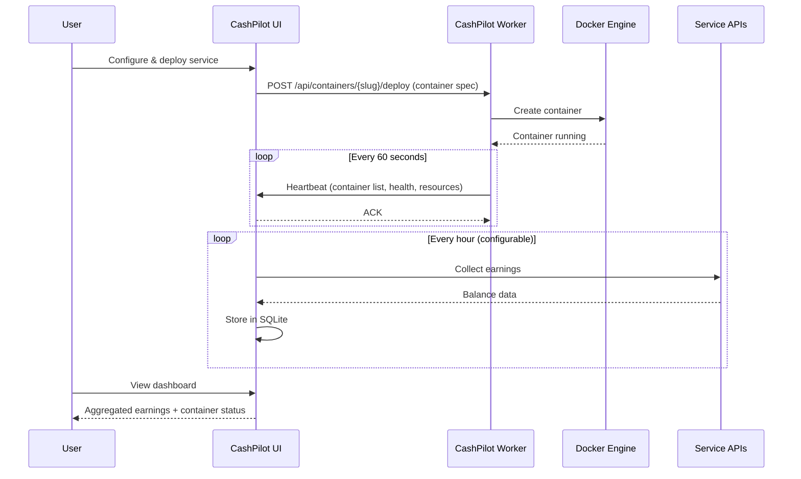

# Как это работает { #how-it-works }

CashPilot построен на разделении на **UI и воркер**. UI никогда не обращается к Docker: все операции с контейнерами проходят через воркеры. Это разделение — основной принцип устройства, и именно оно позволяет управлять парком из нескольких серверов.

## Компоненты { #components }

| Компонент | Образ | Порт | Доступ к Docker | Назначение |
|-----------|-------|:----:|:-------------:|---------|
| **CashPilot UI** | `drumsergio/cashpilot` | 8080 | Нет | Веб-панель, сбор заработка, каталог сервисов, хранение учётных данных, расписание |
| **CashPilot Worker** | `drumsergio/cashpilot-worker` | 8081 | Через `cashpilot-socket-proxy` | Жизненный цикл контейнеров Docker, отчёты о работоспособности, сигналы активности для UI |

В CashPilot **нет автономного режима**. Каждому серверу, на котором работают контейнеры Docker, нужен воркер. UI — это только панель и планировщик: он может работать на любой машине, в том числе на машине без Docker.

## Принципы устройства { #design-principles }

1. **Разделение обязанностей.** UI отвечает за панель, сбор заработка, расписание и аутентификацию пользователей. Воркеры отвечают за жизненный цикл контейнеров Docker и отчёты о работоспособности. Их обязанности никогда не пересекаются.
2. **Воркерам нужен Docker через прокси сокета.** Воркер без доступа к Docker бесполезен. С поставляемыми файлами compose он никогда не получает сам сокет: он обращается к Docker через `cashpilot-socket-proxy`. Версии для Unraid и TrueNAS по-прежнему монтируют сам сокет ([магазины приложений](app-stores.md)). Если управление Docker вам не нужно, запустите только UI, чтобы отслеживать заработок.
3. **Единый источник истины.** Только экземпляр UI собирает заработок, хранит историю и показывает панель. Воркеры никогда не собирают заработок.
4. **Заработок никогда не дублируется.** Собирает только UI, поэтому один и тот же аккаунт не может быть посчитан дважды.
5. **Воркеры — спутники без состояния.** Воркер знает, какие контейнеры держать запущенными, и URL UI, которому он отчитывается. В локальных файлах он хранит только свой id и ключ парка (`.worker_id`, `.worker_key`; ни базы данных, ни данных о заработке).
6. **YAML — это истина.** Каждый сервис описан в `services/{category}/{slug}.yml`. UI, развёртывание, документация и экспорт compose берутся из этих файлов.

## Структура каталогов { #directory-structure }

```
cashpilot/
  app/                      # FastAPI application
    main.py                 # App entrypoint, lifespan, container/fleet/earnings routes
    deps.py                 # Shared auth guards + Jinja2 template environment
    routers/                # Route groups split out of main.py: auth, pages, users
    catalog.py              # Loads YAML service definitions, caches, SIGHUP reload
    orchestrator.py         # Docker SDK: deploy, stop, restart, remove, logs
    database.py             # Async SQLite: earnings, config, deployments, users, workers
    worker_api.py           # Worker REST API: heartbeat, container commands, mini-UI
    setup_token.py          # First-run setup-token gate (owner-account creation)
    metrics.py              # Optional Prometheus metrics (/metrics)
    exchange_rates.py       # Crypto/fiat conversion via CoinGecko + Frankfurter
    collectors/             # Earnings collectors (one module per service, UI only)
      base.py               # BaseCollector ABC + EarningsResult dataclass
      honeygain.py          # Example: JWT auth + balance endpoint
      __init__.py           # COLLECTOR_MAP registry + make_collectors() factory
    templates/              # Jinja2: dashboard, fleet, catalog, setup wizard, payouts, settings
    static/
      css/style.css         # Classic night by default, plus dark, light, sunrise and warm
      js/app.js             # Vanilla JS, CP namespace, Chart.js, wizard state machine
  services/                 # YAML service definitions (SINGLE SOURCE OF TRUTH)
    _schema.yml             # Schema documentation
    bandwidth/              # Bandwidth sharing services
    depin/                  # DePIN services
    storage/                # Storage sharing services
    compute/                # GPU compute services
    mining/                 # Mining services
  docs/                     # Documentation and guides
    guides/                 # Per-service setup guides
  Dockerfile                # UI image: multi-stage python:3.15-alpine, su-exec, non-root
  Dockerfile.worker         # Worker image: minimal deps, no collectors/templates
  docker-compose.yml        # Single-server deployment
  docker-compose.fleet.yml  # Multi-server fleet deployment
```

## Поток данных { #data-flow }



### Сигнал активности (от воркера к UI) { #heartbeat-worker-to-ui }

Каждые 60 секунд каждый воркер отправляет:

- Список контейнеров со статусом (running, stopped, exited)
- Потребление ресурсов каждым контейнером (процент CPU, память в MB)
- Сведения о системе (ОС, архитектура, имя хоста, доступность Docker)
- Свой URL, о котором он сообщает сам (явный `CASHPILOT_WORKER_URL` или автоматически определённый запасной вариант)

UI сохраняет это в своей базе SQLite и показывает на странице **Fleet** (Парк).

### Команды (от UI к воркеру) { #commands-ui-to-worker }

UI может поручить любому воркеру:

- **Развернуть** контейнер сервиса (полная спецификация: образ, переменные окружения, тома, порты)
- **Остановить**, **запустить**, **перезапустить** или **удалить** контейнер
- **Получить логи** контейнера

Команды передаются вызовами REST API от UI к воркеру.

### Поток учётных данных { #credential-flow }

Воркер **никогда не обрабатывает и не хранит учётные данные**:

1. Пользователь задаёт учётные данные сервиса в UI (они хранятся зашифрованными в SQLite).
2. При развёртывании UI отправляет воркеру полную спецификацию контейнера (включая переменные окружения).
3. Воркер передаёт спецификацию в Docker API. Docker хранит переменные окружения в конфигурации контейнера.
4. При перезапусках: `docker restart` сохраняет переменные окружения штатно.
5. При полном переразвёртывании (удаление + создание): UI отправляет полную спецификацию заново.

### Сбор заработка { #earnings-collection }

UI запускает по расписанию сборщики для каждого настроенного сервиса:

- **Автоматические сборщики** получают балансы через API сервисов (аутентификация по JWT, по cookie, по API-ключам) у тех провайдеров, у которых есть API
- Результаты хранятся в SQLite в исходной валюте (USD, MYST, GRASS, STORJ и т. д.)
- Курсы валют берутся из CoinGecko (криптовалюта) и Frankfurter (фиат) и кэшируются на 15 минут
- Каждое показание хранит курс USD на день, когда оно было снято. Криптовалютное показание, сохранённое без курса (старше столбца курса), получает цену своего дня из дневной истории CoinGecko при запуске и раз в день; день без цены остаётся без оценки
- Панель пересчитывает и показывает суммы в валюте, которую выбрал пользователь

## Технологический стек { #tech-stack }

| Технология | Назначение |
|---|---|
| FastAPI | Бэкенд-фреймворк (Python 3.15, async) |
| Jinja2 | HTML-шаблоны, отрисовываемые на сервере |
| SQLite | База данных (aiosqlite, без настройки, хранится в `/data`) |
| Docker SDK for Python | Управление жизненным циклом контейнеров через сокет |
| PyYAML | Разбор определений сервисов |
| APScheduler | Периодический сбор заработка |
| httpx | Асинхронный HTTP-клиент для сборщиков заработка |
| cryptography (Fernet) | Шифрование сохранённых учётных данных при хранении |
| Chart.js | Графики заработка во фронтенде |
| su-exec | Понижает права с root до пользователя `cashpilot` после настройки в entrypoint (Dockerfile) |

## База данных { #database }

SQLite с хранением данных 400 дней. Основные таблицы:

- **earnings** -- история заработка по сервисам (время, slug, баланс, валюта)
- **deployments** -- активные развёртывания контейнеров (slug, ID контейнера, зашифрованные переменные окружения, статус)
- **config** -- настройки «ключ-значение» и зашифрованные учётные данные
- **users** -- аккаунты (имя пользователя, хеш пароля bcrypt, роль)
- **user_preferences** -- состояние первичной настройки для каждого пользователя (режим настройки, выбранные категории, часовой пояс)
- **health_events** -- история работоспособности контейнеров (start, stop, crash, check_ok, check_down)
- **workers** -- реестр воркеров парка (ID клиента, имя, URL, статус, последний сигнал активности, зашифрованный ключ парка для каждого воркера)

## Модель безопасности { #security-model }

- Все учётные данные шифруются при хранении симметричным шифрованием Fernet
- Аутентификация воркера в UI по ключам парка для каждого воркера (`CASHPILOT_API_KEY` — только учётные данные для подключения и начальной настройки)
- Управляемые контейнеры работают с `--security-opt no-new-privileges`
- Соглашение об именах контейнеров: `cashpilot-{slug}` с метками `cashpilot.managed=true`
- У контейнера UI **нет** доступа к сокету Docker
- Аутентификация на основе сессий с системой ролей (owner/writer/viewer)
