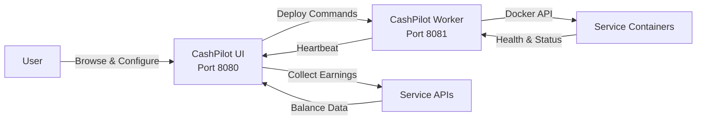

# เริ่มต้นใช้งาน { #getting-started }

## ข้อกำหนดเบื้องต้น { #prerequisites }

- **Docker** พร้อม **ปลั๊กอิน Compose v2 เวอร์ชัน 2.23.1 ขึ้นไป** ตรวจสอบได้
  ด้วย `docker compose version` เวอร์ชันที่เก่ากว่านี้อ่านการกำหนดค่าแบบ inline
  ในไฟล์ compose ไม่ได้ Docker Desktop มีปลั๊กอินนี้มาให้แล้ว หากใช้ Docker
  Engine เปล่า ๆ บน Linux ให้ติดตั้งจากที่เก็บแพ็กเกจของ Docker
  (https://docs.docker.com/compose/install/linux/ ) บน macOS ที่ใช้ Colima
  ให้ติดตั้งด้วย Homebrew แล้วลิงก์เป็นปลั๊กอินของ Docker:

    ```sh
    brew install docker-compose
    mkdir -p ~/.docker/cli-plugins
    ln -sfn "$(brew --prefix)/opt/docker-compose/bin/docker-compose" ~/.docker/cli-plugins/docker-compose
    ```

- โฮสต์ Linux, macOS หรือ Windows (amd64 หรือ arm64)
- RAM ว่างอย่างน้อย 1 GB สำหรับ CashPilot และบริการที่ CashPilot จัดการ
- **CashPilot หนึ่งชุดต่อหนึ่งโฮสต์ Docker** ดูคำเตือนด้านล่าง

!!! warning "CashPilot หนึ่งชุดต่อหนึ่งโฮสต์ Docker"
    อย่าติดตั้ง CashPilot สองชุดบนโฮสต์ Docker เดียวกัน ไฟล์ compose
    ใช้ชื่อคอนเทนเนอร์แบบตายตัว (`cashpilot-ui`, `cashpilot-worker`,
    `cashpilot-socket-proxy`) ไฟล์ชุดที่สองจึงล้มเหลวเพราะชื่อซ้ำกัน
    หากเปลี่ยนชื่อเพื่อเลี่ยงปัญหานี้ ทั้งสองชุดก็ยังใช้โฮสต์ร่วมกันอยู่ดี
    เวิร์กเกอร์แต่ละตัวจัดการทุกคอนเทนเนอร์ที่มีป้ายกำกับของ CashPilot
    ไม่ว่าชุดไหนจะเป็นผู้สร้าง ดังนั้นแดชบอร์ดแต่ละชุดจะแสดง หยุด และแทนที่
    แอปหารายได้ของอีกชุดหนึ่ง ทั้งสองชุดยังใช้เครือข่าย `cashpilot-isolated`
    ชื่อแอปหารายได้ (`cashpilot-<service>`) พอร์ตบนโฮสต์ และ volume อย่าง
    `mysterium-data` ร่วมกันด้วย หากต้องการติดตั้งชุดที่สอง ให้ใช้โฮสต์หรือ VM อื่น
    หากต้องการรันแอปหารายได้บนเซิร์ฟเวอร์เพิ่ม ให้เพิ่มเวิร์กเกอร์เข้าแดชบอร์ดเดียวแทน
    ([กลุ่มเครื่อง](fleet.md))

## เริ่มต้นอย่างรวดเร็ว { #quick-start }

### 1. ดาวน์โหลดไฟล์ compose แล้วเริ่มระบบ { #1-fetch-the-compose-file-and-launch }

```bash
curl -fsSLO https://raw.githubusercontent.com/GeiserX/CashPilot/main/docker-compose.yml
docker compose up -d
```

คำสั่งนี้เริ่มคอนเทนเนอร์ที่ทำงานต่อเนื่องสามตัว ก่อนหน้านั้น
`cashpilot-migrate` ซึ่งทำงานครั้งเดียวจะรันแล้วจบด้วยรหัส 0 ทุกครั้งที่ `up`
ดังนั้น `docker compose ps -a` จะแสดงสถานะเป็น `Exited (0)` ซึ่งเป็นเรื่องปกติ

| คอนเทนเนอร์ | พอร์ต | หน้าที่ |
|-----------|------|---------|
| **cashpilot-migrate** | ไม่มี | รันครั้งเดียวแล้วจบ ย้ายข้อมูลที่รุ่นเก่าสร้างไว้ไปยัง volume ที่ socket proxy ยอมรับ และไม่มีอะไรต้องทำในการติดตั้งใหม่ |
| **cashpilot-ui** | 8080 | แดชบอร์ดเว็บ การเก็บรายได้ แคตตาล็อกบริการ |
| **cashpilot-worker** | 8081 | เอเจนต์ Docker ที่ติดตั้งใช้งานและเฝ้าดูคอนเทนเนอร์ของบริการ |
| **cashpilot-socket-proxy** | ไม่มี | ถือ Docker socket แบบอ่านอย่างเดียว และส่งสำเนาที่กรองแล้วให้เวิร์กเกอร์ ([ค่าเริ่มต้นด้านความปลอดภัย](security-defaults.md)) |

### 2. เปิดแดชบอร์ด { #2-open-the-dashboard }

เปิด [http://localhost:8080](http://localhost:8080) ในเบราว์เซอร์ เนื่องจากยังไม่มีบัญชีใด จึงจะเข้าสู่หน้าต้อนรับ ซึ่งใช้สร้างบัญชีเจ้าของ

!!! tip "พอร์ต 8080 ถูกใช้อยู่แล้วหรือ"
    เลือกพอร์ตโฮสต์อื่นในไฟล์ `.env` ที่อยู่ข้าง `docker-compose.yml`
    แทนการแก้ไฟล์ compose:

    ```bash
    printf '\nCASHPILOT_UI_PORT=8088\n' >> .env
    docker compose up -d
    ```

    จากนั้นเปิด http://localhost:8088 และเก็บค่านี้ไว้ใน `.env` เพราะ
    การอัปเดตจากในแอปอ่านไฟล์นั้น ไม่ได้อ่าน shell (`printf` ขึ้นต้นด้วย
    การขึ้นบรรทัดใหม่ เพื่อไม่ให้บรรทัดนี้ไปต่อกับบรรทัดสุดท้ายของ `.env` ที่มีอยู่)

    ตัวแปรนี้ต้องใช้ `docker-compose.yml` ที่บรรทัด `ports:` เป็น
    `${CASHPILOT_UI_PORT:-8080}:8080` ไฟล์ของ v1.61 และเก่ากว่ากำหนด
    `8080:8080` ไว้ตายตัวและไม่สนใจตัวแปรนี้ ให้ดาวน์โหลดไฟล์ปัจจุบัน หรือ
    เก็บการแมปพอร์ตที่แก้ไว้เองก็ได้ การอัปเดตจากในแอปยอมรับแบบนั้นเช่นกัน

!!! warning "ต้องใช้โทเค็นตั้งค่าในการเริ่มใช้งานครั้งแรก"
    เมื่อเริ่มครั้งแรก CashPilot จะสร้างโทเค็นตั้งค่าแบบใช้ครั้งเดียว และพิมพ์ไว้ในบันทึกของคอนเทนเนอร์ **cashpilot-ui**:

    ```bash
    docker compose logs cashpilot-ui
    ```

    มองหาบรรทัดลักษณะนี้:

    ```
    FIRST-RUN SETUP: no account exists yet. Open /register and enter this
    one-time setup token to create the owner account: <token>
    ```

    คัดลอกโทเค็นนั้นไปใส่ในช่อง **Setup token** (โทเค็นตั้งค่า) ในขั้นตอน **Owner account** (บัญชีเจ้าของ) ของหน้าต้อนรับ พร้อมชื่อผู้ใช้และรหัสผ่าน เพื่อสร้างบัญชีแรก (บัญชีเจ้าของ) โทเค็นนี้แสดงเฉพาะในบันทึกเท่านั้น ไม่เคยอยู่ใน URL และถูกทิ้งอย่างถาวรเมื่อมีบัญชีเจ้าของแล้ว

### 3. เรียกดูแคตตาล็อกบริการ { #3-browse-the-service-catalog }

หน้า **Catalog** (แคตตาล็อก) แสดงทุกบริการ พร้อมแพลตฟอร์ม ค่าประมาณรายเดือน และสิ่งที่บริการต้องการ (IP ที่อยู่อาศัย, GPU) กรองตามหมวดหมู่ (Bandwidth, DePIN, Storage, Compute, Mining) หรือค้นหาตามชื่อได้ **Add** (เพิ่ม) เปิดตัวช่วยตั้งค่าที่บริการนั้น **Details** (รายละเอียด) แสดงคำอธิบาย การจ่ายเงิน และความเสี่ยงในการติดตั้งใช้งาน ส่วนบริการที่ไม่ได้รันใน Docker จะมีลิงก์ **Visit** (เยี่ยมชม) แทน

บริการสองประเภทควรตรวจสอบให้ละเอียดก่อน ได้แก่ บริการที่จ่ายเงินหลังจากล็อกโทเค็นเป็นเงินวางค้ำ (stake) แล้วเท่านั้น เช่น Anyone Protocol, Sia และ Flux และรีเลย์ที่เผยแพร่ IP ของคุณ ซึ่งอาจทำให้แอปแบนด์วิดท์แบบที่อยู่อาศัยจ่ายน้อยลง ดู [ตรวจสอบสองเรื่องก่อนติดตั้งใช้งาน](guides/index.md)

### 4. เพิ่มบริการด้วยตัวช่วยตั้งค่า { #4-add-services-with-the-wizard }

เมื่อมีบัญชีเจ้าของแล้ว **Add services** (เพิ่มบริการ) จะเปิดตัวช่วยตั้งค่า หลังจากนั้นปุ่ม **+ Add service** (+ เพิ่มบริการ) ที่แถบด้านบนจะเปิดตัวช่วยอีกครั้ง เลือกหมวดหมู่ แล้วเลือกบริการ สำหรับแต่ละบริการ ตัวช่วยจะแสดงลิงก์ **Sign Up** (สมัคร) ถามเฉพาะข้อมูลรับรองที่บริการนั้นต้องการ (อีเมลและรหัสผ่าน โทเค็น API เป็นต้น) และให้เลือกเวิร์กเกอร์ที่จะรันบริการนั้น คลิก **Deploy** (ติดตั้งใช้งาน) แล้ว CashPilot จะดึงอิมเมจ สร้างคอนเทนเนอร์ และเริ่มเฝ้าดู

### 5. ติดตามบนแดชบอร์ด { #5-watch-it-on-the-dashboard }

แดชบอร์ดแสดงแต่ละบริการที่ติดตั้งใช้งานแล้วพร้อมสถานะและยอดคงเหลือ และหน้า **Fleet** (กลุ่มเครื่อง) แสดงเวิร์กเกอร์ทุกตัว

## วิธีการทำงาน { #how-it-works }



1. **คุณกำหนดค่า** บริการผ่านเว็บ UI -- เลือกบริการ ใส่ข้อมูลรับรอง คลิกติดตั้งใช้งาน
2. **UI ส่ง** สเปกของคอนเทนเนอร์ (อิมเมจ, ตัวแปรสภาพแวดล้อม, volume) ไปยังเวิร์กเกอร์ผ่าน REST API
3. **เวิร์กเกอร์สร้าง** คอนเทนเนอร์ Docker และเริ่มเฝ้าดูสุขภาพ
4. **เวิร์กเกอร์รายงาน** สถานะคอนเทนเนอร์กลับไปยัง UI ทุก 60 วินาทีผ่านสัญญาณชีพ
5. **UI เก็บ** รายได้จาก API ของบริการตามกำหนดเวลาที่ปรับได้ (ค่าเริ่มต้น: ทุกชั่วโมง)
6. **แดชบอร์ด** แสดงรายได้รวม รายละเอียดแยกตามบริการ และสุขภาพของคอนเทนเนอร์

## การกำหนดค่า { #configuration }

### ตัวแปรสภาพแวดล้อมของ UI { #ui-environment-variables }

| ตัวแปร | ค่าเริ่มต้น | คำอธิบาย |
|----------|---------|-------------|
| `TZ` | `UTC` | เขตเวลาสำหรับการตั้งเวลาและการแสดงผล |
| `CASHPILOT_SECRET_KEY` | *(สร้างอัตโนมัติ)* | คีย์ลงนามสำหรับเซสชันการเข้าสู่ระบบ เก็บไว้ที่ `/data/.secret_key` **ไม่ได้เข้ารหัสข้อมูลรับรอง** |
| `CASHPILOT_ENCRYPTION_KEY` | *(สร้างอัตโนมัติ)* | คีย์ Fernet ที่เข้ารหัสข้อมูลรับรองที่จัดเก็บไว้ เก็บไว้ที่ `/data/.fernet_key` ใช้เฉพาะเมื่อไม่มีไฟล์นั้น จึงควรตั้งค่านี้เมื่อกู้คืนข้อมูลสำรองเท่านั้น |
| `CASHPILOT_API_KEY` | *(จาก `/fleet`)* | คีย์ลงทะเบียนที่ใช้ร่วมกันสำหรับเวิร์กเกอร์ เวิร์กเกอร์แต่ละตัวจะได้คีย์ของตัวเองเมื่อลงทะเบียน ดู [กลุ่มเครื่อง](fleet.md) |
| `CASHPILOT_COLLECT_INTERVAL` | `60` | จำนวนนาทีระหว่างรอบการเก็บรายได้ |
| `CASHPILOT_UI_PORT` | `8080` | พอร์ตโฮสต์ที่เผยแพร่ UI ตั้งค่าใน `.env` เมื่อพอร์ต 8080 ถูกใช้อยู่ |
| `CASHPILOT_BIND_ADDR` | `127.0.0.1` | อินเทอร์เฟซของโฮสต์ที่เผยแพร่พอร์ต UI **ค่าเริ่มต้นคือ loopback**: แดชบอร์ดสั่งงานเวิร์กเกอร์ที่เข้าถึง Docker socket ได้ จึงไม่เปิดให้เครือข่ายเข้าถึงตั้งแต่แรก ตั้งค่าเป็น IP ที่ระบุ (เช่น ที่อยู่ Tailscale/VPN) หรือ `0.0.0.0` เพื่อเปิดให้เข้าถึง หรือ (แนะนำ) ใช้ reverse proxy ที่มีการยืนยันตัวตนไว้ด้านหน้า |

พอร์ตเว็บของ UI ภายในคอนเทนเนอร์กำหนดตายตัวที่ `8080` (ตั้งผ่าน `CMD` ของคอนเทนเนอร์) `CASHPILOT_UI_PORT` และ `CASHPILOT_BIND_ADDR` เลือกเพียงพอร์ตและอินเทอร์เฟซของโฮสต์ที่ใช้เผยแพร่เท่านั้น

### ตัวแปรสภาพแวดล้อมของเวิร์กเกอร์ { #worker-environment-variables }

| ตัวแปร | ค่าเริ่มต้น | คำอธิบาย |
|----------|---------|-------------|
| `TZ` | `UTC` | เขตเวลา |
| `CASHPILOT_UI_URL` | -- | URL ของคอนเทนเนอร์ UI เช่น `http://cashpilot-ui:8080` |
| `CASHPILOT_API_KEY` | -- | ต้องตรงกับคีย์ลงทะเบียนของ UI ใช้เฉพาะตอนลงทะเบียน หลังจากนั้นเวิร์กเกอร์ใช้คีย์ของตัวเอง |
| `CASHPILOT_WORKER_NAME` | *(hostname)* | ชื่อที่แสดงของเวิร์กเกอร์นี้ในแดชบอร์ดกลุ่มเครื่อง |
| `CASHPILOT_WORKER_URL` | *(ตรวจหาอัตโนมัติ)* | URL ที่ UI ใช้เข้าถึงเวิร์กเกอร์นี้ เช่น `http://192.168.1.50:8081` ควรกำหนดเองสำหรับกลุ่มเครื่องข้ามโฮสต์ เพราะการตรวจหาอัตโนมัติอาจรายงาน IP ภายในคอนเทนเนอร์ที่เข้าถึงไม่ได้ |
| `CASHPILOT_WORKER_BIND_ADDR` | `127.0.0.1` | **ใช้กับ compose ของกลุ่มเครื่องและเวิร์กเกอร์ระยะไกลเท่านั้น** (`docker-compose.fleet.yml`): อินเทอร์เฟซของโฮสต์ที่เผยแพร่พอร์ต API ของเวิร์กเกอร์ซึ่งเข้าถึง Docker socket ได้ ค่าเริ่มต้นคือ loopback ส่วน `docker-compose.yml` ค่าเริ่มต้นไม่ได้เผยแพร่พอร์ต 8081 เลย API ของเวิร์กเกอร์ติดตั้งใช้งานหรือหยุดคอนเทนเนอร์ใดก็ได้ (= root บนโฮสต์) ดังนั้นสำหรับเวิร์กเกอร์ระยะไกล ให้ผูกกับอินเทอร์เฟซส่วนตัวหรือ VPN (เช่น IP ของ Tailscale) **ห้าม** ใช้ IP สาธารณะ |
| `CASHPILOT_PORT` | `8081` | พอร์ตที่เวิร์กเกอร์ **ประกาศ** ให้ UI ทราบ ค่านี้ *ไม่ได้* เปลี่ยนพอร์ตที่รับฟัง ซึ่งกำหนดตายตัวโดย `CMD` ของอิมเมจ ดู [ข้อมูลอ้างอิงการกำหนดค่า](configuration.md) |

### ตัวอย่าง Docker Compose { #docker-compose-example }

```yaml
--8<-- "docker-compose.yml"
```

!!! note "นี่คือไฟล์จริง"

    บล็อกด้านบนดึงมาจาก `docker-compose.yml` ในที่เก็บโค้ดแบบคำต่อคำ
    จึงไม่มีทางคลาดเคลื่อนจากสิ่งที่เผยแพร่จริง ก่อนหน้านี้ ฉบับที่คัดลอกด้วยมือ
    เคยเผยแพร่ API ของเวิร์กเกอร์ซึ่งเข้าถึง Docker socket ได้บนทุกอินเทอร์เฟซ
    และปักหมุด `:latest` ซึ่งทั้งสองอย่างเป็นสิ่งที่หน้า
    [ค่าเริ่มต้นด้านความปลอดภัย](security-defaults.md) บอกว่าไม่ควรทำ

!!! warning "การเข้าถึง Docker Socket"
    เวิร์กเกอร์จัดการคอนเทนเนอร์ของบริการผ่าน Docker แต่ไม่ได้ mount `/var/run/docker.sock` คอนเทนเนอร์ `cashpilot-socket-proxy` ถือ socket ไว้และส่งต่อให้เวิร์กเกอร์เฉพาะคำสั่งที่เวิร์กเกอร์ใช้ โดยปฏิเสธคอนเทนเนอร์แบบ privileged และการ bind โฟลเดอร์ของโฮสต์ที่ไม่ได้ระบุไว้ ([สิ่งที่ถูกปฏิเสธ](security-defaults.md#docker-socket-proxy)) การอัปเดตจากในแอปต้องเปิดใช้เอง: ทำงานเฉพาะเมื่อมี `CASHPILOT_COMPOSE_DIR=<this folder>` ใน `.env` ข้างไฟล์ compose และการตั้งค่านั้นทำให้คอนเทนเนอร์ bind โฟลเดอร์นั้นได้ ซึ่งทำให้ proxy อ่อนแอลง ([ผลที่ตามมา](security-defaults.md#docker-socket-proxy)) หากไม่ตั้งค่านี้ ให้อัปเดตด้วย `docker compose pull && docker compose up -d` เวิร์กเกอร์ยังคงควบคุมทุกคอนเทนเนอร์บนโฮสต์ ดังนั้นเพื่อความปลอดภัยสูงสุด ให้รัน CashPilot บนเครื่องหรือ VLAN เฉพาะ

!!! tip "การเก็บรักษาคีย์ลับ"
    ข้อมูลรับรองเข้ารหัสด้วย `CASHPILOT_ENCRYPTION_KEY` **ไม่ใช่** `CASHPILOT_SECRET_KEY` ซึ่งใช้ลงนามเซสชันการเข้าสู่ระบบเท่านั้น คีย์เข้ารหัสสร้างขึ้นอัตโนมัติในการรันครั้งแรกและเก็บไว้ที่ `/data/.fernet_key` **ให้สำรองไฟล์นั้นไว้** หาก volume ถูกสร้างใหม่โดยไม่มีไฟล์นี้ ระบบจะสร้างคีย์ใหม่ และข้อมูลรับรองที่จัดเก็บไว้ทั้งหมดจะอ่านไม่ได้อย่างถาวร การตั้งค่า `CASHPILOT_ENCRYPTION_KEY` มีไว้สำหรับกู้คืนข้อมูลสำรองนั้น ไฟล์คีย์มีลำดับความสำคัญเหนือกว่าเสมอ การตั้งค่านี้บนระบบที่ทำงานปกติจึงไม่เปลี่ยนอะไร

!!! tip "รหัสผ่านและความลับใน UI"
    เปลี่ยนรหัสผ่านของตัวเองได้ทุกเมื่อจากเมนูรูปโปรไฟล์ -> **Change password** (เปลี่ยนรหัสผ่าน) (ใช้ได้ทุกบทบาท) การเปลี่ยนนี้จะออกจากระบบเซสชันอื่นทั้งหมด ใน **Settings** (การตั้งค่า) ความลับที่จัดเก็บไว้เป็นแบบเขียนได้อย่างเดียว: ใส่ค่าเพื่อเปลี่ยน หรือเว้นช่องว่างไว้เพื่อคงค่าเดิม ข้อมูลรับรองที่บันทึกไว้จะไม่ถูกส่งกลับไปยังเบราว์เซอร์เลย

## การอัปเดต CashPilot { #updating-cashpilot }

ไฟล์ compose ปักหมุดซีรีส์ major.minor เช่น `drumsergio/cashpilot:X.Y` ดังนั้น `pull` จะดึงแพตช์ล่าสุดของซีรีส์นั้น:

```bash
docker compose pull
docker compose up -d
```

`docker compose pull` ดึงอิมเมจล่าสุดที่เผยแพร่ และ `up -d` สร้างใหม่
เฉพาะคอนเทนเนอร์ที่อิมเมจเปลี่ยน ไฟล์ compose ที่มาพร้อมกันตั้งค่า
`pull_policy: always` ไว้ ดังนั้นแม้แต่ `docker compose up -d` อย่างเดียวก็จะดึง
อิมเมจล่าสุดก่อน

**จากแดชบอร์ด** **Settings** (การตั้งค่า), **About and updates** (เกี่ยวกับและการอัปเดต) รันสองคำสั่งเดียวกันนี้
ให้จากคอนเทนเนอร์ผู้ช่วยที่มีอายุสั้น ผู้ช่วยอ่านไฟล์ compose และ `.env` ที่อยู่ข้างกัน
(หรือไฟล์ที่ส่งด้วย `--env-file`) ไม่เคยอ่าน shell ที่ใช้เริ่ม CashPilot สมมติว่าเริ่มด้วย `CASHPILOT_UI_PORT=8088 docker compose up -d`
การอัปเดตจะย้ายแดชบอร์ดกลับไปที่ 8080 จึงหยุดและบอกเหตุผลแทน
ใส่ค่านั้นไว้ใน `.env` แล้วปุ่มนี้จะทำงานได้

!!! note "**ไม่** จำเป็นต้อง build ใหม่"
    CashPilot มีอิมเมจหลายสถาปัตยกรรมที่ build ไว้แล้วบน Docker Hub
    ([`drumsergio/cashpilot`](https://hub.docker.com/r/drumsergio/cashpilot),
    [`drumsergio/cashpilot-worker`](https://hub.docker.com/r/drumsergio/cashpilot-worker))
    `docker compose build` / `--build` ใช้เฉพาะเมื่อตั้งใจ
    build จากซอร์สด้วย `docker-compose.build.yml` สำหรับการติดตั้งปกติ
    `pull` + `up -d` คือขั้นตอนการอัปเดตที่ครบถ้วนและถูกต้อง

### การปักหมุดเวอร์ชันที่ระบุ { #pinning-a-specific-version }

หากต้องการอยู่กับรุ่นใดรุ่นหนึ่งโดยเฉพาะ ให้แทนแท็กซีรีส์ `X.Y` ใน
`docker-compose.yml` ด้วยแท็กรุ่นเต็ม `X.Y.Z` ทั้งที่
`drumsergio/cashpilot` และ `drumsergio/cashpilot-worker` (ใช้แท็กเดียวกันทั้งสองเสมอ)
แล้วลบ `pull_policy: always` ออก ดูแท็กได้ที่
[Docker Hub](https://hub.docker.com/r/drumsergio/cashpilot/tags)

หากต้องการย้ายไปซีรีส์ที่ใหม่กว่า ให้แก้ทั้งสองแท็ก: ที่โฮสต์ UI ก่อน แล้วจึง
ที่โฮสต์เวิร์กเกอร์ทุกเครื่อง อ่าน
[UPGRADING.md](https://github.com/GeiserX/CashPilot/blob/main/UPGRADING.md)
ก่อน เพราะรุ่นหลักอย่าง 3.0 มีขั้นตอนเฉพาะของตัวเอง

### การอัปเดตอัตโนมัติ (ไม่บังคับ) { #automating-updates-optional }

หากต้องการอัปเดตโดยไม่ต้องลงมือเอง ให้ตั้งตัวจัดกำหนดการให้รันสองคำสั่งเดียวกันนี้
เช่น ด้วยรายการ cron รายวัน:

```cron
0 4 * * *  cd /path/to/cashpilot && docker compose pull && docker compose up -d
```

หรือรันตัวอัปเดตอัตโนมัติอย่าง [Watchtower](https://containrrr.dev/watchtower/)
หรือ [Diun](https://crazymax.dev/diun/) กับคอนเทนเนอร์ของ CashPilot สิ่งเหล่านี้
ไม่บังคับ CashPilot ไม่ได้รวมตัวอัปเดตมาให้

### การล้างอิมเมจเก่า { #cleaning-up-old-images }

CashPilot ดึงอิมเมจแต่ไม่เคยลบ การอัปเดตและการติดตั้งใช้งานใหม่แต่ละครั้ง
อาจทิ้งอิมเมจก่อนหน้าไว้บนดิสก์ ในกลุ่มเครื่องทดสอบสามเซิร์ฟเวอร์ อิมเมจเก่าของ
CashPilot และแอปหารายได้รวมกันประมาณ 3 GB ซึ่งถือว่าน้อยเมื่อเทียบกับ
สิ่งที่โปรแกรมอื่นบนโฮสต์เดียวกันมักทิ้งไว้ ดังนั้นให้ดูทั้งโฮสต์:

```bash
docker system df
```

ค่า `RECLAIMABLE` ในบรรทัด `Images` คือพื้นที่ที่ Docker คืนได้

**ทำไม CashPilot ไม่ทำส่วนนี้ให้** เวิร์กเกอร์เข้าถึง Docker ผ่าน
socket proxy สำหรับอิมเมจ proxy อนุญาตให้ดึงอิมเมจและอ่านอิมเมจตามชื่อ
เท่านั้น ไม่สามารถแสดงรายการอิมเมจของโฮสต์หรือลบอิมเมจได้ เวิร์กเกอร์ที่ทำได้
ก็จะเห็นและลบอิมเมจของโปรแกรมอื่นทุกตัวบนโฮสต์ด้วย
ดู [สิ่งที่ proxy ปฏิเสธ](security-defaults.md#docker-socket-proxy)

**ขั้นที่ 1: ลบอิมเมจ dangling** อิมเมจ dangling คืออิมเมจที่ไม่มีแท็กและไม่มี
คอนเทนเนอร์ใดใช้ ทั้งที่กำลังรันและที่หยุดอยู่ การอัปเดตผ่านแท็กที่เปลี่ยนได้อย่าง
`X.Y` (ซีรีส์แบบที่ไฟล์ compose ปักหมุดไว้), `latest` หรือ digest จะทิ้งอิมเมจแบบนี้ไว้พอดี:

```bash
docker image prune
```

คำสั่งนี้ลบอิมเมจที่รันอยู่ก่อนการอัปเดตผ่านแท็กที่เปลี่ยนได้ด้วย: เมื่อ
อิมเมจใหม่ของซีรีส์นั้นมาถึง อิมเมจเก่าก็ไม่มีแท็ก หากต้องการทางย้อนกลับ ให้จด
เวอร์ชันที่แน่นอนไว้ก่อนอัปเดต (ส่วนท้ายของแถบด้านข้างแสดงไว้) เพื่อ
ดึง `drumsergio/cashpilot:<X.Y.Z>` ได้อีกครั้ง หรือปักหมุดไฟล์ compose ไว้กับ
แท็ก `X.Y.Z` ที่แน่นอน แล้วอิมเมจเก่าจะยังมีแท็กอยู่ และใช้ขั้นที่ 2 แทน

Docker จะถามก่อนลบ ในรายการ cron ให้เพิ่ม `--force` เพื่อข้าม
คำถาม ตัวเลือกนี้ไม่เปลี่ยนอย่างอื่น:

```cron
30 4 * * 0  docker image prune --force
```

!!! warning "อย่าเพิ่ม `-a`"
    `docker image prune -a` ลบทุกอิมเมจที่ไม่มีคอนเทนเนอร์ใดใช้อยู่
    ตอนนี้ ทั้งแบบ dangling และแบบมีแท็ก ซึ่งรวมถึงอิมเมจของ stack ที่ตั้งใจหยุดไว้
    และอิมเมจที่ build เองในเครื่องและดึงใหม่ไม่ได้

**ขั้นที่ 2: ลบแท็กเก่าที่ปักหมุดไว้** อิมเมจที่ปักหมุดเวอร์ชันไว้จะยังมีแท็ก
หลังจากย้ายไปเวอร์ชันใหม่กว่า `prune` จึงข้ามไป อิมเมจของ CashPilot ต่อไปนี้
ถูกปักหมุด:

| ที่เก็บ | สิ่งที่ปักหมุด |
|---|---|
| `drumsergio/cashpilot` | ไฟล์ compose (ซีรีส์เก่า หรือเวอร์ชันที่แน่นอนที่ปักหมุดไว้) |
| `drumsergio/cashpilot-worker` | ไฟล์ compose เช่นเดียวกับด้านบน |
| `drumsergio/cashpilot-tunnel` | เวิร์กเกอร์ หนึ่งแท็กต่อเวอร์ชันของเวิร์กเกอร์ |
| `drumsergio/cashpilot-earnapp` | รายการ EarnApp ในแคตตาล็อก |
| `drumsergio/cashpilot-anyone` | รายการ Anyone Protocol ในแคตตาล็อก |

อิมเมจของบริการที่ลบไปแล้วก็เช่นกัน: แท็กจะยังอยู่จนกว่า
จะลบเอง อิมเมจในแคตตาล็อกที่ปักหมุดด้วย digest เช่น MystNodes หรือ ProxyBase
จะเสียแท็กเมื่ออิมเมจที่ใหม่กว่ามาแทน ขั้นที่ 1 จึงครอบคลุมแล้ว

ก่อนอื่น ให้แสดงรายการแท็กที่ไม่มีคอนเทนเนอร์ใดใช้ ตัวอย่างนี้ใช้กับอิมเมจของเวิร์กเกอร์
สำหรับที่เก็บอื่นในตาราง ให้เปลี่ยน `repo`:

```bash
repo=drumsergio/cashpilot-worker
used=$(docker ps -a --format '{{.Image}}')
docker image ls "$repo" --format '{{.Repository}}:{{.Tag}}' | grep -vxF "$used"
```

จากนั้นลบแท็กเก่าทีละแท็กตามชื่อ:

```bash
docker image rm drumsergio/cashpilot-worker:<old tag>
```

อย่าเพิ่ม `-f` หากไม่มีตัวเลือกนี้ Docker จะปฏิเสธการลบอิมเมจที่
คอนเทนเนอร์ยังใช้อยู่ ทั้งที่กำลังรันและที่หยุดอยู่ และพิมพ์
`conflict: unable to delete` เมื่อเห็นข้อความนี้ ให้เก็บอิมเมจไว้ เก็บแท็ก
ที่รันอยู่และแท็กที่รันก่อนหน้านั้นไว้ เพื่อให้ยังย้อนกลับได้หนึ่งเวอร์ชัน
ลบเฉพาะแท็กที่เก่ากว่าสองแท็กนั้น

คอลัมน์ **Host disk** (ดิสก์ของโฮสต์) ในแดชบอร์ดแสดงพื้นที่ว่างบนระบบไฟล์ที่
เก็บ `/data` ของเวิร์กเกอร์ อิมเมจมักอยู่บนระบบไฟล์เดียวกัน ภายใต้
data root ของ Docker แต่ไม่เสมอไป `docker info --format '{{.DockerRootDir}}'`
แสดง data root ของ Docker หากใช้ containerd image store ซึ่งเป็นค่าเริ่มต้นของ
การติดตั้ง Docker Engine 29 ใหม่ อิมเมจจะอยู่ใต้ root ของ containerd แทน
ปกติคือ `/var/lib/containerd` `docker info --format '{{.Driver}}'` จะพิมพ์
`overlayfs` สำหรับ containerd image store และ `overlay2` สำหรับแบบดั้งเดิม
ตรวจสอบพื้นที่ว่างบนระบบไฟล์ที่เก็บไดเรกทอรีที่เกี่ยวข้อง

## บริการที่รองรับ { #supported-services }

CashPilot รองรับ **<!-- n:live -->50<!-- /n --> บริการ** ที่เปิดใช้งานอยู่หรืออยู่ในช่วงเบตา ในห้าหมวดหมู่:

- **การแบ่งปันแบนด์วิดท์** (<!-- n:bandwidth -->18<!-- /n -->): แบ่งปันแบนด์วิดท์อินเทอร์เน็ตเพื่อสร้างรายได้แบบพาสซีฟ
- **DePIN** (<!-- n:depin -->15<!-- /n -->): เครือข่ายโครงสร้างพื้นฐานทางกายภาพแบบกระจายศูนย์
- **การประมวลผลด้วย GPU** (<!-- n:compute -->7<!-- /n -->): ให้เช่า GPU สำหรับงาน AI และงานประมวลผล
- **พื้นที่จัดเก็บ** (<!-- n:storage -->2<!-- /n -->): แบ่งปันพื้นที่ดิสก์บนเครือข่ายจัดเก็บข้อมูลแบบกระจายศูนย์
- **การขุด** (<!-- n:mining -->8<!-- /n -->): ติดตั้งใช้งานเครื่องขุด หรือติดตามพูลตามที่อยู่รับการจ่ายเงิน ([การขุด](mining.md))

ในจำนวนนี้ **<!-- n:docker -->21<!-- /n -->** บริการติดตั้งใช้งานและจัดการได้โดยอัตโนมัติผ่าน Docker แคตตาล็อกติดตามอีก <!-- n:tracked -->29<!-- /n --> บริการ (แอปเบราว์เซอร์หรือเดสก์ท็อป <!-- n:extension -->18<!-- /n --> รายการ, โหนด GPU <!-- n:gpu -->7<!-- /n --> รายการ, พูลการขุด <!-- n:mining_pools -->4<!-- /n --> รายการ) CashPilot อ่านยอดคงเหลือของบริการเหล่านี้ได้เมื่อมีตัวเก็บข้อมูลรองรับ

ดูแคตตาล็อกทั้งหมดในส่วน [คู่มือบริการ](guides/index.md)

## ขั้นตอนถัดไป { #next-steps }

- [วิธีการทำงาน](how-it-works.md) -- ทำความเข้าใจการออกแบบที่แยก UI กับเวิร์กเกอร์
- [การจัดการกลุ่มเครื่อง](fleet.md) -- ติดตั้งใช้งานบนหลายเซิร์ฟเวอร์
- [การปกป้องเครือข่ายในบ้าน](home-network-security.md) -- กันคอนเทนเนอร์ไม่ให้เข้าถึง LAN และกรณีที่ gVisor ช่วยได้
- [คู่มือบริการ](guides/index.md) -- คำแนะนำการตั้งค่าอย่างละเอียดของแต่ละบริการ
- [การลบ CashPilot ออกทั้งหมด](uninstall.md) -- ลบทุกอย่างที่ CashPilot สร้างขึ้น เพื่อเริ่มใหม่หรือเลิกใช้
