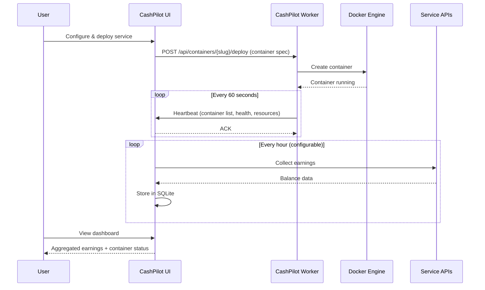

# วิธีการทำงาน { #how-it-works }

CashPilot ใช้สถาปัตยกรรมที่แยก **UI + เวิร์กเกอร์** ออกจากกัน UI ไม่แตะ Docker เลย -- การทำงานกับคอนเทนเนอร์ทั้งหมดผ่านเวิร์กเกอร์ การแยกส่วนนี้เป็นหลักการออกแบบหลัก และเป็นสิ่งที่ทำให้จัดการกลุ่มเครื่องหลายเซิร์ฟเวอร์ได้

## ส่วนประกอบ { #components }

| ส่วนประกอบ | อิมเมจ | พอร์ต | การเข้าถึง Docker | หน้าที่ |
|-----------|-------|:----:|:-------------:|---------|
| **CashPilot UI** | `drumsergio/cashpilot` | 8080 | ไม่มี | แดชบอร์ดเว็บ การเก็บรายได้ แคตตาล็อกบริการ การจัดเก็บข้อมูลรับรอง การตั้งเวลา |
| **CashPilot Worker** | `drumsergio/cashpilot-worker` | 8081 | ผ่าน `cashpilot-socket-proxy` | วงจรชีวิตของคอนเทนเนอร์ Docker การรายงานสุขภาพ สัญญาณชีพไปยัง UI |

**ไม่มีโหมดสแตนด์อโลน** ทุกเซิร์ฟเวอร์ที่รันคอนเทนเนอร์ Docker ต้องมีเวิร์กเกอร์ UI เป็นเพียงแดชบอร์ดและตัวตั้งเวลา -- รันบนเครื่องใดก็ได้ รวมถึงเครื่องที่ไม่มี Docker

## หลักการออกแบบ { #design-principles }

1. **แยกหน้าที่ชัดเจน** UI ดูแล: แดชบอร์ด การเก็บรายได้ การตั้งเวลา การยืนยันตัวตนผู้ใช้ เวิร์กเกอร์ดูแล: วงจรชีวิตของคอนเทนเนอร์ Docker การรายงานสุขภาพ หน้าที่ทั้งสองไม่ทับซ้อนกันเลย
2. **เวิร์กเกอร์ต้องเข้าถึง Docker ผ่าน socket proxy** เวิร์กเกอร์ที่เข้าถึง Docker ไม่ได้ก็ไร้ประโยชน์ เมื่อใช้ไฟล์ compose ที่มาพร้อมกัน เวิร์กเกอร์จะไม่ได้ socket ดิบเลย: เข้าถึง Docker ผ่าน `cashpilot-socket-proxy` ส่วนรายการใน Unraid และ TrueNAS ยังคง mount socket ดิบ ([ร้านแอป](app-stores.md)) หากไม่ต้องการจัดการ Docker ก็รันเฉพาะ UI เพื่อติดตามรายได้ได้
3. **แหล่งข้อมูลจริงแหล่งเดียว** UI เป็นตัวเดียวที่เก็บรายได้ จัดเก็บข้อมูลย้อนหลัง และให้บริการแดชบอร์ด เวิร์กเกอร์ไม่เคยเก็บรายได้
4. **รายได้ไม่ถูกนับซ้ำ** เนื่องจากมีเพียง UI ที่เก็บ จึงไม่มีความเสี่ยงที่บัญชีเดียวกันจะถูกนับสองครั้ง
5. **เวิร์กเกอร์เป็นดาวเทียมที่ไม่เก็บสถานะ** เวิร์กเกอร์รู้ว่าต้องให้คอนเทนเนอร์ใดทำงานต่อ และต้องรายงานไปยัง URL ของ UI ใด เวิร์กเกอร์เก็บเพียง id ของตัวเองและคีย์กลุ่มเครื่องลงไฟล์ในเครื่อง (`.worker_id`, `.worker_key` ไม่มีฐานข้อมูล ไม่มีข้อมูลรายได้)
6. **YAML คือความจริง** ทุกบริการอยู่ใน `services/{category}/{slug}.yml` UI การติดตั้งใช้งาน เอกสาร และการส่งออก compose ล้วนมาจากไฟล์เหล่านี้

## โครงสร้างไดเรกทอรี { #directory-structure }

```
cashpilot/
  app/                      # FastAPI application
    main.py                 # App entrypoint, lifespan, container/fleet/earnings routes
    deps.py                 # Shared auth guards + Jinja2 template environment
    routers/                # Route groups split out of main.py: auth, pages, users
    catalog.py              # Loads YAML service definitions, caches, SIGHUP reload
    orchestrator.py         # Docker SDK: deploy, stop, restart, remove, logs
    database.py             # Async SQLite: earnings, config, deployments, users, workers
    worker_api.py           # Worker REST API: heartbeat, container commands, mini-UI
    setup_token.py          # First-run setup-token gate (owner-account creation)
    metrics.py              # Optional Prometheus metrics (/metrics)
    exchange_rates.py       # Crypto/fiat conversion via CoinGecko + Frankfurter
    collectors/             # Earnings collectors (one module per service, UI only)
      base.py               # BaseCollector ABC + EarningsResult dataclass
      honeygain.py          # Example: JWT auth + balance endpoint
      __init__.py           # COLLECTOR_MAP registry + make_collectors() factory
    templates/              # Jinja2: dashboard, fleet, catalog, setup wizard, payouts, settings
    static/
      css/style.css         # Classic night by default, plus dark, light, sunrise and warm
      js/app.js             # Vanilla JS, CP namespace, Chart.js, wizard state machine
  services/                 # YAML service definitions (SINGLE SOURCE OF TRUTH)
    _schema.yml             # Schema documentation
    bandwidth/              # Bandwidth sharing services
    depin/                  # DePIN services
    storage/                # Storage sharing services
    compute/                # GPU compute services
    mining/                 # Mining services
  docs/                     # Documentation and guides
    guides/                 # Per-service setup guides
  Dockerfile                # UI image: multi-stage python:3.15-alpine, su-exec, non-root
  Dockerfile.worker         # Worker image: minimal deps, no collectors/templates
  docker-compose.yml        # Single-server deployment
  docker-compose.fleet.yml  # Multi-server fleet deployment
```

## การไหลของข้อมูล { #data-flow }



### สัญญาณชีพ (เวิร์กเกอร์ไปยัง UI) { #heartbeat-worker-to-ui }

ทุก 60 วินาที เวิร์กเกอร์แต่ละตัวจะส่ง:

- รายการคอนเทนเนอร์พร้อมสถานะ (running, stopped, exited)
- การใช้ทรัพยากรของแต่ละคอนเทนเนอร์ (เปอร์เซ็นต์ CPU, หน่วยความจำเป็น MB)
- ข้อมูลระบบ (OS, สถาปัตยกรรม, hostname, การมี Docker ให้ใช้)
- URL ที่เวิร์กเกอร์รายงานเอง (`CASHPILOT_WORKER_URL` ที่กำหนดไว้ หรือค่าสำรองที่ตรวจหาอัตโนมัติ)

UI จัดเก็บข้อมูลนี้ในฐานข้อมูล SQLite และแสดงในหน้า **Fleet** (กลุ่มเครื่อง)

### คำสั่ง (UI ไปยังเวิร์กเกอร์) { #commands-ui-to-worker }

UI สั่งเวิร์กเกอร์ตัวใดก็ได้ให้:

- **ติดตั้งใช้งาน** คอนเทนเนอร์ของบริการ (สเปกเต็ม: อิมเมจ, ตัวแปรสภาพแวดล้อม, volume, พอร์ต)
- **หยุด**, **เริ่ม**, **รีสตาร์ต** หรือ **ลบ** คอนเทนเนอร์
- **ดึงบันทึก** จากคอนเทนเนอร์

คำสั่งส่งผ่านการเรียก REST API จาก UI ไปยังเวิร์กเกอร์

### การไหลของข้อมูลรับรอง { #credential-flow }

เวิร์กเกอร์ **ไม่เคยจัดการหรือจัดเก็บข้อมูลรับรอง**:

1. ผู้ใช้กำหนดค่าข้อมูลรับรองของบริการใน UI (จัดเก็บแบบเข้ารหัสใน SQLite)
2. เมื่อติดตั้งใช้งาน UI จะส่งสเปกเต็มของคอนเทนเนอร์ (รวมตัวแปรสภาพแวดล้อม) ไปยังเวิร์กเกอร์
3. เวิร์กเกอร์ส่งสเปกต่อให้ Docker API แล้ว Docker จัดเก็บตัวแปรสภาพแวดล้อมไว้ในการกำหนดค่าของคอนเทนเนอร์
4. สำหรับการรีสตาร์ต: `docker restart` คงตัวแปรสภาพแวดล้อมไว้ได้เอง
5. สำหรับการติดตั้งใช้งานใหม่ทั้งหมด (ลบ + สร้าง): UI ส่งสเปกเต็มอีกครั้ง

### การเก็บรายได้ { #earnings-collection }

UI รันตัวเก็บข้อมูลตามกำหนดเวลาสำหรับแต่ละบริการที่กำหนดค่าไว้:

- **ตัวเก็บข้อมูลอัตโนมัติ** ดึงยอดคงเหลือผ่าน API ของบริการ (JWT auth, cookie auth, คีย์ API) สำหรับผู้ให้บริการที่มีตัวเก็บข้อมูล
- ผลลัพธ์จัดเก็บใน SQLite เป็นสกุลเงินต้นทาง (USD, MYST, GRASS, STORJ เป็นต้น)
- อัตราแลกเปลี่ยนดึงจาก CoinGecko (คริปโต) และ Frankfurter (สกุลเงินทั่วไป) แคชไว้ 15 นาที
- ค่าที่อ่านได้แต่ละครั้งจัดเก็บอัตรา USD ของวันที่อ่าน ค่าคริปโตที่จัดเก็บไว้โดยไม่มีอัตรา (เก่ากว่าคอลัมน์อัตรา) จะได้ราคาของวันนั้นจากประวัติรายวันของ CoinGecko ตอนเริ่มระบบและวันละครั้ง วันที่ไม่มีราคาจะยังไม่มีราคาต่อไป
- แดชบอร์ดแปลงและแสดงผลเป็นสกุลเงินที่ผู้ใช้เลือก

## เทคโนโลยีที่ใช้ { #tech-stack }

| เทคโนโลยี | หน้าที่ |
|---|---|
| FastAPI | เฟรมเวิร์กฝั่งแบ็กเอนด์ (Python 3.15, async) |
| Jinja2 | เทมเพลต HTML ที่เรนเดอร์ฝั่งเซิร์ฟเวอร์ |
| SQLite | ฐานข้อมูล (aiosqlite ไม่ต้องกำหนดค่า จัดเก็บใน `/data`) |
| Docker SDK for Python | การจัดการวงจรชีวิตของคอนเทนเนอร์ผ่าน socket |
| PyYAML | การแยกวิเคราะห์นิยามบริการ |
| APScheduler | การเก็บรายได้เป็นระยะ |
| httpx | ไคลเอนต์ HTTP แบบ async สำหรับตัวเก็บข้อมูลรายได้ |
| cryptography (Fernet) | การเข้ารหัสข้อมูลรับรองที่จัดเก็บไว้ |
| Chart.js | กราฟรายได้ฝั่งหน้าเว็บ |
| su-exec | ลดสิทธิ์จาก root เป็นผู้ใช้ `cashpilot` หลังการตั้งค่า entrypoint (Dockerfile) |

## ฐานข้อมูล { #database }

SQLite เก็บข้อมูลไว้ 400 วัน ตารางหลัก:

- **earnings** -- รายได้ย้อนหลังของแต่ละบริการ (timestamp, slug, ยอดคงเหลือ, สกุลเงิน)
- **deployments** -- การติดตั้งใช้งานคอนเทนเนอร์ที่ใช้งานอยู่ (slug, container ID, ตัวแปรสภาพแวดล้อมที่เข้ารหัส, สถานะ)
- **config** -- การตั้งค่าแบบคีย์-ค่า และข้อมูลรับรองที่เข้ารหัส
- **users** -- บัญชี (ชื่อผู้ใช้, แฮชรหัสผ่าน bcrypt, บทบาท)
- **user_preferences** -- สถานะการเริ่มใช้งานของแต่ละผู้ใช้ (โหมดการตั้งค่า, หมวดหมู่ที่เลือก, เขตเวลา)
- **health_events** -- ประวัติสุขภาพของคอนเทนเนอร์ (start, stop, crash, check_ok, check_down)
- **workers** -- ทะเบียนเวิร์กเกอร์ในกลุ่มเครื่อง (client ID, ชื่อ, URL, สถานะ, สัญญาณชีพล่าสุด, คีย์กลุ่มเครื่องของแต่ละเวิร์กเกอร์ที่เข้ารหัส)

## โมเดลความปลอดภัย { #security-model }

- ข้อมูลรับรองทั้งหมดเข้ารหัสขณะจัดเก็บด้วยการเข้ารหัสแบบสมมาตร Fernet
- การยืนยันตัวตนระหว่างเวิร์กเกอร์กับ UI ใช้คีย์กลุ่มเครื่องของแต่ละเวิร์กเกอร์ (`CASHPILOT_API_KEY` เป็นเพียงข้อมูลรับรองสำหรับลงทะเบียนครั้งแรกเท่านั้น)
- คอนเทนเนอร์ที่จัดการรันด้วย `--security-opt no-new-privileges`
- หลักการตั้งชื่อคอนเทนเนอร์: `cashpilot-{slug}` พร้อมป้ายกำกับ `cashpilot.managed=true`
- คอนเทนเนอร์ UI **ไม่มี** สิทธิ์เข้าถึง Docker socket
- การยืนยันตัวตนแบบเซสชันพร้อมระบบบทบาท (owner/writer/viewer)
