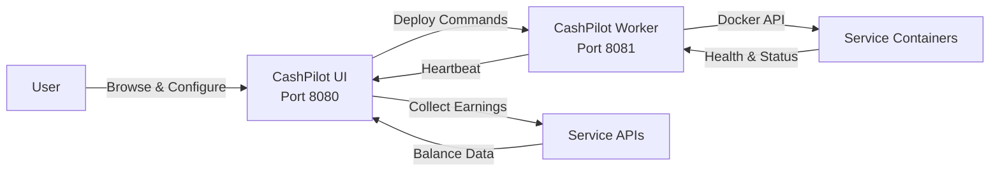

# Başlarken { #getting-started }

## Ön koşullar { #prerequisites }

- **Compose v2 eklentisi, sürüm 2.23.1 veya daha yenisi** ile birlikte **Docker**. Bunu
  `docker compose version` ile kontrol edin. Eski sürümler compose dosyasındaki satır içi
  yapılandırmayı okuyamaz. Docker Desktop eklentiyi içerir. Linux'ta yalın bir Docker
  Engine üzerinde eklentiyi Docker'ın paket deposundan kurun
  (<https://docs.docker.com/compose/install/linux/>). Colima kullanan macOS'ta
  eklentiyi Homebrew ile kurun ve bir Docker eklentisi olarak bağlayın:

    ```sh
    brew install docker-compose
    mkdir -p ~/.docker/cli-plugins
    ln -sfn "$(brew --prefix)/opt/docker-compose/bin/docker-compose" ~/.docker/cli-plugins/docker-compose
    ```

- Bir Linux, macOS veya Windows ana makinesi (amd64 veya arm64)
- CashPilot ve yönettiği hizmetler için en az 1 GB boş RAM
- **Docker ana makinesi başına bir CashPilot.** Aşağıdaki uyarıya bakın.

!!! warning "Docker ana makinesi başına bir CashPilot"
    Tek bir Docker ana makinesinde iki CashPilot kurulumu çalıştırmayın. Compose dosyaları
    sabit konteyner adları kullanır (`cashpilot-ui`, `cashpilot-worker`,
    `cashpilot-socket-proxy`), bu yüzden dosyanın ikinci bir kopyası ad
    çakışması nedeniyle başarısız olur. Bunu aşmak için adları değiştirirseniz iki kurulum yine de
    aynı ana makineyi paylaşır. Her worker, hangi kurulum oluşturmuş olursa olsun, CashPilot'un
    etiketlerini taşıyan her konteyneri yönetir. Böylece her pano diğerinin kazanç
    uygulamalarını listeler, durdurur ve değiştirir. İkisi ayrıca
    `cashpilot-isolated` ağını, kazanç uygulaması adlarını (`cashpilot-<service>`),
    ana makine portlarını ve `mysterium-data` gibi birimleri de paylaşır. İkinci bir
    kurulum için başka bir ana makine veya VM kullanın. Kazanç uygulamalarını daha fazla sunucuda çalıştırmak için
    bunun yerine tek bir panoya worker ekleyin ([Filo](fleet.md)).

## Hızlı başlangıç { #quick-start }

### 1. Compose dosyasını indirin ve başlatın { #1-fetch-the-compose-file-and-launch }

```bash
curl -fsSLO https://raw.githubusercontent.com/GeiserX/CashPilot/main/docker-compose.yml
docker compose up -d
```

Bu komut sürekli çalışan üç konteyner başlatır. Onlardan önce tek seferlik
`cashpilot-migrate` her `up` işleminde çalışır ve 0 koduyla çıkar, bu yüzden
`docker compose ps -a` onu `Exited (0)` olarak gösterir. Bu normaldir.

| Konteyner | Port | Amaç |
|-----------|------|---------|
| **cashpilot-migrate** | yok | Bir kez çalışır ve çıkar. Eski bir sürümün oluşturduğu verileri soket proxy'sinin kabul ettiği birimlere taşır; yeni bir kurulumda yapacak bir şey bulmaz |
| **cashpilot-ui** | 8080 | Web panosu, kazanç toplama, hizmet kataloğu |
| **cashpilot-worker** | 8081 | Hizmet konteynerlerini dağıtan ve izleyen Docker ajanı |
| **cashpilot-socket-proxy** | yok | Docker soketini salt okunur tutar ve worker'a filtrelenmiş bir kopyasını verir ([Varsayılan güvenlik ayarları](security-defaults.md)) |

### 2. Panoyu açın { #2-open-the-dashboard }

Tarayıcınızda [http://localhost:8080](http://localhost:8080) adresine gidin. Henüz hiçbir hesap olmadığı için sahip hesabını oluşturan karşılama sayfasına ulaşırsınız.

!!! tip "8080 portu zaten kullanımda mı?"
    Compose dosyasını düzenlemek yerine `docker-compose.yml` dosyasının yanındaki bir
    `.env` dosyasında başka bir ana makine portu seçin:

    ```bash
    printf '\nCASHPILOT_UI_PORT=8088\n' >> .env
    docker compose up -d
    ```

    Ardından http://localhost:8088 adresini açın. Değeri `.env` içinde tutun, çünkü
    uygulama içi güncelleme kabuğunuzu değil o dosyayı okur. (`printf` yeni satırla
    başlar, böylece satır mevcut bir `.env` dosyasının son satırına asla eklenmez.)

    Değişken, `ports:` satırı
    `${CASHPILOT_UI_PORT:-8080}:8080` olan bir `docker-compose.yml` gerektirir. v1.61 ve daha eski sürümlerin dosyası
    `8080:8080` değerini sabit yazar ve değişkeni yok sayar. Güncel dosyayı indirin ya da
    kendi düzenlediğiniz port eşlemesini koruyun: uygulama içi güncelleme bunu da kabul eder.

!!! warning "İlk çalıştırma kurulum belirteci gerekir"
    İlk başlatmada CashPilot tek kullanımlık bir kurulum belirteci üretir ve bunu **cashpilot-ui** konteynerinin günlüklerine yazar:

    ```bash
    docker compose logs cashpilot-ui
    ```

    Şuna benzer bir satır arayın:

    ```
    FIRST-RUN SETUP: no account exists yet. Open /register and enter this
    one-time setup token to create the owner account: <token>
    ```

    İlk hesabı (sahip hesabını) oluşturmak için bu belirteci, bir kullanıcı adı ve parolayla birlikte, karşılama sayfasının **Owner account** (Sahip hesabı) adımındaki **Setup token** (Kurulum belirteci) alanına kopyalayın. Belirteç yalnızca günlüklerde gösterilir, hiçbir zaman bir URL'de gösterilmez ve sahip hesabı oluştuğu anda kalıcı olarak atılır.

### 3. Hizmet kataloğuna göz atın { #3-browse-the-service-catalog }

**Catalog** (Katalog) sayfası her hizmeti platformları, aylık bir tahmin ve gereksinimleriyle (ev IP'si, GPU) listeler. Kategoriye göre (Bandwidth, DePIN, Storage, Compute, Mining) filtreleyin veya ada göre arayın. **Add** (Ekle) o hizmette kurulum sihirbazını açar, **Details** (Ayrıntılar) hizmetin açıklamasını, ödemelerini ve dağıtım riskini gösterir; Docker'da çalışmayan hizmetlerde bunun yerine bir **Visit** (Ziyaret et) bağlantısı bulunur.

İki tür hizmete önce daha yakından bakmak gerekir: Anyone Protocol, Sia ve Flux gibi yalnızca bir token stake'i kilitledikten sonra ödeme yapan hizmetler ve IP'nizi yayımlayan, ev bant genişliği uygulamalarının size ödediği tutarı düşürebilecek relay'ler. [Dağıtmadan önce iki şeyi kontrol edin](guides/index.md) bölümüne bakın.

### 4. Sihirbazla hizmet ekleyin { #4-add-services-with-the-wizard }

Sahip hesabı oluştuktan sonra **Add services** (Hizmet ekle) kurulum sihirbazını açar; daha sonra üst çubuktaki **+ Add service** (Hizmet ekle) düğmesi onu yeniden açar. Önce kategorileri, sonra hizmetleri seçin. Sihirbaz her hizmet için bir **Sign Up** (Kaydol) bağlantısı gösterir, yalnızca o hizmetin gerektirdiği kimlik bilgilerini (e-posta ve parola, API belirteci vb.) ister ve hizmeti çalıştıracağınız worker'ları seçmenize izin verir. **Deploy** (Dağıt) düğmesine tıklayın; CashPilot imajı çeker, konteyneri oluşturur ve izlemeye başlar.

### 5. Panoda izleyin { #5-watch-it-on-the-dashboard }

Pano, dağıtılan her hizmeti durumu ve bakiyesiyle gösterir; **Fleet** (Filo) sayfası da her worker'ı gösterir.

## Nasıl çalışır { #how-it-works }



1. **Siz yapılandırırsınız**: hizmetleri web arayüzünden ayarlarsınız; bir hizmet seçer, kimlik bilgilerini girer, dağıt düğmesine tıklarsınız.
2. **Arayüz gönderir**: konteyner tanımını (imaj, ortam değişkenleri, birimler) REST API üzerinden worker'a gönderir.
3. **Worker oluşturur**: Docker konteynerini oluşturur ve sağlığını izlemeye başlar.
4. **Worker bildirir**: konteyner durumunu her 60 saniyede bir yaşam sinyalleriyle arayüze bildirir.
5. **Arayüz toplar**: kazançları hizmet API'lerinden yapılandırılabilir bir zamanlamayla toplar (varsayılan: saatte bir).
6. **Pano** toplu kazançları, hizmet başına dökümleri ve konteyner sağlığını gösterir.

## Yapılandırma { #configuration }

### Arayüz ortam değişkenleri { #ui-environment-variables }

| Değişken | Varsayılan | Açıklama |
|----------|---------|-------------|
| `TZ` | `UTC` | Zamanlama ve görüntüleme için saat dilimi |
| `CASHPILOT_SECRET_KEY` | *(otomatik üretilir)* | Oturum açma oturumları için imzalama anahtarı. `/data/.secret_key` konumunda saklanır. **Kimlik bilgilerini şifrelemez** |
| `CASHPILOT_ENCRYPTION_KEY` | *(otomatik üretilir)* | Saklanan kimlik bilgilerini diskte şifreleyen Fernet anahtarı. `/data/.fernet_key` konumunda saklanır. Yalnızca o dosya yoksa benimsenir, bu yüzden yalnızca bir yedeği geri yüklemek için ayarlayın |
| `CASHPILOT_API_KEY` | *(`/fleet` sayfasından)* | Worker'lar için ortak kayıt anahtarı. Her worker kaydolduğunda kendi anahtarını alır; bkz. [Filo](fleet.md) |
| `CASHPILOT_COLLECT_INTERVAL` | `60` | Kazanç toplama döngüleri arasındaki dakika sayısı |
| `CASHPILOT_UI_PORT` | `8080` | Arayüzün yayımlandığı ana makine portu. 8080 doluysa `.env` içinde ayarlayın |
| `CASHPILOT_BIND_ADDR` | `127.0.0.1` | Arayüz portunun yayımlandığı ana makine arayüzü. **Varsayılan olarak loopback**: pano, Docker soketine erişen worker'a komut verebilir, bu yüzden kutudan çıktığı haliyle ağınıza açılmaz. Açmak için belirli bir IP (ör. bir Tailscale/VPN adresi) veya `0.0.0.0` ayarlayın ya da (tercih edilen yol) önüne kimlik doğrulayan bir ters proxy koyun |

Arayüzün konteyner içindeki web portu `8080` olarak sabittir (konteynerin `CMD` komutuyla ayarlanır). `CASHPILOT_UI_PORT` ve `CASHPILOT_BIND_ADDR` yalnızca bu portun yayımlandığı ana makine portunu ve arayüzünü seçer.

### Worker ortam değişkenleri { #worker-environment-variables }

| Değişken | Varsayılan | Açıklama |
|----------|---------|-------------|
| `TZ` | `UTC` | Saat dilimi |
| `CASHPILOT_UI_URL` | -- | Arayüz konteynerinin URL'si, ör. `http://cashpilot-ui:8080` |
| `CASHPILOT_API_KEY` | -- | Arayüzün kayıt anahtarıyla eşleşmelidir. Yalnızca kayıt için gerekir; worker daha sonra kendi anahtarını kullanır |
| `CASHPILOT_WORKER_NAME` | *(ana makine adı)* | Bu worker'ın filo panosundaki görünen adı |
| `CASHPILOT_WORKER_URL` | *(otomatik algılanır)* | Arayüzün bu worker'a ulaşmak için kullandığı URL, ör. `http://192.168.1.50:8081`. Farklı ana makinelere yayılan filolarda açıkça ayarlayın: otomatik algılama, ulaşılamayan bir konteyner içi IP bildirebilir |
| `CASHPILOT_WORKER_BIND_ADDR` | `127.0.0.1` | **Yalnızca filo ve uzak worker compose dosyası** (`docker-compose.fleet.yml`): worker'ın Docker soketine erişen API portunun yayımlandığı ana makine arayüzü, varsayılan olarak loopback. Varsayılan `docker-compose.yml` 8081 portunu hiç yayımlamaz. Worker API'si herhangi bir konteyneri dağıtabilir veya durdurabilir (= ana makinede root), bu yüzden uzak bir worker için özel/VPN arayüzüne (ör. bir Tailscale IP'si) bağlayın, **asla** genel bir IP'ye bağlamayın |
| `CASHPILOT_PORT` | `8081` | Worker'ın arayüze **bildirdiği** port. Dinleme portunu *değiştirmez*; o port imajın `CMD` komutuyla sabittir; bkz. [yapılandırma başvurusu](configuration.md) |

### Docker Compose örneği { #docker-compose-example }

```yaml
--8<-- "docker-compose.yml"
```

!!! note "Bu gerçek dosyadır"

    Yukarıdaki blok depodaki `docker-compose.yml` dosyasından olduğu gibi alınır,
    bu yüzden gerçekte yayımlanan dosyadan sapamaz. Daha önce elle kopyalanmış bir
    sürümü worker'ın Docker soketine erişen API'sini her arayüzde yayımlıyor ve
    `:latest` sabitliyordu; [varsayılan güvenlik ayarları](security-defaults.md)
    sayfası ikisini de yapmamanızı söyler.

!!! warning "Docker soketine erişim"
    Worker hizmet konteynerlerini Docker üzerinden yönetir, ancak `/var/run/docker.sock` bağlamaz. Soketi `cashpilot-socket-proxy` konteyneri tutar ve worker'a yalnızca onun yaptığı çağrıları iletir; ayrıcalıklı konteynerleri ve listelemediğiniz ana makine klasörlerinin bağlanmasını reddeder ([neleri reddettiği](security-defaults.md#docker-socket-proxy)). Uygulama içi güncelleme isteğe bağlıdır: yalnızca compose dosyasının yanındaki `.env` içinde `CASHPILOT_COMPOSE_DIR=<this folder>` olduğunda çalışır ve bu ayar konteynerlerin o klasörü bağlamasına izin verir, bu da proxy'yi zayıflatır ([bunun bedeli](security-defaults.md#docker-socket-proxy)). Ayarı boş bırakın ve `docker compose pull && docker compose up -d` ile güncelleyin. Worker yine de ana makinedeki her konteyneri kontrol eder, bu yüzden en iyi güvenlik için CashPilot'u ayrı bir makinede veya VLAN'da çalıştırın.

!!! tip "Gizli anahtarın kalıcılığı"
    Kimlik bilgileri `CASHPILOT_SECRET_KEY` ile **değil**, `CASHPILOT_ENCRYPTION_KEY` ile şifrelenir; `CASHPILOT_SECRET_KEY` yalnızca oturum açma oturumlarını imzalar. Şifreleme anahtarı ilk çalıştırmada otomatik üretilir ve `/data/.fernet_key` konumunda saklanır. **O dosyanın yedeğini alın.** Birim o dosya olmadan yeniden oluşturulursa yeni bir anahtar üretilir ve saklanan her kimlik bilgisi kalıcı olarak okunamaz hale gelir. `CASHPILOT_ENCRYPTION_KEY` ayarı o yedeği geri yüklemek içindir; anahtar dosyası her zaman önceliklidir, bu yüzden sağlıklı bir kurulumda ayarlamak hiçbir şeyi değiştirmez.

!!! tip "Arayüzde parolalar ve gizli değerler"
    Kendi parolanızı istediğiniz zaman avatar menüsü -> **Change password** (Parolayı değiştir) yoluyla değiştirin (tüm rollere açıktır); bu işlem diğer oturumlarınızı kapatır. **Settings** (Ayarlar) içinde saklanan gizli değerler yalnızca yazılabilir: değiştirmek için bir değer girin ya da mevcut değeri korumak için alanı boş bırakın. Kaydedilen kimlik bilgileri tarayıcıya hiçbir zaman geri gönderilmez.

## CashPilot'u güncelleme { #updating-cashpilot }

Compose dosyası `drumsergio/cashpilot:X.Y` gibi bir ana.alt sürüm serisini sabitler, bu yüzden `pull` o serinin en yeni yamasını çeker:

```bash
docker compose pull
docker compose up -d
```

`docker compose pull` en yeni yayımlanmış imajı çeker, `up -d` ise yalnızca
imajı değişen konteynerleri yeniden oluşturur. Birlikte gelen compose dosyaları
`pull_policy: always` ayarlar, bu yüzden yalın bir `docker compose up -d` bile
önce en son imajı çeker.

**Panodan.** **Settings** (Ayarlar), **About and updates** (Hakkında ve güncellemeler) aynı iki
komutu sizin için kısa ömürlü bir yardımcı konteynerden çalıştırır. Yardımcı,
compose dosyalarınızı ve yanlarındaki `.env` dosyasını (ya da `--env-file` ile verdiğiniz dosyaları) okur,
CashPilot'u başlattığınız kabuğu asla okumaz. Diyelim ki CashPilot'u `CASHPILOT_UI_PORT=8088 docker compose up -d` ile başlattınız.
Güncelleme panoyu yeniden 8080'e taşırdı, bu yüzden bunun yerine durur ve nedenini
size söyler. Bu değeri `.env` içine koyun, düğme çalışır.

!!! note "Yeniden derlemeniz **gerekmez**"
    CashPilot, Docker Hub'da önceden derlenmiş çok mimarili imajlar yayımlar
    ([`drumsergio/cashpilot`](https://hub.docker.com/r/drumsergio/cashpilot),
    [`drumsergio/cashpilot-worker`](https://hub.docker.com/r/drumsergio/cashpilot-worker)).
    `docker compose build` / `--build` yalnızca `docker-compose.build.yml` ile
    bilerek kaynaktan derliyorsanız önemlidir. Normal kurulumlarda
    `pull` + `up -d` eksiksiz ve doğru güncelleme yöntemidir.

### Belirli bir sürümü sabitleme { #pinning-a-specific-version }

Tam olarak tek bir sürümde kalmak için `docker-compose.yml` içindeki `X.Y`
seri etiketini hem `drumsergio/cashpilot` hem de `drumsergio/cashpilot-worker`
üzerinde tam bir `X.Y.Z` sürüm etiketiyle değiştirin (ikisinde de her zaman aynı
etiket) ve `pull_policy: always` satırını kaldırın. Etiketlere
[Docker Hub](https://hub.docker.com/r/drumsergio/cashpilot/tags) üzerinden göz atın.

Daha yeni bir seriye geçmek için iki etiketi de düzenleyin: önce arayüzün ana makinesinde,
sonra her worker ana makinesinde. Önce
[UPGRADING.md](https://github.com/GeiserX/CashPilot/blob/main/UPGRADING.md)
dosyasını okuyun, çünkü 3.0 gibi büyük bir sürümün kendi adımları vardır.

### Güncellemeleri otomatikleştirme (isteğe bağlı) { #automating-updates-optional }

Güncellemelerle uğraşmak istemiyorsanız bir zamanlayıcıyı aynı iki komuta yönlendirin,
örneğin günlük bir cron girdisiyle:

```cron
0 4 * * *  cd /path/to/cashpilot && docker compose pull && docker compose up -d
```

Ya da CashPilot konteynerlerine karşı [Watchtower](https://containrrr.dev/watchtower/)
veya [Diun](https://crazymax.dev/diun/) gibi bir otomatik güncelleyici çalıştırın. Bunlar
isteğe bağlıdır. CashPilot bir güncelleyiciyle birlikte gelmez.

### Eski imajları temizleme { #cleaning-up-old-images }

CashPilot imajları çeker ama hiçbir zaman silmez. Her güncelleme ve her yeniden dağıtım
önceki imajı diskte bırakabilir. Üç sunuculu bir test filosunda eski
CashPilot ve kazanç uygulaması imajları toplam yaklaşık 3 GB tuttu. Bu, aynı ana makinedeki
diğer programların genellikle geride bıraktığı miktarın yanında küçüktür, bu yüzden
ana makinenin tamamına bakın:

```bash
docker system df
```

`Images` satırındaki `RECLAIMABLE` değeri, Docker'ın boşaltabileceği alandır.

**CashPilot bunu neden sizin için yapmıyor?** Worker, Docker'a
soket proxy'si üzerinden ulaşır. Proxy, imajlar konusunda worker'ın yalnızca bir imajı çekmesine ve adıyla
bir imajı okumasına izin verir, başka hiçbir şeye izin vermez. Worker ana makinenin imajlarını listeleyemez veya birini silemez. Bunu
yapabilen bir worker, ana makinedeki diğer tüm programların imajlarını da görebilir ve silebilirdi.
Bkz. [proxy'nin neleri reddettiği](security-defaults.md#docker-socket-proxy).

**Adım 1: sarkan (dangling) imajları kaldırın.** Sarkan bir imajın etiketi yoktur ve
çalışan ya da durdurulmuş hiçbir konteyner onu kullanmaz. `X.Y` (compose dosyalarının sabitlediği gibi bir seri),
`latest` veya bir digest gibi hareketli bir etiket üzerinden yapılan güncelleme geride tam olarak bunları bırakır:

```bash
docker image prune
```

Bu komut, hareketli bir etiket üzerinden yapılan güncellemeden önce çalıştırdığınız imajı da siler:
o serinin yeni imajı geldiğinde eskisinin etiketi kalmaz. Geri dönüş yolunu korumak için
güncellemeden önce tam sürümü not edin (kenar çubuğunun altı onu gösterir), böylece
`drumsergio/cashpilot:<X.Y.Z>` imajını yeniden çekebilirsiniz. Ya da compose dosyasını
tam bir `X.Y.Z` etiketine sabitleyin; o zaman eski imaj etiketini korur ve 2. adım geçerli olur.

Docker silmeden önce sorar. Bir cron girdisinde soruyu atlamak için `--force` ekleyin.
Başka hiçbir şeyi değiştirmez:

```cron
30 4 * * 0  docker image prune --force
```

!!! warning "`-a` eklemeyin"
    `docker image prune -a`, sarkan ya da etiketli olsun, şu anda hiçbir konteynerin
    kullanmadığı her imajı siler. Buna bilerek durdurduğunuz yığınların imajları ve
    yerelde derlediğiniz, yeniden çekemeyeceğiniz imajlar da dahildir.

**Adım 2: eski sabitlenmiş etiketleri kaldırın.** Bir sürüme sabitlenmiş imaj, daha yenisine
geçtikten sonra etiketini korur, bu yüzden `prune` onu atlar. Şu CashPilot imajları
sabitlenmiştir:

| Depo | Onu ne sabitler |
|---|---|
| `drumsergio/cashpilot` | Compose dosyası (eski bir seri ya da sabitlediğiniz tam bir sürüm) |
| `drumsergio/cashpilot-worker` | Compose dosyası, yukarıdakiyle aynı |
| `drumsergio/cashpilot-tunnel` | Worker, worker sürümü başına bir etiket |
| `drumsergio/cashpilot-earnapp` | EarnApp katalog girdisi |
| `drumsergio/cashpilot-anyone` | Anyone Protocol katalog girdisi |

Kaldırdığınız bir hizmetin imajı için de aynısı geçerlidir: onu kaldırana kadar etiketi kalır.
MystNodes veya ProxyBase gibi digest ile sabitlenmiş bir katalog imajı, yerini daha yenisi
aldığında etiketini kaybeder, bu yüzden 1. adım onu zaten kapsar.

Önce hiçbir konteynerin kullanmadığı etiketleri listeleyin. Bu örnek worker imajı içindir.
Tablodaki başka bir depo için `repo` değerini değiştirin:

```bash
repo=drumsergio/cashpilot-worker
used=$(docker ps -a --format '{{.Image}}')
docker image ls "$repo" --format '{{.Repository}}:{{.Tag}}' | grep -vxF "$used"
```

Ardından her eski etiketi adıyla, teker teker kaldırın:

```bash
docker image rm drumsergio/cashpilot-worker:<old tag>
```

`-f` eklemeyin. Bu seçenek olmadan Docker, çalışan ya da durdurulmuş bir konteynerin
hâlâ kullandığı bir imajı kaldırmayı reddeder ve
`conflict: unable to delete` yazdırır. Bunu gördüğünüzde imajı tutun. Bir sürüm geri
dönebilmek için çalıştırdığınız etiketi ve ondan önce çalıştırdığınız etiketi tutun.
Yalnızca bu ikisinden eski etiketleri kaldırın.

Panodaki **Host disk** (Ana makine diski) sütunu, worker'ın `/data` dizinini barındıran
dosya sistemindeki boş alanı gösterir. İmajlar genellikle aynı dosya sisteminde, Docker'ın
veri kökü altında durur, ama her zaman değil. `docker info --format '{{.DockerRootDir}}'`
Docker'ın veri kökünü gösterir. Yeni bir Docker Engine 29 kurulumunda varsayılan olan
containerd imaj deposuyla imajlar bunun yerine containerd'nin kökü altında,
normalde `/var/lib/containerd` içinde durur. `docker info --format '{{.Driver}}'`,
containerd imaj deposu için `overlayfs`, klasik depo için `overlay2` yazdırır.
Geçerli olan dizini barındıran dosya sistemindeki boş alanı kontrol edin.

## Desteklenen hizmetler { #supported-services }

CashPilot, beş kategoride etkin veya beta durumundaki **<!-- n:live -->50<!-- /n --> hizmeti** destekler:

- **Bant genişliği paylaşımı** (<!-- n:bandwidth -->18<!-- /n -->): pasif gelir için internet bant genişliğinizi paylaşın
- **DePIN** (<!-- n:depin -->15<!-- /n -->): merkeziyetsiz fiziksel altyapı ağları
- **GPU işlem gücü** (<!-- n:compute -->7<!-- /n -->): GPU'nuzu yapay zeka ve işlem yükleri için kiraya verin
- **Depolama** (<!-- n:storage -->2<!-- /n -->): merkeziyetsiz depolama ağlarında disk alanı paylaşın
- **Madencilik** (<!-- n:mining -->8<!-- /n -->): bir madenci dağıtın veya bir havuzu ödeme adresine göre izleyin ([Madencilik](mining.md))

Bunlardan **<!-- n:docker -->21<!-- /n -->** tanesi Docker ile otomatik olarak dağıtılabilir ve yönetilebilir. Katalog diğer <!-- n:tracked -->29<!-- /n --> hizmeti de izler (<!-- n:extension -->18<!-- /n --> tarayıcı veya masaüstü uygulaması, <!-- n:gpu -->7<!-- /n --> GPU düğümü, <!-- n:mining_pools -->4<!-- /n --> madencilik havuzu). CashPilot, bir toplayıcının bulunduğu yerlerde bunların bakiyelerini okur.

Kataloğun tamamına [Hizmet rehberleri](guides/index.md) bölümünden göz atın.

## Sonraki adımlar { #next-steps }

- [Nasıl çalışır](how-it-works.md) -- Arayüz + worker ayrımı tasarımını anlayın
- [Filo yönetimi](fleet.md) -- Birden çok sunucuya dağıtın
- [Ev ağınızı koruma](home-network-security.md) -- Konteynerleri LAN'ınızdan uzak tutun ve gVisor'ın ne zaman yardımcı olduğunu öğrenin
- [Hizmet rehberleri](guides/index.md) -- Her hizmet için ayrıntılı kurulum talimatları
- [CashPilot'u tamamen kaldırma](uninstall.md) -- Oluşturduğu her şeyi kaldırın; baştan başlamak veya ayrılmak için
