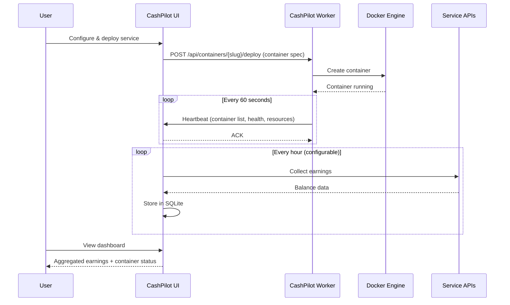

# Nasıl çalışır { #how-it-works }

CashPilot, ayrık bir **arayüz + worker** mimarisi kullanır. Arayüz Docker'a hiçbir zaman dokunmaz -- tüm konteyner işlemleri worker'lar üzerinden yapılır. Bu ayrım temel bir tasarım ilkesidir ve çok sunuculu filo yönetimini mümkün kılan şey de budur.

## Bileşenler { #components }

| Bileşen | İmaj | Port | Docker erişimi | Amaç |
|-----------|-------|:----:|:-------------:|---------|
| **CashPilot UI** | `drumsergio/cashpilot` | 8080 | Yok | Web panosu, kazanç toplama, hizmet kataloğu, kimlik bilgisi saklama, zamanlama |
| **CashPilot Worker** | `drumsergio/cashpilot-worker` | 8081 | `cashpilot-socket-proxy` üzerinden | Docker konteyner yaşam döngüsü, sağlık bildirimi, arayüze yaşam sinyalleri |

**Bağımsız bir mod yoktur**. Docker konteynerleri çalıştıran her sunucunun bir worker'a ihtiyacı vardır. Arayüz saf bir pano/zamanlayıcıdır -- Docker olmayan bir makine dahil herhangi bir makinede çalışabilir.

## Tasarım ilkeleri { #design-principles }

1. **Sorumlulukların ayrılması.** Arayüzün işi: pano, kazanç toplama, zamanlama, kullanıcı kimlik doğrulaması. Worker'ların işi: Docker konteyner yaşam döngüsü, sağlık bildirimi. Bu işler hiçbir zaman çakışmaz.
2. **Worker'ların soket proxy'si üzerinden Docker'a ihtiyacı vardır.** Docker erişimi olmayan bir worker işe yaramaz. Birlikte gelen compose dosyalarıyla worker ham soketi hiçbir zaman almaz: Docker'a `cashpilot-socket-proxy` üzerinden ulaşır. Unraid ve TrueNAS listeleri ham soketi hâlâ bağlar ([uygulama mağazaları](app-stores.md)). Docker yönetimine ihtiyacınız yoksa kazançları izlemek için yalnızca arayüzü çalıştırın.
3. **Tek doğruluk kaynağı.** Kazançları toplayan, geçmiş verileri saklayan ve panoyu sunan tek şey arayüz örneğidir. Worker'lar hiçbir zaman kazanç toplamaz.
4. **Kazançlar asla iki kez sayılmaz.** Yalnızca arayüz topladığı için aynı hesabın iki kez sayılma riski yoktur.
5. **Worker'lar durumsuz uydulardır.** Bir worker hangi konteynerleri çalışır tutacağını ve rapor vereceği arayüzün URL'sini bilir. Yerel dosyalarda yalnızca kendi ID'sini ve filo anahtarını saklar (`.worker_id`, `.worker_key`; veritabanı yok, kazanç verisi yok).
6. **Doğruluk YAML'dadır.** Her hizmet `services/{category}/{slug}.yml` içinde yaşar. Arayüz, dağıtım, belgeler ve compose dışa aktarımı bu dosyalardan türetilir.

## Dizin yapısı { #directory-structure }

```
cashpilot/
  app/                      # FastAPI application
    main.py                 # App entrypoint, lifespan, container/fleet/earnings routes
    deps.py                 # Shared auth guards + Jinja2 template environment
    routers/                # Route groups split out of main.py: auth, pages, users
    catalog.py              # Loads YAML service definitions, caches, SIGHUP reload
    orchestrator.py         # Docker SDK: deploy, stop, restart, remove, logs
    database.py             # Async SQLite: earnings, config, deployments, users, workers
    worker_api.py           # Worker REST API: heartbeat, container commands, mini-UI
    setup_token.py          # First-run setup-token gate (owner-account creation)
    metrics.py              # Optional Prometheus metrics (/metrics)
    exchange_rates.py       # Crypto/fiat conversion via CoinGecko + Frankfurter
    collectors/             # Earnings collectors (one module per service, UI only)
      base.py               # BaseCollector ABC + EarningsResult dataclass
      honeygain.py          # Example: JWT auth + balance endpoint
      __init__.py           # COLLECTOR_MAP registry + make_collectors() factory
    templates/              # Jinja2: dashboard, fleet, catalog, setup wizard, payouts, settings
    static/
      css/style.css         # Classic night by default, plus dark, light, sunrise and warm
      js/app.js             # Vanilla JS, CP namespace, Chart.js, wizard state machine
  services/                 # YAML service definitions (SINGLE SOURCE OF TRUTH)
    _schema.yml             # Schema documentation
    bandwidth/              # Bandwidth sharing services
    depin/                  # DePIN services
    storage/                # Storage sharing services
    compute/                # GPU compute services
    mining/                 # Mining services
  docs/                     # Documentation and guides
    guides/                 # Per-service setup guides
  Dockerfile                # UI image: multi-stage python:3.15-alpine, su-exec, non-root
  Dockerfile.worker         # Worker image: minimal deps, no collectors/templates
  docker-compose.yml        # Single-server deployment
  docker-compose.fleet.yml  # Multi-server fleet deployment
```

## Veri akışı { #data-flow }



### Yaşam sinyali (worker'dan arayüze) { #heartbeat-worker-to-ui }

Her worker 60 saniyede bir şunları gönderir:

- Durumlarıyla birlikte konteyner listesi (çalışıyor, durduruldu, çıktı)
- Konteyner başına kaynak kullanımı (CPU yüzdesi, MB cinsinden bellek)
- Sistem bilgisi (işletim sistemi, mimari, ana makine adı, Docker'ın kullanılabilirliği)
- Kendi bildirdiği URL (açıkça ayarlanmış `CASHPILOT_WORKER_URL` ya da otomatik algılanan bir yedek değer)

Arayüz bunu SQLite veritabanında saklar ve **Fleet** (Filo) sayfasında gösterir.

### Komutlar (arayüzden worker'a) { #commands-ui-to-worker }

Arayüz herhangi bir worker'a şunları yaptırabilir:

- Bir hizmet konteynerini **dağıtmak** (tam tanım: imaj, ortam değişkenleri, birimler, portlar)
- Bir konteyneri **durdurmak**, **başlatmak**, **yeniden başlatmak** veya **kaldırmak**
- Bir konteynerden **günlükleri almak**

Komutlar, arayüzden worker'a REST API çağrılarıyla gönderilir.

### Kimlik bilgisi akışı { #credential-flow }

Worker **kimlik bilgilerini hiçbir zaman işlemez veya saklamaz**:

1. Kullanıcı hizmetin kimlik bilgilerini arayüzde yapılandırır (SQLite'ta şifrelenmiş olarak saklanır).
2. Dağıtım sırasında arayüz, tam konteyner tanımını (ortam değişkenleri dahil) worker'a gönderir.
3. Worker tanımı Docker API'sine iletir. Docker ortam değişkenlerini konteyner yapılandırmasında saklar.
4. Yeniden başlatmalarda: `docker restart` ortam değişkenlerini doğal olarak korur.
5. Tam yeniden dağıtımlarda (kaldır + oluştur): arayüz tam tanımı yeniden gönderir.

### Kazanç toplama { #earnings-collection }

Arayüz, yapılandırılan her hizmet için zamanlanmış toplayıcılar çalıştırır:

- **Otomatik toplayıcılar**, toplayıcısı olan sağlayıcılar için bakiyeleri hizmet API'leri üzerinden çeker (JWT kimlik doğrulaması, çerez kimlik doğrulaması, API anahtarları)
- Sonuçlar SQLite'ta yerel para birimiyle (USD, MYST, GRASS, STORJ vb.) saklanır
- Döviz kurları CoinGecko'dan (kripto) ve Frankfurter'dan (itibari para) çekilir, 15 dakika önbelleğe alınır
- Her okuma, alındığı günün USD kurunu saklar. Kur olmadan saklanmış bir kripto okuması (kur sütunundan daha eski) kendi gününün fiyatını CoinGecko'nun günlük geçmişinden başlangıçta ve günde bir kez alır; fiyatı olmayan bir gün fiyatsız kalır
- Pano, değerleri dönüştürür ve kullanıcının tercih ettiği para biriminde gösterir

## Teknoloji yığını { #tech-stack }

| Teknoloji | Amaç |
|---|---|
| FastAPI | Arka uç çatısı (Python 3.15, async) |
| Jinja2 | Sunucuda oluşturulan HTML şablonları |
| SQLite | Veritabanı (aiosqlite, yapılandırma gerektirmez, `/data` içinde saklanır) |
| Docker SDK for Python | Soket üzerinden konteyner yaşam döngüsü yönetimi |
| PyYAML | Hizmet tanımlarının ayrıştırılması |
| APScheduler | Düzenli kazanç toplama |
| httpx | Kazanç toplayıcıları için async HTTP istemcisi |
| cryptography (Fernet) | Saklanan kimlik bilgilerinin diskte şifrelenmesi |
| Chart.js | Ön yüzdeki kazanç grafikleri |
| su-exec | Giriş noktası kurulumundan sonra root yetkisini `cashpilot` kullanıcısına düşürür (Dockerfile) |

## Veritabanı { #database }

400 günlük veri saklama süresiyle SQLite. Başlıca tablolar:

- **earnings** -- Hizmet başına geçmiş kazançlar (zaman damgası, slug, bakiye, para birimi)
- **deployments** -- Etkin konteyner dağıtımları (slug, konteyner ID'si, şifrelenmiş ortam değişkenleri, durum)
- **config** -- Anahtar-değer ayarları ve şifrelenmiş kimlik bilgileri
- **users** -- Hesaplar (kullanıcı adı, bcrypt parola özeti, rol)
- **user_preferences** -- Kullanıcı başına ilk kurulum durumu (kurulum modu, seçilen kategoriler, saat dilimi)
- **health_events** -- Konteyner sağlık geçmişi (start, stop, crash, check_ok, check_down)
- **workers** -- Filodaki worker'ların kaydı (istemci ID'si, ad, URL, durum, son yaşam sinyali, worker başına şifrelenmiş filo anahtarı)

## Güvenlik modeli { #security-model }

- Tüm kimlik bilgileri diskte Fernet simetrik şifrelemesiyle şifrelenir
- Worker'dan arayüze kimlik doğrulama worker başına filo anahtarlarıyla yapılır (`CASHPILOT_API_KEY` yalnızca kayıt/önyükleme kimlik bilgisidir)
- Yönetilen konteynerler `--security-opt no-new-privileges` ile çalışır
- Konteyner adlandırma kuralı: `cashpilot.managed=true` etiketli `cashpilot-{slug}`
- Arayüz konteynerinin Docker soketine erişimi **yoktur**
- Rol sistemiyle (sahip/düzenleyici/görüntüleyici) oturum tabanlı kimlik doğrulama
