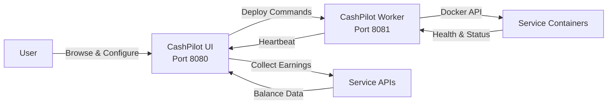

# Перші кроки { #getting-started }

## Передумови { #prerequisites }

- **Docker** із **плагіном Compose v2 версії 2.23.1 або новішої**. Перевірте
  це командою `docker compose version`. Старіші версії не вміють читати вбудовану
  конфігурацію у файлі compose. Docker Desktop уже містить цей плагін. На «голому» Docker
  Engine у Linux встановіть його з репозиторію пакетів Docker
  (<https://docs.docker.com/compose/install/linux/>). На macOS з Colima
  встановіть його через Homebrew і під'єднайте як плагін Docker:

    ```sh
    brew install docker-compose
    mkdir -p ~/.docker/cli-plugins
    ln -sfn "$(brew --prefix)/opt/docker-compose/bin/docker-compose" ~/.docker/cli-plugins/docker-compose
    ```

- Хост на Linux, macOS або Windows (amd64 або arm64)
- Щонайменше 1 GB вільної RAM для CashPilot і сервісів, якими він керує
- **Один CashPilot на один хост Docker.** Див. попередження нижче.

!!! warning "Один CashPilot на один хост Docker"
    Не запускайте дві інсталяції CashPilot на одному хості Docker. Файли compose
    використовують фіксовані імена контейнерів (`cashpilot-ui`, `cashpilot-worker`,
    `cashpilot-socket-proxy`), тому друга копія файлу не запуститься через конфлікт
    імен. Якщо ви перейменуєте їх, щоб обійти це, дві інсталяції однаково
    ділитимуть один хост. Кожен воркер керує всіма контейнерами з мітками
    CashPilot, хоч би яка інсталяція їх створила. Тож кожна панель показує,
    зупиняє й замінює застосунки для заробітку іншої. Дві інсталяції також ділять
    мережу `cashpilot-isolated`, імена застосунків для заробітку (`cashpilot-<service>`),
    їхні порти на хості та томи, як-от `mysterium-data`. Для другої
    інсталяції використайте інший хост або VM. Щоб запускати застосунки для заробітку на більшій кількості серверів,
    натомість додайте воркери до однієї панелі ([Парк](fleet.md)).

## Швидкий старт { #quick-start }

### 1. Завантажте файл compose і запустіть { #1-fetch-the-compose-file-and-launch }

```bash
curl -fsSLO https://raw.githubusercontent.com/GeiserX/CashPilot/main/docker-compose.yml
docker compose up -d
```

Це запускає три контейнери, що працюють постійно. Перед ними одноразовий
`cashpilot-migrate` запускається й завершується з кодом 0 при кожному `up`, тому
`docker compose ps -a` показує його як `Exited (0)`. Це нормально.

| Контейнер | Порт | Призначення |
|-----------|------|---------|
| **cashpilot-migrate** | немає | Запускається один раз і завершується. Переносить дані, створені старішим випуском, на томи, які приймає проксі сокета, а на новій інсталяції не знаходить нічого для роботи |
| **cashpilot-ui** | 8080 | Вебпанель, збирання заробітку, каталог сервісів |
| **cashpilot-worker** | 8081 | Агент Docker, який розгортає контейнери сервісів і стежить за ними |
| **cashpilot-socket-proxy** | немає | Тримає сокет Docker лише для читання і дає воркеру відфільтровану копію ([Типові параметри безпеки](security-defaults.md)) |

### 2. Відкрийте панель { #2-open-the-dashboard }

Відкрийте у браузері [http://localhost:8080](http://localhost:8080). Оскільки облікового запису ще немає, ви потрапите на сторінку привітання, яка створює акаунт власника.

!!! tip "Порт 8080 уже зайнятий?"
    Виберіть інший порт хоста у файлі `.env` поруч із `docker-compose.yml`,
    а не редагуйте файл compose:

    ```bash
    printf '\nCASHPILOT_UI_PORT=8088\n' >> .env
    docker compose up -d
    ```

    Потім відкрийте http://localhost:8088. Залиште значення в `.env`, бо
    оновлення із застосунку читає цей файл, а не вашу оболонку. (`printf` починається
    з нового рядка, щоб цей рядок ніколи не злився з останнім рядком наявного `.env`.)

    Змінна потребує `docker-compose.yml`, у якому рядок `ports:` має вигляд
    `${CASHPILOT_UI_PORT:-8080}:8080`. Файл версії v1.61 і старіших жорстко задає
    `8080:8080` та ігнорує її. Завантажте поточний файл або
    залиште власне відредаговане зіставлення портів: оновлення із застосунку приймає і його.

!!! warning "Потрібен токен первинного налаштування"
    Під час першого запуску CashPilot генерує одноразовий токен налаштування і виводить його в журнали контейнера **cashpilot-ui**:

    ```bash
    docker compose logs cashpilot-ui
    ```

    Шукайте рядок на кшталт:

    ```
    FIRST-RUN SETUP: no account exists yet. Open /register and enter this
    one-time setup token to create the owner account: <token>
    ```

    Скопіюйте цей токен у поле **Setup token** (Токен налаштування) на кроці **Owner account** (Акаунт власника) сторінки привітання разом з іменем користувача та паролем, щоб створити перший акаунт (власника). Він з'являється лише в журналах, ніколи в URL, і назавжди відкидається, щойно акаунт власника створено.

### 3. Перегляньте каталог сервісів { #3-browse-the-service-catalog }

Сторінка **Catalog** (Каталог) показує кожен сервіс із його платформами, місячною оцінкою та тим, що йому потрібно (домашня IP, GPU). Фільтруйте за категорією (**Bandwidth** (Трафік), **DePIN** (DePIN), **Storage** (Сховище), **Compute** (Обчислення), **Mining** (Майнінг)) або шукайте за назвою. **Add** (Додати) відкриває майстер налаштування для цього сервісу, **Details** (Подробиці) показує його опис, виплати й ризик розгортання, а сервіси, які не працюють у Docker, натомість отримують посилання **Visit** (Відвідати).

Два типи сервісів варто спершу роздивитися уважніше: сервіси, які платять лише після того, як ви заблокуєте стейк токенів, як-от Anyone Protocol, Sia і Flux, а також релеї, що публікують вашу IP, через що застосунки для поширення домашнього трафіку можуть платити вам менше. Див. [Перевірте дві речі перед розгортанням](guides/index.md).

### 4. Додайте сервіси за допомогою майстра { #4-add-services-with-the-wizard }

Щойно акаунт власника створено, **Add services** (Додати сервіси) відкриває майстер налаштування; пізніше кнопка **+ Add service** (+ Додати сервіс) у верхній панелі відкриває його знову. Виберіть категорії, потім сервіси. Для кожного сервісу майстер показує посилання **Sign Up** (Зареєструватися), запитує лише ті облікові дані, які потрібні цьому сервісу (email і пароль, API-токен тощо), і дає змогу вибрати воркери, на яких його запускати. Натисніть **Deploy** (Розгорнути), і CashPilot завантажить образ, створить контейнер і почне стежити за ним.

### 5. Стежте за ним на панелі { #5-watch-it-on-the-dashboard }

Панель показує кожен розгорнутий сервіс із його статусом і балансом, а сторінка **Fleet** (Парк) показує кожен воркер.

## Як це працює { #how-it-works }



1. **Ви налаштовуєте** сервіси через вебінтерфейс -- вибираєте сервіс, вводите облікові дані, натискаєте «розгорнути».
2. **UI надсилає** специфікацію контейнера (образ, змінні середовища, томи) воркеру через REST API.
3. **Воркер створює** контейнер Docker і починає стежити за його працездатністю.
4. **Воркер повідомляє** UI про статус контейнера кожні 60 секунд через сигнали активності.
5. **UI збирає** заробіток з API сервісів за налаштовуваним розкладом (типово: щогодини).
6. **Панель** показує сукупний заробіток, розбивку за сервісами та працездатність контейнерів.

## Конфігурація { #configuration }

### Змінні середовища UI { #ui-environment-variables }

| Змінна | Типово | Опис |
|----------|---------|-------------|
| `TZ` | `UTC` | Часовий пояс для розкладу та відображення |
| `CASHPILOT_SECRET_KEY` | *(генерується автоматично)* | Ключ підпису для сеансів входу. Зберігається в `/data/.secret_key`. **Не шифрує облікові дані** |
| `CASHPILOT_ENCRYPTION_KEY` | *(генерується автоматично)* | Ключ Fernet, що шифрує збережені облікові дані на диску. Зберігається в `/data/.fernet_key`. Застосовується лише тоді, коли цього файлу немає, тож задавайте його лише для відновлення резервної копії |
| `CASHPILOT_API_KEY` | *(з `/fleet`)* | Спільний ключ підключення для воркерів. Кожен воркер отримує власний ключ, коли підключається; див. [Парк](fleet.md) |
| `CASHPILOT_COLLECT_INTERVAL` | `60` | Хвилини між циклами збирання заробітку |
| `CASHPILOT_UI_PORT` | `8080` | Порт хоста, на якому опубліковано UI. Задайте його в `.env`, коли 8080 зайнятий |
| `CASHPILOT_BIND_ADDR` | `127.0.0.1` | Інтерфейс хоста, на якому опубліковано порт UI. **Типово loopback**: панель може віддавати команди воркеру з доступом до сокета Docker, тому з коробки вона не відкрита для вашої мережі. Задайте конкретну IP (наприклад, адресу Tailscale/VPN) або `0.0.0.0`, щоб відкрити її, або (краще) поставте перед нею зворотний проксі з автентифікацією |

Вебпорт UI всередині контейнера фіксований: `8080` (задається через `CMD` контейнера). `CASHPILOT_UI_PORT` і `CASHPILOT_BIND_ADDR` вибирають лише порт хоста та інтерфейс, на яких його опубліковано.

### Змінні середовища воркера { #worker-environment-variables }

| Змінна | Типово | Опис |
|----------|---------|-------------|
| `TZ` | `UTC` | Часовий пояс |
| `CASHPILOT_UI_URL` | -- | URL контейнера UI, наприклад `http://cashpilot-ui:8080` |
| `CASHPILOT_API_KEY` | -- | Має збігатися з ключем підключення UI. Потрібен лише для підключення; потім воркер використовує власний ключ |
| `CASHPILOT_WORKER_NAME` | *(ім'я хоста)* | Відображуване ім'я цього воркера на панелі парку |
| `CASHPILOT_WORKER_URL` | *(визначається автоматично)* | URL, за яким UI звертається до цього воркера, наприклад `http://192.168.1.50:8081`. Задавайте явно для парків на кількох хостах: автовизначення може повідомити недосяжну внутрішню IP контейнера |
| `CASHPILOT_WORKER_BIND_ADDR` | `127.0.0.1` | **Лише compose для парку та віддаленого воркера** (`docker-compose.fleet.yml`): інтерфейс хоста, на якому опубліковано порт API воркера з доступом до сокета Docker, типово loopback. Типовий `docker-compose.yml` взагалі не публікує порт 8081. API воркера може розгортати й зупиняти будь-який контейнер (= root на хості), тож для віддаленого воркера прив'язуйте його до приватного/VPN-інтерфейсу (наприклад, IP Tailscale), **ніколи** до публічної IP |
| `CASHPILOT_PORT` | `8081` | Порт, який воркер **повідомляє** UI. Він *не* змінює порт прослуховування, який фіксує `CMD` образу; див. [довідник із конфігурації](configuration.md) |

### Приклад Docker Compose { #docker-compose-example }

```yaml
--8<-- "docker-compose.yml"
```

!!! note "Це справжній файл"

    Блок вище дослівно включено з `docker-compose.yml` у
    репозиторії, тому він не може розійтися з тим, що насправді постачається. Раніше
    скопійована вручну версія публікувала API воркера з доступом до сокета Docker на всіх
    інтерфейсах і закріплювала `:latest`, а сторінка
    [типових параметрів безпеки](security-defaults.md) радить не робити ні того, ні іншого.

!!! warning "Доступ до сокета Docker"
    Воркер керує контейнерами сервісів через Docker, але не монтує `/var/run/docker.sock`. Контейнер `cashpilot-socket-proxy` тримає сокет і пропускає до нього лише ті виклики воркера, які той робить, відхиляючи привілейовані контейнери та прив'язки тек хоста, яких ви не вказали ([що він відхиляє](security-defaults.md#docker-socket-proxy)). Оновлення із застосунку вмикається вручну: воно працює лише з `CASHPILOT_COMPOSE_DIR=<this folder>` у `.env` поруч із файлом compose, і цей параметр дозволяє контейнерам прив'язувати цю теку, що послаблює проксі ([чого це коштує](security-defaults.md#docker-socket-proxy)). Не задавайте його й оновлюйте командою `docker compose pull && docker compose up -d`. Воркер однаково керує кожним контейнером на хості, тому для найкращої безпеки запускайте CashPilot на окремій машині або у VLAN.

!!! tip "Збереження секретного ключа"
    Облікові дані шифруються ключем `CASHPILOT_ENCRYPTION_KEY`, **а не** `CASHPILOT_SECRET_KEY`, який лише підписує сеанси входу. Ключ шифрування генерується автоматично під час першого запуску і зберігається в `/data/.fernet_key`. **Зробіть резервну копію цього файлу.** Якщо том буде створено заново без нього, згенерується новий ключ, і всі збережені облікові дані назавжди стануть нечитабельними. `CASHPILOT_ENCRYPTION_KEY` задають для відновлення цієї резервної копії; файл ключа завжди має пріоритет, тож якщо задати змінну на працездатному екземплярі, нічого не зміниться.

!!! tip "Паролі та секрети в UI"
    Змінити власний пароль можна будь-коли в меню аватара -> **Change password** (Змінити пароль) (доступно всім ролям); це завершує ваші інші сеанси. У **Settings** (Налаштування) збережені секрети доступні лише для запису: введіть значення, щоб змінити його, або залиште поле порожнім, щоб зберегти наявне. Збережені облікові дані ніколи не надсилаються назад у браузер.

## Оновлення CashPilot { #updating-cashpilot }

Файл compose закріплює серію major.minor, як-от `drumsergio/cashpilot:X.Y`, тому `pull` завантажує найновіший патч цієї серії:

```bash
docker compose pull
docker compose up -d
```

`docker compose pull` завантажує найновіший опублікований образ, а `up -d` створює заново
лише ті контейнери, чий образ змінився. Файли compose, що постачаються, задають
`pull_policy: always`, тому навіть проста команда `docker compose up -d` спершу завантажить
найновіший образ.

**З панелі.** **Settings** (Налаштування), **About and updates** (Про програму та оновлення) виконує ці самі дві
команди за вас із короткочасного допоміжного контейнера. Допоміжний контейнер читає ваші
файли compose і `.env` поруч із ними (або файли, які ви передали через
`--env-file`), але ніколи не оболонку, з якої ви запустили CashPilot. Припустімо, ви запустили його командою `CASHPILOT_UI_PORT=8088 docker compose up -d`.
Оновлення повернуло б панель на 8080, тому воно зупиняється і пояснює чому.
Запишіть це значення в `.env`, і кнопка запрацює.

!!! note "Перезбирати **не** потрібно"
    CashPilot постачає готові багатоархітектурні образи на Docker Hub
    ([`drumsergio/cashpilot`](https://hub.docker.com/r/drumsergio/cashpilot),
    [`drumsergio/cashpilot-worker`](https://hub.docker.com/r/drumsergio/cashpilot-worker)).
    `docker compose build` / `--build` мають сенс, лише якщо ви свідомо
    збираєте з вихідного коду за допомогою `docker-compose.build.yml`. Для звичайних інсталяцій
    `pull` + `up -d` — це повна й правильна процедура оновлення.

### Закріплення конкретної версії { #pinning-a-specific-version }

Щоб залишатися на одному точному випуску, замініть тег серії `X.Y` у
`docker-compose.yml` на повний тег випуску `X.Y.Z` і для
`drumsergio/cashpilot`, і для `drumsergio/cashpilot-worker` (завжди однаковий тег для
обох) та видаліть `pull_policy: always`. Теги можна переглянути на
[Docker Hub](https://hub.docker.com/r/drumsergio/cashpilot/tags).

Щоб перейти на новішу серію, змініть обидва теги: спершу на хості UI, потім на
кожному хості воркера. Спочатку прочитайте
[UPGRADING.md](https://github.com/GeiserX/CashPilot/blob/main/UPGRADING.md),
бо мажорний випуск, як-от 3.0, має власні кроки.

### Автоматизація оновлень (необов'язково) { #automating-updates-optional }

Якщо ви хочете оновлень без власної участі, налаштуйте планувальник на ті самі дві команди,
наприклад щоденним записом cron:

```cron
0 4 * * *  cd /path/to/cashpilot && docker compose pull && docker compose up -d
```

Або запустіть для контейнерів CashPilot засіб автооновлення, як-от [Watchtower](https://containrrr.dev/watchtower/)
чи [Diun](https://crazymax.dev/diun/). Це
необов'язково. CashPilot не містить вбудованого засобу оновлення.

### Прибирання старих образів { #cleaning-up-old-images }

CashPilot завантажує образи, але ніколи їх не видаляє. Кожне оновлення і кожне перерозгортання
може залишити попередній образ на диску. На тестовому парку з трьох серверів старі
образи CashPilot і застосунків для заробітку разом займали близько 3 GB. Це небагато порівняно
з тим, що зазвичай залишають інші програми на тому самому хості, тож дивіться на
весь хост:

```bash
docker system df
```

Значення `RECLAIMABLE` у рядку `Images` — це те, що Docker може звільнити.

**Чому CashPilot не робить цього за вас.** Воркер звертається до Docker через
проксі сокета. Щодо образів проксі дозволяє йому завантажити образ і прочитати образ за іменем,
і більше нічого. Він не може переглянути список образів хоста чи видалити образ. Воркер, який
міг би це робити, також бачив би й видаляв би образи всіх інших програм на хості.
Див. [що відхиляє проксі](security-defaults.md#docker-socket-proxy).

**Крок 1: видаліть «висячі» образи.** «Висячий» образ не має тегу, і жоден
контейнер його не використовує, ні запущений, ні зупинений. Оновлення через рухомий тег, як-от
`X.Y` (серія, як та, що її закріплюють файли compose), `latest` або дайджест, залишає саме такі образи:

```bash
docker image prune
```

Це також видаляє образ, який ви запускали до оновлення через рухомий тег: щойно
надходить новий образ цієї серії, старий утрачає тег. Щоб зберегти шлях назад, запишіть
точну версію перед оновленням (її видно внизу бічної панелі), щоб
ви могли знову завантажити `drumsergio/cashpilot:<X.Y.Z>`. Або закріпіть у файлі compose
точний тег `X.Y.Z`; тоді старий образ зберігає свій тег, і застосовується крок 2.

Docker питає, перш ніж видаляти. У записі cron додайте `--force`, щоб пропустити
запитання. Більше нічого це не змінює:

```cron
30 4 * * 0  docker image prune --force
```

!!! warning "Не додавайте `-a`"
    `docker image prune -a` видаляє кожен образ, який зараз не використовує жоден
    контейнер, «висячий» чи з тегом. Серед них образи стеків, які ви зупинили
    навмисно, і образи, які ви зібрали локально і не можете завантажити знову.

**Крок 2: видаліть старі закріплені теги.** Образ, закріплений за версією, зберігає свій тег
після переходу на новішу, тому `prune` його пропускає. Ці образи CashPilot
закріплені:

| Репозиторій | Що його закріплює |
|---|---|
| `drumsergio/cashpilot` | Файл compose (стара серія або точна версія, яку ви закріпили) |
| `drumsergio/cashpilot-worker` | Файл compose, так само, як вище |
| `drumsergio/cashpilot-tunnel` | Воркер, один тег на кожну версію воркера |
| `drumsergio/cashpilot-earnapp` | Запис EarnApp у каталозі |
| `drumsergio/cashpilot-anyone` | Запис Anyone Protocol у каталозі |

Те саме стосується образу сервісу, який ви видалили: його тег залишається, доки ви
його не видалите. Образ каталогу, закріплений за дайджестом, як-от MystNodes чи ProxyBase,
утрачає свій тег, коли його замінює новіший, тож його вже охоплює крок 1.

Спершу виведіть теги, які не використовує жоден контейнер. Цей приклад для образу воркера.
Для іншого репозиторію з таблиці змініть `repo`:

```bash
repo=drumsergio/cashpilot-worker
used=$(docker ps -a --format '{{.Image}}')
docker image ls "$repo" --format '{{.Repository}}:{{.Tag}}' | grep -vxF "$used"
```

Потім видаліть кожен старий тег за іменем, по одному:

```bash
docker image rm drumsergio/cashpilot-worker:<old tag>
```

Не додавайте `-f`. Без нього Docker відмовляється видаляти образ, який
досі використовує контейнер, запущений чи зупинений, і виводить
`conflict: unable to delete`. Побачивши це, залиште образ. Залиште тег,
який ви запускаєте, і тег, який запускали перед ним, щоб мати змогу повернутися на одну версію назад.
Видаляйте лише теги, старіші за ці два.

Стовпець **Host disk** (Диск хоста) на панелі показує вільне місце у файловій системі, яка
містить `/data` воркера. Образи зазвичай лежать у тій самій файловій системі, у
кореневому каталозі даних Docker, але не завжди. `docker info --format '{{.DockerRootDir}}'`
показує кореневий каталог даних Docker. Зі сховищем образів containerd, типовим для
нової інсталяції Docker Engine 29, образи натомість лежать у кореневому каталозі containerd,
зазвичай `/var/lib/containerd`. `docker info --format '{{.Driver}}'` виводить
`overlayfs` для сховища образів containerd і `overlay2` для класичного.
Перевірте вільне місце у файловій системі, що містить відповідний каталог.

## Підтримувані сервіси { #supported-services }

CashPilot підтримує **<!-- n:live -->50<!-- /n --> сервісів**, які активні або перебувають у беті, у п'яти категоріях:

- **Поширення трафіку** (<!-- n:bandwidth -->18<!-- /n -->): діліться своїм інтернет-трафіком заради пасивного доходу
- **DePIN** (<!-- n:depin -->15<!-- /n -->): децентралізовані мережі фізичної інфраструктури
- **Обчислення на GPU** (<!-- n:compute -->7<!-- /n -->): здавайте свій GPU в оренду для ШІ та обчислювальних навантажень
- **Сховище** (<!-- n:storage -->2<!-- /n -->): діліться місцем на диску в децентралізованих мережах зберігання
- **Майнінг** (<!-- n:mining -->8<!-- /n -->): розгорніть майнер або відстежуйте пул за адресою виплат ([Майнінг](mining.md))

З них **<!-- n:docker -->21<!-- /n -->** можна розгортати й керувати автоматично через Docker. Решту <!-- n:tracked -->29<!-- /n --> каталог лише відстежує (<!-- n:extension -->18<!-- /n --> браузерних або десктопних застосунків, <!-- n:gpu -->7<!-- /n --> вузлів GPU, <!-- n:mining_pools -->4<!-- /n --> майнінгових пулів). CashPilot читає їхні баланси там, де є збирач.

Повний каталог дивіться в розділі [Посібники із сервісів](guides/index.md).

## Наступні кроки { #next-steps }

- [Як це працює](how-it-works.md) -- Зрозумійте розподіл на UI та воркер
- [Керування парком](fleet.md) -- Розгортання на кількох серверах
- [Захист домашньої мережі](home-network-security.md) -- Тримайте контейнери поза вашою LAN і дізнайтеся, коли допомагає gVisor
- [Посібники із сервісів](guides/index.md) -- Докладні інструкції з налаштування кожного сервісу
- [Повне видалення CashPilot](uninstall.md) -- Видаліть усе, що він створив, щоб почати спочатку або піти
