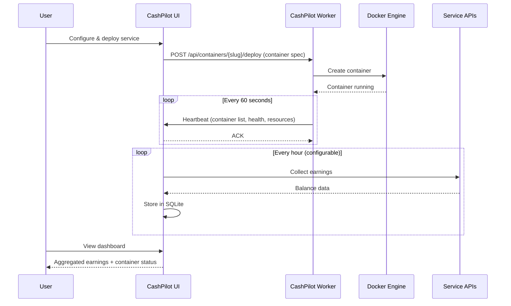

# Як це працює { #how-it-works }

CashPilot використовує розділену архітектуру **UI + воркер**. UI ніколи не торкається Docker -- усі операції з контейнерами проходять через воркери. Цей поділ є основним принципом дизайну, і саме він уможливлює керування парком із кількох серверів.

## Компоненти { #components }

| Компонент | Образ | Порт | Доступ до Docker | Призначення |
|-----------|-------|:----:|:-------------:|---------|
| **CashPilot UI** | `drumsergio/cashpilot` | 8080 | Немає | Вебпанель, збирання заробітку, каталог сервісів, зберігання облікових даних, розклад |
| **Воркер CashPilot** | `drumsergio/cashpilot-worker` | 8081 | Через `cashpilot-socket-proxy` | Життєвий цикл контейнерів Docker, звіти про працездатність, сигнали активності до UI |

**Автономного режиму немає**. Кожен сервер, на якому працюють контейнери Docker, потребує воркера. UI — це суто панель і планувальник -- він може працювати на будь-якій машині, зокрема без Docker.

## Принципи дизайну { #design-principles }

1. **Розподіл відповідальності.** UI відповідає за панель, збирання заробітку, розклад, автентифікацію користувачів. Воркери відповідають за життєвий цикл контейнерів Docker і звіти про працездатність. Їхні обов'язки ніколи не перетинаються.
2. **Воркерам потрібен Docker, через проксі сокета.** Воркер без доступу до Docker марний. З файлами compose, що постачаються, він ніколи не отримує «сирий» сокет: він звертається до Docker через `cashpilot-socket-proxy`. Пакети Unraid і TrueNAS досі монтують «сирий» сокет ([магазини застосунків](app-stores.md)). Якщо керування Docker вам не потрібне, просто запустіть лише UI, щоб відстежувати заробіток.
3. **Єдине джерело істини.** Екземпляр UI — єдиний, хто збирає заробіток, зберігає історичні дані та обслуговує панель. Воркери ніколи не збирають заробіток.
4. **Заробіток ніколи не дублюється.** Оскільки збирає лише UI, немає ризику, що той самий акаунт буде пораховано двічі.
5. **Воркери — це супутники без стану.** Воркер знає, які контейнери тримати запущеними, і URL UI, якому звітувати. Він зберігає в локальних файлах лише власний id і ключ парку (`.worker_id`, `.worker_key`; без бази даних, без даних про заробіток).
6. **YAML — це істина.** Кожен сервіс описано в `services/{category}/{slug}.yml`. UI, розгортання, документація та експорт compose походять із цих файлів.

## Структура каталогів { #directory-structure }

```
cashpilot/
  app/                      # FastAPI application
    main.py                 # App entrypoint, lifespan, container/fleet/earnings routes
    deps.py                 # Shared auth guards + Jinja2 template environment
    routers/                # Route groups split out of main.py: auth, pages, users
    catalog.py              # Loads YAML service definitions, caches, SIGHUP reload
    orchestrator.py         # Docker SDK: deploy, stop, restart, remove, logs
    database.py             # Async SQLite: earnings, config, deployments, users, workers
    worker_api.py           # Worker REST API: heartbeat, container commands, mini-UI
    setup_token.py          # First-run setup-token gate (owner-account creation)
    metrics.py              # Optional Prometheus metrics (/metrics)
    exchange_rates.py       # Crypto/fiat conversion via CoinGecko + Frankfurter
    collectors/             # Earnings collectors (one module per service, UI only)
      base.py               # BaseCollector ABC + EarningsResult dataclass
      honeygain.py          # Example: JWT auth + balance endpoint
      __init__.py           # COLLECTOR_MAP registry + make_collectors() factory
    templates/              # Jinja2: dashboard, fleet, catalog, setup wizard, payouts, settings
    static/
      css/style.css         # Classic night by default, plus dark, light, sunrise and warm
      js/app.js             # Vanilla JS, CP namespace, Chart.js, wizard state machine
  services/                 # YAML service definitions (SINGLE SOURCE OF TRUTH)
    _schema.yml             # Schema documentation
    bandwidth/              # Bandwidth sharing services
    depin/                  # DePIN services
    storage/                # Storage sharing services
    compute/                # GPU compute services
    mining/                 # Mining services
  docs/                     # Documentation and guides
    guides/                 # Per-service setup guides
  Dockerfile                # UI image: multi-stage python:3.15-alpine, su-exec, non-root
  Dockerfile.worker         # Worker image: minimal deps, no collectors/templates
  docker-compose.yml        # Single-server deployment
  docker-compose.fleet.yml  # Multi-server fleet deployment
```

## Потік даних { #data-flow }



### Сигнал активності (від воркера до UI) { #heartbeat-worker-to-ui }

Кожні 60 секунд кожен воркер надсилає:

- Список контейнерів зі статусом (запущений, зупинений, завершений)
- Використання ресурсів кожним контейнером (відсоток CPU, пам'ять у MB)
- Відомості про систему (ОС, архітектура, ім'я хоста, доступність Docker)
- Свій URL, який він сам повідомляє (явний `CASHPILOT_WORKER_URL` або автоматично визначений запасний варіант)

UI зберігає це у своїй базі даних SQLite і показує на сторінці **Fleet** (Парк).

### Команди (від UI до воркера) { #commands-ui-to-worker }

UI може доручити будь-якому воркеру:

- **Deploy** (Розгорнути) контейнер сервісу (повна специфікація: образ, змінні середовища, томи, порти)
- **Stop** (Зупинити), **start** (запустити), **restart** (перезапустити) або **remove** (видалити) контейнер
- **Fetch logs** (Отримати журнали) контейнера

Команди надсилаються викликами REST API від UI до воркера.

### Потік облікових даних { #credential-flow }

Воркер **ніколи не обробляє і не зберігає облікові дані**:

1. Користувач налаштовує облікові дані сервісу в UI (вони зберігаються зашифрованими в SQLite).
2. Під час розгортання UI надсилає воркеру повну специфікацію контейнера (зокрема змінні середовища).
3. Воркер передає специфікацію в Docker API. Docker зберігає змінні середовища в конфігурації контейнера.
4. Для перезапусків: `docker restart` зберігає змінні середовища засобами самого Docker.
5. Для повних перерозгортань (видалення + створення): UI повторно надсилає повну специфікацію.

### Збирання заробітку { #earnings-collection }

UI запускає за розкладом збирачі для кожного налаштованого сервісу:

- **Автоматичні збирачі** отримують баланси через API сервісів (автентифікація JWT, через cookie, API-ключі) для тих провайдерів, які їх мають
- Результати зберігаються в SQLite у рідній валюті (USD, MYST, GRASS, STORJ тощо)
- Курси обміну беруться з CoinGecko (криптовалюти) і Frankfurter (фіатні валюти), кешуються на 15 хвилин
- Кожен показник зберігає курс USD на день, коли його зняли. Криптовалютний показник, збережений без нього (старший за стовпець курсу), отримує ціну свого дня з денної історії CoinGecko під час запуску і раз на день; день без ціни залишається без оцінки
- Панель перераховує й показує суми в бажаній валюті користувача

## Технологічний стек { #tech-stack }

| Технологія | Призначення |
|---|---|
| FastAPI | Бекенд-фреймворк (Python 3.15, async) |
| Jinja2 | HTML-шаблони, що рендеряться на сервері |
| SQLite | База даних (aiosqlite, без налаштування, зберігається в `/data`) |
| Docker SDK for Python | Керування життєвим циклом контейнерів через сокет |
| PyYAML | Розбір визначень сервісів |
| APScheduler | Періодичне збирання заробітку |
| httpx | Асинхронний HTTP-клієнт для збирачів заробітку |
| cryptography (Fernet) | Шифрування збережених облікових даних на диску |
| Chart.js | Графіки заробітку у фронтенді |
| su-exec | Знижує права з root до користувача `cashpilot` після налаштування в entrypoint (Dockerfile) |

## База даних { #database }

SQLite зі зберіганням даних 400 днів. Основні таблиці:

- **earnings** -- Історичний заробіток за сервісами (позначка часу, slug, баланс, валюта)
- **deployments** -- Активні розгортання контейнерів (slug, ID контейнера, зашифровані змінні середовища, статус)
- **config** -- Налаштування ключ-значення та зашифровані облікові дані
- **users** -- Акаунти (ім'я користувача, хеш пароля bcrypt, роль)
- **user_preferences** -- Стан онбордингу для кожного користувача (режим налаштування, вибрані категорії, часовий пояс)
- **health_events** -- Історія працездатності контейнерів (start, stop, crash, check_ok, check_down)
- **workers** -- Реєстр воркерів парку (ID клієнта, ім'я, URL, статус, останній сигнал активності, зашифрований ключ парку для кожного воркера)

## Модель безпеки { #security-model }

- Усі облікові дані зашифровані на диску симетричним шифруванням Fernet
- Автентифікація воркера в UI через ключі парку, окремі для кожного воркера (`CASHPILOT_API_KEY` — лише облікові дані для підключення та початкового запуску)
- Керовані контейнери працюють із `--security-opt no-new-privileges`
- Правило іменування контейнерів: `cashpilot-{slug}` з мітками `cashpilot.managed=true`
- Контейнер UI **не має** доступу до сокета Docker
- Автентифікація на основі сеансів із системою ролей (власник/редактор/спостерігач)
