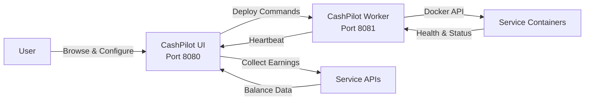

# Bắt đầu { #getting-started }

## Yêu cầu { #prerequisites }

- **Docker** với **plugin Compose v2, phiên bản 2.23.1 trở lên**. Kiểm tra
  bằng `docker compose version`. Các phiên bản cũ hơn không đọc được cấu hình
  nội tuyến trong file compose. Docker Desktop đã có sẵn plugin này. Trên Docker
  Engine thuần trên Linux, hãy cài nó từ kho gói của Docker
  (<https://docs.docker.com/compose/install/linux/>). Trên macOS dùng Colima,
  hãy cài nó bằng Homebrew rồi liên kết nó thành plugin của Docker:

    ```sh
    brew install docker-compose
    mkdir -p ~/.docker/cli-plugins
    ln -sfn "$(brew --prefix)/opt/docker-compose/bin/docker-compose" ~/.docker/cli-plugins/docker-compose
    ```

- Một máy chủ Linux, macOS hoặc Windows (amd64 hoặc arm64)
- Còn trống ít nhất 1 GB RAM cho CashPilot và các dịch vụ nó quản lý
- **Mỗi máy chủ Docker chỉ một CashPilot.** Xem cảnh báo bên dưới.

!!! warning "Mỗi máy chủ Docker chỉ một CashPilot"
    Đừng chạy hai bản cài CashPilot trên cùng một máy chủ Docker. Các file compose
    dùng tên container cố định (`cashpilot-ui`, `cashpilot-worker`,
    `cashpilot-socket-proxy`), nên bản sao thứ hai của file sẽ lỗi vì trùng
    tên. Nếu bạn đổi tên để tránh lỗi đó, hai bản cài vẫn dùng chung
    máy chủ. Mỗi worker quản lý mọi container mang nhãn của
    CashPilot, bất kể bản cài nào đã tạo ra nó. Vì vậy mỗi bảng điều khiển sẽ liệt kê,
    dừng và thay thế các ứng dụng kiếm tiền của bản kia. Hai bản cài còn dùng chung
    mạng `cashpilot-isolated`, tên các ứng dụng kiếm tiền (`cashpilot-<service>`),
    cổng trên máy chủ và các volume như `mysterium-data`. Với bản cài thứ hai,
    hãy dùng một máy chủ hoặc VM khác. Để chạy ứng dụng kiếm tiền trên nhiều máy chủ hơn, hãy thêm
    worker vào một bảng điều khiển duy nhất ([Đội máy](fleet.md)).

## Bắt đầu nhanh { #quick-start }

### 1. Tải file compose và khởi chạy { #1-fetch-the-compose-file-and-launch }

```bash
curl -fsSLO https://raw.githubusercontent.com/GeiserX/CashPilot/main/docker-compose.yml
docker compose up -d
```

Lệnh này khởi động ba container chạy lâu dài. Trước chúng, container chạy một lần
`cashpilot-migrate` chạy và thoát với mã 0 ở mỗi lần `up`, nên
`docker compose ps -a` hiển thị nó là `Exited (0)`. Điều đó là bình thường.

| Container | Cổng | Mục đích |
|-----------|------|---------|
| **cashpilot-migrate** | không có | Chạy một lần rồi thoát. Nó chuyển dữ liệu mà một bản phát hành cũ đã tạo sang các volume mà socket proxy chấp nhận, và không có gì để làm trên bản cài mới |
| **cashpilot-ui** | 8080 | Bảng điều khiển web, thu thập thu nhập, danh mục dịch vụ |
| **cashpilot-worker** | 8081 | Agent Docker triển khai và giám sát container của các dịch vụ |
| **cashpilot-socket-proxy** | không có | Giữ Docker socket ở chế độ chỉ đọc và đưa cho worker một bản đã lọc ([Mặc định bảo mật](security-defaults.md)) |

### 2. Mở bảng điều khiển { #2-open-the-dashboard }

Mở [http://localhost:8080](http://localhost:8080) trong trình duyệt. Vì chưa có tài khoản nào, bạn sẽ đến trang chào mừng, nơi tạo tài khoản chủ sở hữu.

!!! tip "Cổng 8080 đã bị dùng?"
    Chọn một cổng khác trên máy chủ trong file `.env` nằm cạnh `docker-compose.yml`,
    thay vì sửa file compose:

    ```bash
    printf '\nCASHPILOT_UI_PORT=8088\n' >> .env
    docker compose up -d
    ```

    Sau đó mở http://localhost:8088. Hãy giữ giá trị này trong `.env`, vì
    bản cập nhật trong ứng dụng đọc file đó chứ không đọc shell của bạn. (`printf` bắt đầu bằng
    một ký tự xuống dòng để dòng mới không bao giờ dính vào dòng cuối của một `.env` đã có.)

    Biến này cần một `docker-compose.yml` có dòng `ports:` là
    `${CASHPILOT_UI_PORT:-8080}:8080`. File của v1.61 trở về trước ghi cứng
    `8080:8080` và bỏ qua biến này. Hãy tải file hiện tại, hoặc
    giữ ánh xạ cổng bạn đã tự sửa: bản cập nhật trong ứng dụng cũng chấp nhận cách đó.

!!! warning "Cần mã thiết lập cho lần chạy đầu"
    Ở lần khởi động đầu tiên, CashPilot tạo một mã thiết lập dùng một lần và in nó ra nhật ký của container **cashpilot-ui**:

    ```bash
    docker compose logs cashpilot-ui
    ```

    Tìm một dòng giống như:

    ```
    FIRST-RUN SETUP: no account exists yet. Open /register and enter this
    one-time setup token to create the owner account: <token>
    ```

    Sao chép mã đó vào trường **Setup token** (Mã thiết lập) ở bước **Owner account** (Tài khoản chủ sở hữu) của trang chào mừng, cùng với tên người dùng và mật khẩu, để tạo tài khoản đầu tiên (chủ sở hữu). Mã này chỉ hiện trong nhật ký, không bao giờ trong URL, và bị hủy vĩnh viễn khi tài khoản chủ sở hữu đã tồn tại.

### 3. Xem danh mục dịch vụ { #3-browse-the-service-catalog }

Trang **Catalog** (Danh mục) liệt kê mọi dịch vụ cùng các nền tảng, mức ước tính hằng tháng và những gì nó cần (IP dân cư, GPU). Lọc theo nhóm (**Bandwidth** (Băng thông), **DePIN** (DePIN), **Storage** (Lưu trữ), **Compute** (Điện toán), **Mining** (Đào coin)) hoặc tìm theo tên. **Add** (Thêm) mở trình hướng dẫn cài đặt cho dịch vụ đó, **Details** (Chi tiết) hiển thị mô tả, các khoản thanh toán và rủi ro khi triển khai, còn các dịch vụ không chạy trong Docker có liên kết **Visit** (Truy cập) thay thế.

Có hai loại dịch vụ cần xem kỹ trước: các dịch vụ chỉ trả tiền sau khi bạn khóa một khoản stake token, như Anyone Protocol, Sia và Flux, và các relay công khai IP của bạn, điều có thể làm giảm số tiền các ứng dụng băng thông dân cư trả cho bạn. Xem [Kiểm tra hai điều trước khi triển khai](guides/index.md).

### 4. Thêm dịch vụ bằng trình hướng dẫn { #4-add-services-with-the-wizard }

Khi tài khoản chủ sở hữu đã tồn tại, **Add services** (Thêm dịch vụ) mở trình hướng dẫn cài đặt; về sau, nút **+ Add service** (+ Thêm dịch vụ) trên thanh trên cùng sẽ mở lại nó. Chọn các nhóm, rồi chọn dịch vụ. Với mỗi dịch vụ, trình hướng dẫn hiển thị một liên kết **Sign Up** (Đăng ký), chỉ hỏi những thông tin đăng nhập mà dịch vụ đó cần (email và mật khẩu, API token, v.v.) và cho bạn chọn các worker sẽ chạy nó. Nhấn **Deploy** (Triển khai) và CashPilot sẽ kéo image, tạo container và bắt đầu theo dõi nó.

### 5. Theo dõi trên bảng điều khiển { #5-watch-it-on-the-dashboard }

Bảng điều khiển hiển thị mỗi dịch vụ đã triển khai cùng trạng thái và số dư của nó, còn trang **Fleet** (Đội máy) hiển thị mọi worker.

## Cách hoạt động { #how-it-works }



1. **Bạn cấu hình** dịch vụ qua giao diện web -- chọn một dịch vụ, nhập thông tin đăng nhập, nhấn triển khai.
2. **UI gửi** đặc tả container (image, biến môi trường, volume) đến worker qua REST API.
3. **Worker tạo** container Docker và bắt đầu giám sát sức khỏe của nó.
4. **Worker báo cáo** trạng thái container về UI mỗi 60 giây bằng tín hiệu hoạt động.
5. **UI thu thập** thu nhập từ API của các dịch vụ theo lịch có thể cấu hình (mặc định: mỗi giờ).
6. **Bảng điều khiển** hiển thị tổng thu nhập, phần chia theo từng dịch vụ và sức khỏe container.

## Cấu hình { #configuration }

### Biến môi trường của UI { #ui-environment-variables }

| Biến | Mặc định | Mô tả |
|----------|---------|-------------|
| `TZ` | `UTC` | Múi giờ dùng cho lịch chạy và hiển thị |
| `CASHPILOT_SECRET_KEY` | *(tự tạo)* | Khóa ký cho các phiên đăng nhập. Lưu tại `/data/.secret_key`. **Không mã hóa thông tin đăng nhập** |
| `CASHPILOT_ENCRYPTION_KEY` | *(tự tạo)* | Khóa Fernet mã hóa thông tin đăng nhập được lưu trữ. Lưu tại `/data/.fernet_key`. Chỉ được dùng khi file đó không tồn tại, nên chỉ đặt nó để khôi phục một bản sao lưu |
| `CASHPILOT_API_KEY` | *(từ `/fleet`)* | Khóa ghi danh dùng chung cho các worker. Mỗi worker nhận khóa riêng khi ghi danh; xem [Đội máy](fleet.md) |
| `CASHPILOT_COLLECT_INTERVAL` | `60` | Số phút giữa các chu kỳ thu thập thu nhập |
| `CASHPILOT_UI_PORT` | `8080` | Cổng trên máy chủ mà UI được công bố. Đặt nó trong `.env` khi cổng 8080 đã bị dùng |
| `CASHPILOT_BIND_ADDR` | `127.0.0.1` | Giao diện mạng của máy chủ mà cổng UI được công bố. **Mặc định là loopback**: bảng điều khiển có thể ra lệnh cho worker có Docker socket, nên mặc định nó không lộ ra mạng của bạn. Đặt một IP cụ thể (ví dụ một địa chỉ Tailscale/VPN) hoặc `0.0.0.0` để công bố nó, hoặc (nên dùng) chạy một reverse proxy có xác thực ở phía trước |

Cổng web của UI bên trong container cố định là `8080` (đặt qua `CMD` của container). `CASHPILOT_UI_PORT` và `CASHPILOT_BIND_ADDR` chỉ chọn cổng và giao diện mạng trên máy chủ mà nó được công bố.

### Biến môi trường của worker { #worker-environment-variables }

| Biến | Mặc định | Mô tả |
|----------|---------|-------------|
| `TZ` | `UTC` | Múi giờ |
| `CASHPILOT_UI_URL` | -- | URL của container UI, ví dụ `http://cashpilot-ui:8080` |
| `CASHPILOT_API_KEY` | -- | Phải khớp với khóa ghi danh của UI. Chỉ cần để ghi danh; sau đó worker dùng khóa riêng của nó |
| `CASHPILOT_WORKER_NAME` | *(hostname)* | Tên hiển thị của worker này trong bảng điều khiển đội máy |
| `CASHPILOT_WORKER_URL` | *(tự phát hiện)* | URL mà UI dùng để kết nối tới worker này, ví dụ `http://192.168.1.50:8081`. Hãy đặt rõ cho đội máy trải trên nhiều máy chủ: việc tự phát hiện có thể báo một IP nội bộ của container mà UI không kết nối được |
| `CASHPILOT_WORKER_BIND_ADDR` | `127.0.0.1` | **Chỉ dành cho compose của đội máy và worker từ xa** (`docker-compose.fleet.yml`): giao diện mạng của máy chủ mà cổng API Docker-socket của worker được công bố, mặc định là loopback. `docker-compose.yml` mặc định hoàn toàn không công bố cổng 8081. API của worker có thể triển khai/dừng bất kỳ container nào (= quyền root trên máy chủ), nên với worker từ xa hãy bind vào một giao diện riêng/VPN (ví dụ một IP Tailscale), **không bao giờ** vào IP công khai |
| `CASHPILOT_PORT` | `8081` | Cổng mà worker **thông báo** cho UI. Nó *không* thay đổi cổng lắng nghe, vốn cố định bởi `CMD` của image; xem [tài liệu tham khảo cấu hình](configuration.md) |

### Ví dụ Docker Compose { #docker-compose-example }

```yaml
--8<-- "docker-compose.yml"
```

!!! note "Đây là file thật"

    Khối ở trên được chèn nguyên văn từ `docker-compose.yml` trong
    kho mã, nên nó không thể lệch khỏi những gì thực sự được phát hành. Trước đây, một
    bản chép tay của nó đã công bố API Docker-socket của worker trên mọi
    giao diện mạng và ghim `:latest`, cả hai điều mà trang
    [mặc định bảo mật](security-defaults.md) dặn bạn đừng làm.

!!! warning "Quyền truy cập Docker socket"
    Worker quản lý container của các dịch vụ qua Docker, nhưng nó không mount `/var/run/docker.sock`. Container `cashpilot-socket-proxy` giữ socket và chỉ chuyển cho worker những lệnh gọi mà worker thực hiện, từ chối các container đặc quyền và các bind của thư mục máy chủ mà bạn chưa liệt kê ([những gì nó từ chối](security-defaults.md#docker-socket-proxy)). Bản cập nhật trong ứng dụng là tùy chọn bật: nó chỉ chạy khi có `CASHPILOT_COMPOSE_DIR=<this folder>` trong `.env` cạnh file compose, và thiết lập đó cho phép container bind thư mục ấy, làm proxy yếu đi ([cái giá của nó](security-defaults.md#docker-socket-proxy)). Hãy để trống và cập nhật bằng `docker compose pull && docker compose up -d`. Worker vẫn kiểm soát mọi container trên máy chủ, nên để bảo mật tốt nhất, hãy chạy CashPilot trên một máy hoặc VLAN riêng.

!!! tip "Lưu giữ khóa bí mật"
    Thông tin đăng nhập được mã hóa bằng `CASHPILOT_ENCRYPTION_KEY`, **không phải** `CASHPILOT_SECRET_KEY`, khóa này chỉ ký các phiên đăng nhập. Khóa mã hóa được tự tạo ở lần chạy đầu và lưu tại `/data/.fernet_key`. **Hãy sao lưu file đó.** Nếu volume được tạo lại mà không có nó, một khóa mới sẽ được tạo và mọi thông tin đăng nhập đã lưu sẽ vĩnh viễn không đọc được. Việc đặt `CASHPILOT_ENCRYPTION_KEY` là để khôi phục bản sao lưu đó; file khóa luôn được ưu tiên, nên đặt nó trên một bản cài đang hoạt động tốt sẽ không thay đổi gì.

!!! tip "Mật khẩu và bí mật trong UI"
    Bạn có thể đổi mật khẩu của mình bất cứ lúc nào từ menu ảnh đại diện -> **Change password** (Đổi mật khẩu) (mọi vai trò đều dùng được); việc này đăng xuất các phiên khác của bạn. Trong **Settings** (Cài đặt), các bí mật đã lưu chỉ ghi được: nhập một giá trị để thay đổi, hoặc để trống trường để giữ giá trị hiện có. Thông tin đăng nhập đã lưu không bao giờ được gửi lại trình duyệt.

## Cập nhật CashPilot { #updating-cashpilot }

File compose ghim một dòng phiên bản major.minor, như `drumsergio/cashpilot:X.Y`, nên `pull` sẽ tải bản vá mới nhất của dòng đó:

```bash
docker compose pull
docker compose up -d
```

`docker compose pull` tải image mới nhất đã được phát hành và `up -d` chỉ tạo lại
những container có image thay đổi. Các file compose được phát hành đặt
`pull_policy: always`, nên ngay cả một lệnh `docker compose up -d` đơn thuần cũng sẽ kéo
image mới nhất trước.

**Từ bảng điều khiển.** **Settings** (Cài đặt), **About and updates** (Giới thiệu và cập nhật) chạy cùng hai
lệnh đó cho bạn từ một container trợ giúp tồn tại trong thời gian ngắn. Container trợ giúp đọc các
file compose của bạn và `.env` nằm cạnh chúng (hoặc các file bạn đã truyền bằng
`--env-file`), không bao giờ đọc shell mà bạn dùng để khởi động CashPilot. Giả sử bạn khởi động nó bằng `CASHPILOT_UI_PORT=8088 docker compose up -d`.
Bản cập nhật sẽ đưa bảng điều khiển về lại cổng 8080, nên nó dừng lại và cho bạn biết lý do
thay vì làm vậy. Hãy đưa giá trị đó vào `.env` và nút sẽ hoạt động.

!!! note "Bạn **không** cần build lại"
    CashPilot phát hành sẵn các image đa kiến trúc trên Docker Hub
    ([`drumsergio/cashpilot`](https://hub.docker.com/r/drumsergio/cashpilot),
    [`drumsergio/cashpilot-worker`](https://hub.docker.com/r/drumsergio/cashpilot-worker)).
    `docker compose build` / `--build` chỉ liên quan nếu bạn cố ý
    build từ mã nguồn bằng `docker-compose.build.yml`. Với các bản cài thông thường,
    `pull` + `up -d` là quy trình cập nhật đầy đủ và đúng.

### Ghim một phiên bản cụ thể { #pinning-a-specific-version }

Để ở lại một bản phát hành chính xác, hãy thay tag dòng phiên bản `X.Y` trong
`docker-compose.yml` bằng tag phát hành đầy đủ `X.Y.Z` trên cả
`drumsergio/cashpilot` và `drumsergio/cashpilot-worker` (luôn cùng một tag trên
cả hai), và xóa `pull_policy: always`. Xem các tag trên
[Docker Hub](https://hub.docker.com/r/drumsergio/cashpilot/tags).

Để chuyển sang một dòng phiên bản mới hơn, hãy sửa cả hai tag: trên máy chủ UI trước, rồi trên
mọi máy chủ worker. Hãy đọc
[UPGRADING.md](https://github.com/GeiserX/CashPilot/blob/main/UPGRADING.md)
trước, vì một bản phát hành lớn như 3.0 có các bước riêng.

### Tự động cập nhật (tùy chọn) { #automating-updates-optional }

Nếu bạn muốn cập nhật không cần can thiệp, hãy cho một trình lập lịch chạy cùng hai lệnh đó,
ví dụ với một mục cron hằng ngày:

```cron
0 4 * * *  cd /path/to/cashpilot && docker compose pull && docker compose up -d
```

Hoặc chạy một công cụ tự cập nhật như [Watchtower](https://containrrr.dev/watchtower/)
hay [Diun](https://crazymax.dev/diun/) cho các container CashPilot. Những công cụ này
là tùy chọn. CashPilot không đi kèm trình cập nhật nào.

### Dọn dẹp image cũ { #cleaning-up-old-images }

CashPilot kéo image về nhưng không bao giờ xóa chúng. Mỗi lần cập nhật và mỗi lần triển khai lại
có thể để lại image trước đó trên đĩa. Trên một đội máy thử nghiệm gồm ba máy chủ, các image
CashPilot và ứng dụng kiếm tiền cũ tổng cộng khoảng 3 GB. Con số đó nhỏ so với
những gì các chương trình khác trên cùng máy chủ thường để lại, nên hãy xem
toàn bộ máy chủ:

```bash
docker system df
```

Giá trị `RECLAIMABLE` trên dòng `Images` là dung lượng Docker có thể giải phóng.

**Vì sao CashPilot không làm việc này cho bạn.** Worker kết nối tới Docker qua
socket proxy. Với image, proxy cho phép nó kéo một image và đọc một image theo tên,
ngoài ra không gì khác. Nó không thể liệt kê image của máy chủ hay xóa image nào. Một worker
làm được điều đó cũng sẽ thấy và xóa được image của mọi chương trình khác trên máy chủ.
Xem [những gì proxy từ chối](security-defaults.md#docker-socket-proxy).

**Bước 1: xóa các image lơ lửng (dangling).** Một image lơ lửng không có tag và không
container nào dùng nó, dù đang chạy hay đã dừng. Một lần cập nhật qua tag di động như
`X.Y` (một dòng phiên bản như dòng mà các file compose ghim), `latest` hoặc một digest để lại chính những image này:

```bash
docker image prune
```

Lệnh này cũng xóa image bạn đã chạy trước một lần cập nhật qua tag di động: khi
image mới của dòng đó về, image cũ không còn tag. Để giữ đường quay lại, hãy ghi
lại phiên bản chính xác trước khi cập nhật (chân thanh bên hiển thị nó), để
bạn có thể kéo lại `drumsergio/cashpilot:<X.Y.Z>`. Hoặc ghim file compose vào
một tag `X.Y.Z` chính xác; khi đó image cũ giữ tag của nó và áp dụng bước 2.

Docker sẽ hỏi trước khi xóa. Trong một mục cron, hãy thêm `--force` để bỏ qua
câu hỏi. Nó không thay đổi gì khác:

```cron
30 4 * * 0  docker image prune --force
```

!!! warning "Đừng thêm `-a`"
    `docker image prune -a` xóa mọi image mà hiện không container nào dùng,
    dù lơ lửng hay có tag. Điều đó bao gồm image của các stack bạn đã cố ý dừng
    và image bạn tự build trên máy mà không thể kéo lại.

**Bước 2: xóa các tag đã ghim cũ.** Một image được ghim vào một phiên bản vẫn giữ tag
sau khi bạn chuyển sang phiên bản mới hơn, nên `prune` bỏ qua nó. Các image CashPilot sau
được ghim:

| Kho | Cái gì ghim nó |
|---|---|
| `drumsergio/cashpilot` | File compose (một dòng phiên bản cũ, hoặc một phiên bản chính xác bạn đã ghim) |
| `drumsergio/cashpilot-worker` | File compose, giống như trên |
| `drumsergio/cashpilot-tunnel` | Worker, mỗi phiên bản worker một tag |
| `drumsergio/cashpilot-earnapp` | Mục EarnApp trong danh mục |
| `drumsergio/cashpilot-anyone` | Mục Anyone Protocol trong danh mục |

Điều tương tự áp dụng cho image của một dịch vụ bạn đã gỡ: tag của nó còn đó cho đến khi bạn
xóa nó. Một image trong danh mục được ghim theo digest, như MystNodes hoặc ProxyBase,
mất tag khi một image mới hơn thay thế nó, nên bước 1 đã bao gồm nó.

Trước tiên hãy liệt kê các tag mà không container nào dùng. Ví dụ này dành cho image worker.
Với một kho khác trong bảng, hãy đổi `repo`:

```bash
repo=drumsergio/cashpilot-worker
used=$(docker ps -a --format '{{.Image}}')
docker image ls "$repo" --format '{{.Repository}}:{{.Tag}}' | grep -vxF "$used"
```

Sau đó xóa từng tag cũ theo tên, mỗi lần một tag:

```bash
docker image rm drumsergio/cashpilot-worker:<old tag>
```

Đừng thêm `-f`. Không có nó, Docker từ chối xóa một image mà
container vẫn đang dùng, dù đang chạy hay đã dừng, và in ra
`conflict: unable to delete`. Khi thấy thông báo đó, hãy giữ image lại. Hãy giữ tag
bạn đang chạy và tag bạn đã chạy trước đó, để bạn vẫn có thể lùi lại một phiên bản.
Chỉ xóa các tag cũ hơn hai tag đó.

Cột **Host disk** (Đĩa máy chủ) của bảng điều khiển hiển thị dung lượng trống trên hệ thống file
chứa `/data` của worker. Image thường nằm trên cùng hệ thống file đó, dưới
thư mục dữ liệu gốc của Docker, nhưng không phải lúc nào cũng vậy. `docker info --format '{{.DockerRootDir}}'`
hiển thị thư mục dữ liệu gốc của Docker. Với kho image containerd, mặc định trên một
bản cài Docker Engine 29 mới, image nằm dưới thư mục gốc của containerd,
thường là `/var/lib/containerd`. `docker info --format '{{.Driver}}'` in ra
`overlayfs` với kho image containerd và `overlay2` với kho kiểu cũ.
Hãy kiểm tra dung lượng trống trên hệ thống file chứa thư mục áp dụng cho bạn.

## Các dịch vụ được hỗ trợ { #supported-services }

CashPilot hỗ trợ **<!-- n:live -->50<!-- /n --> dịch vụ** đang hoạt động hoặc ở giai đoạn beta, trong năm nhóm:

- **Chia sẻ băng thông** (<!-- n:bandwidth -->18<!-- /n -->): chia sẻ băng thông internet của bạn để có thu nhập thụ động
- **DePIN** (<!-- n:depin -->15<!-- /n -->): các mạng hạ tầng vật lý phi tập trung
- **Điện toán GPU** (<!-- n:compute -->7<!-- /n -->): cho thuê GPU của bạn cho các tác vụ AI và điện toán
- **Lưu trữ** (<!-- n:storage -->2<!-- /n -->): chia sẻ dung lượng đĩa trên các mạng lưu trữ phi tập trung
- **Đào coin** (<!-- n:mining -->8<!-- /n -->): triển khai một trình đào hoặc theo dõi một pool theo địa chỉ nhận thanh toán ([Đào coin](mining.md))

Trong số đó, **<!-- n:docker -->21<!-- /n -->** có thể được triển khai và quản lý tự động qua Docker. Danh mục theo dõi <!-- n:tracked -->29<!-- /n --> dịch vụ còn lại (<!-- n:extension -->18<!-- /n --> ứng dụng trình duyệt hoặc máy tính, <!-- n:gpu -->7<!-- /n --> nút GPU, <!-- n:mining_pools -->4<!-- /n --> pool đào coin). CashPilot đọc số dư của chúng ở những nơi có bộ thu thập.

Xem toàn bộ danh mục trong mục [Hướng dẫn dịch vụ](guides/index.md).

## Bước tiếp theo { #next-steps }

- [Cách hoạt động](how-it-works.md) -- Tìm hiểu thiết kế tách UI + Worker
- [Quản lý đội máy](fleet.md) -- Triển khai trên nhiều máy chủ
- [Bảo vệ mạng gia đình](home-network-security.md) -- Giữ các container tránh xa LAN của bạn, và khi nào gVisor có ích
- [Hướng dẫn dịch vụ](guides/index.md) -- Hướng dẫn cài đặt chi tiết cho từng dịch vụ
- [Gỡ bỏ hoàn toàn CashPilot](uninstall.md) -- Xóa mọi thứ nó đã tạo, để bắt đầu lại hoặc để rời đi
