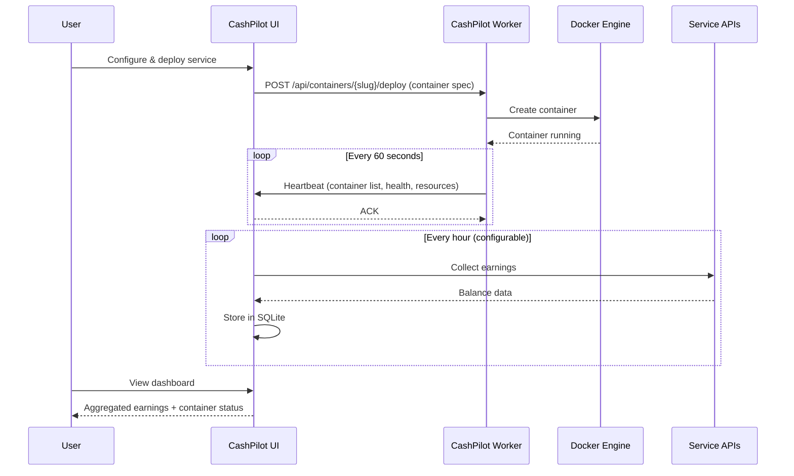

# Cách hoạt động { #how-it-works }

CashPilot dùng kiến trúc tách **UI + Worker**. UI không bao giờ chạm vào Docker -- mọi thao tác với container đều đi qua các worker. Sự tách biệt này là một nguyên tắc thiết kế cốt lõi và là điều giúp quản lý đội máy gồm nhiều máy chủ.

## Thành phần { #components }

| Thành phần | Image | Cổng | Truy cập Docker | Mục đích |
|-----------|-------|:----:|:-------------:|---------|
| **CashPilot UI** | `drumsergio/cashpilot` | 8080 | Không | Bảng điều khiển web, thu thập thu nhập, danh mục dịch vụ, lưu trữ thông tin đăng nhập, lập lịch |
| **CashPilot Worker** | `drumsergio/cashpilot-worker` | 8081 | Qua `cashpilot-socket-proxy` | Vòng đời container Docker, báo cáo sức khỏe, gửi tín hiệu hoạt động tới UI |

CashPilot **không có chế độ độc lập**. Mọi máy chủ chạy container Docker đều cần một worker. UI chỉ là bảng điều khiển/trình lập lịch thuần túy -- nó có thể chạy trên bất kỳ máy nào, kể cả máy không có Docker.

## Nguyên tắc thiết kế { #design-principles }

1. **Tách biệt trách nhiệm.** UI đảm nhận: bảng điều khiển, thu thập thu nhập, lập lịch, xác thực người dùng. Worker đảm nhận: vòng đời container Docker, báo cáo sức khỏe. Chúng không bao giờ chồng lấn.
2. **Worker cần Docker, qua socket proxy.** Một worker không có quyền truy cập Docker thì vô dụng. Với các file compose được phát hành, nó không bao giờ nhận socket gốc: nó kết nối tới Docker qua `cashpilot-socket-proxy`. Các gói Unraid và TrueNAS vẫn mount socket gốc ([kho ứng dụng](app-stores.md)). Nếu bạn không cần quản lý Docker, chỉ cần chạy riêng UI để theo dõi thu nhập.
3. **Một nguồn sự thật duy nhất.** Phiên bản UI là nơi duy nhất thu thập thu nhập, lưu dữ liệu lịch sử và phục vụ bảng điều khiển. Worker không bao giờ thu thập thu nhập.
4. **Thu nhập không bao giờ bị trùng lặp.** Vì chỉ UI thu thập, không có nguy cơ cùng một tài khoản bị tính hai lần.
5. **Worker là vệ tinh không trạng thái.** Một worker biết những container nào cần giữ chạy và URL của UI để báo cáo. Nó chỉ lưu id và khóa đội máy của chính nó vào các file cục bộ (`.worker_id`, `.worker_key`; không có cơ sở dữ liệu, không có dữ liệu thu nhập).
6. **YAML là sự thật.** Mọi dịch vụ nằm trong `services/{category}/{slug}.yml`. UI, việc triển khai, tài liệu và bản xuất compose đều bắt nguồn từ các file này.

## Cấu trúc thư mục { #directory-structure }

```
cashpilot/
  app/                      # FastAPI application
    main.py                 # App entrypoint, lifespan, container/fleet/earnings routes
    deps.py                 # Shared auth guards + Jinja2 template environment
    routers/                # Route groups split out of main.py: auth, pages, users
    catalog.py              # Loads YAML service definitions, caches, SIGHUP reload
    orchestrator.py         # Docker SDK: deploy, stop, restart, remove, logs
    database.py             # Async SQLite: earnings, config, deployments, users, workers
    worker_api.py           # Worker REST API: heartbeat, container commands, mini-UI
    setup_token.py          # First-run setup-token gate (owner-account creation)
    metrics.py              # Optional Prometheus metrics (/metrics)
    exchange_rates.py       # Crypto/fiat conversion via CoinGecko + Frankfurter
    collectors/             # Earnings collectors (one module per service, UI only)
      base.py               # BaseCollector ABC + EarningsResult dataclass
      honeygain.py          # Example: JWT auth + balance endpoint
      __init__.py           # COLLECTOR_MAP registry + make_collectors() factory
    templates/              # Jinja2: dashboard, fleet, catalog, setup wizard, payouts, settings
    static/
      css/style.css         # Classic night by default, plus dark, light, sunrise and warm
      js/app.js             # Vanilla JS, CP namespace, Chart.js, wizard state machine
  services/                 # YAML service definitions (SINGLE SOURCE OF TRUTH)
    _schema.yml             # Schema documentation
    bandwidth/              # Bandwidth sharing services
    depin/                  # DePIN services
    storage/                # Storage sharing services
    compute/                # GPU compute services
    mining/                 # Mining services
  docs/                     # Documentation and guides
    guides/                 # Per-service setup guides
  Dockerfile                # UI image: multi-stage python:3.15-alpine, su-exec, non-root
  Dockerfile.worker         # Worker image: minimal deps, no collectors/templates
  docker-compose.yml        # Single-server deployment
  docker-compose.fleet.yml  # Multi-server fleet deployment
```

## Luồng dữ liệu { #data-flow }



### Tín hiệu hoạt động (worker tới UI) { #heartbeat-worker-to-ui }

Cứ mỗi 60 giây, mỗi worker gửi:

- Danh sách container kèm trạng thái (running, stopped, exited)
- Mức dùng tài nguyên của từng container (phần trăm CPU, MB bộ nhớ)
- Thông tin hệ thống (hệ điều hành, kiến trúc, hostname, Docker có sẵn hay không)
- URL tự báo cáo của nó (`CASHPILOT_WORKER_URL` đặt rõ hoặc một giá trị dự phòng tự phát hiện)

UI lưu thông tin này trong cơ sở dữ liệu SQLite của nó và hiển thị trên trang **Fleet** (Đội máy).

### Lệnh (UI tới worker) { #commands-ui-to-worker }

UI có thể yêu cầu bất kỳ worker nào:

- **Deploy** (Triển khai) một container dịch vụ (đặc tả đầy đủ: image, biến môi trường, volume, cổng)
- **Stop** (Dừng), **start** (Khởi động), **restart** (Khởi động lại) hoặc **remove** (Gỡ bỏ) một container
- **Fetch logs** (Lấy nhật ký) từ một container

Các lệnh được gửi qua các lệnh gọi REST API từ UI tới worker.

### Luồng thông tin đăng nhập { #credential-flow }

Worker **không bao giờ xử lý hay lưu thông tin đăng nhập**:

1. Người dùng cấu hình thông tin đăng nhập của dịch vụ trong UI (được lưu mã hóa trong SQLite).
2. Khi triển khai, UI gửi đặc tả container đầy đủ (bao gồm biến môi trường) tới worker.
3. Worker chuyển đặc tả cho Docker API. Docker lưu các biến môi trường trong cấu hình container.
4. Khi khởi động lại: `docker restart` giữ nguyên biến môi trường theo cách gốc của Docker.
5. Khi triển khai lại hoàn toàn (xóa + tạo): UI gửi lại đặc tả đầy đủ.

### Thu thập thu nhập { #earnings-collection }

UI chạy các bộ thu thập theo lịch cho mỗi dịch vụ đã cấu hình:

- **Bộ thu thập tự động** lấy số dư qua API của dịch vụ (xác thực JWT, xác thực cookie, khóa API) với những nhà cung cấp có API
- Kết quả được lưu trong SQLite bằng tiền tệ gốc (USD, MYST, GRASS, STORJ, v.v.)
- Tỷ giá lấy từ CoinGecko (tiền mã hóa) và Frankfurter (tiền pháp định), lưu bộ nhớ đệm 15 phút
- Mỗi lần đọc lưu tỷ giá USD của ngày nó được ghi nhận. Một lần đọc tiền mã hóa được lưu mà không có tỷ giá (cũ hơn cột tỷ giá) sẽ nhận giá của chính ngày đó từ lịch sử hằng ngày của CoinGecko, lúc khởi động và mỗi ngày một lần; ngày không có giá thì vẫn để trống giá
- Bảng điều khiển quy đổi và hiển thị theo tiền tệ người dùng ưa thích

## Công nghệ sử dụng { #tech-stack }

| Công nghệ | Mục đích |
|---|---|
| FastAPI | Framework backend (Python 3.15, bất đồng bộ) |
| Jinja2 | Template HTML được kết xuất phía máy chủ |
| SQLite | Cơ sở dữ liệu (aiosqlite, không cần cấu hình, lưu trong `/data`) |
| Docker SDK for Python | Quản lý vòng đời container qua socket |
| PyYAML | Phân tích định nghĩa dịch vụ |
| APScheduler | Thu thập thu nhập định kỳ |
| httpx | HTTP client bất đồng bộ cho các bộ thu thập thu nhập |
| cryptography (Fernet) | Mã hóa thông tin đăng nhập được lưu trữ |
| Chart.js | Biểu đồ thu nhập ở frontend |
| su-exec | Hạ quyền từ root xuống người dùng `cashpilot` sau khi entrypoint thiết lập xong (Dockerfile) |

## Cơ sở dữ liệu { #database }

SQLite với thời gian lưu giữ dữ liệu 400 ngày. Các bảng chính:

- **earnings** -- Lịch sử thu nhập theo dịch vụ (thời điểm, slug, số dư, tiền tệ)
- **deployments** -- Các container đang được triển khai (slug, ID container, biến môi trường đã mã hóa, trạng thái)
- **config** -- Cài đặt dạng khóa-giá trị và thông tin đăng nhập đã mã hóa
- **users** -- Tài khoản (tên người dùng, hash mật khẩu bcrypt, vai trò)
- **user_preferences** -- Trạng thái làm quen ban đầu của từng người dùng (chế độ cài đặt, các nhóm đã chọn, múi giờ)
- **health_events** -- Lịch sử sức khỏe container (start, stop, crash, check_ok, check_down)
- **workers** -- Sổ đăng ký worker của đội máy (ID client, tên, URL, trạng thái, tín hiệu hoạt động gần nhất, khóa đội máy riêng của worker đã mã hóa)

## Mô hình bảo mật { #security-model }

- Mọi thông tin đăng nhập được mã hóa khi lưu trữ bằng mã hóa đối xứng Fernet
- Xác thực giữa worker và UI bằng khóa đội máy riêng cho từng worker (`CASHPILOT_API_KEY` chỉ là thông tin xác thực dùng để ghi danh/khởi tạo)
- Các container được quản lý chạy với `--security-opt no-new-privileges`
- Quy ước đặt tên container: `cashpilot-{slug}` với nhãn `cashpilot.managed=true`
- Container UI **không** có quyền truy cập Docker socket
- Xác thực dựa trên phiên với hệ thống vai trò (owner/writer/viewer)
