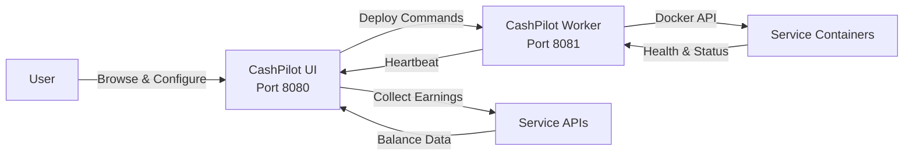

# 快速入门 { #getting-started }

## 前提条件 { #prerequisites }

- **Docker**，并带有 **Compose v2 插件，版本 2.23.1 或更高**。用
  `docker compose version` 检查。旧版本无法读取 compose 文件中的内联配置。
  Docker Desktop 已包含该插件。在 Linux 上只装了 Docker Engine 时，请从 Docker
  的软件包仓库安装它
  (https://docs.docker.com/compose/install/linux/)。在使用 Colima 的 macOS 上，
  用 Homebrew 安装它，并把它链接为 Docker 插件：

    ```sh
    brew install docker-compose
    mkdir -p ~/.docker/cli-plugins
    ln -sfn "$(brew --prefix)/opt/docker-compose/bin/docker-compose" ~/.docker/cli-plugins/docker-compose
    ```

- 一台 Linux、macOS 或 Windows 主机（amd64 或 arm64）
- 至少 1 GB 可用内存，供 CashPilot 及其管理的服务使用
- **每台 Docker 主机只运行一个 CashPilot。** 见下面的警告。

!!! warning "每台 Docker 主机只运行一个 CashPilot"
    不要在同一台 Docker 主机上运行两套 CashPilot。compose 文件
    使用固定的容器名（`cashpilot-ui`、`cashpilot-worker`、
    `cashpilot-socket-proxy`），所以第二份文件会因名称冲突而失败。
    即使你改名绕过这一点，两套安装仍然共用这台主机。每个工作节点都会管理
    所有带有 CashPilot 标签的容器，不管是哪套安装创建的。因此每个仪表板
    都会列出、停止并替换另一套的收益应用。两者还会共用
    `cashpilot-isolated` 网络、收益应用的名称（`cashpilot-<service>`）、
    它们的主机端口以及 `mysterium-data` 这样的卷。要装第二套，
    请使用另一台主机或虚拟机。要在更多服务器上运行收益应用，请改为给同一个仪表板
    添加工作节点（[机群](fleet.md)）。

## 快速开始 { #quick-start }

### 1. 下载 compose 文件并启动 { #1-fetch-the-compose-file-and-launch }

```bash
curl -fsSLO https://raw.githubusercontent.com/GeiserX/CashPilot/main/docker-compose.yml
docker compose up -d
```

这会启动三个长期运行的容器。在它们之前，一次性的
`cashpilot-migrate` 会在每次 `up` 时运行并以代码 0 退出，所以
`docker compose ps -a` 显示它为 `Exited (0)`。这是正常的。

| 容器 | 端口 | 用途 |
|-----------|------|---------|
| **cashpilot-migrate** | 无 | 运行一次后退出。它把旧版本放置的数据移到 socket 代理接受的卷上，在新安装中则无事可做 |
| **cashpilot-ui** | 8080 | Web 仪表板、收益采集、服务目录 |
| **cashpilot-worker** | 8081 | Docker 代理程序，负责部署和监控服务容器 |
| **cashpilot-socket-proxy** | 无 | 以只读方式持有 Docker socket，并给工作节点一个经过过滤的副本（[安全默认设置](security-defaults.md)） |

### 2. 打开仪表板 { #2-open-the-dashboard }

在浏览器中打开 [http://localhost:8080](http://localhost:8080)。由于还没有任何账户，你会进入欢迎页，它用来创建所有者账户。

!!! tip "8080 端口已被占用？"
    在 `docker-compose.yml` 旁边的 `.env` 文件中选择另一个主机端口，
    而不要编辑 compose 文件：

    ```bash
    printf '\nCASHPILOT_UI_PORT=8088\n' >> .env
    docker compose up -d
    ```

    然后打开 http://localhost:8088 。把这个值保留在 `.env` 中，因为
    应用内更新读取的是这个文件，而不是你的 shell。（`printf` 以换行开头，
    这样这一行永远不会和已有 `.env` 的最后一行连在一起。）

    这个变量需要一个 `ports:` 行写作
    `${CASHPILOT_UI_PORT:-8080}:8080` 的 `docker-compose.yml`。v1.61 及更早版本的文件把
    `8080:8080` 写死了，会忽略它。请下载当前的文件，或者
    保留你自己修改过的端口映射：应用内更新也接受它。

!!! warning "首次运行需要设置令牌"
    首次启动时，CashPilot 会生成一个一次性设置令牌，并把它打印到 **cashpilot-ui** 容器的日志中：

    ```bash
    docker compose logs cashpilot-ui
    ```

    找到类似这样的一行：

    ```
    FIRST-RUN SETUP: no account exists yet. Open /register and enter this
    one-time setup token to create the owner account: <token>
    ```

    把这个令牌复制到欢迎页 **Owner account** (所有者账户) 步骤的 **Setup token** (设置令牌) 字段中，再填上用户名和密码，即可创建第一个（所有者）账户。它只会出现在日志中，从不出现在 URL 里，所有者账户创建后就会被永久丢弃。

### 3. 浏览服务目录 { #3-browse-the-service-catalog }

**Catalog** (目录) 页面列出每个服务的平台、每月估算收益以及它需要什么（住宅 IP、GPU）。可以按类别（带宽、DePIN、存储、算力、挖矿）筛选，或按名称搜索。**Add** (添加) 会在该服务上打开设置向导，**Details** (详情) 显示它的说明、付款方式和部署风险，不在 Docker 中运行的服务则改为显示 **Visit** (访问) 链接。

有两类服务需要先仔细看看：只有在你锁定代币质押后才付款的服务，例如 Anyone Protocol、Sia 和 Flux；以及会公开你 IP 的中继，它们可能会降低住宅带宽应用付给你的金额。见[部署前检查两件事](guides/index.md)。

### 4. 用向导添加服务 { #4-add-services-with-the-wizard }

所有者账户创建后，**Add services** (添加服务) 会打开设置向导；之后，顶栏中的 **+ Add service** (+ 添加服务) 按钮可以再次打开它。先选类别，再选服务。对每个服务，向导都会显示一个 **Sign Up** (注册) 链接，只询问该服务需要的凭据（邮箱和密码、API 令牌等），并让你选择在哪些工作节点上运行它。点击 **Deploy** (部署)，CashPilot 就会拉取镜像、创建容器并开始监控它。

### 5. 在仪表板上查看 { #5-watch-it-on-the-dashboard }

仪表板显示每个已部署的服务及其状态和余额，**Fleet** (机群) 页面显示每个工作节点。

## 工作原理 { #how-it-works }



1. **你通过 Web UI 配置**服务：选择一个服务，输入凭据，点击部署。
2. **UI 通过 REST API 把**容器规格（镜像、环境变量、卷）发送给工作节点。
3. **工作节点创建** Docker 容器，并开始监控它的健康状况。
4. **工作节点每 60 秒通过心跳**把容器状态报告给 UI。
5. **UI 按可配置的计划**从服务 API 采集收益（默认：每小时一次）。
6. **仪表板**显示汇总收益、按服务的明细以及容器健康状况。

## 配置 { #configuration }

### UI 环境变量 { #ui-environment-variables }

| 变量 | 默认值 | 说明 |
|----------|---------|-------------|
| `TZ` | `UTC` | 用于计划任务和显示的时区 |
| `CASHPILOT_SECRET_KEY` | *（自动生成）* | 登录会话的签名密钥。保存在 `/data/.secret_key`。**不加密凭据** |
| `CASHPILOT_ENCRYPTION_KEY` | *（自动生成）* | 对存储的凭据进行静态加密的 Fernet 密钥。保存在 `/data/.fernet_key`。只有在该文件不存在时才会采用，所以只在恢复备份时设置它 |
| `CASHPILOT_API_KEY` | *（来自 `/fleet`）* | 工作节点共用的接入密钥。每个工作节点接入时都会获得自己的密钥；见[机群](fleet.md) |
| `CASHPILOT_COLLECT_INTERVAL` | `60` | 两次收益采集之间的分钟数 |
| `CASHPILOT_UI_PORT` | `8080` | UI 发布到的主机端口。8080 被占用时在 `.env` 中设置它 |
| `CASHPILOT_BIND_ADDR` | `127.0.0.1` | UI 端口发布到的主机网络接口。**默认是回环地址**：仪表板可以指挥拥有 Docker socket 的工作节点，所以它默认不暴露到你的网络。设置一个具体 IP（例如 Tailscale/VPN 地址）或 `0.0.0.0` 来暴露它，或者（推荐）在前面运行一个带身份验证的反向代理 |

UI 在容器内的 Web 端口固定为 `8080`（通过容器的 `CMD` 设置）。`CASHPILOT_UI_PORT` 和 `CASHPILOT_BIND_ADDR` 只决定它发布到的主机端口和网络接口。

### 工作节点环境变量 { #worker-environment-variables }

| 变量 | 默认值 | 说明 |
|----------|---------|-------------|
| `TZ` | `UTC` | 时区 |
| `CASHPILOT_UI_URL` | -- | UI 容器的 URL，例如 `http://cashpilot-ui:8080` |
| `CASHPILOT_API_KEY` | -- | 必须与 UI 的接入密钥一致。只在接入时需要；之后工作节点使用自己的密钥 |
| `CASHPILOT_WORKER_NAME` | *（主机名）* | 该工作节点在机群仪表板中的显示名称 |
| `CASHPILOT_WORKER_URL` | *（自动检测）* | UI 用来访问该工作节点的 URL，例如 `http://192.168.1.50:8081`。跨主机的机群请明确设置：自动检测可能报告一个无法访问的容器内部 IP |
| `CASHPILOT_WORKER_BIND_ADDR` | `127.0.0.1` | **仅适用于机群和远程工作节点的 compose**（`docker-compose.fleet.yml`）：工作节点的 Docker-socket API 端口发布到的主机网络接口，默认是回环地址。默认的 `docker-compose.yml` 完全不发布 8081 端口。工作节点 API 可以部署/停止任何容器（= 主机上的 root），所以对远程工作节点，请绑定私有/VPN 网络接口（例如 Tailscale IP），**绝不要**绑定公网 IP |
| `CASHPILOT_PORT` | `8081` | 工作节点向 UI **通告**的端口。它*不会*改变监听端口，监听端口由镜像的 `CMD` 固定；见[配置参考](configuration.md) |

### Docker Compose 示例 { #docker-compose-example }

```yaml
--8<-- "docker-compose.yml"
```

!!! note "这就是真实的文件"

    上面的代码块原样取自仓库中的 `docker-compose.yml`，
    所以它不会与实际发布的内容产生偏差。早先，一份手工复制的版本把
    工作节点的 Docker-socket API 发布到了所有网络接口上，并固定为 `:latest`，
    而这两点正是[安全默认设置](security-defaults.md)页面告诉你不要做的。

!!! warning "Docker Socket 访问"
    工作节点通过 Docker 管理服务容器，但它不挂载 `/var/run/docker.sock`。`cashpilot-socket-proxy` 容器持有该 socket，只把工作节点发出的调用传过去，并拒绝特权容器以及你未列出的主机文件夹绑定（[它拒绝什么](security-defaults.md#docker-socket-proxy)）。应用内更新需要主动开启：只有在 compose 文件旁边的 `.env` 中写入 `CASHPILOT_COMPOSE_DIR=<this folder>` 时它才会运行，而这个设置允许容器绑定该文件夹，会削弱代理的保护（[这样做的代价](security-defaults.md#docker-socket-proxy)）。不设置它，并用 `docker compose pull && docker compose up -d` 更新。工作节点仍然控制主机上的每一个容器，所以为了最佳安全性，请在专用机器或 VLAN 上运行 CashPilot。

!!! tip "密钥的持久保存"
    凭据用 `CASHPILOT_ENCRYPTION_KEY` 加密，**而不是** `CASHPILOT_SECRET_KEY`，后者只用于签名登录会话。加密密钥在首次运行时自动生成，并保存在 `/data/.fernet_key`。**请备份这个文件。** 如果卷在没有它的情况下被重建，就会生成新的密钥，所有已存储的凭据都将永久无法读取。设置 `CASHPILOT_ENCRYPTION_KEY` 是为了恢复那份备份；密钥文件始终优先，所以在一个正常的实例上设置它不会改变任何东西。

!!! tip "UI 中的密码和机密"
    你可以随时从头像菜单 -> **Change password** (修改密码) 修改自己的密码（所有角色都可用）；这会让你的其他会话退出登录。在 **Settings** (设置) 中，已存储的机密是只写的：输入一个值来修改它，或者把字段留空以保留现有的值。已保存的凭据永远不会发回浏览器。

## 更新 CashPilot { #updating-cashpilot }

compose 文件固定的是一个 major.minor 系列，例如 `drumsergio/cashpilot:X.Y`，所以 `pull` 会获取该系列最新的补丁版本：

```bash
docker compose pull
docker compose up -d
```

`docker compose pull` 获取最新发布的镜像，`up -d` 只重建
镜像发生变化的容器。随附的 compose 文件设置了
`pull_policy: always`，所以即使只运行 `docker compose up -d`，也会先拉取
最新镜像。

**从仪表板更新。** **Settings** (设置)、**About and updates** (关于与更新) 会通过一个短时存在的辅助容器
替你运行同样的两条命令。辅助容器读取你的
compose 文件以及它们旁边的 `.env`（或你通过
`--env-file` 传入的文件），从不读取你启动 CashPilot 时所用的 shell。假设你用 `CASHPILOT_UI_PORT=8088 docker compose up -d` 启动了它。
更新会把仪表板放回 8080，所以它会停下来并告诉你原因，
而不会继续。把这个值写进 `.env`，按钮就能正常工作。

!!! note "你**不**需要重新构建"
    CashPilot 在 Docker Hub 上提供预构建的多架构镜像
    （[`drumsergio/cashpilot`](https://hub.docker.com/r/drumsergio/cashpilot)、
    [`drumsergio/cashpilot-worker`](https://hub.docker.com/r/drumsergio/cashpilot-worker)）。
    只有当你有意用 `docker-compose.build.yml` 从源码构建时，`docker compose build` / `--build`
    才有意义。对于普通安装，
    `pull` + `up -d` 就是完整且正确的更新步骤。

### 固定到特定版本 { #pinning-a-specific-version }

要一直使用某个确切的版本，请把
`docker-compose.yml` 中的 `X.Y` 系列标签替换为完整的版本标签 `X.Y.Z`，
`drumsergio/cashpilot` 和 `drumsergio/cashpilot-worker` 都要改（两者始终使用相同的标签），
并删除 `pull_policy: always`。可在
[Docker Hub](https://hub.docker.com/r/drumsergio/cashpilot/tags) 上浏览标签。

要换到更新的系列，请修改两个标签：先在 UI 主机上改，再在
每台工作节点主机上改。请先阅读
[UPGRADING.md](https://github.com/GeiserX/CashPilot/blob/main/UPGRADING.md)，
因为像 3.0 这样的主版本有自己的步骤。

### 自动更新（可选） { #automating-updates-optional }

如果你想要无人值守的更新，可以让调度程序运行同样的两条命令，
例如用一条每日 cron 条目：

```cron
0 4 * * *  cd /path/to/cashpilot && docker compose pull && docker compose up -d
```

或者针对 CashPilot 容器运行一个自动更新工具，例如 [Watchtower](https://containrrr.dev/watchtower/)
或 [Diun](https://crazymax.dev/diun/)。这些
都是可选的。CashPilot 不自带更新工具。

### 清理旧镜像 { #cleaning-up-old-images }

CashPilot 会拉取镜像，但从不删除它们。每次更新和每次重新部署
都可能把上一个镜像留在磁盘上。在一个由三台服务器组成的测试机群上，旧的
CashPilot 和收益应用镜像总共约 3 GB。与同一主机上其他程序通常留下的东西相比，
这并不大，所以请查看
整台主机：

```bash
docker system df
```

`Images` 行上的 `RECLAIMABLE` 值就是 Docker 可以释放的空间。

**为什么 CashPilot 不替你做这件事。** 工作节点通过
socket 代理访问 Docker。对于镜像，代理只允许它拉取一个镜像和按名称读取一个镜像，
别的都不行。它无法列出主机的镜像，也无法删除镜像。一个能够做到这些的工作节点
也会看到并删除主机上所有其他程序的镜像。
见[代理拒绝什么](security-defaults.md#docker-socket-proxy)。

**第 1 步：删除悬空镜像。** 悬空镜像没有标签，也没有任何
容器（无论运行中还是已停止）在使用它。在一个移动标签上进行的更新，例如
`X.Y`（compose 文件固定的那种系列）、`latest` 或摘要，留下的正是这类镜像：

```bash
docker image prune
```

这也会删除你在移动标签上更新之前运行的镜像：一旦
该系列的新镜像到达，旧镜像就没有标签了。为了保留退路，请在更新前
记下确切的版本（侧边栏底部会显示它），这样
你可以再次拉取 `drumsergio/cashpilot:<X.Y.Z>`。或者把 compose 文件固定到
一个确切的 `X.Y.Z` 标签；这样旧镜像会保留它的标签，适用第 2 步。

Docker 删除前会先询问。在 cron 条目中，加上 `--force` 来跳过
询问。它不会改变其他任何东西：

```cron
30 4 * * 0  docker image prune --force
```

!!! warning "不要加 `-a`"
    `docker image prune -a` 会删除当前没有任何容器在使用的每一个镜像，
    无论是悬空的还是有标签的。这包括你有意停止的堆栈的镜像，
    以及你在本地构建、无法再次拉取的镜像。

**第 2 步：删除旧的固定标签。** 固定到某个版本的镜像在你
换到更新版本后仍保留它的标签，所以 `prune` 会跳过它。以下 CashPilot 镜像
是固定的：

| 仓库 | 由什么固定 |
|---|---|
| `drumsergio/cashpilot` | compose 文件（旧的系列，或你固定的确切版本） |
| `drumsergio/cashpilot-worker` | compose 文件，同上 |
| `drumsergio/cashpilot-tunnel` | 工作节点，每个工作节点版本一个标签 |
| `drumsergio/cashpilot-earnapp` | EarnApp 的目录条目 |
| `drumsergio/cashpilot-anyone` | Anyone Protocol 的目录条目 |

你删除的服务的镜像也是如此：它的标签会一直保留，直到你
删除它。按摘要固定的目录镜像，例如 MystNodes 或 ProxyBase，
在被更新的镜像替换时会失去标签，所以第 1 步已经涵盖了它。

先列出没有任何容器使用的标签。这个示例针对工作节点镜像。
对于表格中的其他仓库，请修改 `repo`：

```bash
repo=drumsergio/cashpilot-worker
used=$(docker ps -a --format '{{.Image}}')
docker image ls "$repo" --format '{{.Repository}}:{{.Tag}}' | grep -vxF "$used"
```

然后按名称逐个删除每个旧标签：

```bash
docker image rm drumsergio/cashpilot-worker:<old tag>
```

不要加 `-f`。不加它时，Docker 会拒绝删除仍被某个
容器（无论运行中还是已停止）使用的镜像，并打印
`conflict: unable to delete`。看到这条信息时，请保留该镜像。保留你正在运行的标签
和它之前运行的标签，这样你仍然可以回退一个版本。
只删除比这两个更旧的标签。

仪表板的 **Host disk** (主机磁盘) 列显示存放工作节点 `/data` 的
文件系统上的可用空间。镜像通常位于同一文件系统上、
Docker 的数据根目录下，但并不总是如此。`docker info --format '{{.DockerRootDir}}'`
显示 Docker 的数据根目录。使用 containerd 镜像存储时（这是
新安装的 Docker Engine 29 的默认设置），镜像改为位于 containerd 的根目录下，
通常是 `/var/lib/containerd`。`docker info --format '{{.Driver}}'` 对 containerd 镜像存储打印
`overlayfs`，对传统存储打印 `overlay2`。
请检查存放相应目录的文件系统上的可用空间。

## 支持的服务 { #supported-services }

CashPilot 支持 **<!-- n:live -->50<!-- /n --> 个**处于活跃或测试阶段的服务，分为五个类别：

- **带宽共享**（<!-- n:bandwidth -->18<!-- /n -->）：共享你的互联网带宽，获得被动收入
- **DePIN**（<!-- n:depin -->15<!-- /n -->）：去中心化物理基础设施网络
- **GPU 算力**（<!-- n:compute -->7<!-- /n -->）：把你的 GPU 出租给 AI 和计算任务
- **存储**（<!-- n:storage -->2<!-- /n -->）：在去中心化存储网络上共享磁盘空间
- **挖矿**（<!-- n:mining -->8<!-- /n -->）：部署矿机程序，或按付款地址跟踪矿池（[挖矿](mining.md)）

其中，**<!-- n:docker -->21<!-- /n -->** 个可以通过 Docker 自动部署和管理。目录还跟踪其余 <!-- n:tracked -->29<!-- /n --> 个（<!-- n:extension -->18<!-- /n --> 个浏览器或桌面应用、<!-- n:gpu -->7<!-- /n --> 个 GPU 节点、<!-- n:mining_pools -->4<!-- /n --> 个矿池）。在有采集器的地方，CashPilot 会读取它们的余额。

在[服务指南](guides/index.md)部分浏览完整目录。

## 后续步骤 { #next-steps }

- [工作原理](how-it-works.md) -- 了解 UI + 工作节点的拆分设计
- [机群管理](fleet.md) -- 在多台服务器上部署
- [保护你的家庭网络](home-network-security.md) -- 让容器远离你的 LAN，以及 gVisor 何时有用
- [服务指南](guides/index.md) -- 每个服务的详细设置说明
- [彻底删除 CashPilot](uninstall.md) -- 删除它创建的一切，以便重新开始或彻底离开
