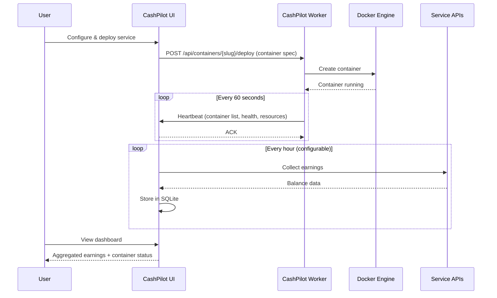

# 工作原理 { #how-it-works }

CashPilot 采用 **UI + 工作节点**拆分架构。UI 从不接触 Docker：所有容器操作都经由工作节点完成。这种分离是核心设计原则，也是多服务器机群管理得以实现的基础。

## 组件 { #components }

| 组件 | 镜像 | 端口 | Docker 访问 | 用途 |
|-----------|-------|:----:|:-------------:|---------|
| **CashPilot UI** | `drumsergio/cashpilot` | 8080 | 无 | Web 仪表板、收益采集、服务目录、凭据存储、计划任务 |
| **CashPilot Worker** | `drumsergio/cashpilot-worker` | 8081 | 经由 `cashpilot-socket-proxy` | Docker 容器生命周期、健康状况报告、向 UI 发送心跳 |

**没有独立模式**。每台运行 Docker 容器的服务器都需要一个工作节点。UI 是纯粹的仪表板/调度器：它可以运行在任何机器上，包括没有 Docker 的机器。

## 设计原则 { #design-principles }

1. **关注点分离。** UI 负责：仪表板、收益采集、计划任务、用户认证。工作节点负责：Docker 容器生命周期、健康状况报告。两者从不重叠。
2. **工作节点需要 Docker，并通过 socket 代理访问。** 没有 Docker 访问权限的工作节点毫无用处。使用随附的 compose 文件时，它从不获得原始 socket：它通过 `cashpilot-socket-proxy` 访问 Docker。Unraid 和 TrueNAS 的上架包仍然挂载原始 socket（[应用商店](app-stores.md)）。如果你不需要 Docker 管理，只运行 UI 来跟踪收益即可。
3. **单一事实来源。** UI 实例是唯一采集收益、存储历史数据并提供仪表板的组件。工作节点从不采集收益。
4. **收益从不重复。** 由于只有 UI 采集，同一个账户不存在被计算两次的风险。
5. **工作节点是无状态的卫星。** 工作节点知道要保持哪些容器运行，以及要向哪个 UI URL 报告。它只把自己的 id 和机群密钥保存到本地文件（`.worker_id`、`.worker_key`；没有数据库，没有收益数据）。
6. **YAML 就是事实。** 每个服务都位于 `services/{category}/{slug}.yml`。UI、部署、文档和 compose 导出都源自这些文件。

## 目录结构 { #directory-structure }

```
cashpilot/
  app/                      # FastAPI application
    main.py                 # App entrypoint, lifespan, container/fleet/earnings routes
    deps.py                 # Shared auth guards + Jinja2 template environment
    routers/                # Route groups split out of main.py: auth, pages, users
    catalog.py              # Loads YAML service definitions, caches, SIGHUP reload
    orchestrator.py         # Docker SDK: deploy, stop, restart, remove, logs
    database.py             # Async SQLite: earnings, config, deployments, users, workers
    worker_api.py           # Worker REST API: heartbeat, container commands, mini-UI
    setup_token.py          # First-run setup-token gate (owner-account creation)
    metrics.py              # Optional Prometheus metrics (/metrics)
    exchange_rates.py       # Crypto/fiat conversion via CoinGecko + Frankfurter
    collectors/             # Earnings collectors (one module per service, UI only)
      base.py               # BaseCollector ABC + EarningsResult dataclass
      honeygain.py          # Example: JWT auth + balance endpoint
      __init__.py           # COLLECTOR_MAP registry + make_collectors() factory
    templates/              # Jinja2: dashboard, fleet, catalog, setup wizard, payouts, settings
    static/
      css/style.css         # Classic night by default, plus dark, light, sunrise and warm
      js/app.js             # Vanilla JS, CP namespace, Chart.js, wizard state machine
  services/                 # YAML service definitions (SINGLE SOURCE OF TRUTH)
    _schema.yml             # Schema documentation
    bandwidth/              # Bandwidth sharing services
    depin/                  # DePIN services
    storage/                # Storage sharing services
    compute/                # GPU compute services
    mining/                 # Mining services
  docs/                     # Documentation and guides
    guides/                 # Per-service setup guides
  Dockerfile                # UI image: multi-stage python:3.15-alpine, su-exec, non-root
  Dockerfile.worker         # Worker image: minimal deps, no collectors/templates
  docker-compose.yml        # Single-server deployment
  docker-compose.fleet.yml  # Multi-server fleet deployment
```

## 数据流 { #data-flow }



### 心跳（工作节点到 UI） { #heartbeat-worker-to-ui }

每 60 秒，每个工作节点会发送：

- 带状态（运行中、已停止、已退出）的容器列表
- 每个容器的资源使用情况（CPU 百分比、内存 MB）
- 系统信息（操作系统、架构、主机名、Docker 是否可用）
- 它自报的 URL（明确设置的 `CASHPILOT_WORKER_URL`，或自动检测得到的备用值）

UI 把这些信息存进它的 SQLite 数据库，并显示在 **Fleet** (机群) 页面上。

### 命令（UI 到工作节点） { #commands-ui-to-worker }

UI 可以指示任一工作节点：

- **Deploy** (部署) 一个服务容器（完整规格：镜像、环境变量、卷、端口）
- **Stop** (停止)、**start** (启动)、**restart** (重启) 或 **remove** (删除) 一个容器
- 从容器 **Fetch logs** (获取日志)

命令通过 UI 向工作节点发出的 REST API 调用来发送。

### 凭据流 { #credential-flow }

工作节点**从不处理或存储凭据**：

1. 用户在 UI 中配置服务凭据（加密存储在 SQLite 中）。
2. 部署时，UI 把完整的容器规格（包括环境变量）发送给工作节点。
3. 工作节点把规格传给 Docker API。Docker 把环境变量存储在容器配置中。
4. 重启时：`docker restart` 原生保留环境变量。
5. 完整重新部署时（删除 + 创建）：UI 会重新发送完整规格。

### 收益采集 { #earnings-collection }

UI 为每个已配置的服务运行计划好的采集器：

- **自动采集器**通过服务 API（JWT 认证、cookie 认证、API 密钥）获取余额，适用于提供了这类 API 的提供商
- 结果以原生货币（USD、MYST、GRASS、STORJ 等）存储在 SQLite 中
- 汇率从 CoinGecko（加密货币）和 Frankfurter（法币）获取，缓存 15 分钟
- 每条读数都会保存其读取当天的 USD 汇率。没有保存汇率的加密货币读数（早于汇率列出现的读数）会在启动时以及每天一次，从 CoinGecko 的每日历史中获取它所在当天的价格；没有价格的日子则保持未定价
- 仪表板按用户偏好的货币换算并显示

## 技术栈 { #tech-stack }

| 技术 | 用途 |
|---|---|
| FastAPI | 后端框架（Python 3.15，异步） |
| Jinja2 | 服务器端渲染的 HTML 模板 |
| SQLite | 数据库（aiosqlite，零配置，存储在 `/data`） |
| Docker SDK for Python | 通过 socket 管理容器生命周期 |
| PyYAML | 解析服务定义 |
| APScheduler | 定期采集收益 |
| httpx | 供收益采集器使用的异步 HTTP 客户端 |
| cryptography (Fernet) | 对存储的凭据进行静态加密 |
| Chart.js | 前端收益图表 |
| su-exec | 在入口脚本完成设置后，从 root 降权为 `cashpilot` 用户（Dockerfile） |

## 数据库 { #database }

SQLite，数据保留 400 天。主要的表：

- **earnings** -- 每个服务的历史收益（时间戳、slug、余额、货币）
- **deployments** -- 当前的容器部署（slug、容器 ID、加密的环境变量、状态）
- **config** -- 键值设置和加密的凭据
- **users** -- 账户（用户名、bcrypt 密码哈希、角色）
- **user_preferences** -- 每个用户的新手引导状态（设置模式、所选类别、时区）
- **health_events** -- 容器健康历史（start、stop、crash、check_ok、check_down）
- **workers** -- 机群工作节点注册表（客户端 ID、名称、URL、状态、最后一次心跳、加密的每个工作节点专属机群密钥）

## 安全模型 { #security-model }

- 所有凭据都使用 Fernet 对称加密进行静态加密
- 工作节点到 UI 的认证使用每个工作节点专属的机群密钥（`CASHPILOT_API_KEY` 只是接入/引导凭据）
- 受管容器以 `--security-opt no-new-privileges` 运行
- 容器命名约定：`cashpilot-{slug}`，带有标签 `cashpilot.managed=true`
- UI 容器**没有** Docker socket 访问权限
- 基于会话的认证，带角色体系（所有者/编辑者/查看者）
